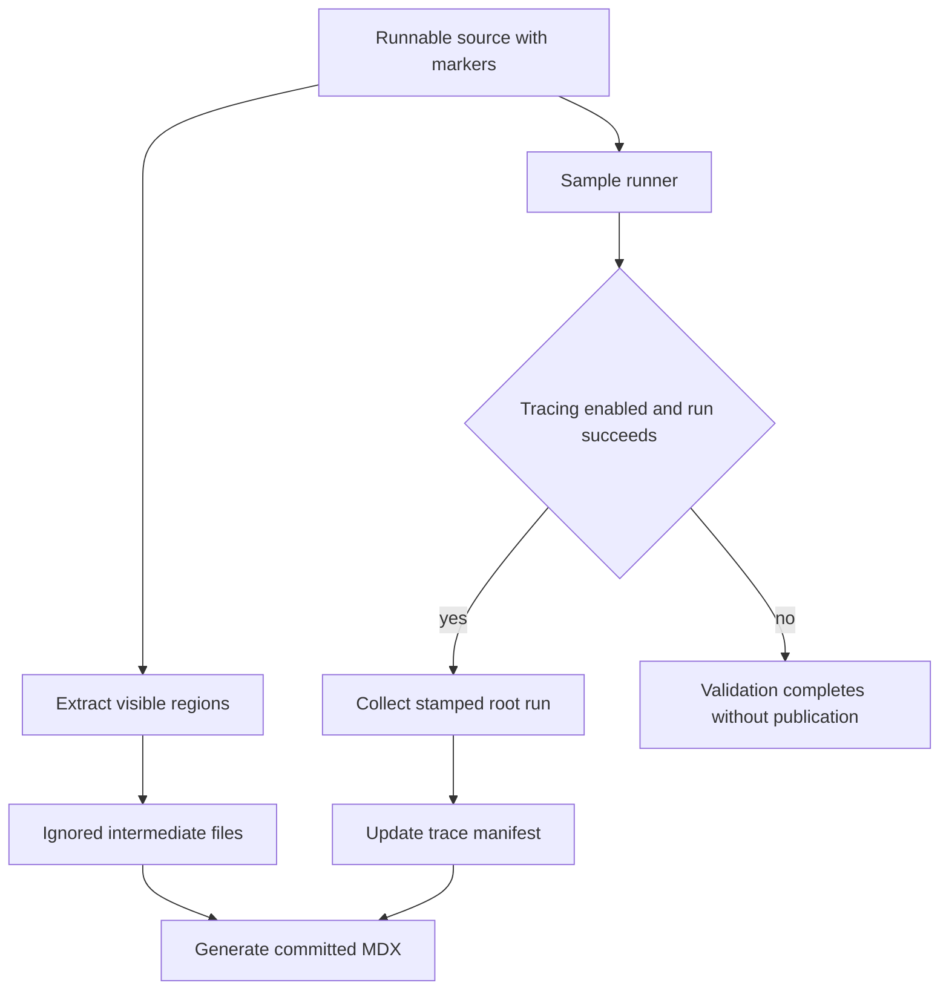
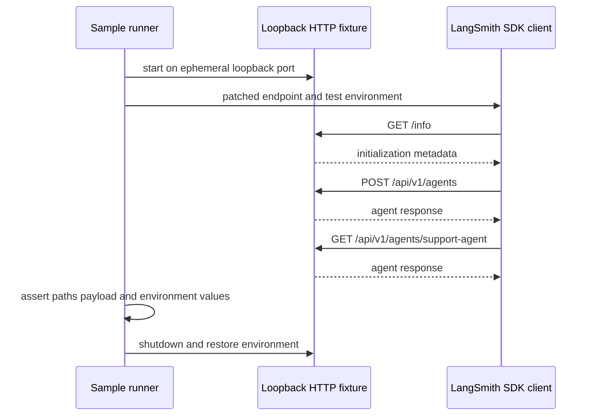

## Source of truth and lifecycle

Runnable files under `src/code-samples/` are the authoring surface. `src/code-samples-generated/` is a gitignored extraction intermediate, while committed MDX under `src/snippets/code-samples/` is derived display output. Change and execute the source first, regenerate snippets, and review the MDX diff; do not treat an intermediate or generated fragment as the primary edit location.



This lifecycle separates executable validation from presentation extraction. Trace publication is an optional post-success path that can add a CTA during rendering; it is not part of ordinary local validation.

## Agent registration: a deterministic local fixture

`src/code-samples/langsmith/create-an-agent.py` is the pattern to use when documentation must demonstrate a live SDK contract but must not create a real service resource. It contains two visible Python regions: `create-agent-py` creates a `Client`, calls `client.agents.create(...)`, and prints the immutable agent ID; `agent-environment-project-py` retrieves that agent, selects `PRODUCTION`, and prints the environment's tracer-session name and ID. The extractor turns them into the separately committed `create-agent-py.mdx` and `agent-environment-project-py.mdx` files.

The surrounding `:remove-start:` blocks make the **whole source file** a deterministic SDK integration test. Before either visible region runs, the harness starts a `ThreadingHTTPServer` on a loopback ephemeral port and patches a cleared process environment so the LangSmith endpoint points to it, credentials and workspace ID are placeholders, tracing is disabled, and run compression is disabled. The fixture returns `{}` for the SDK's `/info` initialization request and a schema-shaped agent response for the create and retrieve operations. After both regions run, assertions require exactly a `POST /api/v1/agents` request with the documented `id`, `name`, and `source_type` payload, followed by `GET /api/v1/agents/support-agent`; they also verify the retrieved production session values before shutting down the server and restoring the environment.



This shows the local request flow exercised by the executable source. It is deliberately different from a credentialed live-service sample: it proves SDK request construction, response parsing, and the documented retrieval flow without authenticating to or mutating LangSmith. Do not add a pre-snippet successful exit to avoid the visible calls; the test must reach the fixture assertions.

### Keep source, fragments, and guide synchronized

`src/langsmith/create-an-agent.mdx` imports both generated fragments rather than duplicating their code. Its programmatic-registration section tells users to install `langsmith>=0.14.12`, use a setup credential with `projects:create`, provide workspace and regional endpoint settings, and call the creation API once before tracing. The repository Python dependency has the same `langsmith>=0.14.12` floor. Thus an SDK signature, request payload, response field, or version-floor change has a coupled change surface: update the runnable fixture and its assertions, regenerate both snippets, and check the guide's imports and surrounding setup guidance.

The source has two marker IDs, so it is intentionally ineligible for trace publication. The trace collector records multi-snippet sources as skipped rather than associating one public trace with two separately rendered fragments. That is correct for this mock-only fixture as well: its local HTTP exchanges are not public LangSmith agent runs.

Run this focused validation and then regenerate output while editing the sample:

```bash
make test-code-samples FILES="src/code-samples/langsmith/create-an-agent.py"
make code-snippets
```

Review both generated files and the page imports after generation. A selective extraction can speed iteration, but a full extraction is needed before treating the generated tree as a complete refresh:

```bash
CODE_SNIPPET_SOURCES="src/code-samples/langsmith/create-an-agent.py" make code-snippets
```

## Authoring regions safely

The extractor supports `.py`, `.ts`, `.java`, `.kt`, `.go`, and `.sh` below `src/code-samples/`. Use matching `:snippet-start: <id>` and `:snippet-end:` lines with `#` for Python and shell or `//` for TypeScript, Java, Kotlin, and Go. IDs require the matching `-py`, `-js`, `-java`, `-kt`, `-go`, or `-sh` suffix; a mismatched ID is extracted but not rendered.

Extraction is line-based, not an AST parse. It recognizes indented markers, strips matched `:remove-start:` / `:remove-end:` regions, dedents the remaining body, normalizes output newlines, and fails on an unclosed snippet or removal marker. Optional initial `:codegroup-tab:` and `:codegroup-fence-mods:` lines control rendering and are not displayed.

Use remove regions for fixture setup, cleanup, and assertions that readers do not need to copy, while ensuring the ordinary program still executes and verifies the visible code. Related Python snippets can share one executable file, as the agent-registration source does. TypeScript runs as one module, including remove regions, so independently runnable examples with duplicate imports or top-level bindings need separate files.

## Run locally and manage dependencies

`make test-code-samples` accepts a space-separated `FILES` list or recursively selects eligible sample files. It executes Python with `uv run python`; TypeScript with `npx tsx`; Java and Kotlin through JBang with Java 21; and Go and shell from `src/code-samples/` with `go run` and `bash`. The default timeout is 1,200 seconds. Python uses the repository uv project, TypeScript shares `src/code-samples/package.json` and its lockfile, and Go resolves through the shared `go.mod`; update a language's manifest and lockfile together when adding a dependency.

The runner normally uses four workers. Only the `evaluate-rag-` and `experiment-runs-query-` fixture families are serialized; unrelated samples remain concurrent. It retries recognized LangSmith rate limits up to five total attempts with a linear 30-second base delay capped at 120 seconds, configurable through environment variables. An exhausted rate limit is skipped rather than failed; ordinary nonzero exits, absent executables, and timeouts fail the sample.

## Extract and render committed MDX

```bash
make code-snippets
```

The target runs extraction before MDX generation. Extraction writes `<source-stem>.snippet.<snippet-id>.<extension>` intermediates; the renderer scans them and writes `<snippet-id>.mdx`. A full extraction clears supported intermediates first. With `CODE_SNIPPET_SOURCES`, extraction replaces only selected valid source stems, but rendering still scans all remaining intermediates.

The renderer emits language fences and supports presentation markers. For eligible Python and TypeScript routable model strings, it can generate a seven-provider `CodeGroup`, changing the first eligible model and matching repeated occurrences. It intentionally leaves `KEEP MODEL`, embedding IDs, and model values passed to embedding or provider-specific chat constructors untouched so output remains runnable. The Google provider keys are language-specific: `google_genai:` in Python and `google:` in TypeScript. Generator tests also reject legacy TypeScript `google_search` and enforce the declared and resolved `@langchain/google` floor of 0.2.6.

Run the focused deterministic generator test when changing renderer behavior or those TypeScript invariants:

```bash
make test TEST_FILE=tests/unit_tests/test_generate_code_snippet_mdx.py
```

## Optional public trace publication

`make update-code-sample-traces` is an explicit publication operation. It requires `LANGSMITH_API_KEY`, enables tracing, uses `LANGSMITH_PROJECT` or `docs-code-samples`, runs samples, and regenerates MDX. Treat it as a request to make a real run public, not as a substitute for local fixtures.


This shows the guarded trace-publication path for a source with exactly one safe snippet ID.

For an eligible source, the runner stamps `LANGSMITH_DOCS_SNIPPET`; collection requires that metadata on a root run rather than choosing a nearby run. Collection is locked and excludes claimed run IDs, so parallel workers cannot overwrite the manifest or claim the same run. Multi-snippet sources are skipped and stale entries are removed. If a successful single-snippet source produces no stamped root run, an old entry is also removed, allowing regeneration to remove the stale **View example trace** Card. Collection happens only after sample success, retries 429 errors under the runner policy, and warns rather than failing the suite if collection fails.

## CI: changed files, full runs, and refresh PRs

The **Test Code Samples** workflow runs on relevant pull requests, manual dispatch, and at 00:00 UTC on the first day of each month. Fork PRs are skipped because some samples require provider secrets. Internal PRs run changed eligible files from the merge-base diff; manual and scheduled runs test all samples and enable tracing. The job provisions PostgreSQL, Python, Node, Java/JBang, and Go, with a 60-minute PR timeout and a 150-minute full-run timeout.

The test step continues after error so a limited-failure full run can still refresh verified traces. On manual or scheduled runs, regeneration requires a non-cancelled test, fewer than 20 ordinary failures, and at least one updated trace link. If generation succeeds, CI updates or creates the deterministic `chore/refresh-code-sample-traces` PR only when `trace-links.json` or generated snippet MDX differs. The final step still fails the workflow for ordinary sample failures; a separate observer creates a Linear issue only for failed or cancelled scheduled runs.

## Change checklist

1. Edit the executable source under `src/code-samples/`, never a generated fragment as the primary change.
2. Use matched, language-correct, uniquely suffixed markers; put non-reader-facing fixture setup and assertions in remove regions.
3. For SDK documentation that must be safe and deterministic, use a loopback fixture and assertions that prove the documented request and response behavior. Use credentialed live-service execution only when the live behavior is intentionally being validated.
4. Run the focused sample with `make test-code-samples FILES="…"`, then run `make code-snippets` and inspect every affected MDX fragment and its importing documentation page.
5. Keep SDK dependency floors aligned among the sample's actual imports, repository manifest, and user-facing installation instructions.
6. Update shared language manifests and lockfiles together; run the focused generator test when renderer or TypeScript Google behavior is relevant.
7. Request trace publication only for a one-snippet source that produces an intended public LangSmith run.

## Related pages

- [Repository Source Map](/openwiki/architecture/source-map.md)
- [GitHub Actions and CI Automation](/openwiki/integrations/github-actions.md)
- [Local Tooling and Commands](/openwiki/operations/cli-tools.md)
- [Testing and Validation Overview](/openwiki/testing/test-overview.md)
- [LangSmith agent documentation](/openwiki/workflows/langsmith-agent-documentation.md)
