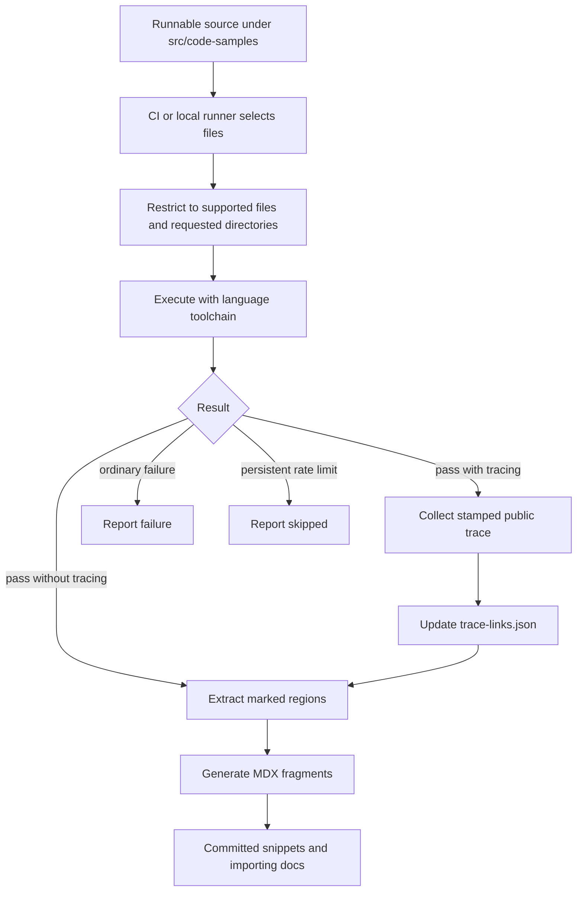
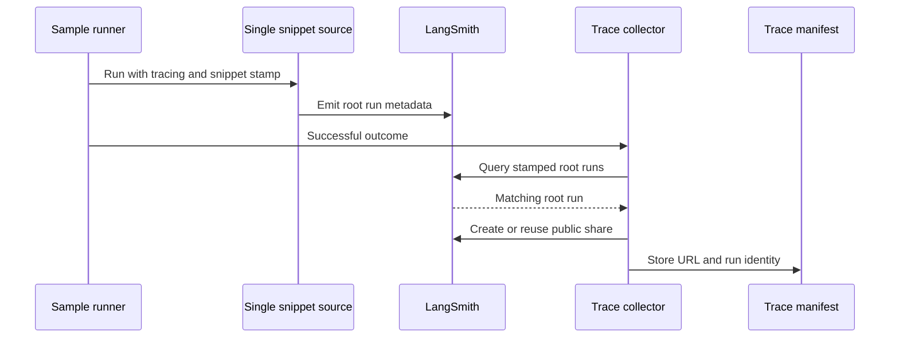

## Source of truth and lifecycle

Runnable examples are authored in supported-language files under `src/code-samples/`. The extracted files in `src/code-samples-generated/` are a gitignored intermediate; committed fragments in `src/snippets/code-samples/` are generated output consumed by documentation pages. Edit and test the runnable source, then regenerate and review the derived MDX—do not make a generated fragment the primary edit location.



This flow shows the ownership boundary from executable source through validation, optional trace publication, extraction, and generated documentation.

The runner's `CODE_SAMPLE_PATHS` filter is restrictive: paths outside `src/code-samples/` are ignored, and resolved ancestry matching prevents a similarly named sibling directory from qualifying. An explicit `FILES` list is still filtered by that setting and by the supported extensions.

Two representative source-to-document relationships show the boundary. The async-subagent TypeScript sample obtains the subagent thread from its task ID, reads the pending interrupt, and creates a resumed run whose command maps the interrupt ID to the app's answer; the async-subagents guide imports its generated JavaScript fragment. The OpenAI observability sample wraps an OpenAI client and decorates its context helper and assistant pipeline with LangSmith tracing; the tracing quickstart imports its generated Python fragment.

## Author and extract snippets

A source may contain visible regions delimited by language-appropriate `:snippet-start: <id>` and `:snippet-end:` comment lines. Python and shell use `#`; TypeScript, Java, Kotlin, and Go use `//`. IDs must end in the language suffix (`-py`, `-js`, `-java`, `-kt`, `-go`, or `-sh`) or the MDX generator skips the extracted file.

Extraction is line based, not an AST transform. It recognizes indented markers, removes matched `:remove-start:` / `:remove-end:` regions, dedents the body, normalizes newlines, and rejects unclosed snippet or remove markers. Remove regions are appropriate for setup, cleanup, and assertions that keep the complete source executable but should not be copied. Keep visible imports, construction, and calls executable; an early successful exit before a visible region prevents the runner from validating what readers see.

`CODE_SNIPPET_SOURCES` can select existing `.py`, `.ts`, `.java`, `.kt`, `.go`, and `.sh` files under `src/code-samples/`. Partial extraction replaces old outputs for those source stems and leaves other generated stems unchanged. A full extraction clears supported intermediate files and rebuilds them. Since generation scans every intermediate that remains, run a full extraction when the generated tree must represent the whole source tree.

## Select and execute samples

```bash
make test-code-samples FILES="src/code-samples/deepagents/async-subagents-answer-waiting.ts"
make test-code-samples FILES="src/code-samples/langsmith/observability-quickstart-app-openai.py"
```

With no `FILES`, the runner recursively selects Python, TypeScript, Java, Kotlin, Go, and shell files, excluding `__pycache__` and `node_modules`. Python runs through `uv run python`; TypeScript uses `npx tsx` from `src/code-samples/`; Go uses the shared `go.mod`; shell runs with `bash`; and Java/Kotlin use JBang with Java 21. Each invocation defaults to 1,200 seconds and can be changed with `CODE_SAMPLE_TIMEOUT_SECONDS`. CI provisions PostgreSQL, Python 3.13, Node 22, Java/JBang, and Go.

The CI matrix has independent `oss` and `langsmith` legs. OSS covers `langchain`, `langgraph`, and `deepagents`; LangSmith covers `langsmith`. Each leg checks that every top-level product directory is covered, so a new product must be added to a matrix path set rather than silently omitted.

The runner defaults to four workers (`CODE_SAMPLE_JOBS`) and keeps unrelated samples concurrent. Samples sharing LangSmith datasets, experiments, or hub prompts are placed into ordered serial chains: `evaluate-rag-`, `experiment-runs-query-`, `prompt-engineering-quickstart`, and `evaluation-quickstart-`. A chain runs on one worker in lexical path order while other samples continue in parallel.

Recognized LangSmith rate-limit output is retried up to five total attempts by default. The delay is linear from `CODE_SAMPLE_RATE_LIMIT_DELAY_SECONDS` (default 30 seconds) and capped at 120 seconds. `CODE_SAMPLE_RATE_LIMIT_ATTEMPTS` and the delay are configurable. An exhausted rate-limited sample is skipped, while an ordinary nonzero exit, missing executable, or timeout is a failure.

The child process inherits the runner environment, so provider and fixture configuration is supplied at the execution boundary rather than embedded in generated snippets. CI supplies gateway-routed provider variables, `POSTGRES_URI`, and provider/API secrets; fork pull requests are excluded because repository secrets are unavailable. The trace-refresh path additionally requires `LANGSMITH_API_KEY`. Treat generated snippets as documentation output: credential values and test-only setup must remain in the executable source or CI environment, never be serialized into a generated fragment.

## Generate MDX

```bash
make code-snippets
```

The target runs extraction followed by MDX generation. The generator scans extracted `*.snippet.*` files, preserves their relative product directory, emits the appropriate language fence, and consumes optional leading `:codegroup-tab:` and `:codegroup-fence-mods:` presentation markers.

For the first eligible Python or TypeScript model ID, generation produces a seven-provider CodeGroup and rewrites repeated matching occurrences. `KEEP MODEL` removes the marker but protects the following model occurrence. Embedding IDs and model IDs passed to provider-specific embedding or chat constructors remain unchanged, preventing generated tabs from producing unrunnable code. Python uses the `google_genai:` provider key; TypeScript uses `google:`. TypeScript samples also must use the camel-case `googleSearch` built-in tool key, and `@langchain/google` must be declared and resolved at version 0.2.6 or later for mixed built-in and function tools.

The OpenAI observability example places `# KEEP MODEL` immediately before its provider-specific bare model ID. Generation strips the marker without converting that constructor into a multi-provider CodeGroup, preserving runnable OpenAI code. Run focused tests when changing these rules:

```bash
make test TEST_FILE=tests/unit_tests/test_test_code_samples.py
make test TEST_FILE=tests/unit_tests/test_generate_code_snippet_mdx.py
```

The runner tests cover recursive and explicit selection, restrictive directory ancestry, and serial-group ordering. Generator tests cover embedding and provider-specific exclusions, marker behavior, language-specific Google conventions, the legacy TypeScript `google_search` rejection, and the package version floor.

## Optional public trace publication

`make update-code-sample-traces` is an explicit publication operation, not ordinary validation. It requires `LANGSMITH_API_KEY`, enables tracing, uses `LANGSMITH_PROJECT` or the `docs-code-samples` default, runs samples, and regenerates MDX. CI enables it only for manual or scheduled full OSS runs; the LangSmith matrix leg uses a separate project and does not refresh the OSS public-trace manifest.



This sequence shows how a successful, eligible sample becomes a verified public-trace link before MDX generation.

For a source with exactly one safe snippet marker, the runner stamps `LANGSMITH_DOCS_SNIPPET` into the sample environment. After a successful run, collection runs under a lock, queries the configured project for a root run with that exact metadata, excludes already claimed run IDs, and stores its public URL in `src/code-samples/trace-links.json`. The generator appends a **View example trace** Card only when the manifest has a URL.

Multi-snippet sources are recorded as skipped and their stale per-snippet entries are removed. If a successful single-snippet source has no stamped root run, an old manifest entry is removed so regeneration removes the stale CTA instead of linking an unverified run. Trace collection retries 429 responses with the runner policy; collection exceptions are warnings and do not fail an otherwise successful sample suite.

## CI operations and failure handling

Fork pull requests skip sample execution because required secrets are unavailable. Internal pull requests test changed supported sample files; scheduled and manual runs test all samples. Matrix legs use `fail-fast: false`, a 60-minute PR timeout, and a 150-minute scheduled/manual timeout. Workflow-level concurrency cancels an older run for the same workflow and ref.

The sample step continues after an error so a limited trace refresh can proceed. On an eligible full OSS run, MDX regeneration requires a non-cancelled test step, fewer than 20 ordinary sample failures, and at least one updated trace link. After successful regeneration, the workflow updates or creates the deterministic `chore/refresh-code-sample-traces` pull request only when `trace-links.json` or generated snippet MDX differs. A final step still fails the job when ordinary samples failed.

A separate scheduled `workflow_run` observer warns rather than failing when `LINEAR_TEAM_KEY` is unset. Otherwise it creates separate Linear issues for unsuccessful OSS and LangSmith legs, or a generic issue when no matrix leg ran.

## Change checklist

1. Edit runnable source under `src/code-samples/`, not generated MDX.
2. Keep markers paired, language-correct, and suffix-correct; ensure visible code executes.
3. Run the focused file with `make test-code-samples FILES="…"`; update package metadata and lockfiles for dependency changes.
4. Run `make code-snippets`, inspect affected committed fragments, and check their importing MDX pages.
5. Run the focused runner or generator tests for selection, concurrency, retries, marker, package, or rendering changes.
6. Use trace publication only for an intended, credentialed, single-snippet run that can safely become public.

## Related pages

- [Source Map](/openwiki/architecture/source-map.md)
- [NPM Snippets](/openwiki/integrations/npm-snippets.md)
- [Local Tooling and Commands](/openwiki/operations/cli-tools.md)
- [Testing and Validation Overview](/openwiki/testing/test-overview.md)
- [LangSmith agent documentation](/openwiki/workflows/langsmith-agent-documentation.md)
