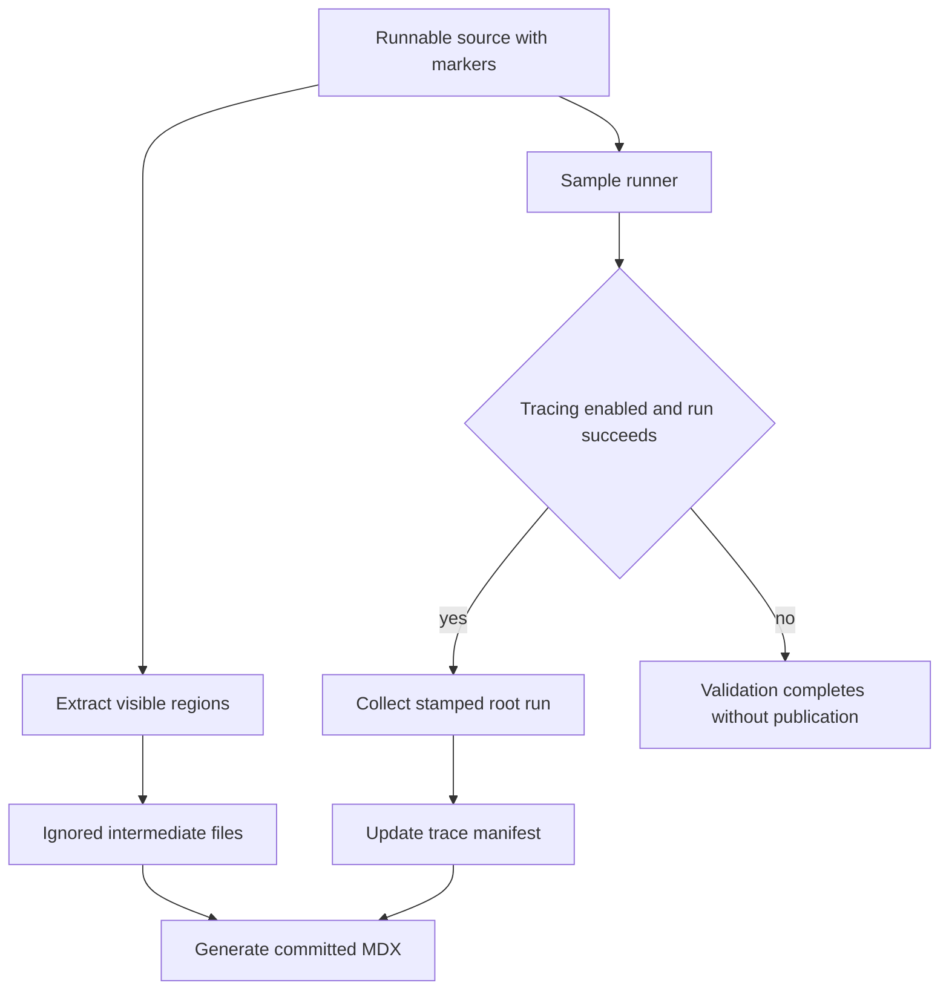

## Source of truth and lifecycle

Runnable sources under `src/code-samples/` are the authoring surface. The extraction intermediate, `src/code-samples-generated/`, is gitignored; committed MDX under `src/snippets/code-samples/` is produced from marked source regions. Make an executable change in the source, run it, regenerate snippets, and review the committed MDX diff rather than editing the intermediate or generated file as the primary change.



This is the code-sample lifecycle: validation and snippet extraction are independent paths, while trace publication is an optional post-success path that can add a CTA during rendering.

## RAG Deep Agents: one runnable tutorial, several snippets

`src/code-samples/deepagents/rag-deep.py` is a representative tutorial source. It exposes seven Python snippets: imports and the curated documentation paths, document loading, a preview, splitting, indexing, a `search_documentation` tool, agent construction, and invocation. The committed `rag-deep-index-py.mdx` is the generated first region: it contains the imports, `DOCS_BASE`, and `DOC_PATHS`, but not the setup guard or later executable work.

The complete Python file is nevertheless the unit the runner executes. Before any snippet marker, a presentation-hidden block checks `OPENAI_API_KEY`; when it is absent, the sample prints a skip message and exits successfully. With the key present, it fetches curated LangChain Markdown pages, skips individual request failures, chunks the loaded documents, and indexes them with `OpenAIEmbeddings` and `InMemoryVectorStore`. Its tool retrieves four similar chunks, writes them to the Deep Agents `StateBackend` under `/retrieved/<batch>/`, and returns those paths. The agent uses that tool and a chunk-analyst subagent; the invocation is protected by `if __name__ == "__main__"`, followed by assertions that the setup objects exist.

This arrangement separates reader-facing regions from required runtime harness and instructions. `:remove-start:` / `:remove-end:` blocks are omitted from each extracted region but remain part of the executed program, which is why the key gate, embedding setup, long prompts, and assertions can support the tutorial without appearing in its individual MDX snippets. The intentional missing-key exit is a selective-runtime policy for this API-backed tutorial, not evidence that its marked body has been exercised in that environment; run it with `OPENAI_API_KEY` to validate the live path.

Because this source has multiple snippet IDs, it is not eligible for a public trace link. Trace collection is intentionally limited to one-snippet source files, so it cannot unambiguously associate one agent run with one generated MDX snippet.

## Authoring regions safely

The extractor supports `.py`, `.ts`, `.java`, `.kt`, `.go`, and `.sh` under `src/code-samples/`. Use matching `:snippet-start: <id>` and `:snippet-end:` lines with `#` for Python and shell, or `//` for TypeScript, Java, Kotlin, and Go. IDs must have the corresponding `-py`, `-js`, `-java`, `-kt`, `-go`, or `-sh` suffix: the renderer silently does not emit a snippet whose ID suffix does not match its source language.

Extraction is line based, not an AST parse. It accepts indented markers, strips matched remove regions, dedents the remaining body, normalizes output newlines, and fails the generation run for an unclosed snippet or remove region. Optional first lines inside a region can specify `:codegroup-tab:` and `:codegroup-fence-mods:`; rendering consumes those directives rather than displaying them.

Keep related tutorial regions in one source when that makes the full program executable, as in `rag-deep.py`. TypeScript is the main exception: the complete file executes as one module, including remove blocks, so separate independently runnable examples if duplicate imports or top-level bindings would collide. Use remove regions for non-reader-facing setup and assertions, but ensure normal, non-skipped runs actually exercise the API construction or behavior represented by the visible region.

## Run locally

Use a focused file list while changing a sample:

```bash
make test-code-samples FILES="src/code-samples/deepagents/rag-deep.py"
```

The runner accepts only supported files below `src/code-samples/`; it warns and skips missing, unsupported, or out-of-tree explicit entries. Without `FILES`, it recursively selects all eligible source files while excluding `node_modules` and `__pycache__`.

Python runs as `uv run python` from the repository. TypeScript runs as `npx tsx`, and Go and shell run as `go run` and `bash`, from `src/code-samples/`; Java and Kotlin use JBang with Java 21. Each process inherits the environment, which allows per-sample gates such as `OPENAI_API_KEY` and service configuration such as `POSTGRES_URI`. The default timeout is 1,200 seconds and can be changed with `CODE_SAMPLE_TIMEOUT_SECONDS`.

Dependencies are shared by language rather than owned by individual samples. Python uses the repository `uv` project. TypeScript uses `src/code-samples/package.json` and its lockfile, which declare the Deep Agents runtime and `tsx`; `make test-code-samples` installs that package before execution. Go runs from `src/code-samples/`, so its shared `go.mod` resolves dependencies. Update the applicable manifest and lockfile together when adding a sample dependency.

The runner uses four workers by default and accepts `CODE_SAMPLE_JOBS`. Only the `evaluate-rag-` and `experiment-runs-query-` path families are serialized with per-group locks; unrelated samples can still overlap. A nonzero exit, absent executable, or timeout is a failure. Recognized LangSmith rate limits are retried up to five total attempts by default, with a linear 30-second delay capped at 120 seconds; `CODE_SAMPLE_RATE_LIMIT_ATTEMPTS` and `CODE_SAMPLE_RATE_LIMIT_DELAY_SECONDS` override that behavior. A sample still rate-limited after retries is reported as skipped rather than failed.

## Extract and render committed MDX

```bash
make code-snippets
```

This target extracts first and then renders. For every marked region, extraction creates `<source-stem>.snippet.<snippet-id>.<extension>` below `src/code-samples-generated/`; the generator scans those intermediates and writes `<snippet-id>.mdx` under `src/snippets/code-samples/`. A normal full extraction clears supported intermediates before rebuilding them.

For focused iteration, set `CODE_SNIPPET_SOURCES` to existing supported paths beneath `src/code-samples/`:

```bash
CODE_SNIPPET_SOURCES="src/code-samples/deepagents/rag-deep.py" make code-snippets
```

Partial extraction replaces intermediates only for the selected source stem. MDX generation still scans every intermediate that remains, so use a full extraction before considering the generated tree a complete refresh.

The renderer emits language fences and can make a seven-provider `CodeGroup` for eligible Python or TypeScript routable model strings. It substitutes the first eligible model ID and repeated occurrences of that same ID. `KEEP MODEL`, embedding model IDs, and `model` values supplied to provider-specific embedding or chat constructors are excluded, so a RAG snippet keeps its embedding configuration runnable while varying its agent model. Python variants use `google_genai:`; TypeScript variants use `google:`. Focused generator tests enforce those language conventions, reject legacy TypeScript `google_search`, and ensure the declared and lockfile-resolved `@langchain/google` version meets the 0.2.6 floor.

Run the focused deterministic test when changing rendering rules or those TypeScript invariants:

```bash
make test TEST_FILE=tests/unit_tests/test_generate_code_snippet_mdx.py
```

## Optional public trace publication

`make update-code-sample-traces` is explicit publication, not normal validation. It enables `CODE_SAMPLE_TRACING=1`, uses `LANGSMITH_PROJECT` or the default `docs-code-samples`, runs the selected samples, then regenerates MDX. It requires `LANGSMITH_API_KEY` and can make a LangSmith run public, so use it only with intended credentials and publication approval.


This shows the guarded trace-publication path for a source with exactly one safe snippet ID.

For an eligible source, the runner sets `LANGSMITH_DOCS_SNIPPET`; the collector requires the same value in root-run metadata rather than selecting a nearby run by time. Collection is locked, and already claimed run IDs are excluded, preventing parallel workers from overwriting the shared manifest or associating a run with the wrong sample. Multi-snippet sources are recorded as skipped and stale entries for their IDs are removed. If a successful eligible source yields no stamped root run, any old entry is also removed; subsequent MDX generation removes the stale **View example trace** Card. Collection runs only after sample success, retries 429s using the runner policy, and warns rather than failing the suite if collection itself fails.

## CI: changed files, full runs, and refresh PRs

The **Test Code Samples** workflow is triggered by relevant pull requests, manual dispatch, and at 00:00 UTC on the first day of every month. It skips fork PRs because provider keys are secrets. For an internal PR it computes the merge-base diff and runs changed eligible files only; manual and scheduled invocations set `run_all=true`, run all samples, and enable tracing. The job provisions PostgreSQL, Python, Node, Java/JBang, and Go, with a 60-minute PR timeout and a 150-minute full-run timeout.

The test step continues after error so a limited-failure full run can still refresh verified traces. On a manual or scheduled run, regeneration requires that testing was not cancelled, fewer than 20 ordinary sample failures occurred, and at least one trace link changed. If regeneration succeeds, CI considers only `src/code-samples/trace-links.json` and `src/snippets/code-samples/`; it creates or appends to the deterministic `chore/refresh-code-sample-traces` pull request only when those artifacts differ. The final workflow step still fails the job when ordinary samples failed. A separate workflow creates a Linear issue only when a scheduled sample workflow failed or was cancelled.

## Change checklist

1. Edit the executable source under `src/code-samples/`; do not hand-edit the extraction intermediate.
2. Add matched language-correct markers, unique language-suffixed IDs, and remove regions only for material readers should not see.
3. For an API-backed sample, decide deliberately whether missing credentials should skip, fail, or exercise an alternative path; document a skip in its output as `rag-deep.py` does.
4. Run `make test-code-samples FILES="…"` with the credentials needed to exercise the intended live path.
5. Run `make code-snippets`, review the committed MDX diff, and use `CODE_SNIPPET_SOURCES` only for focused iteration.
6. Update shared dependency manifests and lockfiles together, then run the focused generator test when model expansion or TypeScript Google conventions are relevant.
7. Request a trace refresh only for a one-snippet source and only when public sharing is intended.

## Related pages

- [Repository Source Map](/openwiki/architecture/source-map.md)
- [GitHub Actions and CI Automation](/openwiki/integrations/github-actions.md)
- [Local Tooling and Commands](/openwiki/operations/cli-tools.md)
- [Quickstart](/openwiki/quickstart.md)
- [Testing and Validation Overview](/openwiki/testing/test-overview.md)
