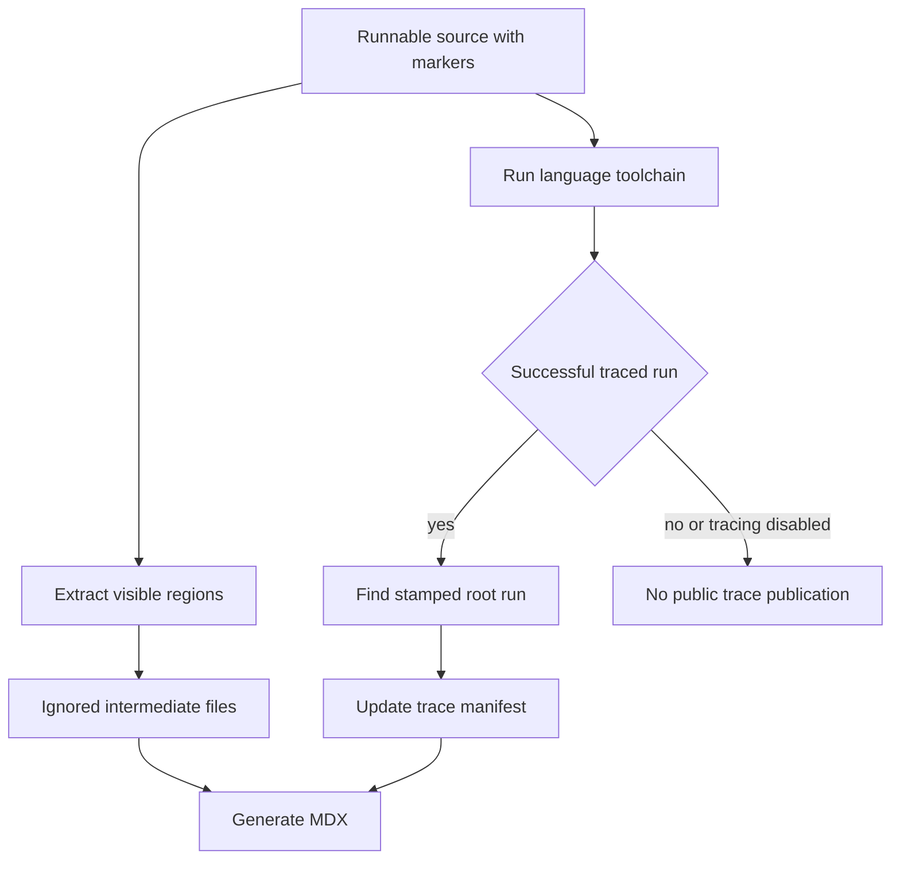
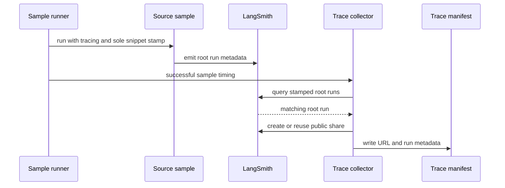

## Ownership and lifecycle

`src/code-samples/` contains the runnable source of truth. `src/code-samples-generated/` is a gitignored extraction intermediate, while `src/snippets/code-samples/` contains the MDX produced from it. Change and validate a source program, regenerate, then review the MDX diff; generated outputs are not the primary editing surface.



This shows the executable-source-to-documentation lifecycle. `make code-snippets` extracts and renders; it does not execute samples. Trace sharing is an optional publication branch after a successful run.

## Author runnable, extractable source

The extractor and runner support `.py`, `.ts`, `.java`, `.kt`, `.go`, and `.sh` under `src/code-samples/`. Delimit reader-visible code with matching `:snippet-start: <id>` and `:snippet-end:` comment markers: `#` for Python and shell, `//` for TypeScript, Java, Kotlin, and Go. The ID must end in the language suffix (`-py`, `-js`, `-java`, `-kt`, `-go`, or `-sh`); the renderer skips a snippet whose ID does not match its source language.

Extraction is deliberately line based, not a language parser. Indented markers are accepted. Matched `:remove-start:` / `:remove-end:` regions are omitted from the displayed snippet, remaining code is dedented, and unclosed snippet or remove regions fail generation. Remove regions affect only presentation: fixture setup, assertions, cleanup, and harness code still run with the complete source file.

Prefer one source file for related snippets on a page, with shared helpers and test-only setup written once. TypeScript needs special care: the entire `.ts` file—including visible regions and remove blocks—executes as one module. Split independently runnable examples into files when duplicate imports or top-level bindings would collide. In every language, keep visible code on an executed path; a sample must not exit before it has exercised the imports, construction, or configuration it documents.

## Execute samples and manage dependencies

For a focused live check, pass a space-separated explicit file list:

```bash
make test-code-samples FILES="src/code-samples/deepagents/skills-tools-resolver.ts"
```

The runner warns and omits missing, unsupported, or out-of-tree `FILES` entries. Without `FILES`, it recursively selects eligible sample files while excluding `node_modules` and `__pycache__`.

It runs Python as `uv run python` from the repository; TypeScript as `npx tsx`, Go as `go run`, and shell as `bash` from `src/code-samples/`; Java and Kotlin run as single-file JBang scripts pinned to Java 21. Each child inherits the parent environment. The default timeout is 1,200 seconds and `CODE_SAMPLE_TIMEOUT_SECONDS` overrides it.

Dependencies are owned at the shared language boundary, not per source example. Python uses the repository `uv` project. TypeScript uses `src/code-samples/package.json` and its committed lockfile; the Make targets install that package before TypeScript execution. The manifest declares the shared sample packages, including `deepagents`, and `tsx` is the TypeScript execution tool; the lockfile records the resolved graph. Go runs from the same directory so `src/code-samples/go.mod` resolves shared Go dependencies. Update the relevant shared manifest and lockfile when changing a sample's dependency.

The runner uses four workers by default; `CODE_SAMPLE_JOBS` configures the count. Per-group locks serialize only the `evaluate-rag-` and `experiment-runs-query-` path families, protecting shared LangSmith fixtures while unrelated samples remain concurrent. A nonzero exit, missing executable, or timeout fails a sample. Recognized LangSmith rate limits instead receive up to five attempts by default, with a linear 30-second base delay capped at 120 seconds. `CODE_SAMPLE_RATE_LIMIT_ATTEMPTS` and `CODE_SAMPLE_RATE_LIMIT_DELAY_SECONDS` override that policy; an exhausted 429 is reported as skipped rather than failed.

## Extract and render MDX

```bash
make code-snippets
```

The target extracts first into files named `<source-stem>.snippet.<snippet-id>.<extension>` beneath `src/code-samples-generated/`, then writes `<snippet-id>.mdx` below `src/snippets/code-samples/`. A full extraction removes supported intermediate files before rebuilding them. For focused iteration, `CODE_SNIPPET_SOURCES` accepts existing supported paths below `src/code-samples/`:

```bash
CODE_SNIPPET_SOURCES="src/code-samples/deepagents/skills-tools-resolver.ts" make code-snippets
```

A partial extraction replaces intermediates only for selected source stems. Rendering still scans every intermediate already present, so perform a full extraction before treating the output as a complete repository-wide refresh.

The generator emits language fences and recognizes optional initial presentation directives: `:codegroup-tab:` supplies a Mintlify CodeGroup tab title and `:codegroup-fence-mods:` supplies fence modifiers. For eligible Python and TypeScript routable model strings, it expands the first eligible model ID and matching repeated occurrences into seven provider variants: Google, OpenAI, Anthropic, OpenRouter, Fireworks, Baseten, and Ollama. `KEEP MODEL` preserves the next model occurrence. Embedding model IDs and models passed to provider-specific embedding or chat constructors are deliberately excluded because substituting a `provider:model` value there would make the sample non-runnable.

Provider syntax is language-specific. TypeScript examples use `google:` and `googleSearch`; Python examples use `google_genai:`. Generator tests reject incompatible Google spellings and require declared and resolved `@langchain/google` versions of at least 0.2.6, protecting Gemini examples that mix built-in and function tools.

For generator logic or these TypeScript dependency invariants, run the deterministic focused test before regenerating output:

```bash
make test TEST_FILE=tests/unit_tests/test_generate_code_snippet_mdx.py
```

## Optional public trace publication

`make update-code-sample-traces` is an explicit publication operation, not ordinary sample validation. It enables `CODE_SAMPLE_TRACING=1`, uses `LANGSMITH_PROJECT` or the default `docs-code-samples`, runs samples, and regenerates MDX. It requires `LANGSMITH_API_KEY`; use it only with approval to publish a public LangSmith URL.



This shows how a successful, single-snippet run becomes a public trace link.

Only a source with exactly one safe snippet ID is eligible. The runner stamps it through `LANGSMITH_DOCS_SNIPPET`; the collector requires that metadata on a root run rather than using timing proximity. Collection runs under a lock, preventing parallel workers from claiming the same run or overwriting `src/code-samples/trace-links.json`.

Sources with no marker receive no link. Multi-snippet sources are recorded as skipped and stale per-snippet entries are removed; split them before requesting a trace link. If a successful single-snippet source has no matching stamped root run, its old manifest entry is removed rather than retained. A match is publicly shared and recorded with its source, URL, run and trace IDs, run name, snippet ID, and update time. MDX receives a **View example trace** Card only when the manifest supplies a URL; regeneration removes a stale trailing CTA otherwise.

Collection runs only after a successful sample. Its 429 retries use the runner policy, but collection errors are warnings and do not turn a successful sample into a failure. This permits a refresh to publish the verified subset without retaining unverified trace links.

## CI maintenance loop

The **Test Code Samples** workflow runs for relevant pull requests, manual dispatch, and at 00:00 UTC on the first day of each month. Fork PRs are skipped because some samples require repository secrets. Internal PRs test changed eligible sample files; manual and scheduled runs test all samples and enable tracing. The job provisions PostgreSQL, Python, Node, Java/JBang, and Go, with a 60-minute timeout for PRs and 150 minutes for full runs.

The sample step continues after errors so trace refresh can proceed when failures are limited. On manual or scheduled runs, MDX regeneration requires a non-cancelled test, fewer than 20 failed samples, and at least one updated trace. After successful regeneration, CI considers only `src/code-samples/trace-links.json` and generated snippet MDX: it creates or updates the deterministic `chore/refresh-code-sample-traces` pull request only when those paths differ. The workflow ultimately fails on ordinary sample failures. A separate observer opens a Linear issue only for failed or cancelled scheduled runs.

## Change checklist

1. Edit the runnable source in `src/code-samples/`, not an intermediate or generated MDX file.
2. Use matched language-correct markers and a unique ID with the required suffix.
3. Keep reader-visible code executable; use remove regions for fixtures, assertions, cleanup, and non-reader-facing harness code.
4. Update the appropriate shared dependency manifest and lockfile with any dependency change.
5. Run `make test-code-samples FILES="…"`, then run `make code-snippets`; use `CODE_SNIPPET_SOURCES` only for focused iteration.
6. Run `make test TEST_FILE=tests/unit_tests/test_generate_code_snippet_mdx.py` when changing rendering, Google provider conventions, or the shared TypeScript dependency floor.
7. Review generated output, remembering that partial extraction leaves unrelated intermediates in place.
8. Refresh traces only for an unambiguous single-snippet source and only with intended credentials and publication approval.

## Related pages

- [Repository Source Map](/openwiki/architecture/source-map.md)
- [Local Tooling and Commands](/openwiki/operations/cli-tools.md)
- [Testing and Validation Overview](/openwiki/testing/test-overview.md)
- [Local development](/openwiki/workflows/local-development.md)
