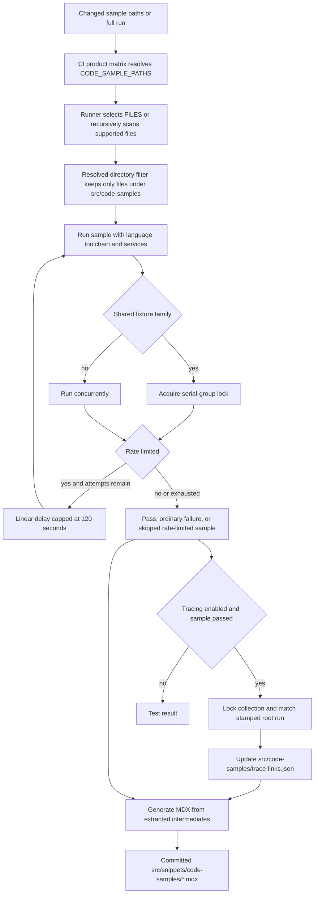
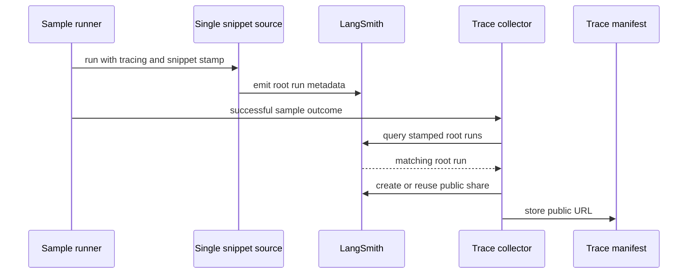

## Lifecycle and source of truth

Runnable documentation examples are authored in supported-language files under `src/code-samples/`, grouped by product. The extracted files in `src/code-samples-generated/` are a gitignored intermediate; the MDX fragments in `src/snippets/code-samples/` are committed generated output consumed by documentation pages. Edit and test the runnable source, then regenerate and review the derived MDX. Do not edit a generated snippet directly.



This flow combines the workflow's product selection with the runner's filtering, concurrency, retry, trace-collection, and generation boundaries. `CODE_SAMPLE_PATHS` is restrictive: entries outside `src/code-samples/` are ignored, and resolved ancestry matching prevents a similarly named sibling directory from widening a run. `FILES` is an explicit list, but it is still filtered by `CODE_SAMPLE_PATHS` and the supported extensions.

Two representative source-to-document relationships illustrate the boundary. `async-subagents-answer-waiting.ts` obtains the subagent thread from its task ID, reads its pending interrupt, and resumes it with a command mapping that interrupt ID to the app-provided answer; the async-subagents guide imports its generated fragment. `observability-quickstart-app-openai.py` wraps an OpenAI client and decorates its context helper and assistant pipeline with LangSmith tracing; its generated Python fragment is included in the tracing quickstart.

## Author runnable regions

A source can contain one or more visible regions delimited by language-appropriate `:snippet-start: <id>` and `:snippet-end:` comment lines. Python and shell use `#`; TypeScript, Java, Kotlin, and Go use `//`. IDs must end in the language suffix (`-py`, `-js`, `-java`, `-kt`, `-go`, or `-sh`): the renderer skips an extracted ID with the wrong suffix.

Extraction is intentionally line based rather than an AST transform. It recognizes indented markers, removes matched `:remove-start:` / `:remove-end:` blocks from the visible body, dedents the result, normalizes newlines, and rejects unclosed snippet or removal markers. Use remove blocks for setup, cleanup, and assertions that make the complete source executable but should not be copied by readers. Do not place an early successful exit before a visible region: the runner must execute the displayed imports, construction, and calls.

Prefer one source for related Python regions, but account for each runtime's scope rules. TypeScript runs as a complete module, including remove blocks; separate independently runnable examples into files when their imports or top-level declarations would collide. A single-snippet source is also the unit eligible for public trace linking; a multi-snippet source is deliberately not linked to one ambiguous trace.

## Select and execute samples

Use the source runner before rendering:

```bash
make test-code-samples FILES="src/code-samples/deepagents/async-subagents-answer-waiting.ts"
make test-code-samples FILES="src/code-samples/langsmith/observability-quickstart-app-openai.py"
```

Without `FILES`, the runner recursively selects eligible Python, TypeScript, Java, Kotlin, Go, and shell samples. With `FILES`, it accepts only existing supported files beneath `src/code-samples/`. `CODE_SAMPLE_PATHS` narrows either mode to named directories, allowing every CI matrix leg to receive the same changed-file list while each leg executes only its product.

The workflow has independent `oss` and `langsmith` matrix legs. OSS covers `langchain`, `langgraph`, and `deepagents`; LangSmith covers `langsmith`. Before running, it checks that every top-level directory under `src/code-samples/` is covered by one of those path sets. This product coverage check is a behavioral boundary: adding a product directory requires adding it to a matrix leg or CI fails rather than silently omitting its samples.

Python executes through `uv run python`. TypeScript runs with `npx tsx` from `src/code-samples/`, where the shared `package.json` and lockfile own its dependencies. Go runs with the shared `go.mod`, and shell runs from the same samples directory. Java and Kotlin run through JBang with Java 21. The default invocation timeout is 1,200 seconds. CI provisions PostgreSQL plus Python, Node 22, Java/JBang, and Go; the PostgreSQL service is available to samples through the configured connection string.

The runner defaults to `CODE_SAMPLE_JOBS=4`, or the positive integer supplied by that environment variable. Per-group locks serialize samples that share state: the `evaluate-rag-`, `experiment-runs-query-`, `prompt-engineering-quickstart`, and `evaluation-quickstart-` path families. Unrelated samples remain concurrent. These serial groups protect shared LangSmith datasets, experiments, or prompts; they do not turn the whole suite into one serial queue.

Recognized LangSmith rate-limit failures are retried up to five total attempts by default, with a linear `CODE_SAMPLE_RATE_LIMIT_DELAY_SECONDS` delay starting at 30 seconds and capped at 120 seconds. `CODE_SAMPLE_RATE_LIMIT_ATTEMPTS` and the delay variable are environment-configurable. An exhaustively rate-limited sample is reported as skipped rather than failed, whereas ordinary nonzero exits, unavailable executables, and timeouts fail the run.

## Extract and generate MDX

```bash
make code-snippets
```

The target runs extraction followed by MDX generation. A full extraction deletes supported intermediate files before rebuilding them. `CODE_SNIPPET_SOURCES` supports source-specific replacement: it must name valid files under `src/code-samples/`, deletes old generated outputs for those source stems, and leaves other stems in place. MDX generation still scans every intermediate that remains, so use a full run before treating the generated tree as a complete refresh.

The generator writes language fences and recognizes optional leading `:codegroup-tab:` and `:codegroup-fence-mods:` presentation markers. For the first eligible Python or TypeScript model ID, it renders a seven-provider CodeGroup and replaces repeated matching occurrences. `KEEP MODEL`, embedding model IDs, and models passed to embeddings or provider-specific chat constructors remain unchanged so the resulting sample stays runnable. Google model keys differ by runtime: Python uses `google_genai:`, while TypeScript uses `google:`.

The observability OpenAI example deliberately puts `# KEEP MODEL` immediately before its wrapped client's bare model ID. Rendering strips that marker but does not convert this provider-specific constructor call into a multi-provider CodeGroup, preserving the quickstart's runnable OpenAI code. The generated MDX gives it a `Python` tab from its presentation marker.

Run focused tests when changing selection or rendering behavior:

```bash
make test TEST_FILE=tests/unit_tests/test_test_code_samples.py
make test TEST_FILE=tests/unit_tests/test_generate_code_snippet_mdx.py
```

The runner-focused tests cover `CODE_SAMPLE_PATHS` selection for recursive and explicit runs, including ancestry boundaries. Generator tests cover model expansion exclusions, language-specific Google conventions, rejection of legacy TypeScript `google_search`, and the declared and resolved `@langchain/google` version floor needed for Gemini tool configuration.

## Optional public trace publication

`make update-code-sample-traces` is an explicit publication operation, not ordinary validation. It requires `LANGSMITH_API_KEY`, enables tracing, selects `LANGSMITH_PROJECT` or the `docs-code-samples` default, runs samples, and regenerates MDX. The workflow enables this path only for manual or scheduled full OSS runs; LangSmith SDK samples use a separate project and do not participate in this agent-root trace refresh.



With tracing enabled, a single-snippet sample receives `LANGSMITH_DOCS_SNIPPET` metadata. After a successful sample only, collection runs under a lock, queries the configured project for a root run with that exact stamp, excludes already claimed run IDs, and stores its public URL in `src/code-samples/trace-links.json`. The renderer appends a **View example trace** Card only when the manifest supplies a URL.

The collector fails closed. Sources with several snippets are recorded as skipped and their stale per-snippet entries are removed. A source with exactly one safe marker can receive a link; if no stamped root run is found, any old manifest entry is removed so regeneration removes the stale CTA rather than linking an unverified run. Trace collection retries rate-limit errors with the runner policy, but collection exceptions are warnings and do not fail a sample suite that otherwise passed.

## CI operations and failure handling

The workflow skips fork pull requests because required secrets are unavailable. Internal pull requests identify changed supported sample files from the merge-base diff; scheduled and manual runs test all samples. Matrix legs run independently with `fail-fast: false`, a 60-minute PR timeout, and a 150-minute scheduled or manual timeout. The job-level concurrency group cancels an older run for the same workflow and ref.

The sample step continues after an error to preserve a limited trace refresh path. On an eligible full OSS run, MDX regeneration requires that the test step was not cancelled, ordinary sample failures are fewer than 20, and at least one trace link changed. If regeneration succeeds, the workflow updates or creates the deterministic `chore/refresh-code-sample-traces` pull request only when `trace-links.json` or generated snippet MDX differs. A final step still fails the job for ordinary sample failures.

A separate `workflow_run` observer handles scheduled failures or cancellations. If `LINEAR_TEAM_KEY` is absent it emits a warning rather than failing. Otherwise it inspects the completed job list and files separate Linear issues for unsuccessful OSS and LangSmith legs; if no matrix leg ran, it files a generic pipeline issue.

## Change checklist

1. Change the runnable source under `src/code-samples/`; never make a derived MDX fragment the primary edit location.
2. Keep markers paired, language-correct, and suffix-correct. Put non-reader-facing harness code in remove blocks, but ensure visible code executes.
3. Run the focused source through `make test-code-samples FILES="…"`; update shared manifests and lockfiles when changing dependencies.
4. Run `make code-snippets`, inspect every affected committed fragment, and check the MDX page that imports it.
5. Run the focused runner or generator tests when changing selection, retries, marker handling, or rendering invariants.
6. Use trace publication only for an intended, credentialed, single-snippet agent run that can safely become public.

## Related pages

- [Local Tooling and Commands](/openwiki/operations/cli-tools.md)
- [Testing and Validation Overview](/openwiki/testing/test-overview.md)
- [LangSmith agent documentation](/openwiki/workflows/langsmith-agent-documentation.md)
