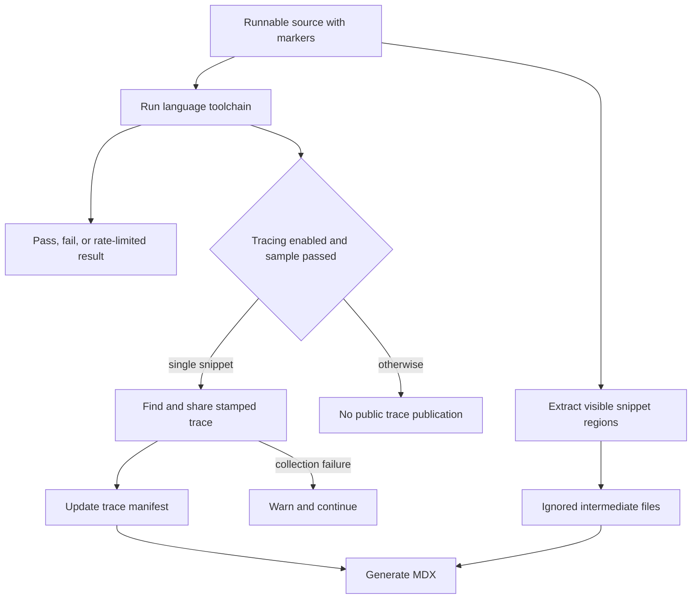

## Ownership and lifecycle

`src/code-samples/` is the executable source of truth. The ignored `src/code-samples-generated/` directory holds extraction intermediates, and MDX under `src/snippets/code-samples/` is generated documentation output—not authored source. Change the source program, validate it, regenerate the MDX, and review that diff rather than editing generated MDX directly.



This is the source-to-documentation lifecycle. `make code-snippets` extracts and renders but does not execute samples. Trace publication is an optional post-success branch; a failed lookup or share does not turn an already successful sample into a failed sample.

## Author a sample that is both readable and executable

Supported source extensions are `.py`, `.ts`, `.java`, `.kt`, `.go`, and `.sh`. Surround the reader-visible region with matching `:snippet-start: <id>` and `:snippet-end:` comments: `#` for Python and shell, and `//` for TypeScript, Java, Kotlin, and Go. The ID must end in the language suffix (`-py`, `-js`, `-java`, `-kt`, `-go`, or `-sh`); generation uses that suffix to choose a fence and does not emit an MDX file for a mismatched extracted ID.

The extractor is deliberately line based rather than parsing the host language. It accepts indented markers, removes content enclosed by matched `:remove-start:` / `:remove-end:` markers from the displayed result, dedents the remaining body, and rejects unclosed snippet or removal regions. Removal is presentation only: the full source—including fixtures, assertions, cleanup, and harnesses—still runs during validation.

Put executable setup and the behavior being demonstrated before a deliberate exit. A hidden tail can assert constructed values or avoid a blocking/live invocation after the visible code has run. In TypeScript, visible and removed regions execute in one module and share top-level bindings. Split independently runnable examples into separate files when imports, `const`/`let`, classes, or functions would collide.

### Deep Agents skills tool samples

The current `skills-tools-*.ts` examples are intentionally separate, single-snippet entry points. They keep virtual `FilesystemBackend` setup, test tool definitions, and validation checks in remove regions while retaining the public skills-tool configuration in the extracted snippet. This makes each example independently executable and eligible for a trace link, unlike a multi-snippet source.

Together they cover the meaningful resolver modes: returning every tool for an integration name, passing a fixed list, resolving tools from `runtime.context.userId`, mapping documentation-facing tool aliases to actual tools, and combining deferred tool loading with `providerToolSearchMiddleware()`. The agent-building examples mark the Anthropic model with `// KEEP MODEL`, so provider CodeGroup expansion cannot silently change the deliberate model choice. Keep the checks after the visible block: the runner must construct—and, where the example invokes it, exercise—the configuration shown to readers.

## Validate the source program

Use a focused run while iterating:

```bash
make test-code-samples FILES="src/code-samples/deepagents/skills-tools-resolver.ts"
```

`FILES` is a space-separated explicit list. Invalid, unsupported, missing, or out-of-tree paths are warned about and omitted. With no list, the runner recursively selects eligible files while excluding `node_modules` and `__pycache__`. It runs Python with `uv run python`, TypeScript with `npx tsx` from `src/code-samples/`, Java and Kotlin through JBang pinned to Java 21, Go with `go run` from that shared directory, and shell with `bash`. Each subprocess receives the parent environment; the default timeout is 1,200 seconds and `CODE_SAMPLE_TIMEOUT_SECONDS` can override it.

The runner defaults to four concurrent jobs, configurable through `CODE_SAMPLE_JOBS`. `SERIAL_GROUPS` adds per-group locks for the `evaluate-rag-` and `experiment-runs-query-` path families, so samples sharing a LangSmith dataset or experiment fixture never overlap while unrelated samples can run concurrently. A normal nonzero exit, missing executable, or timeout fails the run.

A recognized LangSmith 429 is exceptional: the runner makes up to five total attempts by default. The wait after attempt *n* is `CODE_SAMPLE_RATE_LIMIT_DELAY_SECONDS × n` (30 seconds by default), capped at 120 seconds; both the attempt count and base delay are configurable with `CODE_SAMPLE_RATE_LIMIT_ATTEMPTS` and `CODE_SAMPLE_RATE_LIMIT_DELAY_SECONDS`. A sample still rate-limited after those attempts is reported as skipped rather than failed, so it is not evidence that the sample was successfully exercised.

When tracing is enabled, only successful samples enter serialized trace collection. Collection retries LangSmith 429 errors using the same policy, but any other collection exception—or a 429 that remains after retries—is recorded as a warning in `trace_failures`; it does not fail the runner. The runner writes `sample_failures`, passed/total/rate-limited counts, `traces_updated`, and `trace_failures` to `GITHUB_OUTPUT` when available. CI can therefore refresh links from the successful subset even when some samples or trace collections did not succeed.

Python dependencies are owned by the repository `uv` project. TypeScript dependencies are shared by `src/code-samples/package.json`, with the committed `package-lock.json` recording the resolved graph; the Make targets install that package before invoking TypeScript samples. When a TypeScript runtime dependency changes, update this shared package owner and refresh its lockfile; do not create per-sample installs.

## Extract and render the derived snippets

```bash
make code-snippets
```

This target first extracts source regions into files named like `<source-stem>.snippet.<snippet-id>.<extension>` below `src/code-samples-generated/`, then scans those intermediates to render `<snippet-id>.mdx` below `src/snippets/code-samples/`. A full extraction deletes supported intermediate files before rebuilding them. For a fast local iteration, `CODE_SNIPPET_SOURCES` accepts existing supported paths below `src/code-samples/` and replaces intermediates for those source stems only:

```bash
CODE_SNIPPET_SOURCES="src/code-samples/deepagents/skills-tools-resolver.ts" make code-snippets
```

MDX generation still scans every intermediate left in the directory. Run a full extraction before treating the output as complete repository-wide state, and inspect all generated changes after a partial run.

The renderer emits language fences and consumes optional first-line presentation directives: `:codegroup-tab:` supplies a Mintlify CodeGroup tab name, and `:codegroup-fence-mods:` supplies fence modifiers. For eligible Python and TypeScript LangChain-style model strings, it can render seven provider variants in a CodeGroup. `# KEEP MODEL` or `// KEEP MODEL` preserves the following model occurrence. Embedding model IDs and models in provider-specific embedding/chat constructors stay untouched, because substituting a routable `provider:model` value would make the example invalid. The Google provider variant is intentionally language-specific: Python uses `google_genai:`, while TypeScript uses `google:`.

Provider safeguards extend to executable TypeScript samples. They must use `googleSearch` rather than the legacy `google_search` key, and must not use Python's `google_genai:` provider prefix. The generator tests scan the complete TypeScript and Python sample sets for those incompatible spellings. They also require both the declared and lockfile-resolved `@langchain/google` version to be at least `0.2.6`, because that release configures Gemini correctly when built-in and function tools are mixed. These checks protect examples from failing before their request reaches the provider.

## Publish public traces only deliberately

Ordinary sample validation does not publish traces. `make update-code-sample-traces` sets `CODE_SAMPLE_TRACING=1`, uses `LANGSMITH_PROJECT` or the default `docs-code-samples`, runs the samples, and regenerates MDX. It requires `LANGSMITH_API_KEY` to access LangSmith and create public shares.

After a successful traced sample, collection reads its source markers under a lock, preventing parallel workers from overwriting the manifest or claiming the same run. A source with no markers receives no link; a source with more than one marker is recorded in `skipped_multi_snippet` and stale entries for its IDs are removed. Only an unambiguous single-snippet source can be associated with a stamped root run in its execution window. The runner sets `LANGSMITH_DOCS_SNIPPET` to that sole ID, and the collector filters and verifies the matching metadata rather than falling back to a nearby root run. It excludes already claimed run IDs, shares the selected trace publicly, and records source, URL, run/trace IDs, run name, and update time in `src/code-samples/trace-links.json`. Rendering appends the **View example trace** Card only when that manifest contains a URL for the snippet; it removes a stale trailing CTA when no URL is available.

Treat this as a security and content-publication boundary: credentials are necessary, publication is explicit, and splitting a multi-snippet file is required before it can gain a per-snippet public trace link.

## CI maintenance loop

The **Test Code Samples** workflow runs on relevant pull requests, manual dispatch, and the first day of each month. It skips fork PRs because samples can require repository secrets. Internal PRs run changed eligible sample files; manual and scheduled runs test the complete set, provision Python/Node/Java/JBang/Go and PostgreSQL, and enable tracing. The workflow limits its normal PR job to 60 minutes and its full job to 150 minutes.

The test step continues after errors so a full traced run can still collect links. On a manual or scheduled run, regeneration runs when the test step was not cancelled, fewer than 20 samples failed, and at least one trace manifest entry was updated. Thus the refresh threshold is strictly fewer than 20 failures, not a requirement that every sample pass or that every trace collection succeed. If regeneration succeeds, CI considers only `trace-links.json` and generated snippet MDX for a deterministic `chore/refresh-code-sample-traces` branch. It makes no commit when those paths have no diff; otherwise it updates an open PR on that branch or creates one. The final workflow step still fails the job if the sample runner reported ordinary sample failures. A separate `workflow_run` observer opens a Linear issue only when a scheduled **Test Code Samples** run fails or is cancelled.

## Change checklist

1. Edit the runnable file under `src/code-samples/`; do not hand-edit generated snippet MDX or extraction intermediates.
2. Use matched, language-correct markers and a unique ID with the expected language suffix.
3. Keep the visible code on an executed path. Put local fixtures, assertions, cleanup, and non-reader-facing setup in remove regions.
4. For a TypeScript dependency change, update the shared `src/code-samples/package.json` owner and its `package-lock.json` together.
5. Run `make test-code-samples FILES="…"` before including the sample, then run `make code-snippets` with `CODE_SNIPPET_SOURCES` if appropriate.
6. Review generated MDX, remembering that partial extraction does not clear unrelated intermediates.
7. Use trace refresh only with intended credentials and only when publishing a public trace for an unambiguous single-snippet source is acceptable.

## Related pages

- [Preprocessing](/openwiki/concepts/preprocessing.md)
- [GitHub Actions and CI/CD](/openwiki/integrations/github-actions.md)
- [CLI Tools](/openwiki/operations/cli-tools.md)
- [Quickstart](/openwiki/quickstart.md)
- [Testing Overview](/openwiki/testing/test-overview.md)
