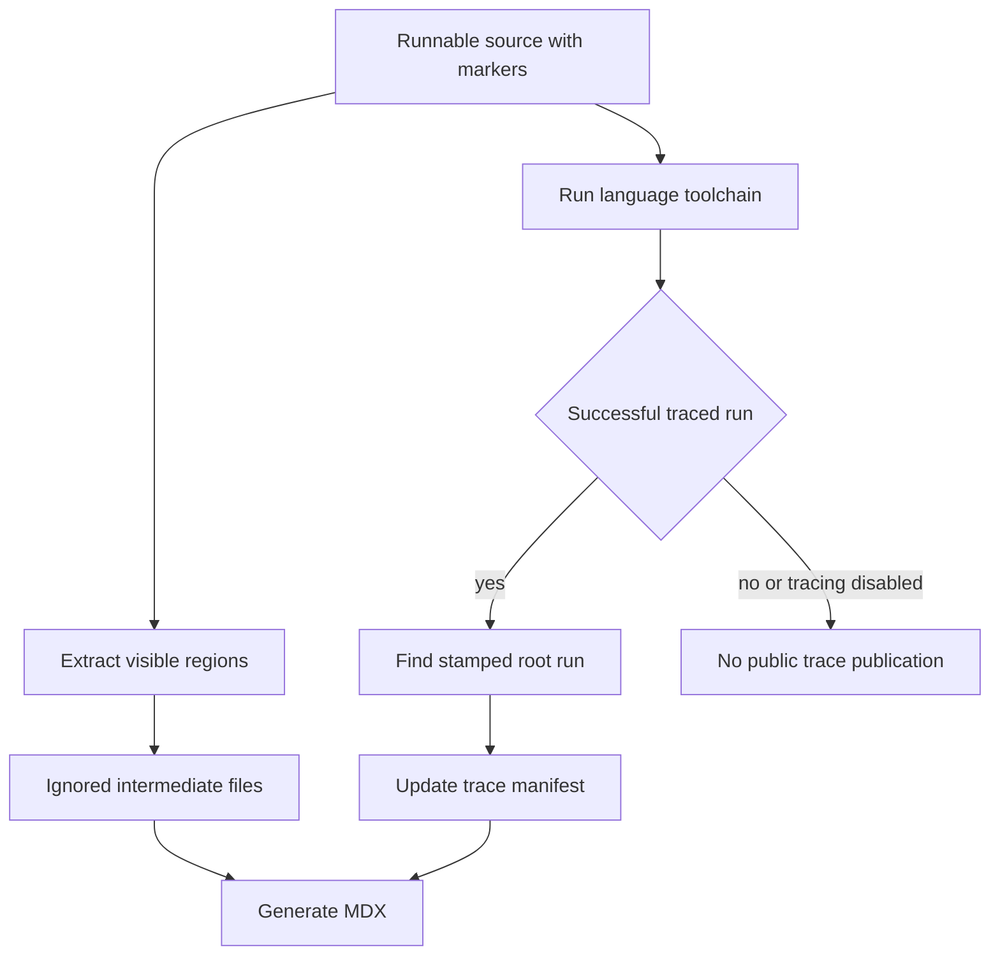
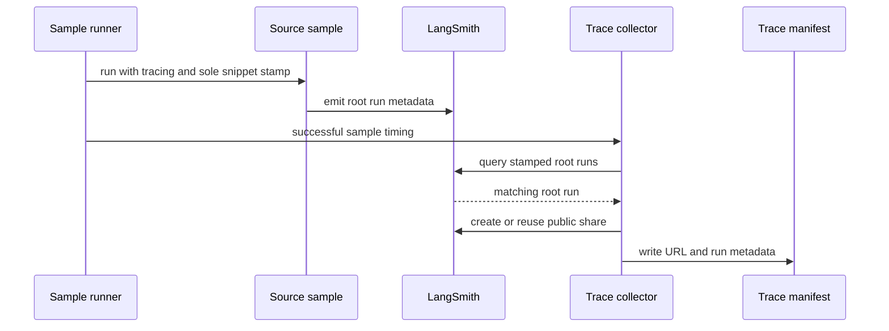

## Ownership and lifecycle

`src/code-samples/` is the executable source of truth. `src/code-samples-generated/` is a gitignored extraction intermediate, and `src/snippets/code-samples/` is generated MDX output. Edit and test the source program, regenerate the derived artifacts, and review the generated MDX diff; do not hand-edit either generated layer.



This shows the executable-source-to-documentation flow. `make code-snippets` performs extraction and rendering; it does not run samples. Trace sharing is a separate, optional post-success publication branch.

## Authoring executable, extractable samples

Supported source extensions are `.py`, `.ts`, `.java`, `.kt`, `.go`, and `.sh`. Put reader-visible code between matching `:snippet-start: <id>` and `:snippet-end:` comment markers: `#` for Python and shell, and `//` for TypeScript, Java, Kotlin, and Go. IDs must carry the matching language suffix: `-py`, `-js`, `-java`, `-kt`, `-go`, or `-sh`. The renderer uses the suffix to choose the output language and skips an extracted ID with the wrong suffix.

The extractor intentionally uses line-based marker recognition rather than a host-language parser. It accepts indented markers, removes matched `:remove-start:` / `:remove-end:` regions from displayed code, dedents the remaining snippet, and fails on an unclosed snippet or removal region. Remove regions affect presentation only: their setup, assertions, cleanup, and harness code still execute when the source file is tested.

Prefer one source file for related snippets on a documentation page, with shared helpers or test-only setup written once. TypeScript is the important exception: the complete `.ts` file runs as one module, including visible regions and remove blocks. Split independently runnable snippets into separate files when duplicate imports or top-level `const`, `let`, class, or function declarations would collide. Keep visible code on an executed path; do not exit before the snippet has exercised its imports, construction, and configuration.

The five `skills-tools-*.ts` Deep Agents samples illustrate this boundary: they are separate single-snippet entry points. Their virtual backend fixtures and validation remain in remove regions while the generated snippets expose integration-wide, fixed-list, per-user, alias-resolver, or deferred-search tool configuration patterns. The agent-building samples place `// KEEP MODEL` before their deliberately selected Anthropic model so renderer expansion does not change it.

## Run the source programs

For focused development:

```bash
make test-code-samples FILES="src/code-samples/deepagents/skills-tools-resolver.ts"
```

`FILES` is a space-separated explicit list. Missing, unsupported, or out-of-tree paths are warned about and omitted. Without it, the runner recursively selects eligible source files, excluding `node_modules` and `__pycache__`.

The runner invokes Python with `uv run python`; TypeScript with `npx tsx` from `src/code-samples/`; Java and Kotlin via JBang pinned to Java 21; Go with `go run` from the shared samples directory; and shell files with `bash`. It passes the parent environment to each subprocess. The default timeout is 1,200 seconds and `CODE_SAMPLE_TIMEOUT_SECONDS` overrides it.

Python uses the repository `uv` project. TypeScript uses the shared `src/code-samples/package.json`; its committed `package-lock.json` records the resolved graph, including the declared Deep Agents runtime and `tsx` execution tool. The Make targets install this package before executing TypeScript samples, so a TypeScript dependency change belongs in the shared package owner and lockfile, not in an individual sample.

The runner uses four workers by default (`CODE_SAMPLE_JOBS` configures it). Per-group locks serialize only the `evaluate-rag-` and `experiment-runs-query-` path families, protecting their shared LangSmith fixtures while unrelated samples remain concurrent. A normal nonzero exit, missing executable, or timeout is a failure.

Recognized LangSmith 429 failures follow a different policy: the runner makes up to five attempts by default. Delay grows linearly from a 30-second base per attempt and is capped at 120 seconds; `CODE_SAMPLE_RATE_LIMIT_ATTEMPTS` and `CODE_SAMPLE_RATE_LIMIT_DELAY_SECONDS` configure those values. An exhausted rate limit is reported as skipped, not passed or failed.

## Extract and render generated snippets

```bash
make code-snippets
```

The target extracts first, writing files such as `<source-stem>.snippet.<snippet-id>.<extension>` beneath `src/code-samples-generated/`, then renders `<snippet-id>.mdx` beneath `src/snippets/code-samples/`. A full extraction clears supported intermediate files before rebuilding them. `CODE_SNIPPET_SOURCES` accepts existing, supported paths under `src/code-samples/` for a focused iteration:

```bash
CODE_SNIPPET_SOURCES="src/code-samples/deepagents/skills-tools-resolver.ts" make code-snippets
```

A partial extraction replaces intermediates for only the selected source stems. Rendering nevertheless scans every intermediate that already exists, so use a full extraction before treating the generated directory as complete repository-wide state.

The renderer emits language fences and supports initial presentation directives: `:codegroup-tab:` chooses a Mintlify CodeGroup tab title and `:codegroup-fence-mods:` supplies fence modifiers. For eligible Python and TypeScript model strings, it expands the first eligible model ID and repeated matching occurrences into seven provider variants: Google, OpenAI, Anthropic, OpenRouter, Fireworks, Baseten, and Ollama. `KEEP MODEL` preserves the next occurrence. Embedding IDs and `model` values passed to provider-specific embedding or chat constructors are not expanded, because substitution would leave non-runnable code.

Provider identifiers are language-specific. TypeScript samples must use `google:` and `googleSearch`; Python samples retain `google_genai:`. Generator tests scan the source sets for incompatible Google spellings and require both declared and lockfile-resolved `@langchain/google` to be at least `0.2.6`, protecting mixed built-in and function-tool examples from failing before a provider request is sent.

## Public trace sharing is a credentialed publication boundary

Normal sample validation does not publish traces. `make update-code-sample-traces` explicitly enables `CODE_SAMPLE_TRACING=1`, selects `LANGSMITH_PROJECT` or the default `docs-code-samples`, runs the samples, and regenerates MDX. It requires `LANGSMITH_API_KEY`. Treat this command as publication of a public LangSmith URL, not as ordinary timing or test telemetry; use only intended credentials and do not place credentials or private trace details in source samples or generated documentation.



This shows the guarded public-trace publication path after a successful sample run.

The sole snippet ID—not timing proximity—establishes eligibility. For an eligible single-snippet source, the runner sets `LANGSMITH_DOCS_SNIPPET`; the collector queries and verifies that metadata on a root run, rather than falling back to a nearby run. It also excludes run IDs already claimed by parallel work. Trace collection occurs under a lock, which protects both that claim set and the shared `src/code-samples/trace-links.json` manifest.

A source with no marker receives no link. A multi-snippet source is recorded in `skipped_multi_snippet` and stale entries for its IDs are removed; splitting is required before it can receive a per-snippet public URL. If a successful single-snippet sample has no matching stamped root run, an old manifest entry is removed rather than retained. A successful match is publicly shared and recorded with source, URL, run and trace IDs, run name, snippet ID, and update time. Generated MDX appends a **View example trace** Card only when the manifest supplies a URL, and removes a stale trailing CTA otherwise.

Only successful samples enter collection. It retries 429 errors using the runner policy, but collection exceptions become warnings and do not convert an already successful sample into a test failure. This allows a refresh to publish the successful subset without representing untraced samples as validated public examples.

## CI maintenance loop

The **Test Code Samples** workflow runs for relevant pull requests, manual dispatch, and at 00:00 UTC on the first day of each month. It skips fork PRs because samples may need repository secrets. Internal PRs test changed eligible sample files; manual and scheduled runs test all samples, provision Python, Node, Java/JBang, Go, and PostgreSQL, and enable tracing. The job timeout is 60 minutes for PR work and 150 minutes for full runs.

The test step continues after errors. On manual or scheduled runs, MDX regeneration proceeds only when the test was not cancelled, fewer than 20 samples failed, and at least one trace entry was updated. If regeneration succeeds, CI considers only `src/code-samples/trace-links.json` and generated snippet MDX for the deterministic `chore/refresh-code-sample-traces` branch: it makes no commit for no diff, otherwise updates an existing PR on that branch or creates one. The final workflow step still fails when ordinary samples failed. A separate observer opens a Linear issue only for failed or cancelled scheduled runs.

## Change checklist

1. Change the runnable source in `src/code-samples/`, never an extraction intermediate or snippet MDX directly.
2. Use matched, language-correct markers and a unique ID with the expected suffix.
3. Keep visible code executable; place assertions, fixtures, cleanup, and non-reader-facing setup in remove regions.
4. Update the shared TypeScript package and lockfile together when a TypeScript dependency changes.
5. Run `make test-code-samples FILES="…"`, then run `make code-snippets`—optionally with `CODE_SNIPPET_SOURCES` while iterating.
6. Review generated output, remembering that partial extraction leaves unrelated intermediates in place.
7. Run trace refresh only with intended credentials and approval to publish a public trace for an unambiguous single-snippet source.

## Related pages

- [Preprocessing](/openwiki/concepts/preprocessing.md)
- [GitHub Actions and CI/CD](/openwiki/integrations/github-actions.md)
- [Agent Skills](/openwiki/operations/agent-skills.md)
- [CLI Tools](/openwiki/operations/cli-tools.md)
- [Testing Overview](/openwiki/testing/test-overview.md)
