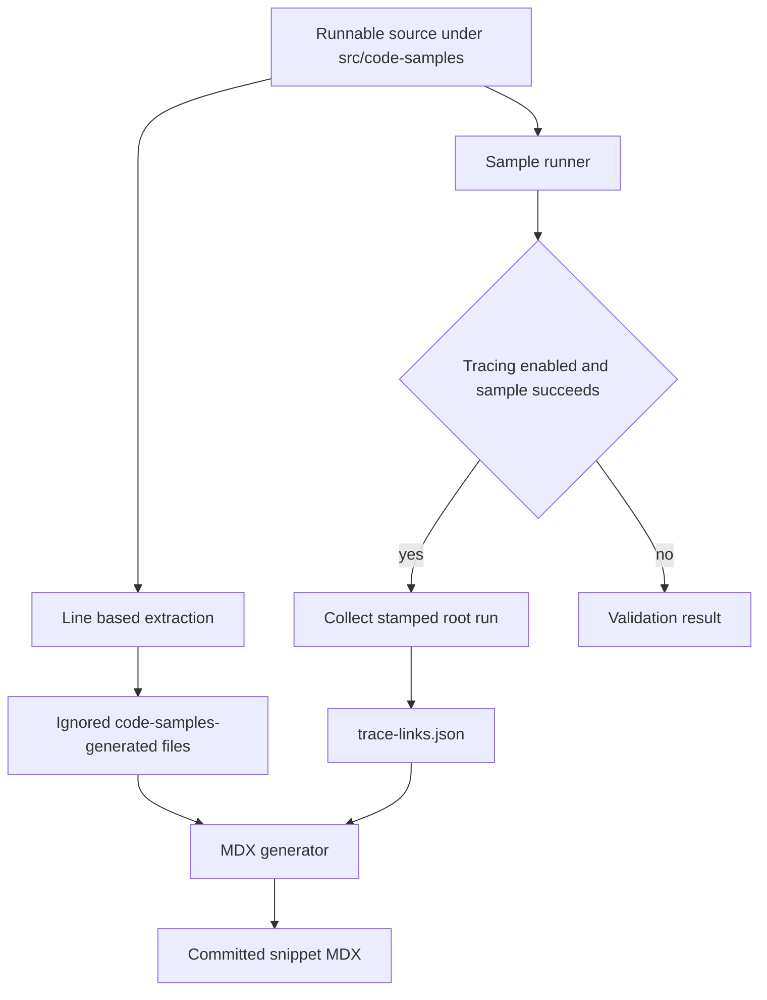
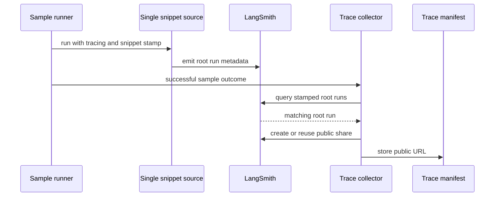

## Source of truth and lifecycle

Runnable documentation examples are authored under `src/code-samples/`, grouped by product. The extracted files in `src/code-samples-generated/` are a gitignored intermediate; the MDX fragments in `src/snippets/code-samples/` are committed generated output consumed by documentation pages. Edit and test the runnable source, then regenerate and review the derived MDX. Do not edit a generated snippet directly.



This is the source-to-docs lifecycle. The ignored intermediate is replaceable build state, while committed MDX is the reviewed documentation artifact.

Two representative source-to-document relationships illustrate the boundary. `async-subagents-answer-waiting.ts` defines the TypeScript helper that reads the subagent thread's pending interrupt and resumes it using the task ID as that thread ID; the async-subagents guide imports its generated fragment. `observability-quickstart-app-openai.py` wraps an OpenAI client and marks both the tool and pipeline with `@traceable`; its generated Python fragment is included in the tracing quickstart. Their generated fragments preserve the visible code but omit source markers and any removed harness code.

## Author runnable regions

A source can contain one or more visible regions delimited by language-appropriate `:snippet-start: <id>` and `:snippet-end:` comment lines. Python and shell use `#`; TypeScript, Java, Kotlin, and Go use `//`. IDs must end in the language suffix (`-py`, `-js`, `-java`, `-kt`, `-go`, or `-sh`): the renderer skips an extracted ID with the wrong suffix.

Extraction is intentionally line based rather than an AST transform. It recognizes indented markers, removes matched `:remove-start:` / `:remove-end:` blocks from the visible body, dedents the result, normalizes newlines, and rejects unclosed snippet or removal markers. Use remove blocks for setup, cleanup, and assertions that make the complete source executable but should not be copied by readers. Do not place an early successful exit before a visible region: the runner must execute the displayed imports, construction, and calls.

Prefer one source for related Python regions, but account for each runtime's scope rules. TypeScript runs as a complete module, including remove blocks; separate independently runnable examples into files when their imports or top-level declarations would collide. A single-snippet source is also the unit eligible for public trace linking; a multi-snippet source is deliberately not linked to one ambiguous trace.

## Execute samples locally

Use the source runner before rendering:

```bash
make test-code-samples FILES="src/code-samples/deepagents/async-subagents-answer-waiting.ts"
make test-code-samples FILES="src/code-samples/langsmith/observability-quickstart-app-openai.py"
```

With `FILES`, the runner accepts only supported files beneath `src/code-samples/`; without it, it recursively selects supported Python, TypeScript, Java, Kotlin, Go, and shell samples. `CODE_SAMPLE_PATHS` further restricts either mode to named directories, which lets CI pass every changed path to each matrix leg while each leg executes only its product. Invalid path filters cannot widen execution outside `src/code-samples/`.

Python executes through `uv run python`. TypeScript runs with `npx tsx` from `src/code-samples/`, whose `package.json` and lockfile are the shared dependency owner; `make test-code-samples` installs that package first. Go and shell also run from that directory, so Go resolves through the shared `go.mod`; Java and Kotlin run through JBang with Java 21. The default sample timeout is 1,200 seconds.

The runner defaults to four workers. It serializes only the `evaluate-rag-` and `experiment-runs-query-` fixture families using per-group locks, leaving unrelated samples concurrent. Recognized LangSmith rate-limit failures are retried up to five total attempts by default, with a linear 30-second base delay capped at 120 seconds; the attempt count and base delay are environment-configurable. An exhaustively rate-limited sample is reported as skipped, whereas ordinary nonzero exits, unavailable executables, and timeouts fail the run.

## Extract and generate MDX

```bash
make code-snippets
```

The target first extracts snippets and then generates MDX. A full extraction deletes supported intermediate files before rebuilding them. `CODE_SNIPPET_SOURCES` supports faster source-specific replacement, but the generator still reads every intermediate that remains, so use a full run before treating the generated tree as a complete refresh.

The generator writes language fences and recognizes optional leading `:codegroup-tab:` and `:codegroup-fence-mods:` presentation markers. For eligible Python or TypeScript routable agent-model strings, it renders a seven-provider CodeGroup and replaces the first eligible model ID and repeated matching occurrences. `KEEP MODEL`, embedding model IDs, and arguments to embeddings or provider-specific chat constructors are intentionally left unchanged so the result remains executable. Google model keys differ by runtime: Python uses `google_genai:`, while TypeScript uses `google:`.

The observability OpenAI example deliberately puts `# KEEP MODEL` immediately before its wrapped client's bare model ID. Rendering strips that marker but does not convert this provider-specific constructor call into a multi-provider CodeGroup, preserving the quickstart's runnable OpenAI code. The generated MDX gives it a `Python` tab from its presentation marker.

Run focused tests when altering filtering or rendering behavior:

```bash
make test TEST_FILE=tests/unit_tests/test_test_code_samples.py
make test TEST_FILE=tests/unit_tests/test_generate_code_snippet_mdx.py
```

The runner-focused tests cover `CODE_SAMPLE_PATHS` selection for full and explicit runs. Generator tests cover model expansion exclusions, language-specific Google conventions, rejection of legacy TypeScript `google_search`, and the declared and resolved `@langchain/google` version floor needed for Gemini tool configuration.

## Optional public trace publication

`make update-code-sample-traces` is an explicit publication operation, not ordinary validation. It enables tracing, selects `LANGSMITH_PROJECT` or the `docs-code-samples` default, runs samples, and regenerates MDX; it requires `LANGSMITH_API_KEY` for meaningful trace collection.



This is the guarded trace-publication path. When tracing is enabled, the runner stamps a source with exactly one safe snippet ID through `LANGSMITH_DOCS_SNIPPET`. After a successful sample only, collection runs under a lock, finds a root run with that exact metadata value, excludes already claimed run IDs, and stores its shared URL in `src/code-samples/trace-links.json`. The renderer appends a **View example trace** Card only when the manifest supplies that URL.

The collector fails closed. Sources with several snippets are recorded as skipped and their stale per-snippet entries are removed. For an otherwise eligible source that produced no stamped root run, any old entry is removed so regeneration removes its stale CTA. Collection retries rate-limit errors with the runner policy, but collection failures are warnings and do not fail a sample suite that otherwise passed.

## CI operations and failure handling

**Test Code Samples** runs for relevant pull requests, manual dispatches, and monthly scheduled runs. Fork PRs are skipped because secrets are unavailable. The workflow has independent `oss` and `langsmith` matrix legs: OSS covers `langchain`, `langgraph`, and `deepagents`; LangSmith covers `langsmith`. It verifies that every top-level sample directory belongs to a leg. Internal PRs identify changed supported sample files from the merge-base diff, and the runner's path filter confines each leg to its product. Manual and scheduled runs test all samples in each leg.

The job provisions PostgreSQL and Python, Node, Java/JBang, and Go. It allows 60 minutes for PR runs and 150 minutes for full runs. Only manual or scheduled **OSS** runs enable tracing and public-share collection, because the collector is intended for LangGraph agent roots rather than LangSmith SDK samples.

The sample step continues after an error to preserve a limited trace refresh path. On an eligible full OSS run, MDX regeneration requires that the test step was not cancelled, ordinary sample failures are fewer than 20, and at least one trace link changed. If regeneration succeeds, the workflow creates or updates `chore/refresh-code-sample-traces` only when `trace-links.json` or generated snippet MDX differs. A final step still fails the job for ordinary sample failures.

A separate `workflow_run` observer handles scheduled failures or cancellations. If `LINEAR_TEAM_KEY` is absent it emits a warning rather than failing. Otherwise it inspects the completed job list and files separate Linear issues for failed OSS and LangSmith legs; if no matrix leg ran, it files a generic pipeline issue.

## Change checklist

1. Change the runnable source under `src/code-samples/`; never make a derived MDX fragment the primary edit location.
2. Keep markers paired, language-correct, and suffix-correct. Put non-reader-facing harness code in remove blocks, but ensure visible code executes.
3. Run the focused source through `make test-code-samples FILES="…"` and update shared manifests and lockfiles when changing dependencies.
4. Run `make code-snippets`, inspect every affected committed fragment, and check the MDX page that imports it.
5. Run the focused runner or generator tests when changing selection, retries, marker handling, or rendering invariants.
6. Use trace publication only for an intended, credentialed, single-snippet agent run that can safely become public.

## Related pages

- [GitHub Actions and CI Automation](/openwiki/integrations/github-actions.md)
- [Agent Skills](/openwiki/operations/agent-skills.md)
- [Local Tooling and Commands](/openwiki/operations/cli-tools.md)
- [Testing and Validation Overview](/openwiki/testing/test-overview.md)
- [LangSmith agent documentation](/openwiki/workflows/langsmith-agent-documentation.md)
