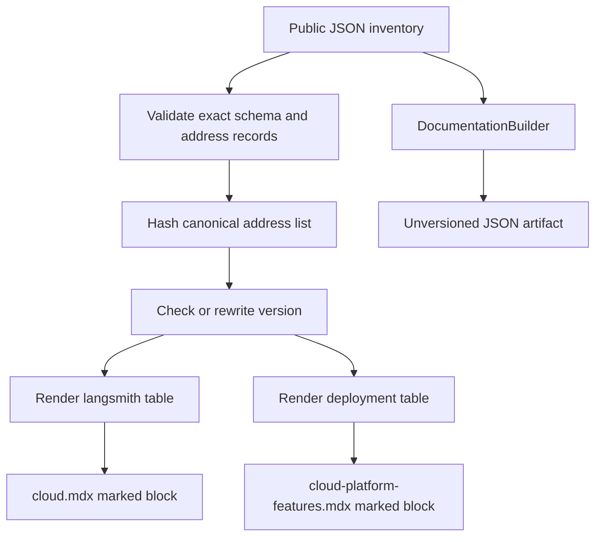

## Purpose and ownership

The egress-IP inventory is the durable, machine-readable source for customer allowlisting. Its owner is `src/langsmith/egress-ip-addresses.json`; the tables in `src/langsmith/cloud.mdx` and `src/langsmith/cloud-platform-features.mdx` are derived display surfaces, not independent sources of network data. The JSON is also the customer automation contract: a build publishes it unchanged at the single unversioned path `/langsmith/egress-ip-addresses.json`.

The two consumers deliberately represent different traffic scopes:

| Inventory selector | Generated page and reader use |
| --- | --- |
| `service: langsmith` | The LangSmith SaaS egress allowlist table in `cloud.mdx`. |
| `service: langsmith-deployment` | The LangSmith Deployment egress allowlist table in `cloud-platform-features.mdx`. |

Both product pages direct automation toward the JSON rather than treating the rendered table as an API. A consumer filters `addresses` by `service`, `cloud`, and `region`, then allowlists **every** matching `cidr`. Addresses can be allocated for future use, so an allowlist must not assume that only currently observed source addresses matter. Pollers compare the content `version`, and operators review additions and removals before changing firewall rules.

## Inventory contract

The top-level JSON object has exactly these fields:

| Field | Contract |
| --- | --- |
| `schema_version` | Integer `1`; other schema versions are rejected. |
| `version` | Nonempty string that must equal the generator's content hash. |
| `addresses` | Nonempty array of egress address records. |

Every record has exactly `service`, `cloud`, `region`, and `cidr`. The supported categorical values are intentionally closed: services are `langsmith` and `langsmith-deployment`; clouds are `gcp` and `aws`; regions are `us`, `eu`, and `apac`. `cidr` must parse as a canonical, globally routable IPv4 network with a `/32` prefix. The validator rejects non-public addresses, wider networks, IPv6, non-canonical CIDRs, unexpected keys, unsupported selectors, and duplicate records with the same complete service/cloud/region/CIDR identity.

Do not copy public IP values into this workflow. Read the current inventory when an operational change is authorized; the schema checks are a guardrail, not authorization to invent an address.

## Generation and drift model



*The generator derives both marked tables and the version from one validated inventory, while the documentation build separately copies that same JSON to its public artifact path.*

`scripts/generate_egress_ip_tables.py` is the sole renderer. It canonicalizes the `addresses` list with sorted object keys and compact JSON separators, then sets `version` to `sha256:` plus the SHA-256 digest of those bytes. The list order remains part of the serialized array and therefore part of the version. A content edit without a regenerated version is drift even if the tables happen to look plausible.

For each service, rendering visits cloud/region combinations in `gcp` then `aws`, and within each cloud `us`, `eu`, then `apac`. It emits only nonempty columns, preserves the inventory order within a column, strips `/32` only for human table cells, and fails if a configured service has no addresses. Thus, JSON retains CIDR semantics while the table is a reader-oriented projection.

The generator requires exactly one pair of these MDX markers in each target page:

```mdx
{/* BEGIN GENERATED EGRESS IP ADDRESSES */}
{/* END GENERATED EGRESS IP ADDRESSES */}
```

It replaces only content between those markers. Missing, repeated, or malformed marker pairs are errors rather than an opportunity to rewrite an ambiguous page.

### Update versus check

| Mode | Behavior | Use it for |
| --- | --- | --- |
| Default | Recomputes and writes a stale `version`, and rewrites only stale generated blocks. | Applying an authorized inventory change. |
| `--check` | Performs the same validation and expected-output comparison, but writes nothing and exits nonzero when the version or either page differs. | Pre-commit, CI, and confirming a clean working tree. |

When checking detects drift, the error names each stale input or target and instructs the maintainer to run the generator. Invalid inventory data or filesystem errors also make the command fail rather than publish partial output.

## Safe operational workflow

1. Obtain and review the authorized egress-address change. Add a record to `src/langsmith/egress-ip-addresses.json` with the correct scope; do not hand-edit its `version` or either generated table. Publish reserved addresses before they carry traffic. Conversely, remove an address only after it no longer carries traffic and has been released; attaching an already-published address needs no inventory change.
2. Regenerate the version and both target blocks from the repository root:

   ```bash
   uv run python scripts/generate_egress_ip_tables.py
   ```

3. Inspect the diff as one atomic change: the inventory data and hash, the SaaS table, and the Deployment table. Confirm each address is scoped to the intended service, cloud, and customer region; do not infer scope from table placement alone.
4. Confirm deterministic cleanliness without modifying files:

   ```bash
   uv run python scripts/generate_egress_ip_tables.py --check
   ```

5. Run the focused regression suite when changing the generator, validation contract, or build placement:

   ```bash
   make test TEST_FILE=tests/unit_tests/test_egress_ip_inventory.py
   ```

6. Commit the JSON and both generated pages together. After release, verify the deployed JSON at `https://docs.langchain.com/langsmith/egress-ip-addresses.json`; it is the integration endpoint consumers poll, not a versioned-language route.

Never “fix” a failing check by editing the Markdown cells, the hash string, or a built artifact. The safe repair boundary is the inventory (for data), the generator (for rendering/validation policy), or the marked-page convention (when changing target structure), followed by regeneration.

## Publication boundary

`DocumentationBuilder.build_all()` recreates the build tree and invokes the unversioned LangSmith build for `src/langsmith`. JSON belongs to the builder's supported copy extensions, whereas MDX is preprocessed. Consequently, the inventory is byte-copied to `build/langsmith/egress-ip-addresses.json`; it is neither duplicated into language-versioned LangSmith routes nor transformed into a generated table. The focused build test asserts byte equality and asserts that this filename occurs exactly once in the build output.

This is a meaningful boundary for integrations: customers can fetch one stable relative URL while maintainers can evolve the two human-readable pages through the same committed source.

## Focused verification and failure diagnosis

`tests/unit_tests/test_egress_ip_inventory.py` exercises the end-to-end contract in a temporary copy. It first checks the committed state, mutates an inventory CIDR, proves that check mode rejects the stale version, runs update mode, and confirms that check mode then passes. It also manually alters a generated table and proves that table drift is detected. Separate cases reject private, non-`/32`, missing-prefix, IPv6, unsupported selector, unexpected-field, and duplicate-record inputs.

The suite also creates a minimal `src` tree, runs `DocumentationBuilder.build_all()`, and verifies byte-for-byte publication at the only expected artifact path. It tests generator and builder behavior locally; it does not authorize new public network addresses or validate external firewall deployment.

Common fixes follow the failed boundary:

- **Schema or public-address failure:** correct the JSON record; do not weaken validation to accept an unpublishable address.
- **Stale version or table:** run the default generator and review its full diff.
- **Marker-count failure:** restore one unambiguous generated region in the affected page, then regenerate; retain surrounding authored prose.
- **Artifact-path failure:** change the builder/copy policy with its test, not the emitted `build/` file.
- **Customer automation concern:** preserve the JSON field contract and content-derived `version`; coordinate removal and allowlist rollout rather than silently replacing values.

## Related pages

- [Repository source map](/openwiki/architecture/source-map.md) — durable-owner and derived-output boundaries.
- [Mintlify integration](/openwiki/integrations/mintlify.md) — generated build-tree and publication boundary.
- [Testing overview](/openwiki/testing/test-overview.md) — selecting the inventory check and focused test.
- [LangSmith agent documentation changes](/openwiki/workflows/langsmith-agent-documentation.md) — broader source-versus-generated documentation discipline.
