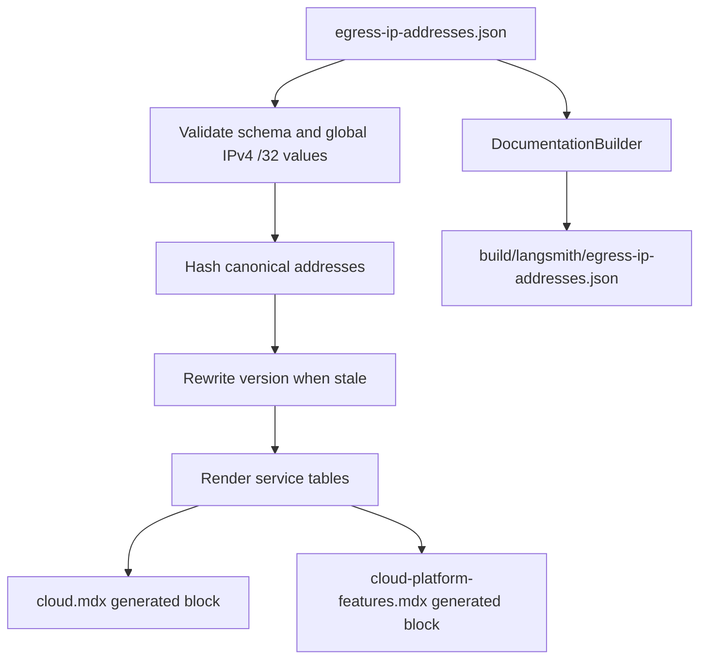

## Ownership and published surfaces

`src/langsmith/egress-ip-addresses.json` is the source of truth for public egress addresses for two services:

- `langsmith` is the LangSmith SaaS list rendered in `src/langsmith/cloud.mdx`.
- `langsmith-deployment` is the separate LangSmith Agent Server list rendered in `src/langsmith/cloud-platform-features.mdx`.

The same JSON is published as-is at `/langsmith/egress-ip-addresses.json` for automation. Do not treat either Markdown table or `build/` as authoritative: the tables are committed generated views, and the build output is disposable.

The Cloud documentation distinguishes egress from ingress. SaaS internet-bound traffic leaves through a NAT gateway, while Agent Server deployments use the separate list; a listed address may be allocated for present or future use.



*This flow shows the inventory's validation, deterministic versioning, generated documentation views, and byte-preserving build publication.*

## Inventory contract and regional data

The generator accepts this top-level shape:

```json
{
  "schema_version": 1,
  "version": "sha256:<content hash>",
  "addresses": [
    {
      "service": "langsmith",
      "cloud": "gcp",
      "region": "us",
      "cidr": "34.59.65.97/32"
    }
  ]
}
```

The example is structural only; use service-owned addresses in the inventory. Validation requires exactly `schema_version`, `version`, and `addresses`; schema version must be `1`, `version` must be a nonempty string, and `addresses` must be nonempty. Every record must contain exactly `service`, `cloud`, `region`, and `cidr`.

| Field | Allowed values / invariant | Effect |
| --- | --- | --- |
| `service` | `langsmith` or `langsmith-deployment` | Selects the owning documentation table. |
| `cloud` | `gcp`, `aws`, or `azure` | Selects the cloud column. Azure is currently represented in the SaaS inventory; the deployment table currently has GCP and AWS entries. |
| `region` | `us`, `eu`, or `apac` | Selects the customer-facing data region used by consumers. |
| `cidr` | Canonical, globally routable IPv4 `/32` | Makes each value a single public address suitable for an allowlist. |

The loader parses CIDRs with strict IPv4 network rules, requires prefix length 32 and canonical string rendering, rejects private/non-global, IPv6, range, missing-mask, unknown-value, and extra-field inputs, and rejects duplicate `(service, cloud, region, cidr)` records before Markdown generation. A service with no records is also a rendering error.

Consumers should fetch the JSON, filter `addresses` by `service`, `cloud`, and `region`, allowlist every matching `cidr`, and poll `version` for changes. This includes allocated reserve addresses: publish a reserve before it carries traffic, and do not remove an address until it has stopped carrying traffic and has been released.

## Generation and drift detection

Run these commands from the repository root after changing the JSON:

```bash
uv run python scripts/generate_egress_ip_tables.py
uv run python scripts/generate_egress_ip_tables.py --check
```

Normal mode loads and validates the inventory, computes the expected version, and rewrites the inventory version and generated blocks when stale. Check mode writes nothing; if the stored version or either table differs, it fails with the stale path(s) and tells the maintainer to run the normal command.

The version is deterministic: `sha256:` followed by the SHA-256 digest of `addresses` serialized as sorted-key, compact JSON. Address-content changes therefore change the version; presentation formatting outside that canonical representation does not.

Rendering iterates clouds in GCP, AWS, then Azure order and regions in US, EU, then APAC order. It emits only populated cloud/region columns for that service, removes `/32` from displayed values, and uses blank cells to align uneven columns. It raises an error when a service has no populated columns.

Each owner page must contain exactly one literal marker pair:

```mdx
{/* BEGIN GENERATED EGRESS IP ADDRESSES */}

{/* END GENERATED EGRESS IP ADDRESSES */}
```

The generator replaces only the material between those markers. Missing, duplicated, or malformed marker structure is an error. Never hand-edit table cells or the `version` field; regeneration is the repair path.

## Safe update lifecycle

1. Change `src/langsmith/egress-ip-addresses.json`, including the correct service, cloud, and customer region—not a rendered table.
2. Publish new reserve addresses before using them. An already-published address can be attached without an inventory change; remove an address only after traffic has stopped and the address is released.
3. Run normal generation and review the JSON plus both generated owner pages. Commit all three together.
4. Run `--check` as the no-write convergence gate.
5. When validating the documentation build, inspect the public artifact, never patch its disposable output.

`DocumentationBuilder.build_all()` builds LangSmith as unversioned content. Its supported-extension copy path preserves JSON bytes, so a full build produces exactly one `build/langsmith/egress-ip-addresses.json` whose bytes match the source inventory. The public path is therefore a publication boundary, not a second data store.

## Tests and failure triage

The focused suite is `tests/unit_tests/test_egress_ip_inventory.py`:

- it starts from a clean copied fixture, detects an address-induced version mismatch, verifies normal regeneration converges, and detects manual table drift;
- it rejects private, non-/32, missing-mask, IPv6, invalid service/cloud/region, and extra-field records;
- it rejects duplicate scoped records; and
- it verifies that a full `DocumentationBuilder` build publishes exactly one byte-for-byte JSON artifact.

Run it directly with:

```bash
uv run pytest tests/unit_tests/test_egress_ip_inventory.py -vv
```

The repository test workflow runs `make test`, which executes the unit-test suite and includes the egress check. For a hash or table failure, correct the canonical JSON or permitted metadata and regenerate; do not repair generated output manually. For a marker or schema failure, restore the one-block page contract or valid JSON shape first. The separate pull-request external-documentation workflow runs `scripts/check-legacy-doc-links.sh` for Markdown or MDX changes; that retired-link scan is independent of egress hash and table drift detection.

For broader repository conventions, see [Testing Overview](/openwiki/testing/test-overview.md) and [Source map](/openwiki/architecture/source-map.md).
