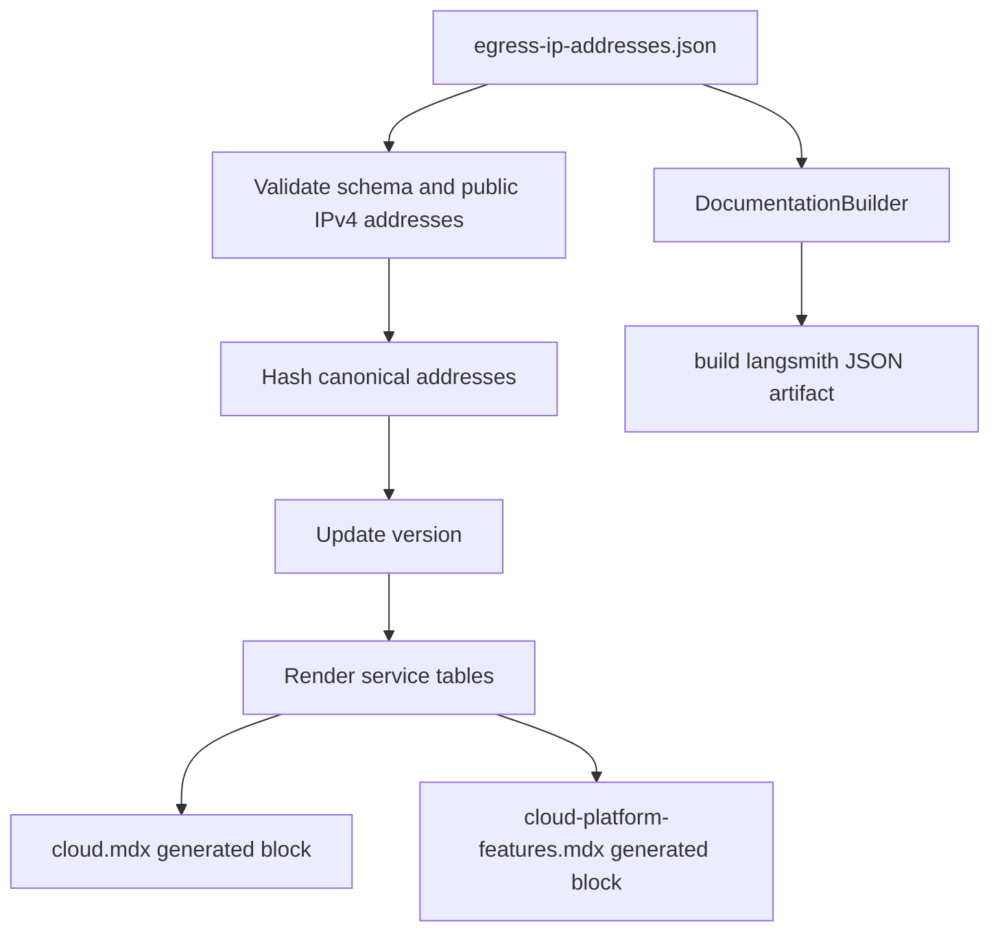

## Ownership and published surfaces

`src/langsmith/egress-ip-addresses.json` is the single source of truth for public egress addresses for two distinct services:

- `langsmith` is the public LangSmith SaaS egress list displayed in `src/langsmith/cloud.mdx`.
- `langsmith-deployment` is the separate deployed-agent egress list displayed in `src/langsmith/cloud-platform-features.mdx`.

The JSON is also the automation interface. The Cloud page tells consumers to filter its `addresses` array by `service`, `cloud`, and `region`, allowlist every matching `cidr`, and compare `version` when polling for changes. The lists are egress lists, not the unrelated ingress addresses in the Cloud page.

Do not treat either rendered Markdown table or `build/` as a source. The tables are committed generated views, while the build recreates an unversioned public artifact at `/langsmith/egress-ip-addresses.json`.



*This flow shows how one inventory feeds the generated human-readable tables and the machine-readable LangSmith artifact.*

## Inventory contract

The generator accepts only this top-level shape:

```json
{
  "schema_version": 1,
  "version": "sha256:<content hash>",
  "addresses": [
    {
      "service": "langsmith",
      "cloud": "gcp",
      "region": "us",
      "cidr": "34.59.65.97/32"
    }
  ]
}
```

The example is structural only; use only real service-owned addresses in the inventory. Validation requires **exactly** the three top-level keys and a nonempty string `version` plus a nonempty `addresses` array. Each address object must contain exactly `service`, `cloud`, `region`, and `cidr`:

| Field | Allowed values / invariant | Why it matters |
| --- | --- | --- |
| `service` | `langsmith` or `langsmith-deployment` | Selects one of the two owning pages and prevents an unrenderable service category. |
| `cloud` | `gcp` or `aws` | Controls the rendered cloud/region column. |
| `region` | `us`, `eu`, or `apac` | Identifies the customer-facing region used for filtering. |
| `cidr` | Canonical, globally routable IPv4 `/32` | Prevents private, IPv6, range, and noncanonical data from becoming an allowlist instruction. |

A tuple of all four fields must be unique. Validation parses each CIDR with strict IPv4 network rules, requires prefix length 32 and canonical string rendering, and rejects addresses that are not global. It also rejects unknown field values and additional or missing keys before it renders Markdown.

## Generation and drift detection

Run the generator from the repository root after changing the JSON:

```bash
uv run python scripts/generate_egress_ip_tables.py
uv run python scripts/generate_egress_ip_tables.py --check
```

Normal mode loads and validates the inventory, computes `version`, and rewrites only stale durable generated content: the `version` field and the table blocks in both owner pages. Check mode makes no writes. It fails if either the stored hash or a table differs from expected output, naming stale paths and directing the maintainer to run the normal command.

The version is deterministic rather than a manually managed release number: it is `sha256:` followed by the SHA-256 digest of `addresses` serialized as sorted-key, compact JSON. Consequently, an address-content change must change the version; formatting outside that canonical address representation does not define the version.

For each service, rendering iterates clouds in GCP then AWS order and regions in US, EU, APAC order. It emits a column only when that service has entries for the cloud/region, strips `/32` in the human table, and vertically aligns uneven address lists with blank cells. A service without any inventory entries is an error.

Each target must contain exactly one literal pair of these markers:

```mdx
{/* BEGIN GENERATED EGRESS IP ADDRESSES */}

{/* END GENERATED EGRESS IP ADDRESSES */}
```

The generator replaces the material strictly between them. Missing, duplicated, or edited marker structure is a generation error; do not add a second generated block to a target. Do not hand-edit the hash or table cells, because the next check or regeneration will expose or overwrite that drift.

## Safe update lifecycle

1. **Change the inventory, not a table.** Add, amend, or remove an address with the service, cloud, and customer region that consumers use to filter it.
2. **Respect egress rollout ordering.** Publish new reserve addresses before they carry traffic. An already-published address can be attached without an inventory change; remove an address only after it no longer carries traffic and has been released.
3. **Regenerate and review all three source changes.** Normal generation may update the JSON's hash and both pages even when the operational change affects one service. Commit the inventory and both generated pages together.
4. **Run the no-write gate.** Use `--check` after regeneration; it proves that schema-valid input, version, and generated tables converge.
5. **Verify the public build boundary when relevant.** A full documentation build copies supported non-Markdown files from unversioned LangSmith source content, including this JSON, to `build/langsmith/egress-ip-addresses.json` without transforming its bytes. Never patch that disposable output.

Consumers should allowlist every matching CIDR, including allocated reserve addresses that may be used later, and should review additions and removals before changing firewall rules. This is why an apparently unused published entry is not necessarily removable.

## Public documentation checks

The repository's test workflow runs `make test`, which executes the unit-test suite. The focused egress tests cover the generator's no-write check path and the build publication boundary. Separately, the pull-request workflow `check-external-doc-links.yml` runs `scripts/check-legacy-doc-links.sh` when Markdown or MDX documentation changes; it scans source docs for links to retired documentation sites. That link-hygiene check does not replace the egress generator's hash and table drift check.

## Tests and failure triage

The focused suite is `tests/unit_tests/test_egress_ip_inventory.py`. It proves four distinct boundaries:

- a copied repository fixture is clean in `--check` mode; mutating an address makes the version stale, normal generation converges it, and manual table edits are detected;
- private CIDRs, ranges, missing masks, IPv6, invalid service/cloud/region values, and extra address fields fail validation;
- duplicate scoped address records fail validation; and
- a full `DocumentationBuilder` build publishes exactly one JSON artifact at `build/langsmith/egress-ip-addresses.json` with byte-for-byte source equality.

Run the focused test during development with:

```bash
uv run pytest tests/unit_tests/test_egress_ip_inventory.py -vv
```

`make test` runs the unit-test suite used by CI, and its egress tests exercise the same check path. For a table/hash failure, do not repair the output manually: correct the canonical JSON or its permitted metadata, run the generator without `--check`, and commit the resulting files. For marker or schema errors, restore the one-block page contract or valid JSON shape first; regeneration cannot choose a safe replacement boundary or infer missing metadata.

For broader repository conventions, see [Testing Overview](/openwiki/testing/test-overview.md) and [LangSmith agent documentation workflow](/openwiki/workflows/langsmith-agent-documentation.md).
