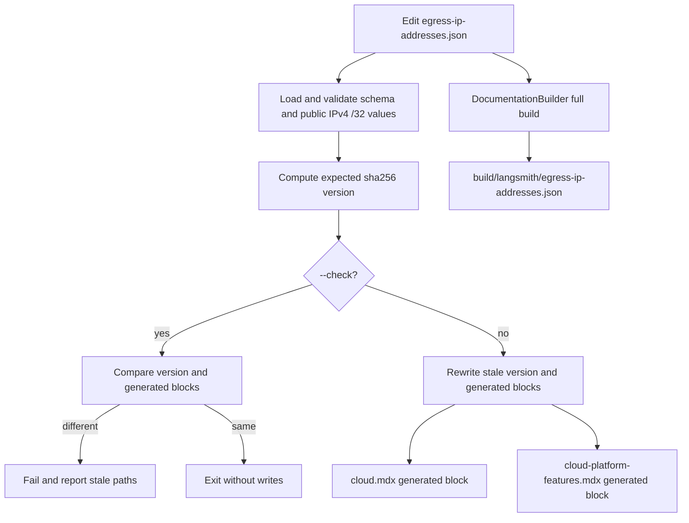

## Ownership and published surfaces

`src/langsmith/egress-ip-addresses.json` is the canonical source for public egress addresses for two rendered services:

- `langsmith` is the LangSmith SaaS list rendered in `src/langsmith/cloud.mdx`.
- `langsmith-deployment` is the LangSmith Agent Server list rendered in `src/langsmith/cloud-platform-features.mdx`.

The same JSON is published as-is at `/langsmith/egress-ip-addresses.json` for firewall and allowlist automation. The Markdown tables are committed generated views; `build/` is disposable output and is not an authority.

The Cloud documentation distinguishes egress from ingress. Internet-bound traffic from LangSmith services uses a NAT gateway, while Agent Server deployments use the separate service list. A listed address can be allocated for present or future use, so consumers should allowlist every matching address rather than only addresses currently observed in traffic.



*This flow shows validation, deterministic drift detection, safe regeneration, and byte-preserving build publication.*

## Inventory contract

The loader accepts this top-level shape:

```json
{
  "schema_version": 1,
  "version": "sha256:<content hash>",
  "addresses": [
    {
      "service": "langsmith",
      "cloud": "gcp",
      "region": "us",
      "cidr": "34.59.65.97/32"
    }
  ]
}
```

Validation requires exactly the top-level fields `schema_version`, `version`, and `addresses`. `schema_version` must be the integer `1`; `version` must be a nonempty string; and `addresses` must be nonempty. Each address record must contain exactly `service`, `cloud`, `region`, and `cidr`.

| Field | Allowed values / invariant | Effect |
| --- | --- | --- |
| `service` | `langsmith` or `langsmith-deployment` | Selects the owner page and generated table. |
| `cloud` | `gcp`, `aws`, or `azure` | Selects the cloud column. The current SaaS inventory includes Azure; deployment entries currently render GCP and AWS columns. |
| `region` | `us`, `eu`, or `apac` | Selects the customer-facing data region. |
| `cidr` | Canonical, globally routable IPv4 `/32` | Represents one public address suitable for an allowlist. |

CIDRs are parsed as strict IPv4 networks. The loader rejects private or otherwise non-global values, IPv6, non-`/32` networks, missing masks, non-canonical spellings, unknown service/cloud/region values, extra fields, and duplicate `(service, cloud, region, cidr)` records. Rendering also fails if either rendered service has no addresses.

Consumers should fetch the JSON, filter `addresses` by `service`, `cloud`, and `region`, allowlist every matching `cidr`, and poll `version` for changes. This includes allocated reserves: publish a reserve before using it; attaching an already-published address needs no inventory edit; remove an address only after traffic has stopped and the address has been released.

## Generated-page contract and drift checks

Each owner page must contain exactly one literal generated marker pair:

```mdx
{/* BEGIN GENERATED EGRESS IP ADDRESSES */}

{/* END GENERATED EGRESS IP ADDRESSES */}
```

The generator replaces only the material between those markers. Missing, duplicated, or malformed marker structure is an error. Rendering iterates clouds in GCP, AWS, then Azure order and regions in US, EU, then APAC order. It emits only populated cloud/region columns for that service, removes `/32` from displayed values, and pads uneven columns with blank cells.

The stored `version` is not hand-maintained. Normal generation computes `sha256:` followed by the SHA-256 digest of `addresses` serialized as sorted-key, compact JSON. Address-content changes therefore change the version; formatting outside that canonical representation does not. In normal mode, a mismatch rewrites the inventory version and both generated blocks. In `--check` mode, nothing is written: a stale version or table raises an error naming the stale path or paths and the repair command.

## Safe update procedure

From the repository root:

```bash
uv run python scripts/generate_egress_ip_tables.py
uv run python scripts/generate_egress_ip_tables.py --check
```

1. Edit `src/langsmith/egress-ip-addresses.json`, including the correct service, cloud, region, and canonical CIDR—not a rendered table.
2. Publish new reserve addresses before using them. Remove an address only after it has stopped carrying traffic and has been released.
3. Run normal generation, then review the JSON and both generated owner pages.
4. Commit the inventory and both generated pages together; never edit table cells or `version` by hand.
5. Run `--check` as the no-write convergence gate.
6. After deployment, verify the public JSON at `https://docs.langchain.com/langsmith/egress-ip-addresses.json`.

`DocumentationBuilder.build_all()` builds LangSmith as unversioned content. Its supported-extension copy path preserves JSON bytes, so a full build produces exactly one `build/langsmith/egress-ip-addresses.json` whose bytes match the source inventory. The build artifact is a publication check, not a second data store.

## Focused tests and failure triage

The focused suite is `tests/unit_tests/test_egress_ip_inventory.py`. It starts from a clean copied fixture, verifies clean and stale check-mode behavior, checks regeneration convergence, and detects manual table drift. It rejects private, non-`/32`, missing-mask, IPv6, invalid service/cloud/region, extra-field, and duplicate records. It also verifies that a full `DocumentationBuilder` build publishes exactly one byte-for-byte JSON artifact.

Run it directly with:

```bash
uv run pytest tests/unit_tests/test_egress_ip_inventory.py -vv
```

The repository test workflow runs `make test`, which executes the unit-test suite and includes the egress check. For a hash or table failure, correct the canonical JSON or permitted metadata and regenerate; do not repair generated output manually. For a marker or schema failure, restore the one-block page contract or valid JSON shape first.

The separate pull-request external-documentation workflow runs `scripts/check-legacy-doc-links.sh` for Markdown or MDX changes and scans source documentation for links to retired documentation sites. That link-hygiene check is independent of egress inventory hash and generated-table drift detection.

For broader repository conventions, see [Testing Overview](/openwiki/testing/test-overview.md) and [Source map](/openwiki/architecture/source-map.md).
