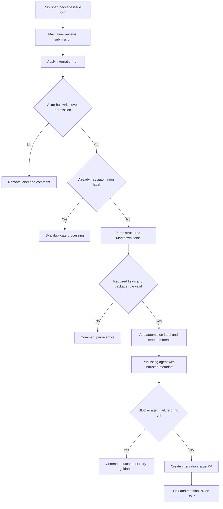
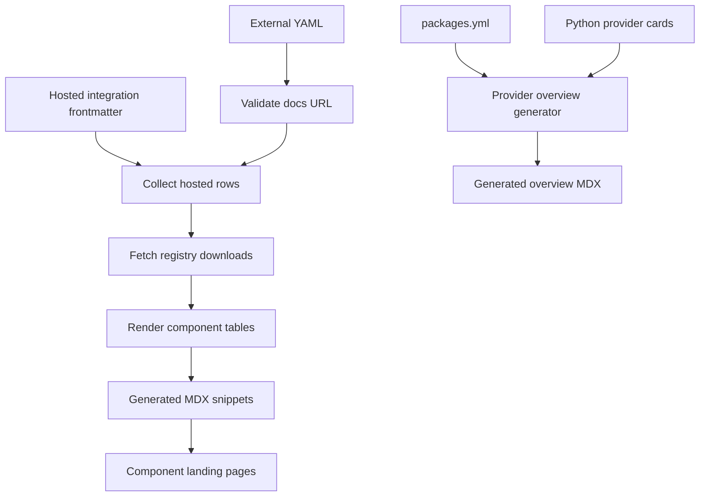
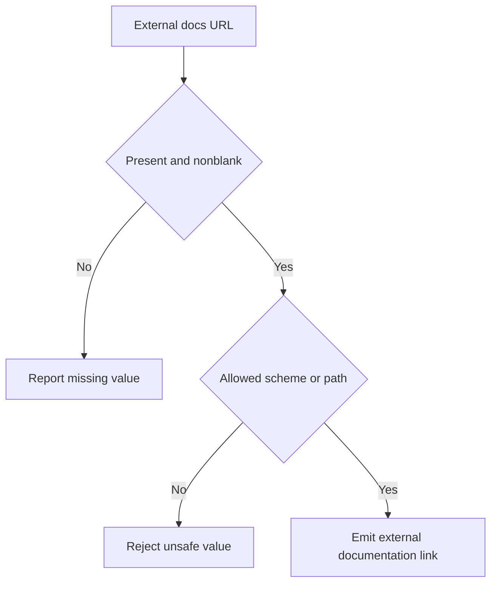
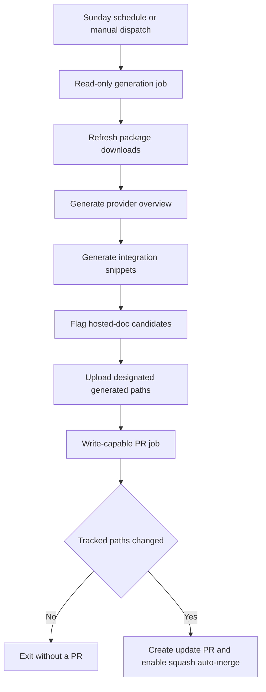
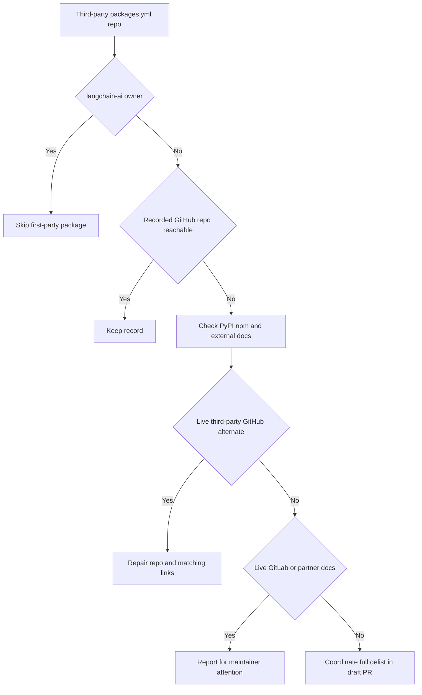

# Integration Listing Automation

Integration discovery has two distinct public surfaces:

- **Component download tables** merge hosted-guide frontmatter with external-listing metadata and are rendered into snippets consumed by integration landing pages.
- The **Python provider overview** is generated independently from `packages.yml` and, where applicable, the authored Python provider-card catalog.

Treat rendered snippets and `src/oss/python/integrations/providers/overview.mdx` as **generated outputs, not inputs**. Correct their metadata or generator and regenerate them. The repository-health scanner is a narrow operational exception: it can directly repair or remove stale generated table rows in the same reviewed change as the underlying listing mutation; regenerate afterward to verify convergence.

## Eligibility and owned inputs

A hosted MDX integration guide requires either at least **50,000 monthly PyPI or npm downloads** or a maintainer feature decision. The threshold does not authorize setting `featured: true` by itself. Integrations below that boundary receive an **external listing** that links to partner-owned documentation rather than a new hosted guide. When a guide becomes hosted, remove its duplicate external entry.

| Owner | What it controls | Safe change |
| --- | --- | --- |
| `scripts/data/integration_external_docs.yaml` | External rows grouped by language and component: display name, registry package, `docs_url`, and component metadata | Add, correct, or remove the row. Prefer partner docs, then a public repository, then the registry page. |
| Hosted integration MDX frontmatter | `integration:` metadata below `src/oss/{python,javascript}/integrations/` | Correct hosted-guide metadata; do not patch the rendered table. |
| `packages.yml` | LangChain package and repository records, download data, and maintainer-only `highlight` | Correct package metadata. `highlight` bypasses the provider-overview download filter and sorts ahead of ordinary packages. |
| `src/oss/{python,javascript}/integrations/providers/all_providers.mdx` | Authored provider-card catalogs | Maintain cards as discovery content. Both catalogs are authored, but only the Python catalog is read by the provider-overview generator. |

External YAML is the canonical input for external language/component rows. `refresh_integration_downloads.py` merges it with hosted `integration:` frontmatter. An external row must have a display `name` and safe `docs_url`; its `pypi` or `npm` field supplies download data when available. External names link to `docs_url`; hosted names link to their LangChain route.

## Intake through maintainer authorization

The **Integration listing** issue form is the normal entry point after a package is published. It applies `integration-submission` and `integration` labels and requests a display name, language, component, package name, docs URL, a short provider description, and optional capability notes. Python/Both submissions need a PyPI package and TypeScript/Both submissions need an npm package. The form tells contributors that a maintainer must apply `integration-run`; opening an issue alone cannot start the privileged automation.



This is the trust and control-flow boundary: maintainer authorization and deterministic parsing precede the agent; the workflow—not the agent—owns GitHub side effects after the agent returns.

`integration-submission.yml` serializes attempts in a non-cancelling per-issue concurrency group. For a label event, it accepts only an `integration-run` action by an actor with `admin`, `maintain`, or `write` permission; manual dispatch is checked the same way. The persistent `integration-automation` label prevents a marked issue from being processed again.

The parser maps known `###` issue-form headings to stable JSON fields, strips form checkbox comments, validates required values and language/package combinations, and never evaluates the submitted text. The workflow passes the resulting JSON to Deep Agents explicitly as **untrusted literal metadata**. URLs, descriptions, and capability notes are listing data, not instructions.

The `submit-integration` skill measures downloads and chooses the hosted or external path without waiting for an author response. It must leave changes uncommitted and must not push, open a PR, or comment. A provider-card description is limited to 160 characters; longer input is reduced to one factual sentence without inventing capabilities. Only hard blockers should create `integration-submission-error.md`.

A blocker file, unsuccessful agent, or no diff produces an issue comment instead of a PR. Failed-agent and no-change comments instruct a maintainer to remove `integration-automation` and reapply `integration-run` to retry; a blocker comment posts the blocker contents for follow-up. For real edits, the workflow mints its App token **after** the agent step, creates `integration/issue-<number>`, and includes review checks for the eligibility decision, docs URL/provider card, and relevant YAML, table, package, or hosted-MDX surfaces. It then links the PR on the source issue and mentions the author on both.

### External PR safeguard

External contributors are redirected to the issue form rather than opening a manual listing PR. `external-integration-pr-comment.yml` uses `pull_request_target`, but it does not check out or execute fork code: it reads changed-file and head-file content through GitHub APIs. For a non-bot external author, an added integration MDX file (other than `TEMPLATE.mdx`) or any change to external-listing YAML receives the `integration` label.

For each newly added MDX page, the workflow accepts a maintainer `featured: true` declaration or verifies its declared PyPI/npm package at 50,000 monthly downloads. If no added page is eligible—including an external-YAML-only PR—it posts one marker-idempotent redirect comment and closes the open PR. A frontmatter or download-verification error fails before the closure path, rather than treating an unverifiable page as eligible. Internal members and configured internal bots are excluded.

## Metadata-to-table generation



This shows the separate input paths for component-table snippets and the provider overview.

`refresh_integration_downloads.py` scans supported Python and JavaScript component directories, excluding indexes, templates, and example data. It merges hosted and external rows, then sorts available download counts descending and names secondarily; unavailable counts sort last. It emits an all-rows snippet for each nonempty component and a featured snippet for chat or a component with featured rows. Python component landing pages import these snippets, so the files are public documentation inputs even though they are generated.

Table schemas are component-specific: chat has capability fields; middleware and retrievers have their own metadata columns; vectorstore capability columns appear only when at least one row declares them. Capability and download cells contain numeric sort values for client-side sorting.

Run from the repository root:

```bash
uv run python scripts/refresh_integration_downloads.py --write
```

Without `--write`, the command prints tables. `--language` and `--component` restrict generation to supported values or `all`. Review the regenerated diff for language, component, link, capability, and unavailable-download behavior; repair metadata or generator code and rerun rather than retaining a hand-patched snippet. The submission skill currently includes instructions to add snippet rows, but the generator header and scheduled regeneration make those rows derived data; a post-submission regeneration is therefore required to make metadata authoritative.

### URL validation and resilient download collection

External URLs are untrusted input. A `docs_url` may be `https://`, `http://`, or a site-relative path beginning with exactly one `/`. Protocol-relative `//…` paths and other schemes—such as `javascript:`, `data:`, and `vbscript:`—are rejected.



This boundary prevents external metadata from becoming an unsafe generated link.

During collection, an external row with a missing URL is skipped with a warning, while an unsafe URL raises an error. The dedicated validation mode reports both missing and unsafe YAML values before network calls or writes:

```bash
uv run python scripts/refresh_integration_downloads.py --check-docs-urls
```

CI runs that command in a read-only job. Focused tests cover allowed and disallowed schemes, unsafe-link fallback, repository-YAML validation, and Markdown cell normalization.

Download lookup is best effort: npm and PyPI fetches retry HTTP 429 up to six times with exponential backoff. Per-run caching avoids refetching a registry/package pair. Other request, parsing, or missing-data failures make that row unavailable instead of aborting table collection.

## Provider overview

`pipeline/tools/partner_pkg_table.py` generates `src/oss/python/integrations/providers/overview.mdx` from `packages.yml`. It excludes configured core packages, includes packages with at least 100,000 downloads unless `highlight` is set, sorts highlighted packages first and then by downloads, and limits output to 50 rows. A package cannot combine `has_reference_docs: true` with `integration: false`.

Provider destinations resolve in priority order: an absolute `provider_page` in `packages.yml`; a hosted provider page from a configured slug or short package name; a matching Python `all_providers.mdx` card href, including an external URL; the declared repository; then PyPI. Update the owning package metadata or authored card and run:

```bash
uv run python pipeline/tools/partner_pkg_table.py
```

CI regenerates the overview and fails if it differs from the checked-in file, directing a change to `packages.yml` or `partner_pkg_table.py`, never to the generated overview.

## Scheduled download refresh and promotion follow-up



This flow shows the privilege boundary: generation has read-only contents permission and the later job alone can write a branch and pull request.

`update-package-downloads.yml` runs at 23:59 UTC every Sunday and can be dispatched manually. It refreshes `packages.yml`, generates the Python provider overview, and regenerates integration snippets. The package refresher rejects duplicate package names, does not refetch records updated within 24 hours, records a missing Pepy badge as zero, and timestamps records it refreshes.

The artifact handoff is intentionally narrow: only `packages.yml`, the Python provider overview, and generated `*-downloads.mdx` and `*-featured.mdx` snippets reach the write-capable job. If those tracked paths have no diff, it exits without a PR. Otherwise it creates a timestamped `chore/update-package-downloads-…` branch, opens the maintenance PR, and enables squash auto-merge.

The same run flags external integrations at the 50,000-download threshold for hosted-doc follow-up. The flagger is dry-run unless both `LINEAR_API_KEY` and `LINEAR_TEAM_KEY` are configured. Before creating a Linear issue, it searches a stable title fragment that omits the changing download count, avoiding duplicate open work.

## Weekly third-party repository health

The independent **Check integration repos** workflow runs at 09:15 UTC each Monday or by manual dispatch. It runs `scripts/check_integration_repos.py --write --evidence "$RUNNER_TEMP/evidence.md"`, appends that Markdown evidence to the job summary, and proceeds to PR handling only if the scan leaves a working-tree change.

The health target is each `packages.yml` `repo` field. The scanner skips `langchain-ai/*` first-party repositories. A missing or malformed repo field, GitHub request failure, or uncertain live alternative is **attention**, not a destructive mutation. Its YAML loader preserves formatting and tolerates duplicate keys so a bad merge does not stop the weekly scan from reporting other findings.



This is the decision boundary for a dead third-party GitHub repository: a missing GitHub page alone never authorizes delisting.

| Outcome | Condition | Mutation |
| --- | --- | --- |
| Safe repair | A different live third-party GitHub repository is corroborated by PyPI, npm, or external docs; a live normalized `owner//repo` typo also qualifies. | Update `packages.yml` `repo` and matching GitHub links in Python provider cards and current download snippets. Never retarget automatically to `langchain-ai/*`. |
| Permanent URL repair | A unique external `docs_url` returns an HTTP 301 or 308 redirect to a different non-registry HTTP(S) URL. | Update external YAML and matching Python-card and current-snippet links. Temporary 302/307 redirects are ignored. |
| Attention | A live GitLab project, partner docs/home page, or only a first-party GitHub alternate remains; malformed/missing repo data and request errors are also attention. | Do not change the listing; include evidence for maintainer review. |
| Full delist | No live third-party GitHub, GitLab, or partner-docs alternate remains. | Remove package and related listing surfaces together in the reviewed draft PR. |

A full delist removes the package record, matching external YAML rows, and matching download-table rows. It removes a Python provider card only when no remaining package shares the normalized `name_short` provider key, preserving shared cards. Without `--write`, the script reports the proposed summary but leaves the working tree unchanged.

When the workflow finds changes, it snapshots them, restores a clean checkout, and either checks out the existing open `chore/dead-integration-repos` branch or creates it from `main`. It reapplies the snapshot, commits, and creates or updates one draft PR, `chore: fix or delist integrations with dead GitHub repos`. Later scans append to that same open draft and refresh its evidence body; none of these repair or delisting changes auto-merge.

For local inspection, run dry first and opt into mutations only after reviewing evidence:

```bash
uv run python scripts/check_integration_repos.py
uv run python scripts/check_integration_repos.py --write --evidence /tmp/evidence.md
```

## Safe change procedure

1. Decide external versus hosted from measured registry downloads and a maintainer feature decision. Do not invent downloads or capabilities.
2. Change the owning input—external YAML, hosted frontmatter, `packages.yml`, an authored provider card, or generator code—not a derived table or overview.
3. Validate external URLs:

   ```bash
   uv run python scripts/refresh_integration_downloads.py --check-docs-urls
   ```

4. Regenerate affected snippets with `--write`; regenerate the provider overview when package metadata, Python provider-card matching, or its generator changes.
5. Review the generated diff. When URL validation or rendering changes, run:

   ```bash
   uv run pytest tests/unit_tests/test_refresh_integration_downloads.py
   ```

## Related pages

- [Source Directory Map](/openwiki/architecture/source-map.md)
- [GitHub Actions and CI/CD](/openwiki/integrations/github-actions.md)
- [Adding pages](/openwiki/operations/adding-pages.md)
- [Agent skills](/openwiki/operations/agent-skills.md)
- [Testing overview](/openwiki/testing/test-overview.md)
