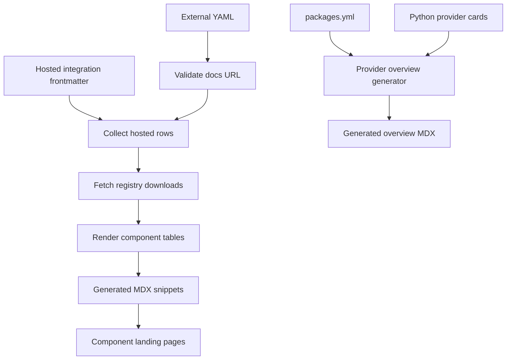
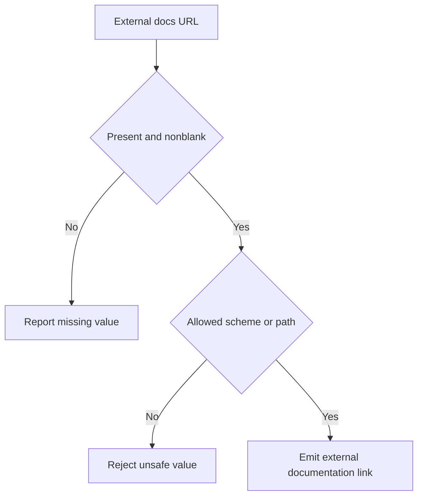
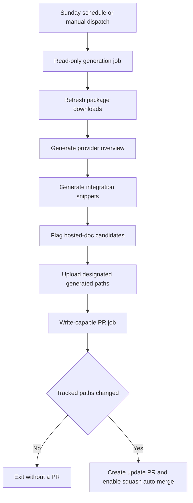
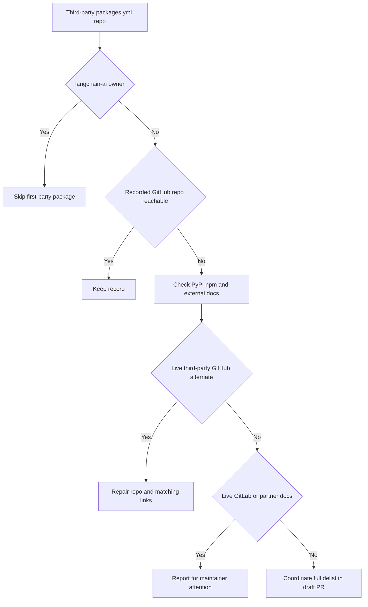
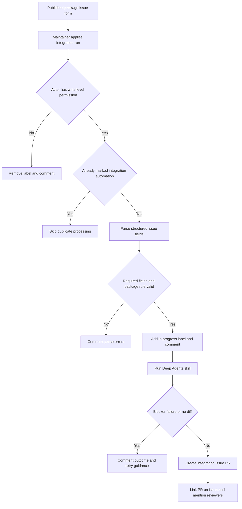

# Integration Listing Automation

Integration discovery has two separate derived surfaces: component download tables and the Python provider overview. Maintainers change the metadata or authored provider cards that own an input, then run the applicable generator. Do **not** hand-edit generated integration snippets under `src/snippets/oss/` or `src/oss/python/integrations/providers/overview.mdx`; correct an owning input or generator and regenerate.

## Listing boundary and source ownership

A package with at least 50,000 monthly PyPI or npm downloads, as verified by the workflow, or an explicit maintainer featured decision, is eligible for a hosted MDX guide. The threshold does not itself authorize `featured: true`. Integrations below that boundary use an external listing that links to partner-owned documentation. When a listing becomes a hosted guide, remove the duplicate external YAML row.

| Owner | Controls | Safe change |
| --- | --- | --- |
| `scripts/data/integration_external_docs.yaml` | External rows grouped by language and component: display name, registry package, `docs_url`, and applicable component metadata | Add, correct, or remove the external row. Prefer partner docs, then a public repository, then the registry page. |
| Hosted integration MDX frontmatter | `integration:` metadata found below `src/oss/{python,javascript}/integrations/` | Correct hosted-guide metadata, not the rendered table. |
| `packages.yml` | LangChain package and repository records, download data, and maintainer-only `highlight` | Correct package metadata. `highlight` bypasses the provider-overview download filter and sorts before ordinary packages. |
| `src/oss/{python,javascript}/integrations/providers/all_providers.mdx` | Authored provider-card catalogs | Maintain cards as discovery content. The Python catalog is also an input to provider-overview link resolution; a matching card may supply an external provider destination. |

External YAML is the canonical metadata source for external language/component rows. The table generator merges those rows with hosted `integration:` frontmatter. An external row needs a display `name` and a safe `docs_url`; `pypi` or `npm` supplies download data when available. It links the displayed name to `docs_url`, whereas a hosted row links to its LangChain route.

## Metadata-to-table flow



This shows the separate input paths for component-table snippets and the provider overview.

`refresh_integration_downloads.py` scans the supported Python and JavaScript component directories, excluding indexes, templates, and example-data files. It collects hosted rows and external rows, then sorts available download counts descending and names secondarily; unavailable counts sort last. The generator emits an all-rows snippet for a component with rows and emits a featured snippet for chat or for a component with featured rows. Component landing pages import these snippets—for example, Python chat and document loaders—so the generated files are public documentation inputs.

Table shape is component-specific: chat has capability fields; middleware and retrievers have their respective metadata columns; and vectorstore capability columns appear only when at least one row declares that capability. Capability and download cells carry numeric sort values, allowing stable first-paint and offline ordering while the client can refresh badges.

Run from the repository root:

```bash
uv run python scripts/refresh_integration_downloads.py --write
```

Without `--write`, the command prints tables. `--language` and `--component` restrict generation to supported values or `all`. Review regenerated output for language, component, links, capabilities, and unavailable-download handling; repair metadata or generator logic and rerun rather than patching a generated row.

### URL validation is a pre-emission boundary

External URLs are untrusted input. A `docs_url` may be `https://`, `http://`, or a site-relative path beginning with exactly one `/`. Protocol-relative `//…` paths and other schemes, including `javascript:`, `data:`, and `vbscript:`, are rejected.



This boundary prevents external metadata from becoming an unsafe generated link.

During collection, a missing external URL is warned about and its row is skipped; an unsafe URL raises an error. The dedicated validation mode reports both missing and unsafe YAML values before network calls or writes:

```bash
uv run python scripts/refresh_integration_downloads.py --check-docs-urls
```

CI runs that command in a read-only job. The focused tests cover accepted and rejected schemes, unsafe-link fallback, validation of repository YAML, and Markdown cell normalization.

Download lookup is best-effort. npm and PyPI fetches retry HTTP 429 up to six times with exponential backoff. The process caches results by registry/package during a run; other request, parsing, and missing-data failures degrade that row to unavailable download data rather than aborting collection.

## Provider overview: a separate derived surface

`pipeline/tools/partner_pkg_table.py` generates `src/oss/python/integrations/providers/overview.mdx` from `packages.yml`. It excludes configured core packages, includes a package at 100,000 downloads or one marked `highlight`, sorts highlighted packages first and then by downloads, and limits output to 50 entries. `has_reference_docs: true` together with `integration: false` is invalid.

Provider destinations resolve in priority order: an absolute `provider_page` in `packages.yml`; a hosted provider page from a configured slug or short package name; a matching Python `all_providers.mdx` card href, including an external URL; the declared repository; then PyPI. Update the metadata or authored card that owns the destination, then run:

```bash
uv run python pipeline/tools/partner_pkg_table.py
```

CI regenerates the overview and fails if it differs from the checked-in file, directing a change to `packages.yml` or `partner_pkg_table.py`, never to the generated overview.

## Scheduled refresh and promotion follow-up



This shows the privilege boundary: generation has read-only contents permission, while the later job can write a branch and pull request.

`update-package-downloads.yml` runs at 23:59 UTC every Sunday and can be dispatched manually. It refreshes `packages.yml`, then generates the provider overview and integration snippets. The package refresher rejects duplicate package names, avoids refetching records updated within 24 hours, records a missing Pepy badge as zero, and timestamps refreshed records.

The artifact handoff is intentionally narrow: only `packages.yml`, the Python provider overview, and generated `*-downloads.mdx` and `*-featured.mdx` snippets reach the write-capable job. It exits when those tracked paths have no diff; otherwise it creates a timestamped `chore/update-package-downloads-…` branch, opens a PR, and enables squash auto-merge.

The same run flags external integrations at the 50,000-download threshold for hosted-doc follow-up. The flagger accepts `--threshold`; it is a dry run unless both `LINEAR_API_KEY` and `LINEAR_TEAM_KEY` are configured. Before it creates a Linear issue, it searches a stable title fragment that excludes the changing download count, avoiding duplicate open work.

## Third-party repository-health scan

The independent **Check integration repos** workflow runs at 09:15 UTC on Monday or by manual dispatch. It has write and pull-request permissions because its output can repair or remove records, unlike the read-only generation stage of the download refresh. It runs `scripts/check_integration_repos.py --write --evidence "$RUNNER_TEMP/evidence.md"`; the evidence report is both appended to the Actions job summary and used as the eventual draft PR body.

The scan deliberately considers only a package's `packages.yml` `repo` field as the health target. It skips every `langchain-ai/*` first-party repository rather than attempting to repair or delist it. Empty or malformed repository values, request failures, and uncertain live alternatives are **attention**, not destructive changes. The scanner preserves YAML quoting and tolerates duplicate YAML keys so a bad merge does not prevent the scheduled scan from reporting other findings.

### Evidence and dispositions

For a third-party GitHub `owner/repo`, a reachable GitHub response is **ok**. When it is missing, the scanner gathers candidate evidence from PyPI `project_urls` and home page, the npm `repository` field when the package declares `js`, and external-listing `docs_url` entries associated with either the PyPI or npm package name. It deduplicates candidates before choosing a disposition.



This is the decision boundary for a dead third-party GitHub repository; a missing GitHub page alone is never sufficient to delist a package.

| Outcome | Condition | Mutation |
| --- | --- | --- |
| Safe repair | A different live third-party GitHub repository is corroborated by PyPI, npm, or external docs; this also covers a live normalized `owner//repo` typo. | Update `packages.yml` `repo` and replace matching GitHub URLs in the Python provider cards and generated download snippets. The checker never auto-retargets to `langchain-ai/*`. |
| Permanent URL repair | A unique external `docs_url` completes an HTTP 301 or 308 redirect to a different non-registry HTTP(S) URL. Temporary 302/307 redirects are ignored. | Update the external YAML `docs_url` and matching href text in the Python provider cards and generated download snippets. |
| Attention | The GitHub repo is gone but a live GitLab project, live partner documentation/home page, or only a first-party GitHub alternate remains; malformed/missing repo data and request errors also land here. Registry pages and the known dead GitHub URL do not count as a partner-docs home. | No listing change; the evidence report identifies it for maintainer review. |
| Full delist | No live third-party GitHub, GitLab, or partner-docs alternate can be found. | Remove the package and related listing surfaces together, but only in the reviewed draft PR. |

Permanent redirects and verified alternate homes therefore have distinct handling: a 301/308 repairs the listing URL itself, while a live GitLab or partner site prevents automatic delisting but does not silently rewrite `repo`. A verified third-party GitHub replacement is the only alternate that auto-repairs the GitHub repository field.

### Coordinated delist and listing invariants

A full delist removes the package from `packages.yml`, external YAML rows whose `pypi` or `npm` matches the removed package, and Markdown rows in every `src/snippets/oss/*-downloads.mdx` that reference its PyPI, Pepy, npm, or dead-GitHub marker. It also removes a matching card from the **Python** `all_providers.mdx` catalog only if no remaining package has the same normalized provider key (`name_short`). This avoids removing a shared provider card when another package still represents that provider. Repo and permanent-docs repairs similarly rewrite matching Python cards and download-table URLs, keeping authored listing links and current generated snippets aligned.

The script scans external documentation URLs separately from package findings, so a permanent redirect can be repaired even if no package repository needs a change. It prints its Markdown evidence on every run. With no actionable repo repair, delist, or docs redirect it exits successfully without mutations; without `--write` it reports the proposed summary and explicitly remains a dry run.

### Draft PR lifecycle and operation

Destructive changes remain reviewable. When the workflow detects a working-tree diff, it snapshots only changed paths, restores a clean checkout, then either checks out the existing open `chore/dead-integration-repos` branch or creates it from `main`. It reapplies the snapshot, commits, and creates or updates one **draft** PR titled `chore: fix or delist integrations with dead GitHub repos`. Later scans append commits to that same open PR and replace its body with fresh evidence; they do not auto-merge it. If no diff remains after restoration, no commit or PR is created.

Run a local inspection first, then opt into mutations only after reviewing the evidence:

```bash
uv run python scripts/check_integration_repos.py
uv run python scripts/check_integration_repos.py --write --evidence /tmp/evidence.md
```

Review every proposed full delist, the candidate source noted in the evidence, all coordinated files, and regenerated-table implications before merging the draft. The health checker directly edits existing snippets to keep the listing consistent at removal time; subsequently running the normal generators is the safe way to verify that metadata-derived output remains stable.

## External contribution and issue intake policy

External contributors should use the Integration listing issue form, not a manual PR for a new listing. `external-integration-pr-comment.yml` runs as `pull_request_target` for non-draft PR updates. It only uses GitHub API data about changed files and PR-head file content; it does not check out or execute fork code. This boundary is essential because both fork-head frontmatter and issue-form fields are untrusted data.

For a non-bot external author, the PR workflow detects added integration files (excluding `TEMPLATE.mdx`) or a change to the external-listing YAML and applies the `integration` label. It evaluates each newly added MDX file as eligible only when its frontmatter says `featured: true` or its declared PyPI/npm package can be fetched and verified at 50,000 monthly downloads. If any added MDX file is eligible, the workflow does not redirect or close the PR. A PR that only changes external-listing YAML, or whose new MDX files are not eligible, is redirected to the issue form with one marker-protected comment and is closed when open. A failed frontmatter or download verification fails the workflow before this closure path; it does not treat an unverifiable guide as eligible. Internal members and configured internal bots are not redirected by this workflow.

### Maintainer-authorized issue lifecycle

The issue workflow is separate. An `integration-run` label event is eligible to proceed only when the actor has `admin`, `maintain`, or `write` permission; otherwise the workflow removes that label and tells the author that a maintainer must apply it. A manual `workflow_dispatch` run is also permission-checked. Issue creation alone cannot start the privileged agent. A non-cancelling per-issue concurrency group serializes attempts, and the `integration-automation` label causes already-marked issues to be skipped.



This flow shows that authorization and parsing happen before the agent receives untrusted metadata, while GitHub feedback and PR creation are workflow-owned steps after it returns.

The parser maps recognized issue-form headings to JSON and validates required fields and language/package combinations without evaluating the supplied values. Parse errors are reported on the issue. The workflow passes the structured fields to the agent as untrusted literal metadata; the agent must leave edits uncommitted and must not push, create a PR, or comment.

A blocker file, failed agent, or no diff yields an issue comment rather than a PR; failed-agent and no-change feedback explains that a maintainer can remove `integration-automation` and reapply `integration-run` to retry. When edits exist, the workflow creates `integration/issue-<number>` with review checks for eligibility, URL/provider card, and generated surfaces; it then links and mentions the PR on the source issue.

## Safe change procedure

1. Decide whether the integration is external or hosted from measured registry downloads and a maintainer feature decision. Do not invent download counts or capabilities.
2. Change the owning input—external YAML, hosted frontmatter, `packages.yml`, an authored provider card, or generator code—not a derived output.
3. For external metadata, validate URLs:

   ```bash
   uv run python scripts/refresh_integration_downloads.py --check-docs-urls
   ```

4. Regenerate affected snippets with `--write`; regenerate the provider overview when package metadata, Python provider-card matching, or its generator changes.
5. Review the generated diff. When validation or table rendering changes, run:

   ```bash
   uv run pytest tests/unit_tests/test_refresh_integration_downloads.py
   ```

## Related pages

- [Source Directory Map](/openwiki/architecture/source-map.md)
- [GitHub Actions and CI/CD](/openwiki/integrations/github-actions.md)
- [Quickstart](/openwiki/quickstart.md)
- [Testing overview](/openwiki/testing/test-overview.md)
