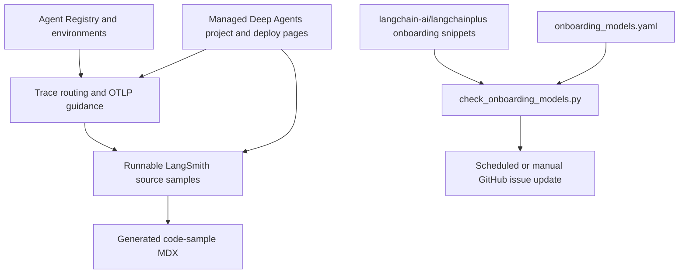

## Scope and ownership

This workflow connects several documentation surfaces without treating them as one implementation. The Agent Registry defines the workspace-level agent and environment model; trace-routing pages explain how SDK and OTLP clients address it; Managed Deep Agents (MDA) pages explain local and hosted execution; runnable sources keep language examples executable; and a repository checker monitors model IDs in onboarding snippets owned by `langchain-ai/langchainplus`.



This diagram shows the documented dependency flow: product-owned pages and sample sources are inputs to the documentation surface, while onboarding snippets remain an external read-only integration monitored by this repository.

Edit the source that owns the behavior, then inspect its consumers:

| Concern | Authoritative repository source | Consumer boundary |
| --- | --- | --- |
| Agent identity and environments | `src/langsmith/agent-registry.mdx`, `src/langsmith/agent-environments.mdx` | Registration, resolution, routing, and UI guidance |
| SDK and OTLP routing | `src/langsmith/log-traces-to-agent.mdx`, `src/langsmith/trace-with-opentelemetry.mdx`, and `src/snippets/langsmith/otlp-agent-addressing-note.mdx` | Language samples and endpoint examples |
| MDA project inputs and deployment | `src/langsmith/managed-deep-agents-project-structure.mdx` and `src/langsmith/managed-deep-agents-deploy.mdx` | Local development, hosted deployment, Context Hub, secrets, and schedules |
| Runnable examples | `src/code-samples/langsmith/` | Generated `src/snippets/code-samples/` imports |
| Onboarding model freshness | `scripts/check_onboarding_models.py` and `scripts/data/onboarding_models.yaml` | External `langchainplus` snippets and a standing issue |

The repository does not own the onboarding snippet files. The YAML names the external repository, branch, and paths; the checker reads them and reports stale IDs. It never edits those files. Treat a finding as an issue to fix in `langchainplus`, not as permission to patch a local copy.

## Agent model and destination invariants

An agent is a workspace-level organization unit. Each trace belongs to one agent and exactly one of the fixed environments: Production, Staging, Development, or Local. An identifier is set at creation and is immutable; a display name is editable and does not change trace routing. Agents created outside Studio start with all four environments, while a Studio-built agent starts with Production and creates another environment when first addressed.

Registration is setup rather than application startup. Programmatic creation requires a PAT or service key with `projects:create`, not a tracing key. The creation response supplies each environment's `tracer_session_name` and `tracer_session_id`; an existing or archived identifier returns `409`. For older project-shaped integrations, use the returned `tracer_session_name` as `project_name`, and use `tracer_session_id` or the resolved `session_id` for APIs with `project_id` or `project_ids`. These values must be read from the environment, not derived from an agent name.

An agent address is an identifier plus an environment. Code configuration takes precedence over `LANGSMITH_AGENT_ID` and `LANGSMITH_AGENT_ENVIRONMENT`; the variables are considered only when code supplies no destination. A partial variable pair warns and leaves otherwise unaddressed calls untraced. Agent addressing is available for Cloud agent-based workspaces. Project-based workspaces, including self-hosted LangSmith, use project settings; self-hosted ingestion with an agent address is rejected with `403`.

Keep destination dialects exclusive. Agent variables combined with `LANGSMITH_PROJECT`, `LANGCHAIN_PROJECT`, or `LANGCHAIN_SESSION` warn and suppress calls without an explicit code destination. Passing `address` and `project_name` together errors in SDK calls, and ingestion rejects requests containing both address types. A code-level `project_name` override is the intentional exception used by destinations such as evaluations.

For OTLP, routing is carried by both `Langsmith-Agent-Id` and `Langsmith-Agent-Environment` headers, not by span attributes. The Python exporter derives both from the agent variables only when `OTEL_EXPORTER_OTLP_HEADERS` is unset; TypeScript and other exporters must set them. Partial headers, mixed project-and-agent headers, and unsupported self-hosted requests are rejected. Project-based workspaces use `Langsmith-Project` instead.

Endpoint shape is a separate concern. `OTEL_EXPORTER_OTLP_ENDPOINT` is a base URL to which OTLP/HTTP appends `/v1/traces`; `OTEL_EXPORTER_OTLP_TRACES_ENDPOINT` and a collector `traces_endpoint` are used exactly as supplied. Do not put `/v1/traces` in the generic base variable, or the exporter produces a duplicate path and a `404`. The focused endpoint test checks both forms and scans documentation for the invalid generic pattern.

## Runnable language samples

The trace-routing samples are source files, not independent documentation implementations. Python demonstrates `ls.agent_address(...)` in a decorator and `tracing_context`; TypeScript uses `new AgentAddress(...)` in `traceable` configuration; Java uses `new AgentAddress(...)` in a `TraceConfig` builder. Their `:remove:` blocks keep executable assertions or validation outside the rendered snippet while the visible region remains a runnable example.

The generated fragments are derived artifacts. `make code-snippets` extracts marked regions from `src/code-samples/` and generates MDX; `make test-code-samples` executes selected runnable sources. Do not repair a generated fragment by hand. A source with several snippets is intentionally excluded from public trace-link publication because one source does not identify one unambiguous trace.

Use the source-level checks when changing this surface:

```bash
make test-code-samples FILES="src/code-samples/langsmith/log-traces-to-agent.py"
make test-code-samples FILES="src/code-samples/langsmith/log-traces-to-agent.ts"
make test-code-samples FILES="src/code-samples/langsmith/TraceAgentExample.java"
make code-snippets
```

Review the MDX page that imports the regenerated fragment, but keep the runnable source as the edit location. The broader sample lifecycle also owns marker extraction, language suffixes, execution selection, and optional public trace publication; those concerns are documented in [Runnable Code Samples and Snippet Generation](/openwiki/workflows/code-sample-lifecycle.md).

## Managed Deep Agents: local versus hosted

An MDA project is a normal Python or TypeScript package with one root agent entry: `agent.py` exporting a named `agent` created with `define_deep_agent`, or `agent.ts`/`agent.tsx` exporting a named `agent` created with `defineDeepAgent`. Managed paths such as `identity`, `memory`, direct children of `channels` and `schedules`, `tools/mcp`, and `sandbox` enable managed capabilities; other modules are application code imported by the entrypoint. `instructions.md` and `skills/` are managed context synchronized to Context Hub. Dependencies live in `pyproject.toml` or `package.json`, and non-reserved `.env` values can become deployment secrets.

`mda dev` validates and compiles the project into `.mda/build`, copies local environment and identity configuration, creates a local Context Hub mock, starts the language-specific LangGraph development server, and opens Studio. It does not create or update a hosted deployment; source changes require stopping and rerunning it. Local runs target the agent's Local environment and `{name}-local`. In an agent-based workspace those traces are rejected until a matching agent record exists, although Studio chat still works. Local identity, temporary sandbox fallback, and non-provisioned schedules are development defaults, not production behavior.

`mda deploy` is the hosted path. It compiles the project, syncs `instructions.md` and `skills/` to Context Hub, archives source from `.mda/build`, forwards non-reserved environment values as hosted secrets, and reconciles schedules after the deployment is live. `--no-wait` exits before the deployed state and therefore skips schedule reconciliation. The deploy page also owns region, BYOC, deployment-type, Python-version, reserved-secret, and failure semantics; do not infer those from the local-development page.

The project-structure page is the authority for which files are discovered and which are ordinary imports. The deploy page is the authority for what crosses the hosted boundary. When changing either, check both local execution and the resulting Agent Server deployment rather than treating `.mda/build` as a hosted artifact.

## External onboarding model monitoring

`scripts/data/onboarding_models.yaml` declares the external source `langchain-ai/langchainplus`, the `main` ref, the onboarding snippet paths, provider preferred models, current model IDs, and explicit ignores such as the speech-to-text `gpt-4o-mini-transcribe`. A listed model also permits its dated snapshot form. The registry is configuration and policy; it does not contain the snippets.

`scripts/check_onboarding_models.py` validates the registry, restricts repository and path inputs, reads either the external GitHub contents or a local checkout supplied with `--repo-dir`, detects provider-shaped IDs, and reports each non-current ID with a preferred replacement. It exits `0` when all scanned models are current, `1` for findings, and `2` when registry or input data cannot be read. The checker deliberately avoids false positives for package names, prose OpenAI o-series mentions, and configured ignores.

The scheduled or manually dispatched workflow supplies read-only access to `langchainplus`, publishes the report in the job summary, and opens, updates, or closes the standing issue **Outdated models in LangSmith onboarding snippets**. A stale onboarding model is therefore an external product-content dependency: update the source snippets and related product documentation in their owning repository, then let the next check confirm freshness.

Run the checker locally when changing its parser or registry policy:

```bash
uv run python scripts/check_onboarding_models.py
uv run pytest tests/unit_tests/test_check_onboarding_models.py
```

The focused tests cover provider-prefix detection, dated snapshots, false-positive exclusions, safe source validation, local-checkout reads, registry validity, and exit behavior. They do not prove that the external GitHub files are reachable; the scheduled workflow owns that integration check.

## Change checklist

1. Change registry or environment behavior in the current LangSmith source pages, then reconcile registration, resolution, routing, and UI terminology.
2. For routing changes, verify code precedence, partial variables, project conflicts, Cloud versus self-hosted behavior, OTLP header pairing, and base versus per-signal endpoint semantics.
3. For a sample change, edit the marked runnable source, run it, regenerate snippets, and inspect importing MDX. Do not edit generated output.
4. For MDA changes, keep `mda dev` distinct from `mda deploy`; verify the root entrypoint, managed paths, Context Hub, secrets, Local traces, and schedule timing.
5. For onboarding model changes, update the registry policy only when the external snippet contract changes; use the checker and its focused tests, and route snippet fixes to `langchainplus`.

## Related pages

- [Documentation Route and Language Versioning](/openwiki/concepts/versioning.md)
- [Reference Documentation Boundaries](/openwiki/integrations/reference-docs.md)
- [Runnable Code Samples and Snippet Generation](/openwiki/workflows/code-sample-lifecycle.md)
<!-- openwiki: broken internal link [/langsmith/agent-registry] file "/langsmith/agent-registry" does not exist. Fix the href or restore the target, then delete this comment. -->
- [Agent Registry](/langsmith/agent-registry)
<!-- openwiki: broken internal link [/langsmith/log-traces-to-agent] file "/langsmith/log-traces-to-agent" does not exist. Fix the href or restore the target, then delete this comment. -->
- [Log traces to an agent](/langsmith/log-traces-to-agent)
<!-- openwiki: broken internal link [/langsmith/managed-deep-agents-deploy] file "/langsmith/managed-deep-agents-deploy" does not exist. Fix the href or restore the target, then delete this comment. -->
- [Deploy a Managed Deep Agent](/langsmith/managed-deep-agents-deploy)
