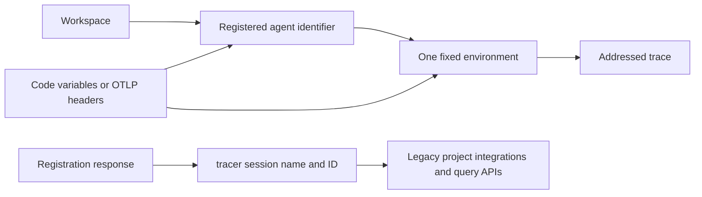

## Scope and ownership

This workflow maintains a *connected documentation contract*, not a duplicate of LangSmith product documentation. The authored LangSmith MDX pages explain different parts of one model: an agent has an immutable identifier, traces are addressed to that identifier **and** one environment, and an environment has legacy trace-storage identities for APIs and integrations that still speak in projects. Keep those statements coherent wherever the model is introduced, configured, queried, or shown in a framework integration.

| Surface | Durable owner | Safe change action | Do not treat as source |
| --- | --- | --- | --- |
| Agent, environment, registration, addressing, resolution, concepts, quickstart, and framework-integration narrative | Authored `src/langsmith/*.mdx` and authored reusable `src/snippets/langsmith/*.mdx` / `src/snippets/*.mdx` | Edit the page or shared snippet that owns the rule; revise its consumers when a shared statement changes. | A rendered route beneath `build/`. |
| Agent-registration display fragments | Marked regions in `src/code-samples/langsmith/create-an-agent.py` | Change, run, and regenerate from the executable source. | `src/code-samples-generated/` and the committed fragment MDX as primary inputs. |
| Committed display fragments | `src/snippets/code-samples/create-agent-py.mdx` and `agent-environment-project-py.mdx` | Commit regenerated output and inspect it with the importing guide. | Handwritten replacement for the executable example. |
| LangSmith REST reference input | `src/langsmith/langsmith-platform-openapi.json`, generated by `scripts/process_langsmith_openapi.py` | Change processor policy or the service contract, then regenerate and review through the dedicated refresh path. | Individual JSON operations or endpoint MDX. |
| REST endpoint pages | Mintlify deployment configured in `src/docs.json` | Verify a preview or deployed site. | Deployment-generated `/langsmith/smith-api` endpoints and `build/`. |

The repository builder emits ordinary `src/langsmith/` pages once below `/langsmith/`; these are not Python/JavaScript route pairs. `src/docs.json` separately projects the agent setup pages, observability pages, resolution page, and the OpenAPI reference into navigation. When a change adds, removes, moves, or renames a page, make the navigation/redirect decision explicitly rather than assuming the source file or a menu label supplies it.

## The invariant to preserve



*An agent address selects an environment for trace ingestion, while that environment supplies compatibility identities for older project-shaped consumers.*

The following are cross-page invariants, and a change to any one requires checking the affected connected pages and snippets:

1. **Address is a pair.** An agent identifier and environment identify the destination together. The fixed vocabulary is `local`, `development`, `staging`, and `production` for code configuration; neither member alone supplies a default destination. Explicit SDK address configuration wins over environment variables.
2. **Identifier is not display name.** Registration establishes a stable, immutable identifier; the display name is editable. Guides and examples must route with the identifier and must not suggest constructing it from a label.
3. **Creation is setup, not request-path work.** Programmatic creation needs a setup credential with `projects:create`; tracing thereafter can use a tracing key. A duplicate identifier returns `409`, and an archived identifier remains unavailable.
4. **Environment storage is the compatibility bridge.** An environment yields `tracer_session_name` for integrations requiring `project_name` and `tracer_session_id` / resolved `session_id` for APIs named `project_id` or `project_ids`. These are returned backing-storage values, not strings an author or reader should derive from an agent name.
5. **Do not mix destination dialects.** Agent addressing must not coexist with legacy project settings for the same trace. This includes `LANGSMITH_PROJECT`, `LANGCHAIN_PROJECT`, and `LANGCHAIN_SESSION`, and applies to code configuration and OTLP headers. A project override intentionally routes that call to its project destination; a simultaneous explicit address and project name is an error. Partial agent variables warn and leave otherwise unaddressed calls untraced.
6. **Workspace capability matters.** Agent addressing is for Cloud agent-based workspaces. Project-based and self-hosted documentation must use the project compatibility path rather than imply that agent routing will work; agent-addressed requests in unsupported self-hosted workspaces are rejected.

## Change by responsibility, not by page count

### Model, setup, and query surfaces

Use the smallest owner for a conceptual change, then propagate only its contract:

- `agents.mdx` owns the workspace → agent → environment → trace mental model and identifier/display-name distinction. `agent-environments.mdx` owns the four names, creation-dependent availability, and UI selection semantics. Keep their environment vocabulary and lifecycle statements aligned.
- `create-an-agent.mdx` owns registration routes, ID validation, credentials, duplicate behavior, response fields, and the compatibility-project retrieval workflow. It must distinguish registration of an external LangSmith record from an in-process framework call that builds or runs an agent.
- `log-traces-to-agent.mdx` owns SDK/environment-variable and OTLP destination configuration, precedence, conflicts, and trace-ingestion errors. `resolve-an-agent.mdx` owns converting an agent/environment address to the storage UUID consumed by project-shaped query and feedback APIs. Do not collapse `tracer_session_name` and `session_id`: they serve different legacy call sites.
- `observability-concepts.mdx` owns the run/trace/thread/trajectory vocabulary and explains an environment as backing trace storage in agent-based workspaces. `observability-quickstart.mdx` is the executable reader journey: configure credentials and destination, instrument the app, run it, then locate the trace. Keep it compatible with both agent-based routing and project-based/self-hosted guidance.

The quickstart's inline Python/TypeScript examples are authored page content, while its Java and Kotlin blocks are imported generated code-sample fragments. Its trace-ingestion setup is a reusable authored snippet, so a wording or configuration change there can affect multiple guides. The OpenAI guide is a thin consumer of the reusable `src/snippets/trace-with-openai.mdx`; change the snippet when the shared wrapper behavior or prerequisites change, not only the consuming page. OpenTelemetry is a separate authored integration guide, with shared prerequisite and OTLP-addressing notes.

### Framework and OpenTelemetry integration boundaries

For wrapper or framework changes, confirm that all integrations still communicate the same destination rules rather than copying configuration independently:

- The OpenAI reusable snippet says `wrap_openai` / `wrapOpenAI` provides automatic client tracing and composes with `traceable`; it still requires `LANGSMITH_TRACING=true`, an API key, and, in agent-based workspaces, both agent variables.
- The quickstart demonstrates an outer traceable function, a nested tool span, and a wrapped OpenAI client; its viewing instructions must agree with the selected agent environment or legacy project destination.
- OpenTelemetry supports either LangSmith SDK integration or a standard OTLP exporter. With agent-based routing, exporter requests carry both `Langsmith-Agent-Id` and `Langsmith-Agent-Environment`; the Python SDK can derive them from the agent variables only when `OTEL_EXPORTER_OTLP_HEADERS` is unset. Other exporters need the headers explicitly. OTLP rejects one header without the other, or agent headers together with `Langsmith-Project`; self-hosted/project-based guidance uses the project header instead.

Do not turn trace semantic-attribute mapping or OpenTelemetry fanout into an agent-addressing change. Those mappings describe how spans become run fields; destination selection remains an ingestion-level address/header concern.

## Runnable registration example and derived fragments

`create-an-agent.py` is a two-snippet executable source. The `create-agent-py` region creates `support-agent` with `Client.agents.create`; the `agent-environment-project-py` region retrieves it, selects `PRODUCTION`, and prints its compatibility session name and ID. `create-an-agent.mdx` imports both generated fragments, so registration API changes have one coupled update path:

1. Update the runnable file's visible SDK calls and hidden fixture schema/assertions together.
2. Preserve the two marker IDs and their matching extraction boundaries. The source deliberately has two reader-facing fragments, so it is not a public-trace publication candidate.
3. Run the source against its loopback fixture, regenerate fragment MDX, and inspect both generated files plus the importing guide.
4. Keep the guide's `langsmith>=0.14.12` installation instruction aligned with the repository dependency floor and actual SDK API use.

The hidden fixture starts a loopback `ThreadingHTTPServer`, clears and patches process environment to use it, disables tracing, returns `/info` metadata and an agent-shaped response, and asserts the SDK sends the documented create POST followed by retrieval GET. It makes the example a deterministic SDK request/response contract test without credentials or a live agent. Do not replace it with a real service call merely to make the displayed fragment appear shorter.

```bash
make test-code-samples FILES="src/code-samples/langsmith/create-an-agent.py"
make code-snippets
```

Use this source-specific regeneration while iterating only with the usual caution that rendering still scans retained extraction intermediates:

```bash
CODE_SNIPPET_SOURCES="src/code-samples/langsmith/create-an-agent.py" make code-snippets
```

Changes to the general extraction/rendering mechanism also need its focused generator coverage; generation checks presentation consistency but do not execute the sample.

## REST reference boundary

The programmatic registration narrative may name `POST /api/v1/agents` and `GET /api/v1/agents/{id}`, but authored MDX is not the REST endpoint reference. `src/docs.json` supplies `src/langsmith/langsmith-platform-openapi.json` as the input for Mintlify's `langsmith/smith-api` directory, which Mintlify renders at deployment. The committed JSON is itself a generated, reviewed platform input. Never hand-edit it, a generated endpoint page, or `build/` to correct API documentation.

For a REST-reference change, use [LangSmith OpenAPI Refresh](/openwiki/workflows/langsmith-openapi-refresh.md): alter `scripts/process_langsmith_openapi.py` policy or the upstream service-owned contract, regenerate, review the standing refresh PR, and inspect deployment rendering. `make check-openapi` validates the separate Agent Server OpenAPI document, not this platform reference; local link filtering deliberately excludes deployment-generated `smith-api` routes. This workflow therefore cannot use a passing local OpenAPI check as proof that every LangSmith REST endpoint rendered.

## Focused validation and review

Choose checks by the contract changed:

| Changed contract | Focused evidence |
| --- | --- |
| Registration sample or its snippet markers | `make test-code-samples FILES="src/code-samples/langsmith/create-an-agent.py"`, then `make code-snippets` and review both fragments and imports. |
| Generated-fragment renderer behavior | `make test TEST_FILE=tests/unit_tests/test_generate_code_snippet_mdx.py` and a regenerated diff. |
| Authored agent, address, quickstart, OpenAI, or OTel prose | `make lint_prose FILES="src/langsmith/..."`; include changed shared snippets in review and run link/build validation if routes or links changed. |
| Navigation, route, anchor, or docs configuration | `make broken-links-with-anchors`; a clean build is required because `docs.json` independently controls menus and OpenAPI declarations. |
| OpenAPI policy or committed platform specification | Controlled processor regeneration, diff review, and Mintlify preview/deployment verification; use the separate refresh workflow. |
| Live framework/provider behavior | Run a credentialed representative sample only when the change crosses that remote boundary. The loopback registration fixture is intentionally not evidence of production credentials or service mutation. |

Before merge, trace each changed statement through its consumer: agent model → addressing guide and reusable prerequisites → quickstart/integration pages; registration response → compatibility-project and resolver guidance; executable sample → generated fragments → creation guide; platform API input → deployment-generated reference. This catches the characteristic failures in this area: a renamed variable in only one guide, a display name offered as an address, an invented project name, conflicting OTLP headers, a copied generated snippet, or an endpoint “fix” made in derived output.

## Related pages

- [Repository Source Map](/openwiki/architecture/source-map.md)
- [Documentation Route and Language Versioning](/openwiki/concepts/versioning.md)
- [Repository Wiki Quickstart](/openwiki/quickstart.md)
- [Testing and Validation Overview](/openwiki/testing/test-overview.md)
- [Runnable Code Samples and Snippet Generation](/openwiki/workflows/code-sample-lifecycle.md)
- [LangSmith OpenAPI Refresh](/openwiki/workflows/langsmith-openapi-refresh.md)
