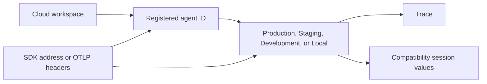
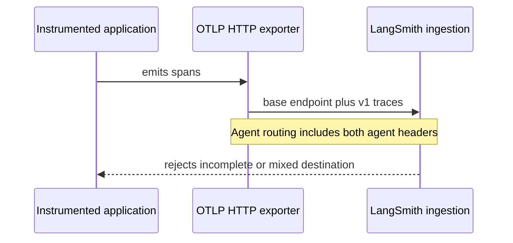
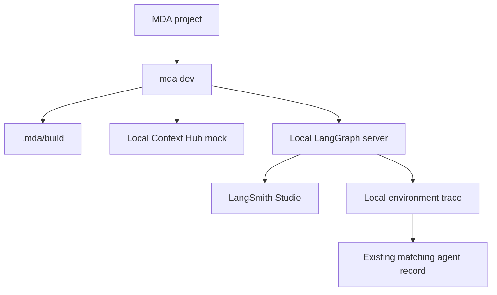

## Scope and source ownership

This workflow covers one connected contract: a registered LangSmith agent is the destination for traces, an environment selects the destination within that agent, SDK and OTLP clients convey that address, and documentation presents runnable examples without making generated fragments authoritative. It also covers the local Managed Deep Agents (MDA) path, which produces Local-environment traces under that same registry model.

Edit the source that owns the behavior, then update its documentation consumers. In particular:

| Change | Authoritative source | Consumer boundary to check |
| --- | --- | --- |
| Registry model, identifiers, environments | `src/langsmith/agent-registry.mdx`, `src/langsmith/agent-environments.mdx` | Registration, routing, resolution, and UI guidance |
| Agent-routing rules and supported SDKs | `src/langsmith/log-traces-to-agent.mdx` | Shared OTLP addressing note and language sample imports |
| OTLP setup and endpoint semantics | `src/langsmith/trace-with-opentelemetry.mdx` and `src/snippets/langsmith/otlp-agent-addressing-note.mdx` | All OTLP examples and endpoint tests |
| Python, TypeScript, and Java trace examples | `src/code-samples/langsmith/log-traces-to-agent.py`, `log-traces-to-agent.ts`, and `TraceAgentExample.java` | Generated `src/snippets/code-samples/trace-agent-*.mdx` imports only |
| MDA local development | `src/langsmith/managed-deep-agents-local-development.mdx` | MDA deploy guidance and the agent-registration prerequisite |

Do not repair a rendered `src/snippets/code-samples/` fragment by hand. It is output from marked runnable sources. Preserve `:snippet-start:`, `:snippet-end:`, and `:remove:` regions: the visible example and the hidden validation harness deliberately have different jobs.

## Registry and destination invariants



This diagram shows that an address chooses an agent and one environment, while the selected environment supplies compatibility storage identities.

An agent is a workspace-level organization unit. Every trace belongs to one agent environment; the fixed names are Production, Staging, Development, and Local, and custom names are not available. The identifier is the immutable routing value, whereas the display name is editable. Do not infer an identifier or an environment's backing session values from a display name.

Registration is setup, not startup work. Programmatic creation requires a PAT or service key with `projects:create`; a tracing key can submit traces later but cannot create the record. SDK/API/UI-created external agents start with all four environments, while agents created in Build start with Production and acquire other environments when first addressed. An existing or archived identifier produces a `409`, so callers should reuse or deliberately choose another identifier rather than retry creation on every application run.

For older integrations that still require a project-shaped destination, retrieve the selected environment. Use its returned `tracer_session_name` for `project_name`-style settings and its `tracer_session_id` or resolved `session_id` with APIs named `session_id`, `project_id`, or `project_ids`. These are returned compatibility/storage values, not name transformations.

## Trace routing: precedence and failure behavior

An agent address is an identifier plus one of `local`, `development`, `staging`, or `production`; neither half selects a destination alone. Code configuration wins over environment variables. The SDK reads `LANGSMITH_AGENT_ID` and `LANGSMITH_AGENT_ENVIRONMENT` only if no code destination is given, and a partial pair warns rather than guessing: otherwise unaddressed calls are left untraced.

Agent addressing is available only in Cloud agent-based workspaces. Project-based workspaces, including self-hosted LangSmith, retain project-based configuration; self-hosted ingestion that carries an agent address is rejected with `403`, and the request records no runs.

Keep the two routing dialects mutually exclusive:

- Agent variables combined with `LANGSMITH_PROJECT`, `LANGCHAIN_PROJECT`, or `LANGCHAIN_SESSION` warn and suppress calls without an explicit code destination.
- Passing `address` and `project_name` in the same Python or TypeScript call is an error. An ingestion request that carries both agent and project addresses is rejected.
- A `project_name` override in code is different: it intentionally overrides agent variables, which lets an evaluation use its own experiment destination.

The language samples are concise demonstrations of the same contract: Python uses `ls.agent_address(...)` in `@traceable` or `tracing_context`, TypeScript puts `new AgentAddress(...)` in `traceable` configuration, and Java puts `new AgentAddress(...)` in `TraceConfig`. Keep their address, API, dependency version, and hidden assertions aligned with the routing guide; do not promote an extracted snippet to a separate implementation.

## OpenTelemetry: headers and endpoint shape

OTLP agent routing uses request headers, not span attributes. In an agent-based workspace, send both `Langsmith-Agent-Id` and `Langsmith-Agent-Environment`; `gen_ai.agent.name` does not route a trace. A request with only one agent header, or an agent header mixed with `Langsmith-Project`, receives `400`. The Python exporter can derive both headers from the two LangSmith agent variables with `langsmith>=0.14.9`, but only when `OTEL_EXPORTER_OTLP_HEADERS` is unset. TypeScript and other exporters must supply the headers themselves. Project-based and self-hosted configurations use `Langsmith-Project` instead.

Endpoint variables have deliberately different semantics:

- `OTEL_EXPORTER_OTLP_ENDPOINT` is a base URL. An OTLP/HTTP exporter appends `/v1/traces`, so `https://api.smith.langchain.com/otel` becomes `https://api.smith.langchain.com/otel/v1/traces`.
- `OTEL_EXPORTER_OTLP_TRACES_ENDPOINT` is a per-signal URL used exactly as provided. A collector's `traces_endpoint` is likewise the full trace URL.

Never set the generic base variable to a URL already ending in `/v1/traces`: it yields `/v1/traces/v1/traces` and a `404`. Preserve this distinction in prose and configuration examples; the focused endpoint tests scan all MDX for the invalid generic pattern and instantiate the HTTP exporter to verify both forms resolve once.



This sequence distinguishes transport endpoint construction from request-level destination validation.

## Managed Deep Agents local-development path

`mda dev` is a local compile-and-run workflow, not a deployment operation. It validates the MDA project, writes `.mda/build`, copies the project `.env` and local identity configuration when needed, creates a local Context Hub mock, starts the language-specific LangGraph development server, and opens Studio. A source change requires stopping and rerunning the command to recompile. Studio supports inspecting responses, tool calls, state, and interrupts without creating or updating a hosted deployment.



This flow shows that local execution works independently of hosted deployment, but agent-based trace ingestion needs the registered destination.

Local runs use the agent's Local environment and the `{name}-local` project, where `name` comes from `define_deep_agent` or `defineDeepAgent`. In an agent-based workspace, those traces are rejected until a matching agent record exists. Create it once with the same identifier or run `mda deploy` once; Studio chat still works while trace ingestion is rejected. Local defaults also provide a test identity when needed, fall back to a temporary local sandbox when the configured sandbox is unavailable, and list schedules without provisioning or running them. Test identity and sandbox behavior in a development deployment before production use.

`mda deploy` is the complementary hosted path: it compiles the project, syncs deploy-owned context, uploads the compiled source, and triggers a hosted Agent Server build. Its routing is intentionally separated: instructions and skills go to Context Hub; non-reserved `.env` values may become hosted secrets; source is archived from `.mda/build`; and schedules are reconciled after the deployment is live. `--no-wait` exits before that state and therefore skips schedule reconciliation.

## Change and validation checklist

1. Start with the registry/environment pages when changing terminology, identifier behavior, or the lifecycle of environments. Reconcile registration, routing, and resolution rather than duplicating rules inconsistently.
2. For routing changes, check Cloud versus self-hosted behavior, the partial-variable case, code precedence, and all project-versus-agent conflict outcomes.
3. For OTLP edits, preserve base versus per-signal endpoint semantics and header-pair validation. Run the focused test:

   ```bash
   uv run pytest tests/unit_tests/test_otel_endpoints.py
   ```

4. For a language sample, edit and execute the runnable source, then regenerate snippets and review the importing MDX—not the generated fragment as a source:

   ```bash
   make test-code-samples FILES="src/code-samples/langsmith/log-traces-to-agent.py"
   make test-code-samples FILES="src/code-samples/langsmith/log-traces-to-agent.ts"
   make test-code-samples FILES="src/code-samples/langsmith/TraceAgentExample.java"
   make code-snippets
   ```

5. For MDA local-development changes, keep `mda dev` separate from deployment claims; verify the Local trace destination, registration prerequisite, Studio behavior, sandbox fallback, and non-running schedules against the deployment page where the behavior crosses that boundary.

## Related pages

- [Documentation Route and Language Versioning](/openwiki/concepts/versioning.md)
- [Reference Documentation Boundaries](/openwiki/integrations/reference-docs.md)
- [Runnable Code Samples and Snippet Generation](/openwiki/workflows/code-sample-lifecycle.md)
- [Testing Overview](/openwiki/testing/test-overview.md)
- [Quickstart](/openwiki/quickstart.md)
- [Egress IP Inventory](/openwiki/workflows/egress-ip-inventory.md)
