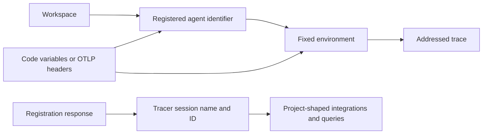
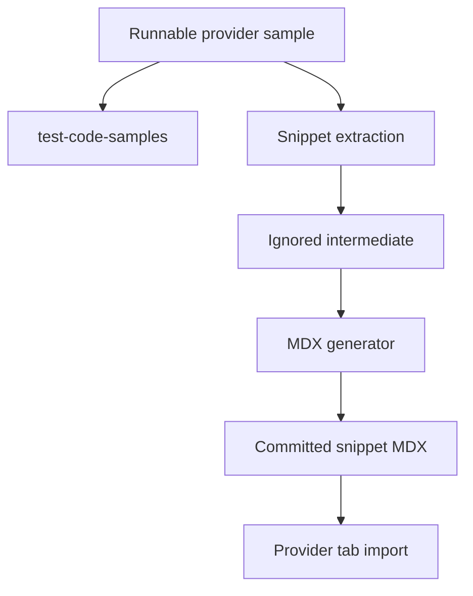
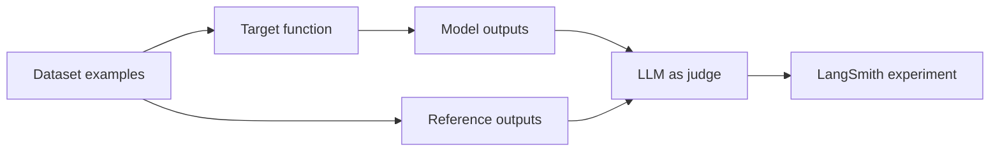
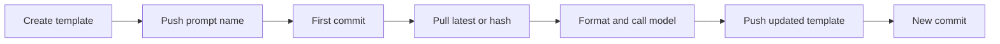
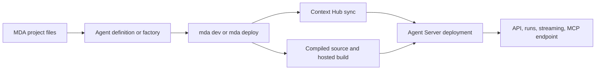

## Scope and ownership

This workflow maintains a connected authoring contract rather than duplicating product documentation. A change can affect the agent/environment trace destination, observability, evaluation, or prompt quickstart samples, Managed Deep Agents (MDA) content emitted in two language routes, navigation and redirects, or a deployment-generated REST reference. Edit the smallest authoritative source, then review every consumer of the changed rule.

| Surface | Authoritative owner | Safe change action | Do not edit as source |
| --- | --- | --- | --- |
| Agent model, registration, routing, resolution, observability, and integration narrative | Authored `src/langsmith/*.mdx` and shared authored snippets | Change the page or reusable snippet that owns the rule, then reconcile consuming guides. | `build/` output. |
| Observability provider code | Runnable `src/code-samples/langsmith/observability-quickstart-app-*` sources | Change and execute the source, regenerate snippet MDX, then inspect the imported quickstart tab. | A committed `src/snippets/code-samples/` fragment. |
| Evaluation and prompt quickstart code | Runnable `src/code-samples/langsmith/evaluation-quickstart-*` and `prompt-engineering-quickstart-*` sources | Preserve ordered, cross-file setup dependencies and marked snippet regions; execute, regenerate, and inspect every importing step. | A committed `src/snippets/code-samples/` fragment. |
| Registration display fragments | Marked regions in `src/code-samples/langsmith/create-an-agent.py` | Maintain visible calls and hidden loopback fixture assertions together, then regenerate. | Generated snippet MDX or intermediates. |
| MDA narrative | Direct `src/langsmith/managed-deep-agents*.mdx` sources | Keep Python and JavaScript conditional branches, project ownership, deployment statements, and cross-links coherent. | One emitted `/langsmith/python/` or `/langsmith/javascript/` route. |
| LangSmith REST reference | Processor policy and upstream contract | Change `scripts/process_langsmith_openapi.py` policy or the service-owned source, regenerate, and review the refresh workflow. | Individual JSON operations, generated endpoint pages, or `build/`. |

`src/docs.json` independently places content in navigation and declares OpenAPI route generation. It does not own an authored page simply because it lists its route. Direct MDA MDX is an exception to ordinary LangSmith routing: it emits both `/langsmith/python/...` and `/langsmith/javascript/...`; navigation projects each language-specific route and redirects retain retired unprefixed MDA URLs. Treat source ownership, navigation placement, and redirects as separate decisions.

## The trace-destination invariant



This diagram shows that an agent address selects one environment for ingestion, while that environment supplies storage identities for project-shaped compatibility consumers.

Keep these rules aligned wherever they appear:

1. An address is the pair of immutable agent identifier and environment. The code vocabulary is `local`, `development`, `staging`, and `production`; an identifier alone does not pick a destination. Explicit SDK configuration wins over environment variables.
2. Agent identifiers are stable routing values, unlike editable display names. Registration is setup work requiring a credential with `projects:create`; a duplicate identifier returns `409`.
3. The response environment supplies `tracer_session_name` for consumers that require a project name and `tracer_session_id` or resolved `session_id` for `project_id`/`project_ids` APIs. Never derive either from an agent label.
4. Do not combine the agent dialect with `LANGSMITH_PROJECT`, `LANGCHAIN_PROJECT`, `LANGCHAIN_SESSION`, a code `project_name`, or an OTLP project header. A partial agent-variable pair warns and leaves otherwise unaddressed calls untraced; explicit conflicting addresses fail or are rejected.
5. Agent routing is for Cloud agent-based workspaces. Self-hosted and project-based setups use project configuration; unsupported self-hosted agent-addressed ingestion is rejected.

OpenTelemetry remains a destination boundary, not a span-semantic change. Agent-routed OTLP must carry both `Langsmith-Agent-Id` and `Langsmith-Agent-Environment`. The Python exporter derives them from the agent variables only if `OTEL_EXPORTER_OTLP_HEADERS` is unset; other exporters must set them. Partial headers, project-and-agent header mixing, and unsupported self-hosted routing are invalid.

## Quickstart and provider sample lifecycle

The tracing quickstart is a reader journey: install provider and LangSmith dependencies, export tracing/API-key variables, choose agent routing or project compatibility setup via the shared trace-ingestion snippet, run an instrumented assistant, and locate the resulting trace. The page imports generated snippets for OpenAI, Anthropic, and Gemini in Python and TypeScript, plus OpenAI Java and Kotlin. It should not claim that the imported Python/TypeScript tabs are hand-authored inline code.

Each provider source demonstrates the same trace tree: the outer `assistant` is traceable, `get_context` is a traceable tool span, and the provider wrapper automatically traces the nested model call. Provider-specific sources own the client import, wrapper, API-key convention, response extraction, and model invocation. In particular, the Gemini TypeScript source maps CI's `GOOGLE_API_KEY` to the reader-facing `GEMINI_API_KEY` inside a removed harness block, so that mapping must not appear in its rendered snippet. `KEEP MODEL` is a rendering directive: retain it adjacent to model calls that must remain provider-specific and executable rather than becoming a generated provider CodeGroup.



This is the sample-to-quickstart path; the runnable source, not the imported MDX, is the editing and execution boundary.

When changing a provider tab, update its source and required dependency/setup prose together. Confirm the model call's wrapper and traceable nesting still match the text that describes the UI: the outer span contains the tool span and model span. The quickstart's final navigation differs by routing mode: agent users select the configured environment; project users open `LANGSMITH_PROJECT`. The Anthropic and Gemini tabs deliberately have no Java/Kotlin variant because the Java SDK wraps only OpenAI.

Run focused validation before regenerating and inspect the matching committed output:

```bash
make test-code-samples FILES="src/code-samples/langsmith/observability-quickstart-app-anthropic.py"
make test-code-samples FILES="src/code-samples/langsmith/observability-quickstart-app-gemini.ts"
make code-snippets
```

Use `CODE_SNIPPET_SOURCES` for an iterative source-specific extraction, but run a full generation before treating the output tree as fully refreshed. The extractor recognizes marked regions and removes harness-only blocks; the renderer owns language fences and tabs. Do not copy displayed code from a fragment back into a source without preserving those markers and testability constraints.

The OpenAI tracing guide is a separate thin consumer of `src/snippets/trace-with-openai.mdx`. Change that shared snippet—not just its page—when shared wrapper behavior or tracing prerequisites change. The reusable ingestion snippet is similarly a consumer boundary: agent-routing instructions must remain compatible with the destination rules above.

## Evaluation and prompt quickstart lifecycles

The evaluation quickstart has two entrypoints that must remain semantically aligned, rather than one being a transcription of the other. The UI flow creates a Playground prompt, dataset, Correctness evaluator, and experiment. The SDK flow imports runnable Python and TypeScript fragments: it creates the `Sample dataset` with input/reference-output examples, defines a target, wraps `CORRECTNESS_PROMPT` with an LLM-as-judge evaluator, and calls `evaluate(...)`. That call pulls dataset examples, invokes the target, passes its outputs plus `reference_outputs` to the evaluator, and records the results as an experiment. Update the setup prose, import names, and all affected fragments together when the data contract or evaluator changes.



This diagram shows the SDK evaluation data flow: an evaluator receives both target outputs and the reference outputs stored with each dataset example.

The runnable evaluation files deliberately execute in sequence. The dataset setup has hidden cleanup because creating an existing dataset name fails; it is run before the evaluation source, which contains three separately extracted snapshots of a growing `eval.py`. Preserve those `:snippet-start:`/`:snippet-end:` regions and harness-only `:remove:` code. A visible fragment is not an independent program merely because it is renderable.

The prompt quickstart follows a second stateful chain. A create source builds a `ChatPromptTemplate` and pushes `prompt-quickstart`; the test source pulls that name, formats its variable, converts to the provider message format, and calls the model; the iterate source pushes an updated template under the same name. Pushing that name again records a new commit rather than overwriting prompt history. Python keeps the three displayed fragments in one executable file, while TypeScript separates ordered `0-create`, `1-test`, and `2-iterate` files. Keep the shared prompt name, lexical ordering, source-specific SDK calls, and removed assertions/logging intact when changing this narrative or its samples.



This diagram shows the prompt quickstart lifecycle: the same prompt name is the versioned history boundary, and a pull can select the latest commit or a hash.

Run the relevant sources in their dependency order and regenerate snippets before reviewing the two quickstarts. In particular, do not test only the prompt test or iteration source without the create source, and do not leave the fixed evaluation dataset from a previous run in place. Use the sample runner for the relevant source family and then `make code-snippets`; if extraction or rendering changes, run the focused extractor/renderer tests listed below.

## Managed Deep Agents: authored model, routing, and deployment boundary

MDA documentation describes a code-first project where the author supplies agent behavior and the managed runtime supplies the Deep Agents harness and hosting. The overview is the capability map; the agent-definition page owns `define_deep_agent` / `defineDeepAgent`, static names, model and runtime-facing options, graph factories, and their repeatability constraints. Do not blur this into generic agent-addressing documentation or ordinary self-hosted Deep Agents guidance.

A static root `agent.py` or `agent.ts`/`agent.tsx` exports the named definition. It is configuration, not a compiled agent: MDA compiles it at deploy time with the managed backend, store, checkpointer, context, and runtime. Instructions and skills are managed context, tools and middleware are normal imported application modules, and recognized paths such as identity, memory, channels, schedules, sandbox, and MCP declarations enable managed capabilities. A factory may choose configuration per run from application context, but context is not verified identity; authorization belongs to the verified runtime caller.

Runtime guidance is a trust and lifecycle boundary. Factories, tools, and middleware retain their native LangChain/LangGraph runtime; MDA adds thread and sandbox fields, while tools and middleware also receive managed server metadata. API context is schema-validated application input; verified identity arrives separately in server information, and managed channel ingress separately establishes delivery origin. Channel runs carry no application context, so required context does not reject them; direct API calls retain native validation. Factories are also invoked for inspection, when execution runtime is absent, and therefore must tolerate missing run context and return stable graph structure and schemas. A factory chooses the sandbox, so its own `backend` is unavailable.



This flow separates deploy-owned context from the compiled source and shows that a successful deployment becomes an Agent Server deployment.

Factories are called at run start and again on resume, retry, and schema/state inspection. They must return the same definition for the same context, avoid side effects and external calls, retain interrupting middleware across configurations, put the name inline so `mda build` can read it, and install dependencies for every model they may select. Configuration ownership matters: static definitions cannot select per-run managed instructions, skills, MCP, sandbox, or browser resources; a factory can replace or clear them using the documented values. Memory is not selected per run.

`mda dev` validates and compiles locally, copies the project environment, creates a local Context Hub mock, starts the language-specific development server, and opens Studio; it does not create a hosted deployment. Local traces target the `{name}-local` project in the agent's Local environment. In agent-based workspaces that trace destination must already have an agent record, created once through registration or `mda deploy`; Studio can work even if those traces are rejected.

`mda deploy` compiles the project, syncs deploy-owned context, uploads compiled source, triggers a hosted build, and then reconciles schedules once the deployment is live. Its `.env` routing is intentionally asymmetric: non-reserved values can become hosted secrets, while reserved platform variables authenticate deployment but are not uploaded as user-managed secrets, and `.env` files are not copied into the archive. `--no-wait` skips schedule reconciliation because it exits before the deployment reaches `DEPLOYED`. Preserve this distinction when changing deployment prose, credentials, or CI examples.

## Registration samples and generated fragments

`create-an-agent.py` is a two-snippet executable source. Its visible regions create `support-agent` and then retrieve it to print Production compatibility session values. Its hidden loopback `ThreadingHTTPServer` fixture patches the environment, disables tracing, returns metadata and an agent-shaped response, and asserts the create POST and retrieval GET. This is a deterministic SDK contract test; do not replace it with a live setup operation.

Keep the two marker IDs and extraction boundaries. A multi-snippet source is not eligible for a single public trace link. When changing the registration flow, update fixture payload/assertions with visible calls, run the sample, regenerate, and inspect both imports in `create-an-agent.mdx`:

```bash
make test-code-samples FILES="src/code-samples/langsmith/create-an-agent.py"
make code-snippets
```

## Generated REST reference boundary

The LangSmith platform REST reference is not authored endpoint MDX. `src/docs.json` gives Mintlify the committed `src/langsmith/langsmith-platform-openapi.json` input and the `langsmith/smith-api` output directory; Mintlify emits endpoint pages at deployment. The platform input is generated from the allowlisted `api.smith.langchain.com` service specification by `scripts/process_langsmith_openapi.py`.

The processor marks configured internal, Fleet, health, and other non-public operations hidden; normalizes operation summaries including Beta/v2 markers; adds and groups tags; and sorts the groups. Its transformation is idempotent for title markers. Adjust the upstream contract or processor policy, then regenerate and review the refresh PR—never patch the committed specification, generated endpoint paths, or `build/`. `make check-openapi` covers the separate Agent Server specification, not this platform REST input; verify rendered REST changes in a Mintlify preview or deployment.

## Review checklist

Choose checks by the changed contract:

| Change | Required review |
| --- | --- |
| Agent address, registration, compatibility identity, OpenAI, or OTLP prose | Reconcile the owning guide, reusable snippet, quickstart, and routing/compatibility consumers; lint prose and validate changed links. |
| Provider quickstart source | Execute the source, regenerate snippets, and compare the generated tab import and trace-tree explanation. |
| Evaluation quickstart source or prose | Preserve the dataset → target → evaluator → experiment contract; execute setup before evaluation, regenerate snippets, and inspect the SDK and UI paths. |
| Prompt quickstart source or prose | Preserve create → pull/test → repeat push ordering and the shared prompt name; execute the prerequisite create source, regenerate snippets, and inspect Python and TypeScript imports. |
| Snippet extraction/rendering mechanism | Run `make test TEST_FILE=tests/unit_tests/test_test_code_samples.py` and `make test TEST_FILE=tests/unit_tests/test_generate_code_snippet_mdx.py`. |
| MDA definition, project, local-dev, or deploy assertion | Check both conditional language outputs, emitted `/langsmith/python/` and `/langsmith/javascript/` routes, navigation, redirects, and linked capability/deployment pages. |
| MDA factory/runtime security guidance | Keep application context separate from verified identity and channel delivery; do not authorize from caller-controlled context. |
| Navigation, route, or docs configuration | Run `make broken-links-with-anchors` and a clean build; navigation controls discoverability while source family controls emitted pages. |
| Platform OpenAPI policy/input | Use the dedicated refresh workflow, review the artifact diff, and inspect Mintlify rendering. |

## Related pages

- [Documentation Route and Language Versioning](/openwiki/concepts/versioning.md)
- [Reference Documentation Boundaries](/openwiki/integrations/reference-docs.md)
- [Runnable Code Samples and Snippet Generation](/openwiki/workflows/code-sample-lifecycle.md)
- [LangSmith OpenAPI Refresh](/openwiki/workflows/langsmith-openapi-refresh.md)
