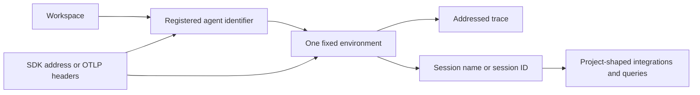
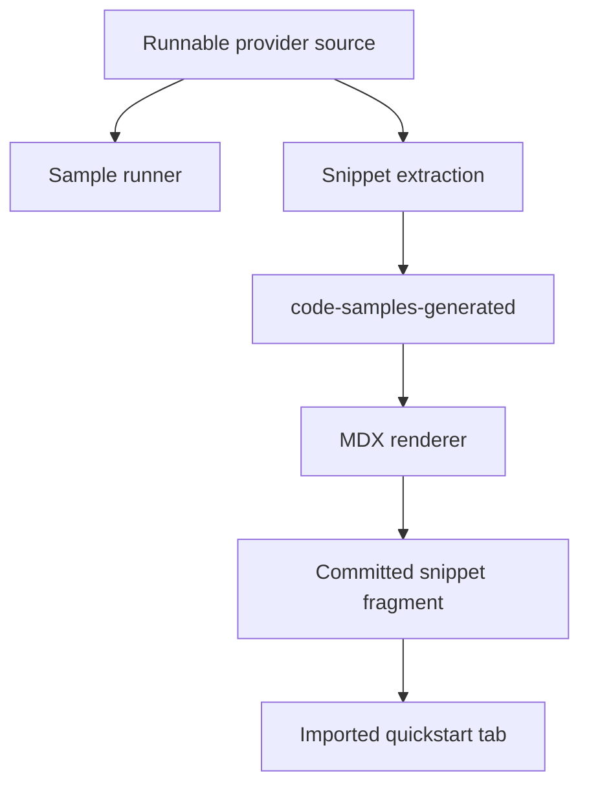
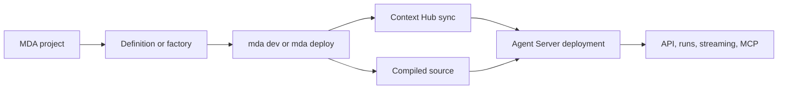
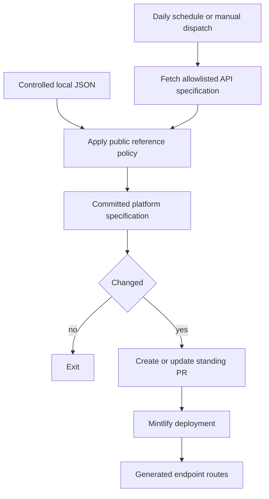

## Scope and ownership

This workflow reconciles a connected documentation system. A change to agent addressing can affect registration, environment selection, OpenTelemetry, the tracing quickstart, and compatibility guidance. A Managed Deep Agents (MDA) change can affect conditional Python/JavaScript pages, route projection, local development, deployment, runtime trust boundaries, and sandbox guidance. Keep the source owner, navigation entry, redirect, generated snippet, and deployment-generated API route distinct.

| Surface | Authoritative owner | Safe change |
| --- | --- | --- |
| Agent model, registration, environment routing, resolution, and observability prose | `src/langsmith/*.mdx` and authored shared snippets | Change the owning page/snippet and reconcile its consumers. |
| Provider quickstart code | Runnable `src/code-samples/langsmith/observability-quickstart-app-*` source | Change and execute the source, regenerate snippets, then inspect the importing quickstart. |
| Agent-registration display fragments | Marked regions in `src/code-samples/langsmith/create-an-agent.py` | Keep visible SDK calls and hidden loopback assertions consistent, execute, then regenerate. |
| MDA narrative | Direct `src/langsmith/managed-deep-agents*.mdx` pages | Keep Python/JavaScript conditional content and capability links coherent. |
| Platform REST reference | Service specification plus `scripts/process_langsmith_openapi.py` policy | Change the service contract or processor policy, run/review the refresh; do not patch JSON or endpoint output. |

`src/docs.json` places pages in navigation and configures OpenAPI route generation; it does not become the owner of an authored MDX page. Direct MDA pages are emitted under both `/langsmith/python/` and `/langsmith/javascript/`, while legacy unprefixed MDA URLs redirect to the Python route. Review source ownership, navigation, and redirects independently.

## Preserve the agent destination contract



This relationship separates the trace ingestion address from the compatibility identities returned for the selected environment.

The agent-registry and environment pages establish the model: each trace belongs to an agent and exactly one of Production, Staging, Development, or Local. Names are fixed, though a UI- or Build-created agent begins with Production and gains the other environments when first addressed. An agent identifier is immutable and is the routing value; a display name is separately editable.

Keep the following invariant consistent in all consumers:

1. An address is **both** agent identifier and environment. Code configuration wins over environment variables; variables are read only if code names no destination, and then both variables are required. A partial pair warns and leaves otherwise unaddressed calls untraced.
2. Registration is one-time setup. The programmatic API needs a personal access token or service key with `projects:create`, not a tracing key, creates all four environments, exposes `tracer_session_name` and `tracer_session_id`, and returns `409` for an existing identifier.
3. `tracer_session_name` is the returned compatibility value for integrations requiring a project name. Resolve the address or read the environment to obtain its backing `session_id`/`tracer_session_id` for `session_id`, `project_id`, and `project_ids` APIs. Never manufacture either value from an identifier or display name.
4. Do not mix agent routing and a legacy project destination. Agent variables plus `LANGSMITH_PROJECT`, `LANGCHAIN_PROJECT`, or `LANGCHAIN_SESSION` are ambiguous. An explicit `address` plus `project_name` errors; ingestion also rejects a request carrying both address types. A code `project_name` override deliberately takes precedence over agent variables so an evaluation can use its own destination.
5. Agent routing applies to Cloud agent-based workspaces. Project-based workspaces, including self-hosted LangSmith, use project configuration; a self-hosted agent-addressed request is rejected with `403` and none of that request's runs are recorded.

For OTLP, route with `Langsmith-Agent-Id` **and** `Langsmith-Agent-Environment`, rather than `Langsmith-Project`. The Python exporter can derive both headers from the agent variables only when `OTEL_EXPORTER_OTLP_HEADERS` is unset; TypeScript and other exporters must set them. Partial agent headers and agent/project header mixing are `400` errors. Preserve the endpoint distinction tested in `test_otel_endpoints.py`: `OTEL_EXPORTER_OTLP_ENDPOINT` is a base URL to which an OTLP/HTTP exporter appends `/v1/traces`; use `OTEL_EXPORTER_OTLP_TRACES_ENDPOINT` when supplying that full signal path. Collector configuration uses `traces_endpoint` for a full traces URL.

## Update observability quickstarts from runnable sources

The tracing quickstart imports generated provider fragments: OpenAI, Anthropic, and Gemini for Python and TypeScript, and OpenAI for Java and Kotlin. It imports the shared ingestion setup snippet. The separate OpenAI integration guide consumes `src/snippets/trace-with-openai.mdx`; change that shared consumer boundary rather than only one rendered page.

Provider sources demonstrate a deliberately nested trace tree: the outer `assistant` is traceable, `get_context`/`getContext` is a traceable tool span, and the provider wrapper traces the model call. Provider sources own their imports, wrapper, API-key use, response extraction, and model call. The Gemini TypeScript source maps CI's `GOOGLE_API_KEY` to reader-facing `GEMINI_API_KEY` inside a removed block, so it must not appear in generated code. Preserve `KEEP MODEL` beside provider model calls so rendering does not erase executable provider specificity.



This is the source-to-quickstart flow: generated MDX is reviewed output, not the authoring or execution boundary.

Validate a modified provider before regenerating, then inspect the corresponding imported tab and the prose describing the trace tree:

```bash
make test-code-samples FILES="src/code-samples/langsmith/observability-quickstart-app-anthropic.py"
make test-code-samples FILES="src/code-samples/langsmith/observability-quickstart-app-gemini.ts"
make code-snippets
```

Use `CODE_SNIPPET_SOURCES` for focused extraction during iteration, but use full generation before declaring generated output refreshed. The extractor handles marked snippets and removed harness blocks; the renderer controls fences and tabs. The quickstart intentionally offers Anthropic and Gemini only in Python and TypeScript because the Java SDK wraps only OpenAI.

## Registration samples are executable contract tests

`create-an-agent.py` produces two generated fragments: it creates `support-agent`, then retrieves it and displays Production session values. The source's removed harness starts a loopback `ThreadingHTTPServer`, patches the SDK environment, disables tracing, returns agent-shaped payloads, and asserts the SDK's POST body and retrieval GET path. It is a deterministic SDK contract test, not a live registration operation.

Retain both snippet markers and the hidden fixture when editing either visible call. A multi-snippet file cannot map unambiguously to one public trace link, so traced-sample publication skips it. Execute the source and regenerate before reviewing both imports in `create-an-agent.mdx`:

```bash
make test-code-samples FILES="src/code-samples/langsmith/create-an-agent.py"
make code-snippets
```

## MDA: definition, runtime, sandbox, and deployment boundaries

An MDA project is ordinary Python or TypeScript with one required root entry: `agent.py`, or `agent.ts`/`agent.tsx`, exporting named `agent`. `define_deep_agent`/`defineDeepAgent` returns a definition; the managed runtime compiles it at deployment with resources it owns. `instructions.md` and `skills/` are deploy-owned Context Hub context, while tools and middleware are ordinary imported modules. Recognized paths such as identity, memory, channels, schedules, sandbox, and MCP declarations enable managed capabilities.

A factory may choose behavior per run from application context, but context is not verified identity. Authorization belongs in tools or middleware using verified caller information. Factories run at start, resume, retry, and Agent Server schema/state inspection; they must tolerate absent execution runtime, return stable structures and schemas, have no side effects or external calls, preserve interrupting middleware, keep the name inline for the build, and include dependencies for every selected model. The factory chooses the sandbox, so it cannot use its own runtime `backend`.



This flow separates deploy-owned context from compiled project source and shows that deployment produces an Agent Server deployment.

Runtime fields are a trust boundary. API `context` is schema-validated application input, `server_info`/`serverInfo` supplies a caller resolved from verified identity, and channel ingress independently verifies delivery. A direct caller cannot create a trusted channel origin by placing a `channel` key in context. Channel deliveries carry no application context and bypass required-context validation; direct API calls keep native validation. A sandbox provides an isolated filesystem and shell. It is declared under `sandbox/`, is reused one per durable thread, and its proxy can control reachable hosts and inject workspace-secret headers outside the sandbox.

`mda dev` validates and compiles into `.mda/build`, copies `.env` into the local build, creates a local Context Hub mock, starts the language-specific development server, and opens Studio without creating or updating a hosted deployment. Local traces use `{name}-local` in the Local environment. In an agent-based workspace the matching agent must already be registered—by creation or a prior deploy—or LangSmith rejects the local traces, although Studio chat continues to work.

`mda deploy` compiles the project, syncs Context Hub content, uploads compiled source, triggers the hosted build, and reconciles schedules after the deployment is live. `.env` is asymmetric by design: it authenticates deployment and forwards non-reserved values as hosted secrets, but reserved platform variables and `.env` files are excluded from the archive. `MDA_INGRESS_SECRET` is required at preflight when backend identity is declared. `--no-wait` exits before `DEPLOYED`, so schedule reconciliation is skipped. Region is selected with `LANGSMITH_ENDPOINT`; credentials must belong to that region, and CI needs `LANGSMITH_API_KEY` because it cannot fall back to browser sign-in.

## Navigation and generated platform API reference

The observability quickstart, log-to-agent guide, resolution guide, and integrations are independently navigated under Monitor, while MDA has separate Python and JavaScript entries under Build. When moving, adding, or renaming a page, update navigation only when discoverability changes and review redirects separately. Validate emitted routes and redirects with a clean build and `make broken-links-with-anchors`.

The platform REST reference starts with committed `src/langsmith/langsmith-platform-openapi.json`; `docs.json` gives Mintlify that input and `langsmith/smith-api` output directory, and Mintlify creates endpoint routes at deployment. The file is generated from the allowlisted `api.smith.langchain.com` specification by `scripts/process_langsmith_openapi.py`. The processor hides configured internal/Fleet and path-matched operations, normalizes summaries, supplies/groups tags, and orders groups. It accepts a local `--input` for controlled reproduction; otherwise it rejects network hosts outside the allowlist.



This is the reviewed platform-reference publication flow. Do not hand-edit the generated specification, endpoint output, or `build/`. The refresh workflow runs daily or by dispatch, and reuses one open refresh branch/PR. `make check-openapi` validates the separate Agent Server input, not the platform specification; inspect platform output in a Mintlify preview or deployment.

## Focused review checklist

| Changed contract | Required review |
| --- | --- |
| Agent address, registration, compatibility identity, or OTLP prose | Reconcile registry, environment, registration, routing, resolution, shared ingestion, and OTLP consumers. Run `tests/unit_tests/test_otel_endpoints.py` when endpoint examples change. |
| Provider source | Execute it, regenerate snippets, and compare the importing quickstart tab and nested-span explanation. |
| Registration sample | Execute `create-an-agent.py`, regenerate snippets, and retain fixture assertions and marker regions. |
| MDA definition, runtime, sandbox, local-dev, or deploy assertion | Review Python and JavaScript branches, project ownership, trust boundary, emitted routes, navigation, redirects, and linked capability pages. |
| MDA deployment configuration | Confirm regional endpoint/auth assumptions, secret/archive routing, and `--no-wait` schedule behavior. |
| Navigation or route configuration | Clean-build and run `make broken-links-with-anchors`; navigation does not establish source ownership. |
| Platform OpenAPI policy/input | Use the processor/refresh workflow, review its artifact diff, and inspect Mintlify rendering. |

## Related pages

- [Documentation Route and Language Versioning](/openwiki/concepts/versioning.md)
- [Reference Documentation Boundaries](/openwiki/integrations/reference-docs.md)
- [Runnable Code Samples and Snippet Generation](/openwiki/workflows/code-sample-lifecycle.md)
- [Egress IP Inventory](/openwiki/workflows/egress-ip-inventory.md)
- [LangSmith OpenAPI Refresh](/openwiki/workflows/langsmith-openapi-refresh.md)
