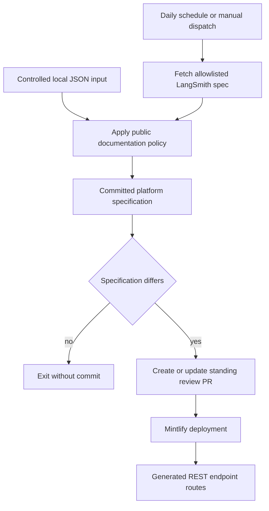

# LangSmith OpenAPI Refresh

The LangSmith REST API reference is published from the generated, committed `src/langsmith/langsmith-platform-openapi.json`. It is not an authored MDX endpoint tree: `src/docs.json` supplies that file to Mintlify's `langsmith/smith-api` directory, and Mintlify generates endpoint routes at deployment. Do not edit the generated specification or deployment-generated endpoint pages by hand.

This flow is separate from the Agent Server and Control Plane APIs. Agent Server uses its own committed `src/langsmith/agent-server-openapi.json` input and `langsmith/agent-server-api` directory. Control Plane uses the remote `https://api.host.langchain.com/openapi.json` source rather than the platform artifact. Changes to one input must not be assumed to update either of the others.

## Ownership and trust boundary

| Concern | Owner | Safe maintenance action |
| --- | --- | --- |
| Upstream platform API description | `https://api.smith.langchain.com/openapi.json` | Correct service-owned content upstream when appropriate. |
| Public REST-reference policy | `scripts/process_langsmith_openapi.py` | Change explicit hiding, titles, grouping, or order, then regenerate. |
| Generated platform input | `src/langsmith/langsmith-platform-openapi.json` | Review and merge the refresh PR; never patch the JSON manually. |
| Refresh and GitHub write authority | `.github/workflows/refresh-langsmith-openapi.yml` | Preserve its narrow staging and standing-PR behavior. |
| Agent Server input | `src/langsmith/agent-server-openapi.json` | Use the separate Agent Server specification-update process. |
| Control Plane input | `https://api.host.langchain.com/openapi.json` | Correct the service-owned source; do not commit a platform copy. |
| Rendered endpoint pages | Mintlify deployment configured by `src/docs.json` | Inspect a deployed preview or production site. |

The processor is the trust and policy boundary between service-owned input and public documentation. Its default network source is `https://api.smith.langchain.com/openapi.json`, and it rejects a parsed hostname outside its `api.smith.langchain.com` allowlist before making a request. `--input` reads a controlled local JSON file instead, which is the appropriate path for reproducing a candidate or developing policy.



This flow shows the platform-only path from constrained service input through review to deployment-generated routes.

## Processor policy and local entrypoints

`process_spec()` mutates a loaded OpenAPI object and the CLI serializes the result as UTF-8 JSON with two-space indentation and a trailing newline. It ignores path-level OpenAPI metadata while iterating operations. The policy deliberately shapes the public surface:

- It sets `x-hidden: true` for configured Fleet, product-feedback, internal/infrastructure, administration/debug, and metrics tags, and for configured health and internal path rules. It also hides matching top-level tags.
- It supplies a summary when one is absent, sentence-cases titles while preserving configured acronyms, and normalizes Beta and v2 markers. Visible non-sandbox `/v2/` operations receive `(v2)`; configured v2 operations have canonical title overrides. Existing markers are stripped before markers are reapplied, so title processing is idempotent.
- It ensures a top-level tag array, adds tags observed only on operations, attaches configured human-readable `x-group` values, and sorts tags by configured group order. Groups not in that order follow alphabetically.

The authoritative extension points are the processor constants such as `HIDDEN_TAGS`, `HIDDEN_PATHS`, `HIDDEN_PATH_PREFIXES`, `TAG_GROUPS`, `GROUP_ORDER`, and the title/v2 tables. Add or remove a public category there, not in the generated JSON.

Run from the repository root. Without `--write`, the processor prints the complete processed document to standard output. `--output` changes the destination, while `--write` creates parent directories and writes it.

```bash
uv run python scripts/process_langsmith_openapi.py --write
```

```bash
uv run python scripts/process_langsmith_openapi.py --input /path/to/openapi.json
```

```bash
uv run python scripts/process_langsmith_openapi.py --input /path/to/openapi.json --write
```

Treat a local write as regeneration of a derived artifact. For an unexpected exposure, omission, label, or sidebar group, change the upstream API description or explicit processor policy, rerun it, and review the complete diff.

## Scheduled writer and review lifecycle

The trusted workflow runs daily at 10:00 UTC or on `workflow_dispatch`, with a 15-minute timeout and only `contents: write` and `pull-requests: write` permissions. It uses Python 3.13 through the repository uv setup action and invokes the processor with `--write`. Its write phase stages only `src/langsmith/langsmith-platform-openapi.json`.

Before checkout, the workflow creates a GitHub App token from `ORG_MEMBERSHIP_APP_ID` and `ORG_MEMBERSHIP_APP_PRIVATE_KEY`. It uses that token for checkout and for `gh` branch/PR operations. The workflow explicitly avoids using `GITHUB_TOKEN` for these writes because PRs or pushes made with it leave `pull_request` workflows awaiting manual approval.

The workflow first saves the generated candidate, restores the checked-out artifact, then searches for an open PR with head `chore/refresh-langsmith-openapi`:

1. If the PR exists, it fetches and checks out that branch; otherwise it creates the branch from the checkout.
2. It restores the newly generated candidate and compares only `src/langsmith/langsmith-platform-openapi.json`.
3. With no diff, it exits successfully without a commit or PR change.
4. With a diff, it commits that file. An existing PR receives an appended commit and normal push. Without an open PR, it force-pushes the standing branch because no open PR references it, then creates a PR against `main`.

This keeps one outstanding refresh PR rather than a daily queue. The PR is the human review boundary for a changing, externally sourced public API reference. Review newly visible or hidden operations, title/version labels, and tag groups before merging.

## Failure semantics and validation boundaries

A disallowed hostname raises `ValueError`; network, TLS, timeout, or JSON-decoding failures stop a candidate from being produced. The workflow shell runs with `set -euo pipefail`, so branch, push, checkout, or PR-command failures stop the write step. A no-diff refresh is a successful no-op.

Local checks do not prove that LangSmith REST endpoint pages were rendered. `make check-openapi` runs `mint openapi-check` only on `langsmith/agent-server-openapi.json`. The Mint broken-link targets filter `/langsmith/smith-api` reports because those routes are generated at deployment rather than present in the local build. Use a processor run and generated-diff review for transformation changes, then inspect a Mintlify preview or production site for the rendered REST surface.

### Focused test boundary

The focused link-filter test covers the Agent Server route prefix and asserts that an ordinary broken-link report remains. The implementation separately filters the LangSmith REST `smith-api` prefix. This test does not render endpoint pages or exercise the platform processor, network fetch, GitHub PR lifecycle, or deployment-generated routes.

Run it with:

```bash
make test TEST_FILE=tests/unit_tests/test_filter_mint_broken_links.py
```

## Safe change checklist

1. Do not hand-edit `src/langsmith/langsmith-platform-openapi.json`, deployment-generated endpoint routes, or `build/`.
2. Keep platform network fetching restricted to `api.smith.langchain.com`; use `--input` for a controlled candidate.
3. Modify hide, grouping, title, or ordering policy in `scripts/process_langsmith_openapi.py`, regenerate, and review the complete diff.
4. Preserve the workflow's single staged path, no-diff exit, GitHub App credential use, and one-standing-PR lifecycle.
5. Route Agent Server input changes through its own process and correct Control Plane content at its remote source rather than committing it as the platform input.
6. Review the refresh PR as a public API documentation change and inspect a Mintlify preview or production deployment for rendered endpoints.

## Related pages

- [Repository Source Map](/openwiki/architecture/source-map.md)
- [GitHub Actions and CI Automation](/openwiki/integrations/github-actions.md)
- [Mintlify Integration](/openwiki/integrations/mintlify.md)
- [Reference Documentation Boundaries](/openwiki/integrations/reference-docs.md)
- [Testing Overview](/openwiki/testing/test-overview.md)
