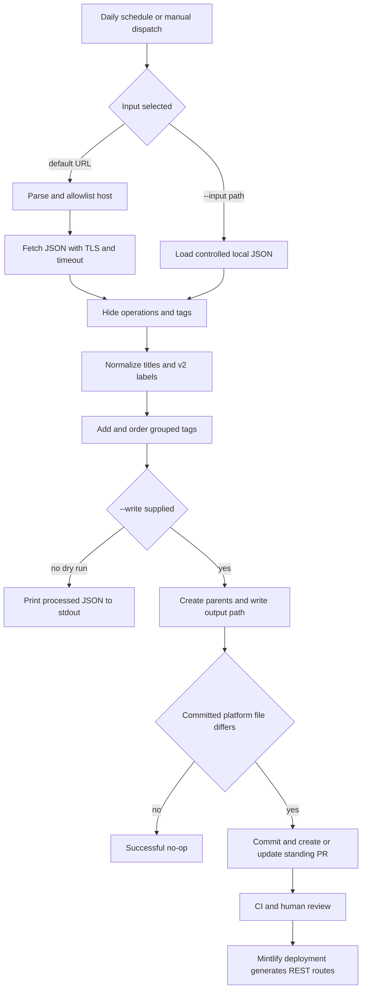

# LangSmith OpenAPI Refresh

The LangSmith REST API reference is published from the generated, committed `src/langsmith/langsmith-platform-openapi.json`. It is not an authored MDX endpoint tree: `src/docs.json` supplies that file to Mintlify's `langsmith/smith-api` directory, and Mintlify generates endpoint routes at deployment. Do not edit the generated specification or deployment-generated endpoint pages by hand.

This workflow owns only the LangSmith REST platform artifact. The Agent Server OpenAPI input is configured separately as `src/langsmith/agent-server-openapi.json` under `langsmith/agent-server-api`. The Control Plane API is also separate: its `src/docs.json` entry points directly to `https://api.host.langchain.com/openapi.json`. Refreshing the platform artifact does not update either API.

## End-to-end flow



This flow is specifically for the platform asset. Host validation happens before a remote request; a local `--input` bypasses network fetching but still goes through the same transformation. The dry-run branch emits the complete processed document and does not write an output file.

## Ownership and trust boundary

| Concern | Owner | Safe maintenance action |
| --- | --- | --- |
| Upstream platform API description | `https://api.smith.langchain.com/openapi.json` | Correct service-owned content upstream when appropriate. |
| Public REST-reference policy | `scripts/process_langsmith_openapi.py` | Change explicit hiding, titles, grouping, or ordering, then regenerate. |
| Generated platform input | `src/langsmith/langsmith-platform-openapi.json` | Review and merge the refresh PR; never patch the JSON manually. |
| Refresh and GitHub write authority | `.github/workflows/refresh-langsmith-openapi.yml` | Preserve its narrow staging and standing-PR behavior. |
| Agent Server input | `src/langsmith/agent-server-openapi.json` | Use the separate Agent Server specification-update process. |
| Control Plane input | `https://api.host.langchain.com/openapi.json` | Correct the service-owned source; do not commit a platform copy. |
| Rendered endpoint pages | Mintlify deployment configured by `src/docs.json` | Inspect a deployed preview or production site. |

The processor is the public-documentation policy boundary between service-owned input and the public REST reference. Its default network source is `https://api.smith.langchain.com/openapi.json`. `fetch_spec()` parses the URL and rejects a hostname outside the `api.smith.langchain.com` allowlist before requesting it. Remote requests use an SSL context, request JSON through the `Accept` header, and time out after 30 seconds. `--input` resolves and reads a local UTF-8 JSON file instead, which is the controlled path for reproducing a candidate or developing policy.

## Transformation policy

`process_spec()` mutates the loaded OpenAPI object in place. It skips path-level metadata such as `parameters`, `summary`, `description`, and `servers` when counting or transforming operations. Its policy deliberately shapes the public surface:

- It sets `x-hidden: true` on operations matching configured Fleet, product-feedback, internal/infrastructure, administration/debug, or metrics tags, as well as exact health/system paths and internal path prefixes. Matching top-level tags receive `x-hidden` too. The exact `/v2/sql/query` rule does not hide neighboring paths such as `/v2/sql/query/stats`.
- It supplies a fallback summary when one is absent, sentence-cases titles while preserving configured acronyms and proper nouns, and normalizes Beta and v2 markers. Visible, non-sandbox `/v2/` operations receive `(v2)`; configured v2 title overrides align selected v2 wording with v1 siblings. Existing markers are stripped before markers are reapplied, so repeated processing is idempotent.
- It ensures a top-level tag array, adds tags observed only on operations, attaches configured human-readable `x-group` values, and sorts tags using `GROUP_ORDER`; unlisted groups follow alphabetically.

The intentional extension points are the processor constants, including `HIDDEN_TAGS`, `HIDDEN_PATHS`, `HIDDEN_PATH_PREFIXES`, `TAG_GROUPS`, `GROUP_ORDER`, and the title/v2 tables. Change public categories there, not in the generated JSON. The processor serializes output as UTF-8 JSON with two-space indentation and a trailing newline.

## Local entrypoints and output boundaries

Run from the repository root:

```bash
uv run python scripts/process_langsmith_openapi.py --write
```

With no `--input`, the command fetches the default allowlisted URL. `--input /path/to/openapi.json` loads a local candidate. Without `--write`, the command is a dry run: it prints the complete processed document to standard output and leaves the filesystem untouched. `--output` selects the destination, and its default is the repository-relative `src/langsmith/langsmith-platform-openapi.json`; with `--write`, parent directories are created before the file is written.

```bash
uv run python scripts/process_langsmith_openapi.py --input /path/to/openapi.json
uv run python scripts/process_langsmith_openapi.py --input /path/to/openapi.json --write
```

A local write regenerates a derived artifact. For an unexpected exposure, omission, title, version marker, or sidebar group, change the upstream description or explicit processor policy, rerun it, and review the complete diff. The workflow stages only the default platform output path; a custom `--output` is useful for local inspection but is not part of the scheduled writer's commit boundary.

## Scheduled writer and review lifecycle

The trusted workflow runs daily at 10:00 UTC or on `workflow_dispatch`, with a 15-minute timeout and only `contents: write` and `pull-requests: write` permissions. It uses Python 3.13 through the repository uv setup action and invokes the processor with `--write`.

Before checkout, it creates a GitHub App token from `ORG_MEMBERSHIP_APP_ID` and `ORG_MEMBERSHIP_APP_PRIVATE_KEY`. Checkout and `gh` branch/PR operations use that token. The workflow avoids `GITHUB_TOKEN` for these writes because pushes or PRs made with it leave `pull_request` workflows awaiting manual approval.

The write step saves the generated candidate, restores the checked-out artifact, and searches for an open PR with head `chore/refresh-langsmith-openapi`:

1. If the PR exists, it fetches and checks out that branch; otherwise it creates the branch from the checkout.
2. It restores the candidate and compares only `src/langsmith/langsmith-platform-openapi.json`.
3. With no diff, it exits successfully without a commit or PR change.
4. With a diff, it commits that file. An existing PR receives an appended commit and normal push. Without an open PR, it force-pushes the standing branch because no open PR references it, then creates a PR against `main`.

This keeps one outstanding refresh PR rather than a daily queue. The workflow creates or updates the standing review PR but never merges it. Human review is the publication boundary for externally sourced documentation: inspect newly visible or hidden operations, title/version labels, tag groups, and the complete generated diff before merging.

## Failure semantics and validation boundaries

A disallowed fetch host raises `ValueError`; network, TLS, timeout, or JSON-decoding failures prevent a candidate from being produced. The workflow's `set -euo pipefail` makes later branch, checkout, commit, push, or PR-command failures stop the write step. A no-diff refresh is a successful no-op.

Local checks do not prove that LangSmith REST endpoint pages were rendered. `make check-openapi` runs `mint openapi-check` only on `langsmith/agent-server-openapi.json`. The broken-link filter excludes `/langsmith/smith-api` reports because those routes exist at deployment but not in the local build. Use a processor run and generated-diff review for transformation changes, then inspect a Mintlify preview or production site for the rendered REST surface.

The reusable documentation link workflow is read-only, uses Node 22 and a cached pinned Mint CLI, and runs `make broken-links-with-anchors`, `make check-mdx`, and `make check-openapi`. It checks generated-tree links, MDX syntax/components, and the Agent Server input; it does not validate the platform artifact or render deployment-generated REST routes.

### Focused tests

The processor test `tests/unit_tests/test_process_langsmith_openapi.py` exercises the path-specific hiding invariant: `/v2/sql/query` is hidden whether or not it has tags, while `/v2/sql/query/stats` and `/v2/runs/query` remain visible. It therefore guards against broadening the exact-path rule into an unsafe prefix rule, but does not test network fetches, CLI writes, or GitHub automation.

The focused link-filter tests cover snippet and OpenAPI false positives while preserving ordinary broken-link reports. In particular, the implementation separately filters the Agent Server route prefix and the LangSmith REST `smith-api` prefix. These tests do not render endpoint pages or exercise the platform processor, network fetch, PR lifecycle, or deployment-generated routes.

```bash
make test TEST_FILE=tests/unit_tests/test_process_langsmith_openapi.py
make test TEST_FILE=tests/unit_tests/test_filter_mint_broken_links.py
```

## Safe change checklist

1. Do not hand-edit `src/langsmith/langsmith-platform-openapi.json`, deployment-generated endpoint routes, or `build/`.
2. Keep platform network fetching restricted to `api.smith.langchain.com`; use `--input` for a controlled candidate.
3. Modify hiding, grouping, title, or ordering policy in `scripts/process_langsmith_openapi.py`, regenerate, and review the complete diff.
4. Preserve the workflow's single staged path, no-diff exit, GitHub App credential use, and one-standing-PR lifecycle.
5. Route Agent Server input changes through its own process and correct Control Plane content at its remote source rather than committing it as the platform input.
6. Review the refresh PR as a public API documentation change and inspect a Mintlify preview or production deployment for rendered endpoints.

## Related pages

- [Mintlify Integration](/openwiki/integrations/mintlify.md)
- [Reference Documentation Boundaries](/openwiki/integrations/reference-docs.md)
- [Testing Overview](/openwiki/testing/test-overview.md)
