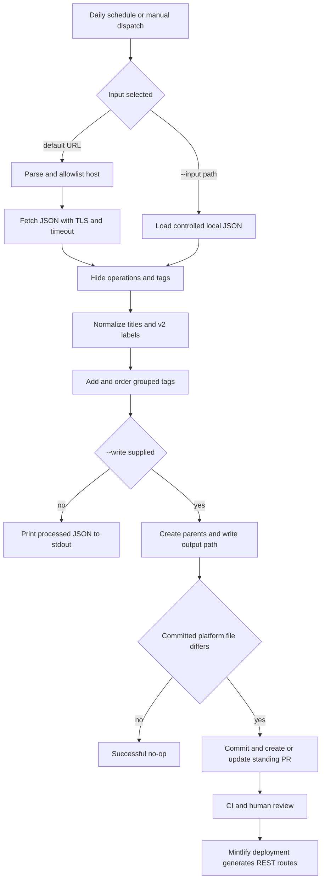

# LangSmith OpenAPI Refresh

LangSmith reference documentation has four OpenAPI sections, but they do not share one refresh mechanism:

| API section | Input ownership | Generated route |
| --- | --- | --- |
| LangSmith REST API | `src/langsmith/langsmith-platform-openapi.json`, refreshed in this repository from `https://api.smith.langchain.com/openapi.json` | `/langsmith/smith-api/` |
| Agent Server API | `src/langsmith/agent-server-openapi.json`, supplied by an external synchronization workflow | `/langsmith/agent-server-api/` |
| Tool Gateway API | `src/langsmith/tool-gateway-openapi.json`, a separately committed specification | `/langsmith/tool-gateway-api/` |
| Control Plane API | `https://api.host.langchain.com/openapi.json`, fetched by Mintlify at deployment; no local copy | `/api-reference/` |

The LangSmith REST reference is not an authored MDX endpoint tree. `src/docs.json` gives Mintlify the committed platform specification and the `langsmith/smith-api` directory; Mintlify generates endpoint routes at deployment. Do not hand-edit the generated specification or deployment-generated endpoint pages. Change the upstream description or the processor policy, regenerate through the workflow, and review the resulting PR.

## End-to-end flow



*This flow covers only the repository-managed LangSmith REST platform artifact.*

Host validation happens before a remote request. A local `--input` bypasses network fetching but follows the same transformation path. The dry-run branch prints the complete processed document and does not write a file.

## Ownership and boundaries

- **Upstream platform specification:** `https://api.smith.langchain.com/openapi.json` is the default source consumed by `scripts/process_langsmith_openapi.py`.
- **Public REST policy:** `scripts/process_langsmith_openapi.py` is the policy boundary between service-owned OpenAPI content and public documentation. Its constants define hiding, grouping, title, and ordering behavior.
- **Committed REST artifact:** `src/langsmith/langsmith-platform-openapi.json` is a derived input. Review and merge its refresh PR; never patch it manually.
- **Agent Server:** `src/langsmith/agent-server-openapi.json` is committed but externally synchronized by the private `langchainplus` workflow `langgraph-api-sync-openapi.yml`, which copies the source specification. Change the source there rather than editing this JSON.
- **Tool Gateway:** `src/langsmith/tool-gateway-openapi.json` is another committed OpenAPI input and is outside the platform refresh workflow.
- **Control Plane:** `src/docs.json` points directly to `https://api.host.langchain.com/openapi.json`; correct service-owned content rather than committing a platform copy. Its authored overview is `src/langsmith/api-ref-control-plane.mdx`.
- **Rendered routes:** Mintlify owns deployment-generated endpoint pages. Inspect a preview or production deployment instead of authoring generated routes locally.

The Agent Server and Control Plane inputs therefore differ in lifecycle: Agent Server is externally synchronized into a committed file, while Control Plane is fetched at deployment. Neither is updated by the scheduled platform refresh.

## Fetching and processing

The processor's default URL is `https://api.smith.langchain.com/openapi.json`. `fetch_spec()` parses the URL and rejects any hostname outside the `api.smith.langchain.com` allowlist before requesting it. Remote requests use an SSL context, request JSON with `Accept: application/json`, and have a 30-second timeout. `--input` resolves and reads a local UTF-8 JSON file, providing a controlled way to reproduce a candidate or develop policy.

`process_spec()` mutates the loaded OpenAPI object in place. It ignores path-level metadata such as `parameters`, `summary`, `description`, and `servers` when processing operations. Its public-documentation policy is:

- Mark operations with configured Fleet, product-feedback, internal/infrastructure, administration/debug, or metrics tags as `x-hidden: true`.
- Hide exact health/system paths and configured internal path prefixes. The exact `/v2/sql/query` rule does not hide neighboring `/v2/sql/query/stats` or `/v2/runs/query` paths. Matching top-level tags also receive `x-hidden`.
- Supply a fallback summary when absent, sentence-case titles while preserving configured acronyms and proper nouns, and normalize Beta and v2 markers. Visible, non-sandbox `/v2/` operations receive `(v2)`; configured overrides align selected v2 titles with v1 siblings. Existing markers are removed before markers are reapplied, making repeated processing idempotent.
- Ensure a top-level tag array, add tags seen only on operations, attach configured human-readable `x-group` values, and sort tags by `GROUP_ORDER`, with unlisted groups following alphabetically.

The intended extension points are `HIDDEN_TAGS`, `HIDDEN_PATHS`, `HIDDEN_PATH_PREFIXES`, `TAG_GROUPS`, `GROUP_ORDER`, and the title/v2 tables. Change policy there, not in generated JSON. Output is UTF-8 JSON with two-space indentation and a trailing newline.

## Local entrypoints

Run from the repository root:

```bash
uv run python scripts/process_langsmith_openapi.py --write
```

Without `--input`, this fetches the default allowlisted URL. A controlled local candidate can be previewed or written:

```bash
uv run python scripts/process_langsmith_openapi.py --input /path/to/openapi.json
uv run python scripts/process_langsmith_openapi.py --input /path/to/openapi.json --write
```

Without `--write`, the command prints the processed JSON to standard output and leaves the filesystem untouched. `--output` selects another destination; the default is `src/langsmith/langsmith-platform-openapi.json`. A write creates parent directories first. The scheduled workflow stages only the default platform path, so a custom output is for local inspection rather than the scheduled commit boundary.

## Scheduled refresh and PR lifecycle

`.github/workflows/refresh-langsmith-openapi.yml` runs daily at 10:00 UTC or through `workflow_dispatch`, with a 15-minute timeout and only `contents: write` and `pull-requests: write` permissions. It sets up Python 3.13 through the repository uv action and runs the processor with `--write`.

Before checkout it creates a GitHub App token from `ORG_MEMBERSHIP_APP_ID` and `ORG_MEMBERSHIP_APP_PRIVATE_KEY`. Checkout and `gh` operations use that token. This avoids the manual approval state that can affect `pull_request` workflows after writes made with `GITHUB_TOKEN`.

The writer maintains one standing review PR on `chore/refresh-langsmith-openapi`:

1. It saves the generated platform file, restores the checked-out version, and looks for an open PR with that head branch.
2. If the PR exists, it checks out the remote standing branch; otherwise it creates the branch from the checkout.
3. It restores the candidate and compares only `src/langsmith/langsmith-platform-openapi.json`.
4. If there is no diff, it exits successfully without a commit or PR change.
5. If there is a diff, it commits only that file. An existing PR receives an appended commit; without an open PR, the workflow force-pushes the unreferenced standing branch and creates a PR against `main`.

The workflow never merges. Human review and merge are the publication boundary for externally sourced documentation: inspect the complete generated diff, visibility changes, title/version labels, and tag groups before merging.

## Failure semantics and validation

A disallowed fetch host raises `ValueError`; network, TLS, timeout, or JSON-decoding failures prevent a candidate from being produced. The write step uses `set -euo pipefail`, so branch, checkout, commit, push, or PR-command failures stop the step. A no-diff result is a successful no-op.

Local checks do not prove that LangSmith REST endpoint pages rendered. `make check-openapi` runs `mint openapi-check` only on the Agent Server specification. `make broken-links-with-anchors` filters OpenAPI-generated paths, including `/langsmith/smith-api`, `/langsmith/agent-server-api/`, `/langsmith/tool-gateway-api/`, and `/api-reference/`, because those routes exist at deployment but not in the local build. Use a processor run and generated-diff review for transformation changes, then inspect a Mintlify preview or production site for generated REST pages.

The reusable documentation link workflow is read-only, uses Node 22 and a cached pinned Mint CLI, and runs `make broken-links-with-anchors`, `make check-mdx`, and `make check-openapi`. Its OpenAPI validation therefore targets only Agent Server; it does not validate the platform or Tool Gateway artifacts or render deployment-generated routes.

## Focused tests

`tests/unit_tests/test_process_langsmith_openapi.py` protects the exact-path hiding invariant for both tagged and untagged inputs: `/v2/sql/query` is hidden, while `/v2/sql/query/stats` and `/v2/runs/query` remain visible. It does not test network fetching, CLI writes, or GitHub automation.

`tests/unit_tests/test_filter_mint_broken_links.py` covers snippet and anchor false positives while preserving ordinary failures. Its OpenAPI case asserts the Agent Server prefix is filtered; the implementation separately excludes the LangSmith REST, Tool Gateway, and Control Plane prefixes. These tests do not render endpoint pages or exercise the platform processor, fetch, PR lifecycle, or deployment.

```bash
make test TEST_FILE=tests/unit_tests/test_process_langsmith_openapi.py
make test TEST_FILE=tests/unit_tests/test_filter_mint_broken_links.py
```

## Safe change checklist

1. Do not hand-edit `src/langsmith/langsmith-platform-openapi.json`, other generated endpoint routes, or `build/`.
2. Keep platform network fetching restricted to `api.smith.langchain.com`; use `--input` for a controlled candidate.
3. Change hiding, grouping, title, or ordering policy in `scripts/process_langsmith_openapi.py`, regenerate, and review the complete diff.
4. Preserve the workflow's single staged path, no-diff exit, GitHub App credential use, and standing-PR lifecycle.
5. Route Agent Server changes through its external synchronization process, maintain Tool Gateway through its own source, and correct Control Plane content at its remote source.
6. Treat the refresh PR as a public API documentation change and inspect a Mintlify preview or production deployment for rendered endpoints.

## Related pages

- [GitHub Actions](/openwiki/integrations/github-actions.md)
- [Mintlify](/openwiki/integrations/mintlify.md)
- [Reference Documentation](/openwiki/integrations/reference-docs.md)
- [CLI Tools](/openwiki/operations/cli-tools.md)
