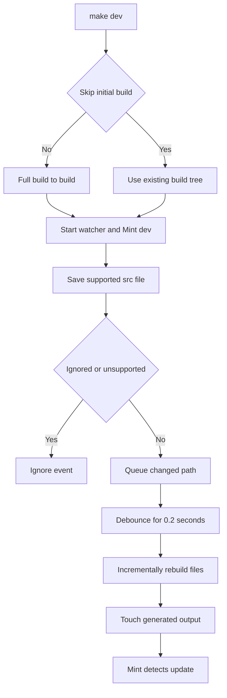

# Local Development Workflow

The local loop has a strict input/output boundary: author documentation, navigation, and assets in `src/`; the Python pipeline generates the Mintlify-facing `build/` tree. `build/` is disposable generated output. Never edit it directly: a full build deletes and recreates it.

## First-time setup

The checkout requires Python 3.13 or later, Node.js, and `uv`. The repository's `.mise.toml` selects Node.js 22, Python 3.13, and `uv` 0.9.26. It also pins Vale, opts into mise's experimental hooks, and installs `prek` pre-commit and pre-push hooks after `mise install`.

```bash
mise trust && mise install
```

Install repository dependencies and the separately installed Mintlify CLI:

```bash
git clone https://github.com/langchain-ai/docs.git
cd docs
make install
```

`make install` runs `uv sync --all-groups`, installs local npm packages, installs the global `mint` executable with `npm install -g mint@latest`, and invokes `make skills`. Mint installation is retried up to three times with increasing delays before the target fails. The Python dependency setup and global Mint installation are distinct: `uv` provides the repository's Python CLI and packages, while the global npm command provides `mint` for serving and generated-site checks.

`make skills` links canonical `.agents/skills/<name>/` directories into the gitignored `.claude/skills/` directory for Claude Code. It retains non-symlink personal entries and removes stale symlinks. Re-run it after adding or renaming a skill, and in each new worktree. Other supported agents read `.agents/skills/` directly; see [Agent Authoring Skills](/openwiki/operations/agent-skills.md).

If the Python `docs` command is unavailable after installation, relaunch the shell or activate the environment so it can find the installed console script. Check the separate Mint installation with `mint --version`.

## Edit authored inputs

Change `src/`, not `build/`. `src/docs.json` owns Mintlify site configuration and navigation, so update it when adding a page. Product content lives under `src/langsmith/` and `src/oss/`; reusable MDX, assets, and styles live under `src/snippets/`, `src/images/`, and `src/style.css`.

When Mint warns that a new navigation page does not exist, include the group's root `index` route without an extension:

```json
{
  "group": "New group",
  "pages": ["new-group/index", "new-group/other-page"]
}
```

## Choose an entrypoint

Use Make targets for usual checkout work. `make dev` and `make build` install local npm packages before calling the pipeline with the repository root on `PYTHONPATH`.

```bash
make dev                         # full build, watch, and local preview
make build                       # full build, then exit
uv run pipeline dev              # direct development command
uv run pipeline dev --skip-build # reuse a suitable existing build tree
uv run pipeline build            # direct one-shot build
```

The project Python CLI is installed as `docs = "pipeline.cli:main"`; after setup, `docs dev` and `docs build` are equivalent high-level entrypoints. Although the parser accepts `docs build --watch`, the build handler does not inspect that option and performs one build. Use `dev` for supported watch behavior. See [CLI Tools](/openwiki/operations/cli-tools.md) for the wider command surface.

## Start the edit–preview loop

```bash
make dev
```

Unless `--skip-build` is set, development mode performs a full build, creates a recursive watcher for `src/`, and starts `mint dev --port 3000` with `build/` as its working directory. Open <http://localhost:3000> and inspect the rendered route, navigation, formatting, and links.



This flow distinguishes the authoritative full reconstruction from focused updates during a preview session.

### Startup, failure, and shutdown

Without `--skip-build`, an initial-build failure returns failure before the watcher or Mint process starts. `--skip-build` deliberately bypasses that guard and merely warns when `build/` is absent; use it only for a known-good generated tree. After startup, a nonzero Mint exit, a cancelled watcher, or an unexpected watcher stop makes development mode fail. If `mint` is missing, the command advises running `make install` or installing it globally.

Press Ctrl+C to stop. The command shuts down the watcher, cancels a pending debounced rebuild, terminates Mint, waits up to five seconds, then kills Mint if needed. It also cancels and joins watcher, Mint-wait, and log-forwarding tasks. On Windows, Mint launches through a shell for `.CMD` compatibility; Unix uses direct execution.

## What an incremental update does

The `watchdog` observer monitors `src/` recursively. Create and modify events for builder-supported extensions are queued, including Markdown and MDX, JSON, images and video, YAML, styles, JavaScript/JSX/TSX, text, HTML, and fonts. It ignores editor backups ending in `~`, `.bak`, or `.orig`, plus hidden temporary files ending in `.tmp`, `.temp`, or `.swp`.

Queued paths are deduplicated in a set, and every event resets a 0.2-second debounce task. One path rebuilds on one worker; larger batches use a `ThreadPoolExecutor` with at most four workers and report progress. After rebuilding, the watcher touches emitted files so Mint detects a change. Versioned OSS content can touch Python and JavaScript outputs, while OpenWiki and Deep Agents Code use one unversioned output.

Deletion is narrower: the watcher removes the source-relative path under `build/` when it exists rather than applying the builder's full routing logic.

## Know when to reset with a full build

`make build` runs `DocumentationBuilder.build_all()` without watching. It clears `build/`, emits Python and JavaScript OSS variants, builds unversioned Deep Agents Code, OpenWiki, and LangSmith content plus managed Deep Agents variants, then copies shared files and npm snippet components.

Incremental builds take the per-file path. They do not rerun whole-tree shared-file collection or npm snippet overlays, and deletion can leave routed variants behind. Run `make build` after navigation, routing, shared-asset, snippet-component, broad preprocessing, deletion, or other cross-file changes, and whenever a preview looks stale. Fix the source or generator and rebuild—never patch `build/`.

For routing and preprocessing detail, see [Build System Architecture](/openwiki/architecture/build-system.md). For the renderer-facing contract, see [Mintlify Integration](/openwiki/integrations/mintlify.md).

## Validate the change

Choose the narrowest check that proves the changed boundary:

| Change boundary | Command | What it checks |
| --- | --- | --- |
| Pipeline, preprocessing, routing, or watcher behavior | `make test` | Pytest with network sockets disabled except Unix sockets. Focus the watcher suite with `make test TEST_FILE=tests/unit_tests/test_watcher.py`. |
| Python tooling and spelling | `make lint` | Ruff formatting and lint diffs, `ty`, and Codespell on `src`. |
| Markdown style | `make lint_md` | Markdownlint below `src`; use `make lint_md_fix` to apply fixes. It requires the markdownlint CLI or suggested VS Code extension. |
| Prose | `make lint_prose` | Installs the Vale version pinned in `.mise.toml` to `.bin/vale`, then checks `src` or `FILES`. |
| Generated links and anchors | `make broken-links-with-anchors` | Rebuilds, runs Mint from `build/` with redirect and anchor checking, and filters known non-actionable reports. |
| Source `@[ref]` references | `make check-cross-refs` | Checks source references separately from Mint's built-site check. |

Focused watcher tests cover backup and temporary-file filtering. Add focused tests when changing event filtering, rebuilding, routing, or shutdown behavior. See [Testing Overview](/openwiki/testing/test-overview.md) for the broader validation model.

## Run Mint safely and troubleshoot tools

Run raw `mint` commands from `build/`, not the project root. At the root, Mintlify can scan `.venv` package files and parse Python-package Markdown as MDX. Prefer wrappers that build and select the generated working directory:

```bash
make broken-links
make broken-links-with-anchors
```

For a raw command:

```bash
cd build
mint broken-links
```

Both link-check targets require a full build, run `mint broken-links --check-redirects` from `build/`, and fail only on remaining link entries after filtering known reports. The anchor variant additionally passes `--check-anchors`. The same directory rule applies to raw export and OpenAPI commands.

If Mint reports compatibility errors, first run `mint update` or `npm install -g mint@latest`, then restart the preview. The configured Node 22 is appropriate: Mint does not support Node 25 or later. `make export` also requires a recent Mint CLI with `mint export`, Node 20 or 22, and an Enterprise Mintlify plan.

### Recovery checklist

1. Re-run `make install` if Python dependencies, local npm packages, the global Mint CLI, or Claude Code skill links are missing.
2. If an initial build fails or a preview is suspicious, run `make build` and correct the authored source or pipeline configuration.
3. If Mint exits, inspect its forwarded logs, update Mint if necessary, and restart `make dev`.
4. For navigation, generated artifacts, routing, shared files, or deletions that incremental mode cannot explain, run a full build.
5. Run raw Mint commands only after `cd build`; otherwise use the Make target.

## Clean generated artifacts safely

`make clean` removes `build/`, root and nested Python bytecode caches, and `.pyc`, `.pyo`, and `.pyd` files. It does not remove authored `src/` files, repository dependencies, or the configured toolchain.

```bash
make clean
make build # regenerate a fresh build tree when needed
```

Use cleanup to discard generated state, then regenerate it; never use it as a substitute for correcting authored input or pipeline behavior.

## Related pages

- [Quickstart](/openwiki/quickstart.md)
- [Build System Architecture](/openwiki/architecture/build-system.md)
- [Mintlify Integration](/openwiki/integrations/mintlify.md)
- [CLI Tools](/openwiki/operations/cli-tools.md)
- [Agent Authoring Skills](/openwiki/operations/agent-skills.md)
- [Testing Overview](/openwiki/testing/test-overview.md)
