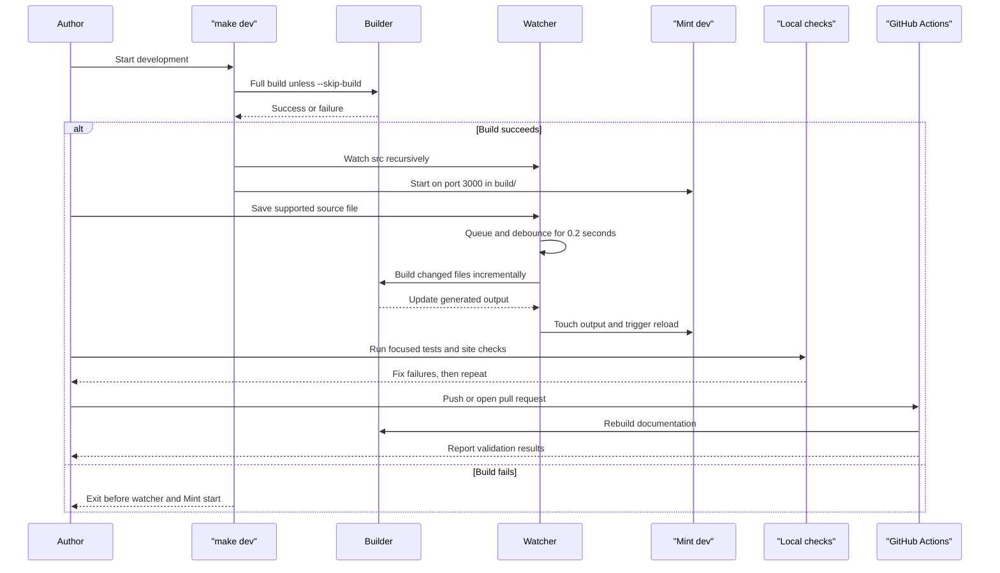

# Local Documentation Development Workflow

The local workflow turns authored files under `src/` into a disposable Mintlify site under `build/`. Edit source, navigation, snippets, and assets in `src/`; never patch generated files in `build/`.

## 1. Prepare the checkout

Use the repository's supported toolchain before editing:

- **Runtime**: Python 3.13 or later and Node.js. The checked-in mise configuration selects Python 3.13, Node.js 22, and `uv` 0.9.26; the project accepts `uv` 0.9.26 or later.
- **Dependencies**: `make install` runs `uv sync --all-groups`, installs root npm packages, installs the global `mint@latest` CLI, and links authoring skills. Mint installation retries up to three times.
- **Worktrees**: Run `make skills` in every new git worktree. It links canonical `.agents/skills/` directories into `.claude/skills/`, preserves existing non-symlink entries, and removes stale skill links.

```bash
mise trust && mise install
make install
```

If the `docs` console script is not on `PATH` after installation, relaunch the shell. The package exposes it from `pipeline.cli:main`; the commands below also work as `uv run pipeline ...` forms.

## 2. Select the source boundary

`src/docs.json` owns Mintlify configuration and navigation. When adding a source page, add its route to the appropriate product, tab, and group; a navigation group must include its root `index` route. Work in the source tree rather than guessing the generated destination:

- Product pages live under `src/langsmith/` and `src/oss/`.
- Reusable content lives under `src/snippets/`.
- Assets and styling live under `src/images/` and `src/style.css`.
- Runnable samples live under `src/code-samples/`.

Keep generated output out of the change. A full build clears `build/`, creates Python and JavaScript OSS variants, emits unversioned Deep Agents Code, OpenWiki, and LangSmith content plus managed Deep Agents variants, and copies shared files and npm snippet components.

## 3. Edit, build, and preview

Use the supported entrypoints:

```bash
make build                       # reconstruct build/, then exit
make dev                         # build, watch, and serve
uv run pipeline build            # direct one-shot pipeline command
uv run pipeline dev              # direct development command
uv run pipeline dev --skip-build # reuse an existing generated tree
```

`make build` is a one-shot production-style build. Although the CLI accepts `docs build --watch`, the build handler ignores that option; `dev` is the supported watcher entrypoint.

### Local edit-to-preview flow



This sequence shows the supported local lifecycle from source edit through CI handoff.

Without `--skip-build`, development performs a successful full build before starting the recursive `src/` watcher and `mint dev --port 3000`. Open <http://localhost:3000>. `--skip-build` only warns if `build/` is absent, so use it only when the generated tree is known to be current.

The dev command starts Mint in `build/`. Unix uses direct process execution; Windows uses a shell for `.CMD` compatibility. A missing Mint binary returns an installation hint. An initial build failure prevents both services from starting; after startup, a nonzero Mint exit or unexpected watcher stop fails the command. Ctrl+C shuts down the watcher, terminates Mint, waits up to five seconds, force-kills it if needed, and cancels its tasks.

### Understand incremental watcher limits

The watchdog observer monitors `src/` recursively. Created and modified files are accepted only for builder-supported extensions; editor backups ending in `~`, `.bak`, or `.orig`, and hidden `.tmp`, `.temp`, or `.swp` files are ignored. Events are deduplicated and debounced for 0.2 seconds. One-file batches use one worker; larger batches use up to four workers with progress reporting. The watcher touches generated paths after rebuilding so Mint notices the change.

Incremental rebuilding is narrower than a full build:

- It does not repeat shared-file collection or the npm snippet-component overlay.
- Deletion removes only the source-relative path below `build/`, not every routed output a full build may have produced.
- Navigation, redirects, shared assets, snippet components, broad preprocessor or package changes, and deletions can leave stale output.

Run `make build`, or `make clean && make build`, when a change crosses those boundaries. Do not edit `build/` directly.

For watcher changes, start with the focused path below; add a full build and a generated-route check when changing routing, output touching, event handling, or shutdown behavior:

```bash
make test TEST_FILE=tests/unit_tests/test_watcher.py
```

## 4. Run proportionate local validation

Run the smallest check that proves the changed behavior, then add generated-site checks for navigation, redirects, components, or links.

| Change boundary | Command | What it establishes |
| --- | --- | --- |
| Pipeline, preprocessor, routing, or watcher behavior | `make test TEST_FILE=tests/unit_tests/test_watcher.py` | Runs the selected pytest path with network sockets disabled and Unix sockets allowed. Omit `TEST_FILE` for the unit-test default. |
| Python quality and spelling | `make lint` | Runs Ruff format/check diffs, `ty`, and Codespell. |
| Markdown formatting | `make lint_md` | Runs Markdownlint below `src`; `make lint_md_fix` applies fixes. It requires the `markdownlint` CLI. |
| Edited prose | `make lint_prose FILES="src/..."` | Installs the Vale version pinned in `.mise.toml` at `.bin/vale` and checks selected prose, excluding code samples. |
| Source `@[ref]` links | `make check-cross-refs` | Resolves source references against the link map. |
| Built routes, redirects, and anchors | `make broken-links-with-anchors` | Rebuilds, runs Mint from `build/`, checks redirects and anchors, filters known non-actionable reports, and fails on remaining link lines. |
| MDX components and foreign syntax | `make check-mdx` | Checks the built site for unknown components and foreign syntax. |
| OpenAPI specification | `make check-openapi` | Validates the built Agent Server OpenAPI specification with Mint. |
| Runnable sample | `make test-code-samples FILES="src/code-samples/..."` | Executes only the selected supported sample. |

`make clean` removes `build/`, Python bytecode caches, and `.pyc`, `.pyo`, and `.pyd` files. It does not repair source or dependency problems.

### Run Mint from `build/`

Use the repository targets rather than raw Mint commands from the repository root. The targets build first and run Mint from `build/`:

```bash
make broken-links
make broken-links-with-anchors
```

Both use `mint broken-links --check-redirects` and filter known reports for deploy-time OpenAPI pages and standalone snippets. The anchor variant adds `--check-anchors`. For an exceptional raw Mint operation:

```bash
make build
cd build
mint broken-links
```

Local installation uses `mint@latest`; CI uses a pinned Mint version, so diagnose a CI-only failure with the CI version in mind. Node.js 22 is the configured local choice; Mint does not support Node.js 25 or later. `make export` additionally requires a recent CLI with `export`, Node 20 or 22, and an Enterprise Mintlify plan. `make export-htmltest` checks external URLs only because exported sites do not contain enough pages for reliable internal-link validation.

### Keep code-sample checks focused

`make test-code-samples` runs all eligible samples when `FILES` is unset. `FILES` is space-separated and accepts only existing `.py`, `.ts`, `.java`, `.kt`, `.go`, and `.sh` files under `src/code-samples/`; missing, unsupported, and out-of-tree values are skipped. `CODE_SAMPLE_PATHS` narrows either all-sample or explicit selection to directories under that root.

```bash
make test-code-samples FILES="src/code-samples/langchain/return-a-string.py"
CODE_SAMPLE_PATHS="src/code-samples/langsmith" make test-code-samples
```

The runner defaults to four jobs and serializes configured fixture-sharing groups. Rate-limited calls retry up to five times by default with a 30-second linear delay per attempt, capped at 120 seconds; both settings are configurable through environment variables. A sample still rate-limited after retries is reported as skipped, not passed.

A local preview needs only the local toolchain and generated site. Running a selected sample locally requires its provider credentials, language runtimes, and services. Credentialed CI separately supplies provider and LangSmith secrets, PostgreSQL, and additional Java and Go setup. Fork pull requests skip those runs because GitHub does not expose repository secrets to them.

## 5. Review and hand off

Before handing off an authored page, invoke the repository's `.agents/skills/docs-review` procedure on the changed source files. It reviews the diff with Vale, checks the style and structure rules in `AGENTS.md`, and checks mechanics such as navigation, internal links, code-block language tags, redirects, and component imports. Review the finished edit, not a draft, and keep the review scoped to the files changed by this pass.

The main CI workflow runs core tests, Python lint, documentation link and syntax checks, cross-reference checks, external documentation URL checks, generated-file checks, and merge-conflict checks. Documentation validation uses frozen uv dependencies, Node 22, and Mint CLI `4.2.1181`, then runs `make broken-links-with-anchors`, `make check-mdx`, and `make check-openapi`. Local checks are comparable, but local Mint is installed as `mint@latest`.

For pull requests, code-sample CI fetches the base branch from `origin`, derives modified supported sample paths, and filters them into OSS or LangSmith product matrix legs. Scheduled and manually dispatched runs test all samples. Secrets, gateway endpoints, the database service, and GitHub token-backed trace-refresh operations require authorized repository CI context and cannot be reproduced from an uncredentialed fork.

## Related pages

- [GitHub Actions integration](/openwiki/integrations/github-actions.md)
- [Adding pages](/openwiki/operations/adding-pages.md)
- [CLI tools](/openwiki/operations/cli-tools.md)
- [Testing overview](/openwiki/testing/test-overview.md)
