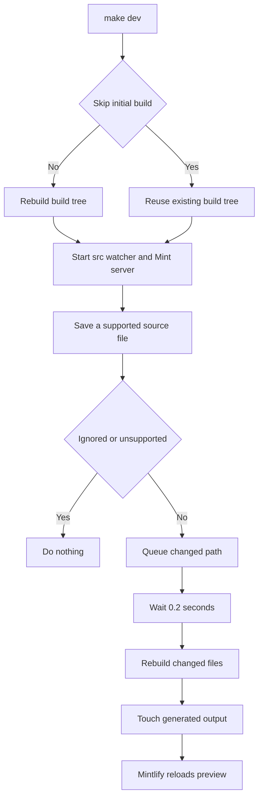

# Local Documentation Development

The contributor loop has a hard boundary: author documentation, navigation, and assets in `src/`; the Python pipeline generates the Mintlify-facing `build/` tree. `build/` is disposable output. Never edit it directly—correct the source or pipeline and regenerate it with a supported Make target.

## Set up a checkout

The repository requires Python 3.13 or later, Node.js, and `uv`. The checked-in mise configuration selects Node.js 22, Python 3.13, and `uv` 0.9.26; it also provides Vale, `prek`, and the Mint npm package. Start with mise when it is available:

```bash
mise trust && mise install
```

Mise enables its experimental hook support and runs `prek install` after installation to install pre-commit and pre-push hooks. Then bootstrap the checkout:

```bash
git clone https://github.com/langchain-ai/docs.git
cd docs
make install
```

`make install` synchronizes all Python dependency groups with `uv sync --all-groups`, installs local npm packages, installs `mint@latest` globally, and links agent skills. A failed global Mint installation is retried up to three times before installation fails.

### Link authoring skills

Task-specific procedures live in canonical `.agents/skills/` directories. Cursor, Codex, GitHub Copilot, Gemini CLI, OpenCode, and Deep Agents use that directory directly, while Claude Code reads `.claude/skills/`. `make install` invokes `make skills` to link each canonical skill into the latter directory. The linking target preserves existing non-symlink entries and removes stale symlinks. Run `make skills` again in a new worktree or after adding or renaming a skill.

The project also installs the Python console command `docs = "pipeline.cli:main"`. If it is not available immediately after setup, relaunch the shell. The Mint command is separately installed; verify it with `mint --version`.

## Edit inputs, not generated output

`src/` contains authored content. `src/docs.json` owns Mintlify navigation and site configuration, so update it when adding a page. Content is primarily under `src/langsmith/` and `src/oss/`; reusable content and presentation inputs include `src/snippets/`, `src/images/`, and `src/style.css`.

When adding a navigation group, include its root `index` route without an extension. Omitting it produces Mintlify's “page doesn't exist” warning even if the site builds:

```json
{
  "group": "New group",
  "pages": ["new-group/index", "new-group/other-page"]
}
```

## Build or preview

Use Make targets for normal contributor work. `make build` and `make dev` install local npm packages and invoke the Python pipeline with the repository root on `PYTHONPATH`.

```bash
make build                       # full reconstruction, then exit
make dev                         # full build, watch, and local preview
uv run pipeline build            # direct one-shot pipeline command
uv run pipeline dev              # direct development command
uv run pipeline dev --skip-build # reuse an existing generated tree
```

`docs build` and `docs dev` are equivalent installed entrypoints. Although the CLI exposes `docs build --watch`, its build handler does not inspect that option: it makes one build and returns. Use `dev` for supported watch behavior.

A full build clears `build/`, generates ordinary OSS Python and JavaScript variants, unversioned Deep Agents Code, OpenWiki, and LangSmith content, and managed Deep Agents variants. It then copies shared files and overlays npm snippet components. This is the authoritative reconstruction of the generated tree.

### Preview lifecycle



This shows the distinction between full reconstruction and the narrower incremental preview path.

Run:

```bash
make dev
```

Unless `--skip-build` is supplied, development mode runs the full build before it starts services. Only a successful initial build starts the recursive `src/` watcher and `mint dev --port 3000` in `build/`; open <http://localhost:3000>. `--skip-build` deliberately reuses what is already in `build/` and only warns if that directory does not exist, so use it only for a known-good generated tree.

An initial-build failure prevents watcher and Mint startup. After startup, a nonzero Mint exit or an unexpectedly stopped watcher makes the command fail. If `mint` cannot be found, install it through `make install` or `npm install -g mint@latest`. On Ctrl+C, the command stops the watcher, terminates Mint, waits up to five seconds, then kills Mint if necessary, and cancels its asynchronous tasks. Windows launches Mint through a shell for `.CMD` compatibility; Unix uses direct execution.

### What an incremental rebuild covers

The watchdog-based watcher monitors `src/` recursively. It queues supported create and modification events, deduplicates paths, and resets a 0.2-second debounce delay on each event. It ignores editor backups ending in `~`, `.bak`, or `.orig` and hidden temporary files ending in `.tmp`, `.temp`, or `.swp`.

A one-file batch builds on one worker; a larger batch uses a `ThreadPoolExecutor` with at most four workers and reports percentage progress. It then touches expected emitted files to make Mint detect the update. Versioned OSS content can have Python and JavaScript outputs, while OpenWiki and Deep Agents Code have one unversioned output.

Incremental work is intentionally not a replacement for a full build:

- It does not repeat the full build's shared-file collection or npm snippet overlay.
- On deletion, it removes only the source-relative path under `build/` when that file exists, rather than applying full routing. Generated routed variants can remain.
- Navigation, redirects, shared assets, snippet components, broad preprocessing changes, package changes, deletions, and a stale-looking preview therefore call for `make build`.

Never repair these symptoms by patching `build/`.

## Validate proportionately

Choose the smallest check that proves the boundary you changed, and add the generated-site check when a change affects routes, navigation, redirects, anchors, or rendering.

| Change boundary | Command | What it establishes |
| --- | --- | --- |
| Pipeline, preprocessing, routing, or watcher behavior | `make test` | Pytest runs with network sockets disabled except Unix sockets. Focus a suite with `make test TEST_FILE=tests/unit_tests/test_watcher.py`. |
| Python quality or source spelling | `make lint` | Ruff formatting and lint diffs, `ty`, and Codespell over `src`. |
| Markdown formatting | `make lint_md` | Markdownlint for `.md` and `.mdx` below `src`. Use `make lint_md_fix` to apply auto-fixes. |
| Edited prose | `make lint_prose FILES="src/..."` | Installs the Vale version pinned in `.mise.toml` into `.bin/vale`, then checks the named files. Without `FILES`, it checks `src/`. |
| Source `@[ref]` links | `make check-cross-refs` | Source references resolve against the repository link map. |
| Built links, redirects, and anchors | `make broken-links-with-anchors` | Rebuilds, then uses Mint against `build/` with redirect and anchor checks. |
| Runnable documentation sample | `make test-code-samples FILES="src/code-samples/..."` | Runs the selected samples with local tools and supplied services or credentials. |

`make lint_md` and `make lint_md_fix` require the `markdownlint` CLI; the target suggests installing `markdownlint-cli` or using the VS Code extension. Focused watcher tests cover backup and temporary-file filtering. Add or run focused tests when changing event filtering, rebuild behavior, routing, or shutdown behavior.

Code-sample execution is a separate, potentially service-backed boundary. `make test-code-samples` runs all samples by default, accepts a space-separated `FILES` selection, and honors `CODE_SAMPLE_JOBS` (default four). Some samples are serialized because they share a LangSmith dataset or experiment fixture; rate-limited samples retry with backoff and can be reported as skipped after retries. A skipped rate-limited sample is not evidence that the sample executed successfully.

## Run Mint safely

Never run raw Mint commands from the project root. Mintlify scans the current directory and can try to parse Markdown in `.venv` packages as MDX, producing errors such as an unexpected `@` character. Prefer supported Make targets, which build first and run Mint from `build/`:

```bash
make broken-links
make broken-links-with-anchors
```

Both targets run `mint broken-links --check-redirects` from `build/`, filter known non-actionable report sections, and fail only if link-report lines remain. The anchor variant also passes `--check-anchors`.

For an exceptional raw Mint operation, build first and change into the generated directory:

```bash
make build
cd build
mint broken-links
```

The same working-directory rule applies to Mint export and OpenAPI commands. `make export` checks that Mint supports `export`, rejects Node 25 or newer, and runs `mint export` in `build/`. It requires Node 20 or 22, a recent Mint CLI, and an Enterprise Mintlify plan. `make export-htmltest` follows export with `htmltest` against the unpacked export; that configuration checks external URLs only because Mint export does not produce a complete page set for reliable internal-link checking.

If Mint reports compatibility errors or exits during development, run `mint update` or `npm install -g mint@latest`, then restart the preview. Node 22 is the configured choice because Mint does not support Node.js 25 or later.

## Reset generated state

`make clean` removes `build/`, root and nested Python bytecode caches, and `.pyc`, `.pyo`, and `.pyd` files. It does not alter authored `src/` content or dependencies.

```bash
make clean
make build
```

Use this sequence to discard generated state and reconstruct it; do not use cleanup instead of fixing the source or generator.

## Related pages

- [Build System Architecture](/openwiki/architecture/build-system.md)
- [Mintlify Integration](/openwiki/integrations/mintlify.md)
- [CLI Tools](/openwiki/operations/cli-tools.md)
- [Repository Wiki Quickstart](/openwiki/quickstart.md)
- [Testing Overview](/openwiki/testing/test-overview.md)
