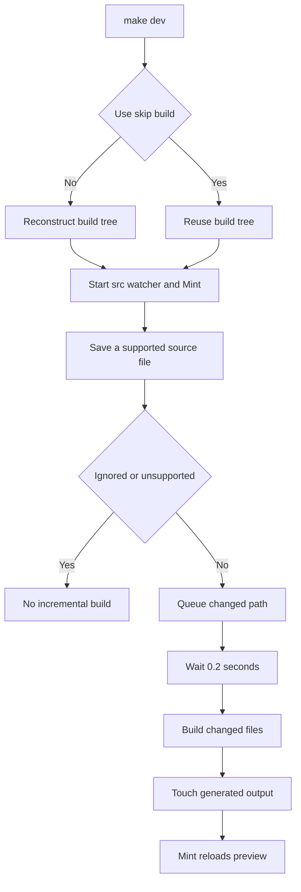

# Local Documentation Development

The practical boundary is simple: author pages, navigation, snippets, and assets in `src/`; the Python pipeline produces the Mintlify site in `build/`. `build/` is disposable generated output. Never patch it to fix a preview—change its source or generator and rebuild instead.

## Bootstrap a checkout or worktree

The project requires Python 3.13+, Node.js, and `uv`. The checked-in mise setup selects Node.js 22, Python 3.13, and `uv` 0.9.26, while the project accepts `uv` 0.9.26 or later. With mise, install the configured toolchain and hooks:

```bash
mise trust && mise install
git clone https://github.com/langchain-ai/docs.git
cd docs
make install
```

`mise install` runs the configured `prek install` post-install hook for pre-commit and pre-push hooks. `make install` synchronizes all Python dependency groups, installs root npm packages, installs the global Mint CLI, and links authoring skills. Mint installation retries up to three times, so an eventual failure is an installation failure rather than a reason to use an unpinned raw preview command.

The Python package installs the `docs` console script (`pipeline.cli:main`). Use either the Make targets or `uv run` forms below; if `docs` is not on `PATH` after installation, relaunch the shell or activate the environment. Mint is a separate global npm binary.

Canonical authoring procedures live in `.agents/skills/`. Most supported agents read that directory directly, but Claude Code reads `.claude/skills/`; `make install` runs `make skills` to create those links. Run it again after a skill rename or addition **and in every new git worktree**. The target preserves an existing non-symlink entry and cleans stale skill symlinks.

## Edit source inputs, not the generated site

`src/docs.json` owns Mintlify configuration and navigation. Add its route when adding a page; a navigation group must include its root `index` route or Mintlify can warn that the page does not exist even when a build succeeds. Typical authored inputs include product content under `src/langsmith/` and `src/oss/`, reusable content under `src/snippets/`, assets under `src/images/`, and `src/style.css`.

The builder clears and regenerates `build/` on a full build. It emits Python and JavaScript OSS variants, unversioned Deep Agents Code, OpenWiki, and LangSmith content, managed Deep Agents variants, shared files, and npm snippet components. Use a full build after changes that affect a whole tree rather than trying to infer generated destinations by hand.

## Build, watch, and preview

```bash
make build                       # reconstruct build/, then exit
make dev                         # build, watch, and serve
uv run pipeline build            # direct one-shot pipeline command
uv run pipeline dev              # direct development command
uv run pipeline dev --skip-build # reuse an existing generated tree
```

`make build` performs a full one-shot build. Although the CLI accepts `docs build --watch`, the build handler does not act on that option; use `dev` for supported watching.

### Preview lifecycle



*Development normally reconstructs the site before services start; subsequent saves follow the narrower incremental path.*

Without `--skip-build`, `dev` must finish a successful full build before it creates the recursive `src/` watcher and starts `mint dev --port 3000` in `build/`. Open <http://localhost:3000>. `--skip-build` only warns when `build/` is absent, so reserve it for a tree known to be current.

An initial build failure means neither service starts. Once running, a nonzero Mint exit or an unexpected watcher stop makes the command fail. Missing Mint produces an install hint; run `make install` or `npm install -g mint@latest`. On Ctrl+C, development signals watcher shutdown, terminates Mint, waits five seconds before a forced kill, and cancels its tasks. Mint launches through a shell on Windows for `.CMD` compatibility and via direct execution on Unix.

### What the watcher does—and does not—refresh

The watchdog observer recursively watches `src/`. Created and modified files with builder-supported extensions are queued, deduplicated, and debounced for 0.2 seconds; editor backups ending in `~`, `.bak`, or `.orig`, and hidden `.tmp`, `.temp`, or `.swp` files, are ignored. A one-file batch builds on one worker. Larger batches use up to four workers, show progress, then touch expected output paths so Mint sees the update.

This is an incremental convenience, not a full build:

- It does not repeat shared-file collection or the npm snippet-component overlay.
- On deletion, it removes only the source-relative path below `build/`, not every routed output that a full builder may have created.
- Navigation, redirects, shared assets, snippet components, broad preprocessor or package changes, and deletions can therefore leave a stale preview. Run `make build` (or `make clean && make build`) before diagnosing the content itself.

For watcher changes, start with `make test TEST_FILE=tests/unit_tests/test_watcher.py`; these focused tests cover temporary and backup-file filtering. Exercise the full build and the relevant generated route as well when changing routing, output touching, event handling, or shutdown behavior.

## Select validation by the changed boundary

Run the smallest check that proves the changed behavior, then add generated-site checks for navigation, redirects, components, or links.

| Change boundary | Command | What it establishes |
| --- | --- | --- |
| Pipeline, preprocessor, routing, or watcher behavior | `make test TEST_FILE=tests/unit_tests/test_watcher.py` | Runs the selected pytest path with Internet sockets disabled and Unix sockets allowed. Omit `TEST_FILE` for the unit-test default. |
| Python quality and spelling | `make lint` | Runs Ruff format/check diffs, `ty`, and Codespell. |
| Markdown formatting | `make lint_md` | Runs Markdownlint below `src`; use `make lint_md_fix` to apply fixes. It requires the `markdownlint` CLI. |
| Edited prose | `make lint_prose FILES="src/..."` | Installs the Vale version pinned in `.mise.toml` at `.bin/vale` and checks selected prose, excluding code samples. |
| Source `@[ref]` links | `make check-cross-refs` | Resolves source references against the link map. |
| Built routes, redirects, anchors, and MDX syntax | `make broken-links-with-anchors` then `make check-mdx` | Rebuilds and checks the generated Mint site; the latter fails on unknown components and foreign syntax that Mint would otherwise only warn about. |
| Committed OpenAPI specification | `make check-openapi` | Runs Mint's OpenAPI validation against the built Agent Server specification. |
| Runnable sample | `make test-code-samples FILES="src/code-samples/..."` | Executes only the selected supported sample. |

`make lint_prose` deliberately uses its local pinned binary even if another Vale is on `PATH`, making its result comparable to the repository configuration. `make clean` removes `build/`, Python bytecode caches, and compiled Python files; it does not repair source or dependency problems.

## Run Mint from the built site

Do not issue raw Mint commands from the repository root. Mint may scan `.venv` files as MDX and fail with errors such as an unexpected `@`. Use the safe targets, which build first and run from `build/`:

```bash
make broken-links
make broken-links-with-anchors
```

Both invoke `mint broken-links --check-redirects`, filter known non-actionable reports, and fail if actionable link-report lines remain. The anchor target additionally passes `--check-anchors`. The filter is intentional: some OpenAPI pages are generated at deploy time and are absent from the local build, and standalone snippets can report links that resolve only when inlined.

For an exceptional raw Mint operation, build and change directory first:

```bash
make build
cd build
mint broken-links
```

If Mint reports compatibility errors or exits during preview, update it with `mint update` or `npm install -g mint@latest`, then restart. Node 22 is the configured local choice; Mint does not support Node.js 25 or later. `make export` additionally requires a recent CLI with `export`, Node 20 or 22, and an Enterprise Mintlify plan; `make export-htmltest` checks only external URLs because Mint exports do not contain enough pages for reliable internal-link validation.

## Keep code-sample execution focused

`make test-code-samples` runs all eligible samples when `FILES` is unset. `FILES` is space-separated and accepts only existing `.py`, `.ts`, `.java`, `.kt`, `.go`, and `.sh` paths under `src/code-samples/`; missing, unsupported, and out-of-tree values are skipped. `CODE_SAMPLE_PATHS` further narrows either all-sample or explicit selection to directories inside that root.

```bash
make test-code-samples FILES="src/code-samples/langchain/return-a-string.py"
CODE_SAMPLE_PATHS="src/code-samples/langsmith" make test-code-samples
```

The runner defaults to four jobs and serializes configured fixture-sharing groups. Rate-limited calls retry up to five times by default with a 30-second linear delay per attempt, capped at 120 seconds; both settings are configurable through environment variables. A sample still rate-limited after retries is reported as skipped, not passed.

Running a selected sample locally is useful only when its provider credentials, language runtimes, and services are available. The local Mint preview does not require them. The credentialed CI workflow supplies provider and LangSmith secrets, a PostgreSQL service, and additional Java and Go setup; it intentionally skips fork pull requests because GitHub does not expose repository secrets there. Do not treat a local preview, an uncredentialed run, or a fork PR as proof that credentialed provider samples pass.

## What CI adds to local checks

The reusable documentation-validation workflow uses frozen uv dependencies, Node 22, and a cached Mint CLI pinned to `4.2.1181`. It runs `make broken-links-with-anchors`, `make check-mdx`, and `make check-openapi`. Run the matching Make commands locally to diagnose a failure, but account for a Mint version difference: local installation uses `mint@latest`, whereas that CI job uses its pinned version.

Some CI behavior specifically requires the repository context rather than just a working tree. For pull requests, code-sample CI fetches the PR base from `origin`, computes changed files, and partitions them into OSS and LangSmith product legs. Scheduled and manual runs execute all samples. Its secrets, gateway endpoints, database service, and GitHub token-backed trace-refresh PR operations cannot be reproduced from a fork without authorized credentials and the same repository permissions.

## Related pages

- [Build System](/openwiki/architecture/build-system.md)
- [Mintlify Integration](/openwiki/integrations/mintlify.md)
- [Agent Skills](/openwiki/operations/agent-skills.md)
- [Developer Commands and CLI Tools](/openwiki/operations/cli-tools.md)
- [Testing and Validation Overview](/openwiki/testing/test-overview.md)
- [Code Sample Lifecycle](/openwiki/workflows/code-sample-lifecycle.md)
