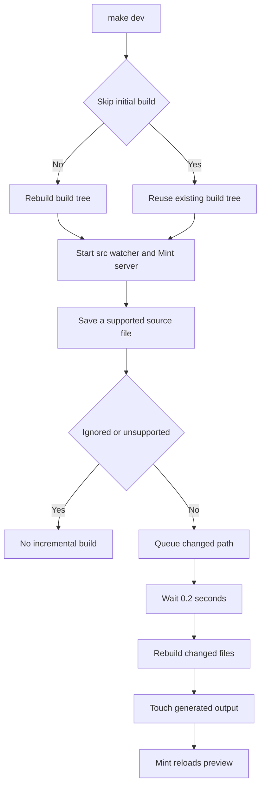

# Local Development Workflow

The contributor loop has a strict input/output boundary: author documentation, navigation, and assets in `src/`; the Python pipeline generates the Mintlify-facing `build/` tree. `build/` is disposable output, so never edit it directly. Correct `src/` or the pipeline, then regenerate with a supported target.

## Bootstrap a checkout

The repository requires Python 3.13 or later, Node.js, and `uv`. The checked-in mise configuration selects Node.js 22, Python 3.13, and `uv` 0.9.26; CI installs the same uv version. When using mise, install the pinned toolchain and hooks first:

```bash
mise trust && mise install
```

Mise enables experimental hooks and runs `prek install` after installation, wiring the configured pre-commit and pre-push hooks. Then bootstrap repository dependencies and the Mint command:

```bash
git clone https://github.com/langchain-ai/docs.git
cd docs
make install
```

`make install` runs `uv sync --all-groups`, installs root npm packages, and installs `mint@latest` globally. Global Mint installation retries up to three times before failing. The installed project exposes `docs`, which dispatches to `pipeline.cli:main`; relaunch the shell if that command is not yet on `PATH`.

### Link authoring skills

Task-specific procedures are canonical in `.agents/skills/`. Cursor, Codex, GitHub Copilot, Gemini CLI, OpenCode, and Deep Agents read that tree directly; Claude Code reads `.claude/skills/`.

`make install` invokes `make skills` to link each canonical skill directory into `.claude/skills/`. The target preserves a pre-existing non-symlink entry and removes stale symlinks. Run it again after adding or renaming a skill, or in each new worktree:

```bash
make skills
```

## Work on source inputs

`src/` contains authored documentation. `src/docs.json` owns Mintlify navigation and site configuration; update it when adding a page. Relevant authored inputs include `src/langsmith/`, `src/oss/`, `src/snippets/`, `src/images/`, and `src/style.css`.

When adding a navigation group, include its root `index` route without an extension. Omitting it causes Mintlify's “page doesn't exist” warning even when the site builds:

```json
{
  "group": "New group",
  "pages": ["new-group/index", "new-group/other-page"]
}
```

## Build and preview

Use Make targets for normal work. `make build` and `make dev` install local npm packages and invoke the Python pipeline with the repository root on `PYTHONPATH`.

```bash
make build                       # reconstruct build/, then exit
make dev                         # build, watch, and preview
uv run pipeline build            # direct one-shot pipeline command
uv run pipeline dev              # direct development command
uv run pipeline dev --skip-build # reuse an existing generated tree
```

After installation, `docs build` and `docs dev` expose the same pipeline CLI. Although the parser accepts `docs build --watch`, the build handler does not inspect that option: it builds once and returns. Use `dev` for supported watching.

A full build removes and recreates `build/`. It builds OSS Python and JavaScript output, unversioned Deep Agents Code, OpenWiki, and LangSmith content, Managed Deep Agents variants, shared files, and the npm snippet-component overlay. That whole-tree reconstruction is the reliable recovery path after broad changes.

### Preview lifecycle



*Development performs a full reconstruction before services by default; saves follow the narrower incremental path.*

Run the preview with:

```bash
make dev
```

Unless `--skip-build` is supplied, development completes a full build before starting the recursive `src/` watcher and `mint dev --port 3000` in `build/`. Open <http://localhost:3000>. `--skip-build` reuses the existing generated tree and only warns when `build/` does not exist, so use it only when that tree is known good.

The preview itself needs the local toolchain and generated site, not provider credentials or CI secrets. An initial build failure prevents both services from starting. After startup, a nonzero Mint exit or unexpected watcher stop fails the command. If Mint is missing, use `make install` or `npm install -g mint@latest`. Ctrl+C stops the watcher, terminates Mint, waits up to five seconds, then kills it if needed and cancels asynchronous tasks. Windows starts Mint through a shell for `.CMD` compatibility; Unix uses direct execution.

### Incremental-build limits

The watchdog watcher recursively observes `src/`. It queues supported created and modified files, deduplicates them, and resets a 0.2-second debounce interval on each event. It ignores editor backups ending in `~`, `.bak`, or `.orig` and hidden temporary files ending in `.tmp`, `.temp`, or `.swp`.

One changed file is built on one worker. Larger batches use up to four `ThreadPoolExecutor` workers and show percentage progress, then touch predicted generated files so Mint detects the output change.

An incremental edit is deliberately not a full reconstruction:

- It does not rerun shared-file collection or the npm snippet overlay.
- A deletion removes only the source-relative path beneath `build/`, rather than applying the builder's full routing rules. Routed generated variants can remain.
- Navigation, redirects, shared assets, snippet components, broad preprocessor changes, package changes, or deletions therefore require `make build`; use it too when hot reload looks stale.

Do not patch `build/` to compensate for any of these cases.

## Validate the changed boundary

Choose the smallest check that proves the change, then add generated-site validation for routes, navigation, redirects, anchors, imports, or rendering.

| Change boundary | Command | What it establishes |
| --- | --- | --- |
| Pipeline, preprocessing, routing, or watcher behavior | `make test TEST_FILE=tests/unit_tests/test_watcher.py` | A focused pytest path; omit `TEST_FILE` for the full unit-test default. Tests run with Internet sockets disabled and Unix sockets allowed. |
| Python quality and spelling | `make lint` | Ruff format/check diffs, `ty`, and Codespell. |
| Markdown formatting | `make lint_md` | Markdownlint below `src`. Use `make lint_md_fix` to apply its fixes. |
| Edited prose | `make lint_prose FILES="src/..."` | Installs the Vale version pinned in `.mise.toml` to `.bin/vale`, then checks selected prose while excluding code samples. |
| Source `@[ref]` links | `make check-cross-refs` | Source references resolve against the link map. |
| Built routes, redirects, and anchors | `make broken-links-with-anchors` | Rebuilds, then checks generated output with Mint. |
| Runnable sample | `make test-code-samples FILES="src/code-samples/..."` | Executes only the selected runnable sample boundary. |

`make lint_md` and `make lint_md_fix` require the `markdownlint` CLI; the target suggests installing `markdownlint-cli` or using the VS Code extension. Focused watcher tests cover backup and temporary-file filtering. Update or run focused tests when changing event filtering, routing, incremental rebuild behavior, or shutdown.

### Run code samples deliberately

`make test-code-samples` runs all eligible samples when `FILES` is unset. `FILES` is a space-separated list, but the runner accepts only existing `.py`, `.ts`, `.java`, `.kt`, `.go`, and `.sh` files under `src/code-samples/`; it warns and skips missing, unsupported, or out-of-tree selections. Use `CODE_SAMPLE_PATHS` to narrow either an all-sample run or an explicit list to space-separated directories under `src/code-samples/`. Entries outside that root are ignored with a warning, preventing a typo from widening the run.

```bash
make test-code-samples FILES="src/code-samples/langchain/return-a-string.py"
CODE_SAMPLE_PATHS="src/code-samples/langsmith" make test-code-samples
```

The runner uses `CODE_SAMPLE_JOBS` with a default of four workers. Known shared LangSmith fixture groups are serialized while unrelated samples may overlap. Rate-limit results retry with increasing delay, capped at 120 seconds; a sample still rate-limited after the configured attempts is reported as skipped rather than as successful execution. `CODE_SAMPLE_RATE_LIMIT_ATTEMPTS` defaults to 5 and `CODE_SAMPLE_RATE_LIMIT_DELAY_SECONDS` defaults to 30.

Samples that call providers or remote services need the corresponding local credentials and tools. The credentialed code-sample workflow receives provider API keys and a PostgreSQL service, and skips fork pull requests because secrets are unavailable there. Those secrets and services are CI concerns, not prerequisites for editing, building, or serving the local Mint preview. For authoring and lifecycle guidance, see [Code Sample Lifecycle](/openwiki/workflows/code-sample-lifecycle.md).

## Run Mint safely

Do not run raw Mint commands from the project root. Mintlify can scan virtual-environment files and parse them as MDX, causing errors such as an unexpected `@` character. Prefer Make targets, which rebuild and run Mint from `build/`:

```bash
make broken-links
make broken-links-with-anchors
```

Both targets run `mint broken-links --check-redirects` from `build/`, filter known non-actionable reports, and fail if remaining link-report lines exist. The anchor variant additionally passes `--check-anchors`.

For an exceptional raw Mint operation, build then change to the generated directory:

```bash
make build
cd build
mint broken-links
```

The same working-directory rule applies to export and OpenAPI commands. `make export` requires a recent Mint CLI with `export`, Node 20 or 22, and an Enterprise Mintlify plan; it rejects Node 25 or later and runs export in `build/`. `make export-htmltest` then unpacks the archive and runs htmltest against external URLs only, because Mint export does not emit a complete enough page set for reliable internal-link checks.

If Mint reports compatibility errors or stops during development, update it with `mint update` or `npm install -g mint@latest`, then restart the preview. Node 22 is the configured local choice because Mint does not support Node.js 25 or later.

## Reset disposable state

`make clean` removes `build/`, root and nested Python bytecode caches, and `.pyc`, `.pyo`, and `.pyd` files. It does not change authored content or dependencies.

```bash
make clean
make build
```

Use this sequence to discard stale generated state and reconstruct it, rather than treating cleanup as a substitute for fixing source or generator behavior.

## Related pages

- [Mintlify Integration](/openwiki/integrations/mintlify.md)
- [Developer Commands and CLI Tools](/openwiki/operations/cli-tools.md)
- [Quickstart](/openwiki/quickstart.md)
- [Testing and Validation Overview](/openwiki/testing/test-overview.md)
- [Code Sample Lifecycle](/openwiki/workflows/code-sample-lifecycle.md)
