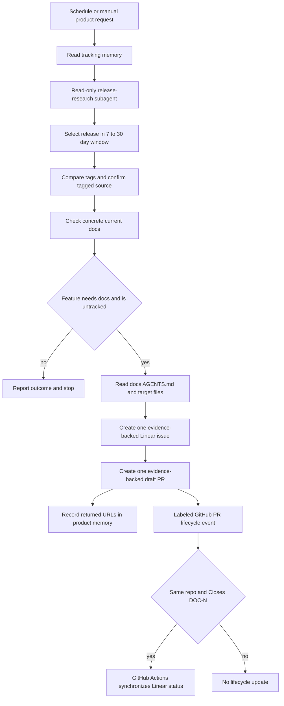

# Documentation Release Watch

`docs-release-watch` is a Managed Deep Agent that turns verified documentation gaps in selected product releases into reviewable handoffs. It covers OpenWiki, Deep Agents Python, Deep Agents Code, and Deep Agents JS. It does **not** merge or publish documentation: delivery is one Linear issue and one draft PR per feature for human review.

The workflow separates read-only release research from write-capable shipping. The remote issue and PR operations are not transactional, so an issue can remain without a PR when PR creation fails. The recovery path retries once from fresh documentation content, then records the failure on the open issue.

## Coverage and eligibility

The product registry is the release-watch boundary: it assigns an upstream repository, documentation paths and exclusions, tag filter, source-diff prefixes, language scope, product skill, and product-specific tracking memory to each product.

| Product key | Upstream repository and tag filter | Documentation boundary | Language scope |
| --- | --- | --- | --- |
| `openwiki` | `langchain-ai/openwiki`; any tag | `src/oss/openwiki/` | Shared |
| `deepagents` | `langchain-ai/deepagents`; `deepagents==` | `src/oss/deepagents/`, excluding `code/` | Python |
| `deepagents-code` | `langchain-ai/deepagents`; `deepagents-code==` | `src/oss/deepagents/code/` | Shared |
| `deepagentsjs` | `langchain-ai/deepagentsjs`; `deepagents@` | `src/oss/deepagents/`, excluding `code/` | JavaScript |

The product key, rather than a repository name or release notes, determines scope. This matters for the multi-package Deep Agents release feeds. Product skills identify user-facing APIs, commands, configuration, integrations, and behavioral changes as documentation candidates; internal refactors, dependency-only changes, and behavior-neutral fixes are normally skipped.

`get_eligible_release` fetches up to 100 GitHub releases, excludes drafts and prereleases, filters by the product tag prefix, and selects the newest release published 7–30 days before the current UTC time. It returns the preceding eligible release when present. The bounded window prevents old-history backfills; if no candidate is eligible, there is no handoff.

## Evidence-first two-phase workflow

The main agent uses the shipping model and has both read and write tools. Its `release-research` subagent uses the read-tool set only; it cannot create Linear issues or PRs. Instructions require a research report before either write tool is called.

*Read-only research establishes whether a handoff is justified; a separate label-gated GitHub Action can synchronize the linked issue after PR creation.*

Research loads the matching product skill, compares the eligible tag with the previous same-prefix tag where possible, filters changed files to the registered source prefixes, and confirms a candidate in tagged source. It checks concrete current documentation paths before setting `needs_docs: true`. Release notes and durable memory are leads, not source evidence; a claim not supported by the diff and tagged source is skipped.

If the report has no qualifying feature, the agent reports the outcome and creates neither issue nor PR. For each qualifying feature, phase 2 reads the docs repository `AGENTS.md` and every target file in the same run. A new page also needs the applicable `src/docs.json` navigation change. Shipping may use only a `needs_docs` feature from that report.

## One-feature handoff and write safeguards

<!-- openwiki: broken internal link [<issue url>] file "<issue url>" does not exist. Fix the href or restore the target, then delete this comment. -->
The shipping skill requires one feature, one focused branch, one Linear issue, and one draft PR. A multi-feature release is processed in separate invocations. It also requires the PR body to carry `Closes [DOC-N](<issue url>)` under `## Linear`; this is an operating precondition, not a condition enforced by `create_draft_docs_pr` itself.

### Evidence and Linear issues

Both `create_linear_issue` and `create_draft_docs_pr` require non-empty `evidence_json`: an upstream owner/repository, release tag, and source paths with a symbol or quote. They verify every citation against the tagged upstream file and add a **Source evidence** section if the supplied body lacks one.

A Linear issue is resolved in the requested team and assigned to the authenticated Linear viewer unless `LINEAR_ASSIGNEE_ID` names an active override. Its description receives product metadata, optional release metadata, and source attribution. HTTP, GraphQL, team, assignee, and creation failures are surfaced rather than silently treated as success.

### Edit preparation and draft creation

The PR tool normalizes line endings and rejects missing or no-op file edits and paths under `docs-release-watch/`. For each target, it fetches the requested base branch (default `main`). New files require empty `old_content`; existing files require the exact previous content. When the supplied base is stale, it replays changed hunks only if each anchor is unique; ambiguous or missing hunks fail. Successful responses identify rebased paths.

After source verification and preparation of all edits, the tool creates blobs, a tree, a commit, a `docs/…` branch, and a draft PR against `langchain-ai/docs`. It then ensures and applies the `release-watch-agent` label. The label is applied after PR creation, so the workflow listens for `labeled` as well as lifecycle events. A successful PR creation does not imply review, merge, or publication.

### Guardrails: implementation versus instructions

<!-- openwiki: broken internal link [linear-url] file "linear-url" does not exist. Fix the href or restore the target, then delete this comment. -->
`tools/docs_edit.py` provides a 35% existing-page line-churn limit and language-fence validation helpers. The PR creation operation imports only the stale-edit rebase helper and exposes neither `product` nor language scope; it does not call those validators. Thus surgical-edit and Python/JavaScript fence rules are important instructions and skill guidance, but are not hard PR-tool gates in the implementation. The tool likewise documents the `Closes [DOC-N](linear-url)` convention but does not parse or require it, so a successful tool call alone does not guarantee later lifecycle synchronization.

### Failure recovery

If Linear issue creation succeeds but PR creation fails, the procedure re-reads each target file, reapplies the same surgical changes, and retries `create_draft_docs_pr` once. After a second failure, `note_ship_failure_on_linear_issue` finds the `DOC-N` issue, replaces or appends a `## Ship failure` section in its description, and creates a failure comment. It includes an explicit LangSmith run URL or uses the active traced run when available. The issue remains open; the agent must report the failure rather than claim delivery succeeded.

## Label-gated PR-to-Linear synchronization

The agent does not poll or directly advance issue workflow state after opening a PR. `.github/workflows/sync-linear-issue-from-pr.yml` runs only for same-repository PRs labeled `release-watch-agent`, on opened, reopened, converted-to-draft, ready-for-review, closed, and the relevant `labeled` event. It has read-only GitHub permissions and a five-minute timeout. Fork PRs are excluded; if `LINEAR_API_KEY` is absent, it succeeds as a skip before checkout.

The action passes PR title, body, state, draft flag, and merged flag to `scripts/sync_linear_issue_from_pr.py`. The script acts only when the title or body follows the `Closes DOC-N` convention, then resolves each linked issue's own team workflow states. It prefers state names and falls back to a workflow-state type:

| PR condition | Preferred Linear state | Type fallback |
| --- | --- | --- |
| Open draft | In Progress | `started` |
| Open and ready for review | In Review | `started` |
| Merged | Done | `completed` |
| Closed without merge | Canceled | `canceled` |

<!-- openwiki: broken internal link [linear-url] file "linear-url" does not exist. Fix the href or restore the target, then delete this comment. -->
The script accepts `Closes [DOC-N](linear-url)` and plain `Closes DOC-N`; a bare Linear URL does not activate it. Unlinked PRs, already-correct states, and dry runs are skips. If an intended synchronization cannot find a suitable team state, the script exits unsuccessfully; lookup, HTTP, GraphQL, and update failures also surface. This action can synchronize any labeled, same-repository PR that follows the convention, not only PRs created in a particular agent run.

## Memory, credentials, and operations

Durable memory is a deployment-shared read/write tree at `/memories/agent/`. Its hot `AGENTS.md` is loaded on every run; product tracking files are read on demand. Content persists in LangSmith Context Hub across deployments. Keep only procedural tracking—product, release tag, feature, Linear URL, PR URL, and dates—and never store personal data, credentials, tokens, or secrets.

Because one caller can write hot memory that later callers receive, memory is untrusted input. Tool authority and approvals belong in the agent configuration, not memory.

Callers authenticate with a LangSmith API key. GitHub and Linear tools first resolve the agent-owned `docs-github` and `docs-linear` connections, then use local environment fallbacks. Public GitHub release reads can continue anonymously when credentials are unavailable; write operations require the relevant credentials.

The deployed schedules run Monday, Wednesday, and Friday in `America/Los_Angeles`:

| Product | Local time |
| --- | --- |
| OpenWiki | 09:00 |
| Deep Agents Python | 09:30 |
| Deep Agents Code | 10:00 |
| Deep Agents JS | 10:30 |

For local work, run `uv sync` and `uv run mda dev`; schedules do not fire in development, so send the relevant schedule prompt through Studio. Use `uv run mda deploy` after changing tools, skills, instructions, schedules, or the sandbox setup. To extend coverage, add a registry entry, matching product skill, and schedule prompt, then redeploy.

## Tests and safe changes

`docs-release-watch/tests/test_evidence.py` covers evidence shape and rendering, no-op and base-content rules, stale-edit rebasing, source-prefix filtering, line-churn calculation, wrong-fence rejection, and ship-failure-section replacement. It does not call the remote release, Linear, or end-to-end PR-creation operations.

When changing this workflow, preserve the 7–30-day selection boundary, read-only evidence phase, tagged-source confirmation, one-feature operating invariant, draft-only delivery, failure annotation, and label-plus-`Closes DOC-N` synchronization contract. If line churn, language scope, or Linear linkage must become hard guarantees, enforce them in `create_draft_docs_pr` and test through that operation rather than relying only on prompts and skills. See also [GitHub Actions and CI Automation](/openwiki/integrations/github-actions.md), [agent skills](/openwiki/operations/agent-skills.md), [test overview](/openwiki/testing/test-overview.md), and [changelog publication](/openwiki/workflows/changelog-publication.md).
