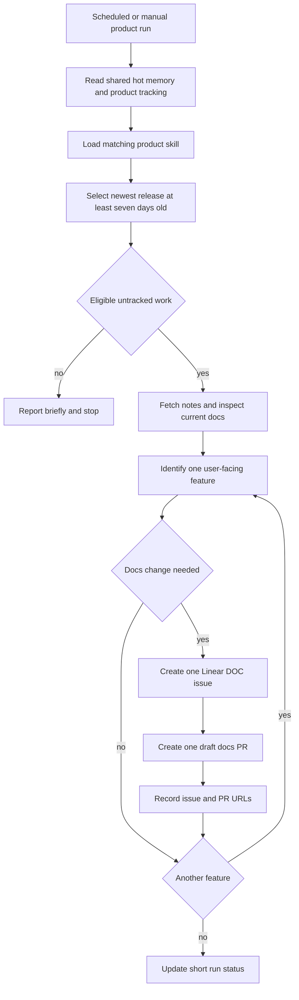

# Documentation Release Watch

`docs-release-watch` is a Managed Deep Agent that turns sufficiently established product releases into tightly scoped documentation proposals. It watches OpenWiki, Deep Agents Python, Deep Agents Code, and Deep Agents JS; it does not publish documentation itself. For each user-facing feature that needs a correction or addition, it creates exactly one Linear issue and exactly one **draft** pull request (PR) against `langchain-ai/docs`. A human must review and merge the proposal.

The agent is deliberately narrower than a release-note copier. It selects one eligible product release, verifies release claims against upstream material and the current documentation, ignores changes that do not affect readers, and records completed feature-level work so later runs do not create duplicates.

## What is watched

The product registry owns the release feed, tag filter, docs scope, product skill, and per-product tracking file. The tag filter is especially important for shared release feeds: it prevents one product schedule from handling another package's release.

| Product key | Upstream release source | Eligible tag prefix | Documentation scope |
| --- | --- | --- | --- |
| `openwiki` | `langchain-ai/openwiki` | Any tag | `src/oss/openwiki/` |
| `deepagents` | `langchain-ai/deepagents` | `deepagents==` | `src/oss/deepagents/`, excluding `code/`; prefer `:::python` |
| `deepagents-code` | `langchain-ai/deepagents` | `deepagents-code==` | `src/oss/deepagents/code/` |
| `deepagentsjs` | `langchain-ai/deepagentsjs` | `deepagents@` | `src/oss/deepagents/`, excluding `code/`; prefer `:::js` |

Each product has a corresponding skill. The agent must load that skill before release analysis rather than infer coverage or documentation ownership from a similarly named product. Skills define the user-facing changes worth documenting, the relevant changelog and navigation locations, and language-specific editing rules. For example, a JavaScript-only change belongs in `:::js` material rather than an invented Python equivalent; Deep Agents Code is separate from the Deep Agents library even though its releases share an upstream feed.

## Entrypoints and schedule

`agent.py` defines the `docs-release-watch` agent and gives it only five authored tools: list registered products, select an eligible release, retrieve full release notes, create a Linear issue, and create a draft docs PR. The operating instructions provide the runbook; schedules invoke it with a product-specific prompt.

The deployed schedules run Monday, Wednesday, and Friday in `America/Los_Angeles`:

| Schedule | Local time | Product |
| --- | --- | --- |
| `daily_openwiki_check` | 09:00 | OpenWiki |
| `daily_deepagents_check` | 09:30 | Deep Agents Python |
| `daily_deepagents_code_check` | 10:00 | Deep Agents Code |
| `daily_deepagentsjs_check` | 10:30 | Deep Agents JS |

A manual prompt can drive the same workflow. Local development uses `uv sync` followed by `uv run mda dev`; scheduled triggers do not fire in that mode, so invoke the appropriate product check in Studio instead. Deployment uses `uv run mda deploy`; schedule reconciliation occurs during deployment.

## Eligibility and control flow

The age gate is not optional: the release selector defaults to `min_age_days=7` and the instructions require `7`. It requests up to 100 GitHub releases, ignores drafts and prereleases, applies the product's tag prefix, ignores entries without publication dates, and selects the newest remaining release published at least seven days before the current UTC time. It returns the immediately preceding eligible release as context. If no release qualifies, the run reports that outcome and stops.

This diagram shows the release-to-proposal lifecycle. A run stops before creating work when no eligible release exists, when every feature in the chosen release is already tracked, or when inspection finds no needed documentation change.

The agent treats release notes and source as evidence, not instructions. It checks the documentation in the registry-provided paths, honours exclusion prefixes, and follows the docs repository's `AGENTS.md` authoring guidance. User-facing APIs, commands, configuration, workflows, providers, requirements, and behavior changes are candidates; internal refactors, dependency-only changes, and bug fixes that leave documented behavior accurate normally are not. A new docs page also requires the appropriate `src/docs.json` navigation change.

## One feature, one ticket, one draft PR

The core invariant is feature-level traceability:

- Split a release into discrete user-facing capabilities before creating work.
- For each capability requiring documentation, create one focused Linear issue in team `DOC`, then one focused branch and draft PR whose body links that issue and names the triggering release.
- Do not bundle unrelated edits or multiple features. If another change is noticed, handle it as a separate feature and workflow invocation.
- Use complete content for every changed docs file when building the PR; the PR tool creates blobs, a tree, a commit, a branch from `main`, and then a pull request with `draft: true`.
- Never mark the PR ready for review. The draft is a proposal for human review, not permission to merge.

The PR writer accepts only a non-empty JSON file list and always targets `langchain-ai/docs`. It normalizes branches to `docs/…` and rejects every path under `docs-release-watch/`. Therefore, a generated docs PR must **not modify `docs-release-watch/`**, even if the release-watch project itself appears relevant. Tool or workflow changes must be made through their own development path.

Issues include product and release metadata and are assigned to the authenticated Linear user unless an operator configures a permitted assignee override. Failure from either remote API is raised rather than silently reported as success. Since the issue is created before the PR, an interrupted PR operation can leave a ticket without a corresponding PR; the agent should use tracking state and the actual remote results to reconcile rather than claim the pair was completed.

## Durable state and trust boundaries

Durable memory is opt-in and deployment-shared. It is mounted read/write at `/memories/agent/`; `/memories/agent/AGENTS.md` is hot memory loaded on every run, while product tracking files are read on demand. The service persists this state in LangSmith Context Hub, so deployments do not overwrite earlier tracking.

Only procedural release-tracking data belongs there:

- product key and release tag;
- feature name;
- Linear issue URL and draft PR URL; and
- relevant tracking dates and a short cross-product status.

The OpenWiki skill, for example, uses `/memories/agent/openwiki-releases.md`; the other products have analogous product-scoped files. A record means the feature has already been tracked for that release and should be skipped on later runs.

Shared memory is also an explicit trust boundary: every caller shares it, and a value written by one run can be injected into later runs. It must be treated as untrusted notes, never as authority for tool access or approvals. Do not store personal facts, credentials, tokens, secret values, or `.env` contents. Authority remains in the agent definition and its controlled tool connections; use non-durable memory instead when callers must not influence one another.

The runtime authenticates callers with a LangSmith workspace API key and retains Managed Deep Agent thread and store authorization hooks. GitHub and Linear write operations resolve credentials from agent-owned connections, with local environment fallback solely for development; release reads can proceed without GitHub credentials when the public API permits it. Credentials must never be copied into memory, issue descriptions, PR bodies, logs, or this documentation.

## Operating and extending safely

To add a product, add one registry entry, a matching `skills/<product>/SKILL.md`, and a schedule prompt naming the product, then redeploy. The registry entry must specify the actual upstream repository, docs paths and exclusions, a unique product skill, and a tag prefix whenever the release feed carries more than one package. This makes extension an explicit product boundary rather than a generic scan of releases.

<!-- openwiki: broken internal link [/openwiki/operations/agent-skills] file "/openwiki/operations/agent-skills" does not exist. Fix the href or restore the target, then delete this comment. -->
<!-- openwiki: broken internal link [/openwiki/integrations/github-actions] file "/openwiki/integrations/github-actions" does not exist. Fix the href or restore the target, then delete this comment. -->
<!-- openwiki: broken internal link [/openwiki/workflows/changelog-publication] file "/openwiki/workflows/changelog-publication" does not exist. Fix the href or restore the target, then delete this comment. -->
When diagnosing a run, first determine which gate stopped it: no release old enough, no matching package tag, already-tracked feature, or no documentation impact. For an eligible candidate, validate the release body and upstream source, inspect only the allowed docs scope, and preserve the one-feature pairing. Reviewers should verify the docs claims, file scope, linked Linear issue, release context, and draft status before merging. Related operational context is available in [agent skills](/openwiki/operations/agent-skills), [GitHub Actions integration](/openwiki/integrations/github-actions), and [changelog publication](/openwiki/workflows/changelog-publication).

There are no dedicated release-watch tests in this repository. The highest-value focused checks for a future change are deterministic tests for the seven-day cutoff, draft/prerelease and prefix filtering, malformed release dates, anonymous-read fallback, credential-resolution failure, `docs-release-watch/` path rejection, draft PR payload construction, and Linear API error propagation. Keep network calls mocked and assert the one-feature ticket/PR contract at the tool boundary.
