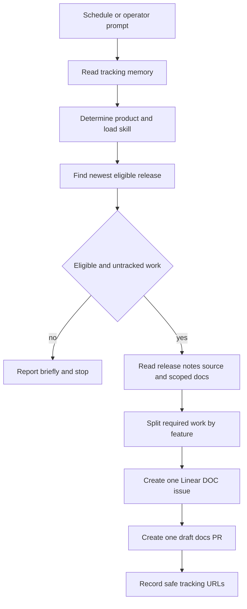

# Release Watch

`docs-release-watch` is a credentialed Managed Deep Agent for proposing documentation follow-up after a product release. It is not a GitHub Actions workflow and does not merge documentation. Given a product-specific prompt, it finds the newest eligible release, compares its release notes and source to the current documentation, and creates a **separate Linear DOC issue and draft `langchain-ai/docs` pull request for each user-facing feature that needs a change**. A human reviews every resulting draft before it can merge.

## Control flow and stopping conditions

The agent exposes only five tools: product discovery, eligible-release lookup, release-note lookup, Linear issue creation, and draft-PR creation. Its instructions supply the higher-level sequence: read tracking state, determine the product, load the matching product skill, apply the release gate, inspect the scoped docs, split work by feature, and update tracking after each successful feature. It should stop when there is no eligible release, when every feature for that release is already tracked, or when inspection finds no necessary documentation change.



*Each eligible, untracked documentation feature follows its own issue-and-draft-PR path; no-op runs do not create artifacts.*

### Release selection is deliberately conservative

`get_eligible_release` reads up to 100 GitHub releases for the selected product, skips drafts and prereleases, filters a shared release feed by the configured tag prefix, and considers only releases published at least `min_age_days` ago (seven by default). It keeps GitHub's newest-first order and returns the first remaining release, plus the next eligible release when present. `get_release_notes` repeats the product-prefix validation before fetching a tag, so a caller cannot request notes for another package in a shared feed.

Release reads can proceed without a GitHub credential: the helper first tries the configured credential and, if GitHub rejects it with 401 or 403, retries the public release endpoint without authorization. This fallback is read-only; creation of a PR requires the GitHub connection. Do not treat a returned release, a release-note claim, or an existing tracking entry as sufficient proof of a documentation change: the agent must verify the product source and current scoped docs.

## Product ownership and extension boundary

The registry is the source of truth for product coverage. Each entry names the upstream GitHub repository, `langchain-ai/docs` as the docs repository, documentation paths, optional excluded path prefixes, a release-tag prefix, a product skill, changelog URL, and a product-specific cold-memory file. The current registry covers OpenWiki, Deep Agents Python, Deep Agents Code, and Deep Agents JS. The two Deep Agents library variants deliberately share docs paths while excluding `src/oss/deepagents/code/`; their tag prefixes and skills prevent a package release on a shared feed from being assessed as the wrong product.

A product skill contributes product-specific judgment rather than broadening the writer's authority. For example, the OpenWiki skill identifies its docs and navigation sources, prioritizes reader-visible commands, integrations, modes, configuration, behavior changes, and requirements, and normally excludes internal refactors, behavior-neutral dependency bumps, and bug fixes that leave existing documentation accurate. It also requires a navigation update plan for a new page.

To add coverage, add a registry entry, a matching `skills/<product>/SKILL.md`, and a schedule prompt that explicitly names the product, then redeploy. Do not add a product merely by writing a prompt: instructions prohibit coverage with no matching skill. The supplied schedules run Monday, Wednesday, and Friday in `America/Los_Angeles`: OpenWiki at 09:00, Deep Agents Python at 09:30, Deep Agents Code at 10:00, and Deep Agents JS at 10:30.

## One-feature delivery contract

The `ship-docs-update` skill is the delivery contract. A release with multiple qualifying features is processed once per feature, with one focused branch, one Linear issue, and one draft PR; unrelated edits must become another issue. Before creating artifacts, the agent prepares complete contents for every file required by that feature alone. The issue description must carry release context, intended files, and acceptance criteria. The PR title matches the scoped issue, its body links the issue and names the triggering release, and its branch convention is `docs/<product>-<version>-<feature-slug>`.

The Linear writer resolves the requested team key, resolves an active assignee (the authenticated API-key owner unless `LINEAR_ASSIGNEE_ID` specifies an active user), creates the issue, and appends product, release, and agent-source metadata when it is absent. GraphQL HTTP, GraphQL-error, missing-team, inactive-assignee, and unsuccessful-mutation responses fail rather than reporting a fabricated issue.

The GitHub writer accepts a non-empty JSON array of complete `{path, content}` files, strips leading slashes, and rejects writes under `docs-release-watch/`. It normalizes a branch into the `docs/` namespace, reads the chosen base branch (default `main`), creates blobs, a tree, a commit, and a branch, then opens a PR with `draft: true`. It does not implement a compensating rollback: a failure after one remote GitHub operation may leave a branch or commit behind. Operators must check for existing issue, branch, commit, and PR artifacts before retrying a write, rather than blindly rerunning it.

## Trust boundaries

### Credentials and identity

Credentials are a write boundary. The GitHub and Linear helpers resolve agent-owned connections named `docs-github` and `docs-linear` first, then use local environment fallbacks. In local `mda dev`, the managed runtime resolves opaque connections from `MDA_DEV_DOCS_GITHUB` and `MDA_DEV_DOCS_LINEAR`; the tools can also fall back to `GITHUB_TOKEN` or `GH_TOKEN` for GitHub and `LINEAR_API_KEY` for Linear. Deployed instances need the agent-owned connections created from the project root. Never place token values in prompts, logs, memory, issues, or PR bodies.

Callers authenticate with LangSmith workspace API keys. Managed identity provides private threads and downstream credentials, but it does **not** make durable memory private; memory scope is configured separately. The model is configured through LangSmith's model gateway, so a deployment also depends on its workspace provider-secret configuration. Treat GitHub and Linear output as external side effects, not a substitute for a review gate.

### Shared durable memory

Durable memory is explicitly enabled with deployment-shared `scope="agent"`. It mounts a read/write tree at `/memories/agent/`; its `AGENTS.md` is hot memory injected into every subsequent run, while product release files are read on demand. Because every caller shares the tree and a prior caller can influence later injected context, memory is untrusted input and must never define tool authority, approvals, or policy.

The only permitted memory content is procedural tracking: product, release tag, feature name, Linear URL, PR URL, and dates. Product files support deduplication for a release-feature pair, while hot memory is intentionally a short status summary. Do not store credentials, secrets, personal information, private release or issue content, or copied instructions. The memory lives in LangSmith Context Hub and survives deployment, so deploying does not reset an incorrect tracking record; correct it cautiously after checking the external artifacts.

## Operation and validation

From `docs-release-watch`, initialize the managed-agent project with `uv sync` and start it with:

```bash
uv run mda dev
```

Schedules do not fire in development. Send the relevant schedule prompt in Studio to exercise the same route, using authorized non-production credentials if a real Linear issue or draft PR could be created. Deploy with `uv run mda deploy`; when schedule definitions change, allow deployment reconciliation to complete rather than using `--no-wait`.

Use an authorized development run of the affected schedule prompt to inspect release/product scoping, the agent response, tracking-memory behavior, and any created draft artifact. This exercises the managed control path and its connections, but it does not establish that the proposed docs are correct or merged. For an emitted documentation change, apply the docs repository's normal authoring, navigation, prose, build, and link validation; see [Adding and Maintaining Documentation Pages](/openwiki/operations/adding-pages.md). For broader guidance on skills and agent procedure ownership, see [Agent Authoring Skills](/openwiki/operations/agent-skills.md), [Repository Wiki Quickstart](/openwiki/quickstart.md), and [Testing Overview](/openwiki/testing/test-overview.md). GitHub Actions has a distinct trusted-writer model; see [GitHub Actions and CI/CD](/openwiki/integrations/github-actions.md).

## Safe-change checklist

1. Preserve the seven-day gate, draft/prerelease exclusion, per-product tag filtering, and newest-eligible selection.
2. Keep the registry, matching product skill, schedule prompt, docs paths, exclusions, and separate cold-memory file aligned.
3. Preserve one feature to one DOC issue and one **draft** PR. Never bundle unrelated work or mark the PR ready for review.
4. Treat GitHub, Linear, credentials, and shared memory as separate trust boundaries. Do not leak or copy sensitive values across them.
5. Preserve the docs-PR path guard and check external artifacts before retrying a partially completed writer operation.
6. Use an authorized controlled development run after changing tools, credentials, prompts, products, or schedules; review generated documentation through the normal docs process.
