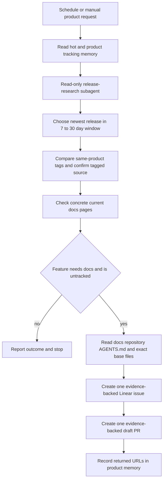

# Documentation Release Watch

`docs-release-watch` is a Managed Deep Agent that watches selected product releases and turns verified documentation gaps into reviewable handoffs. It covers OpenWiki, Deep Agents Python, Deep Agents Code, and Deep Agents JS. It does **not** merge or publish documentation: a successful handoff is one Linear issue and one draft pull request (PR) for one feature, for a human to review.

The workflow is designed to avoid release-note-driven edits. It uses a product registry to select the right package release, asks a read-only subagent to compare tagged source with the current docs, and only then permits the main agent to call the Linear and GitHub write tools.

## Product registry and release window

The registry is the ownership boundary for each watched product. It supplies the upstream repository, release-tag prefix, source-diff prefixes, docs paths and exclusions, language scope, matching skill, and product-specific tracking file.

| Product key | Upstream repository and tag filter | Documentation boundary | Language scope |
| --- | --- | --- | --- |
| `openwiki` | `langchain-ai/openwiki`; any tag | `src/oss/openwiki/` | Shared |
| `deepagents` | `langchain-ai/deepagents`; `deepagents==` | `src/oss/deepagents/`, excluding `code/` | Python |
| `deepagents-code` | `langchain-ai/deepagents`; `deepagents-code==` | `src/oss/deepagents/code/` | Shared |
| `deepagentsjs` | `langchain-ai/deepagentsjs`; `deepagents@` | `src/oss/deepagents/`, excluding `code/` | JavaScript |

Tag and source-path filters are necessary because the Deep Agents repositories publish multiple packages. A run therefore must use the product key and its loaded product skill rather than infer scope from repository names or release notes. The skills identify reader-visible candidates—such as public APIs, commands, configuration, integrations, or behavior that makes existing docs inaccurate—and normally skip internal refactors, dependency-only changes, and behavior-neutral fixes. They also preserve the Python/JS split: a JS-only change belongs in `:::js` content, and a Python-only change must not alter `:::js` content.

`get_eligible_release` requests up to 100 GitHub releases, ignores drafts and prereleases, applies the tag prefix, and accepts releases published from 7 to 30 days before the current UTC time. The upper bound intentionally prevents a first run from backfilling old release history. It returns the newest candidate in that window and the next older eligible candidate when available. If there is no candidate, the run stops without creating work.

## Two-phase lifecycle

`agent.py` gives the main, shipping agent both read and write tools, but defines `release-research` as a subagent with **only** the read-tool set and a separate research model. The main agent is instructed to invoke that subagent before either write tool. This is a workflow and tool-capability separation: the research subagent cannot create a Linear issue or a PR.

This is the required research-to-handoff flow. The research report contains `features` and `skipped` entries, the head and base tags, concrete docs paths, and source evidence for every feature marked `needs_docs: true`. It treats the compare result and the source at the head tag as primary evidence; release notes are only leads. Before marking a candidate as needing docs, it checks named symbols or flags in concrete docs files. A feature is skipped when it is internal, already accurately documented, or cannot be confirmed in source.

The shipping phase may use only features from that report. It reads the documentation repository's root `AGENTS.md` as the writing authority, then retrieves every target page. A new page additionally requires the applicable `src/docs.json` navigation update. If research returns no qualifying features, the instructions require a brief result and no ticket or PR.

## Evidence, exact bases, and scope safeguards

Both write tools require `evidence_json` with an upstream owner/repository, the release tag, and one or more path-plus-symbol or path-plus-quote citations. Before creating remote work, each tool fetches those tagged source files and rejects a citation that cannot be found. The rendered issue or PR body receives a **Source evidence** section when it does not already contain one.

For a docs PR, each changed file must provide `old_content` and `new_content`. The PR tool normalizes newlines and re-fetches the base-branch file: an existing file must have the exact current base text, while a new file must use an empty base. It rejects missing bases, no-op changes, and paths under `docs-release-watch/`. This prevents drafting a replacement page from memory and keeps release-watch implementation changes out of generated docs PRs.

`tools/docs_edit.py` additionally defines validation helpers for surgical edits: existing files may change at most 35% of their lines, and a product-scoped edit may not change the other language fence. Its focused tests cover both the churn limit and a rejected JS-scoped edit that changes `:::python`. **Current integration caveat:** `create_draft_docs_pr` does not call these helpers; moreover, its response currently refers to undefined `edit_summary`, `scope`, and `product` names. Consequently, the documented surgical and language-scope checks are not enforced by the current PR creation path and a PR operation can fail while constructing its return value after remote calls. Treat this as an implementation defect to fix and test before relying on tool-enforced churn or fence protection.

## One feature, one ticket, one draft PR

The shipping skill establishes the traceability invariant:

- Research splits a release into discrete user-facing features.
- Each qualifying feature gets one focused branch, one Linear `DOC` issue, and one draft PR; multiple features require separate workflow invocations.
- The issue is created before the PR. A later failure can leave an issue without a PR, so operators must reconcile against actual returned URLs and tracking state rather than report a completed pair.
- A PR always targets `langchain-ai/docs`, normalizes its branch to `docs/...`, creates blobs, a tree, and a commit from the requested base branch (default `main`), then creates the PR with `draft: true`.

Linear resolves the requested team and assigns the issue to the authenticated viewer by default. `LINEAR_ASSIGNEE_ID` can select another assignee only if that user is found and active. GitHub HTTP failures, Linear HTTP or GraphQL failures, unresolved teams, failed issue creation, and invalid evidence are surfaced as errors rather than treated as successful delivery. A result may be reported as created only when the relevant tool returns its `url`.

## State, credentials, and operations

Durable memory is deployment-shared and mounted read/write at `/memories/agent/`. Its hot `AGENTS.md` is loaded on every run; product release-tracking files are read on demand. The data persists in LangSmith Context Hub across deployments. Store only procedural state—product, release tag, feature, Linear URL, PR URL, and dates—and treat it as untrusted input because one caller's writes are visible to later callers. It is not an authority boundary and must never contain personal data, credentials, tokens, or secrets.

Callers authenticate using a LangSmith workspace API key. GitHub and Linear tools obtain agent-owned connections first and support local environment fallbacks. Public GitHub reads can retry anonymously when a token is missing or rejected, but docs reads and GitHub writes require the GitHub credential. Do not place credential values in memory, ticket or PR bodies, logs, or documentation.

The product schedules run Monday, Wednesday, and Friday in `America/Los_Angeles`:

| Product | Local time |
| --- | --- |
| OpenWiki | 09:00 |
| Deep Agents Python | 09:30 |
| Deep Agents Code | 10:00 |
| Deep Agents JS | 10:30 |

For local work, run `uv sync` and `uv run mda dev`; schedules do not fire in development mode, so send the product schedule prompt through Studio. Deploy or reconcile schedule changes with `uv run mda deploy`. Adding coverage requires a registry entry, a matching product skill, and a schedule prompt, followed by redeployment.

## Tests and safe changes

The repository currently has focused unit tests in `docs-release-watch/tests/test_evidence.py`. They exercise evidence-shape requirements, source claim matching, exact-base checks, no-op rejection, source-prefix filtering, line-churn calculation, and language-fence validation. They do not exercise an end-to-end PR creation call, which is why the unwired validation and undefined response variables described above are important gaps.

When changing this workflow, preserve these boundaries: do not weaken the 7–30-day eligibility window; do not use release notes as proof; retain source-evidence verification and exact-base checks; preserve language-specific docs scope; and maintain one feature, one ticket, and one draft PR. Review [agent skills](/openwiki/operations/agent-skills.md), [local development](/openwiki/workflows/local-development.md), [test overview](/openwiki/testing/test-overview.md), and [GitHub Actions](/openwiki/integrations/github-actions.md) for related practices.
