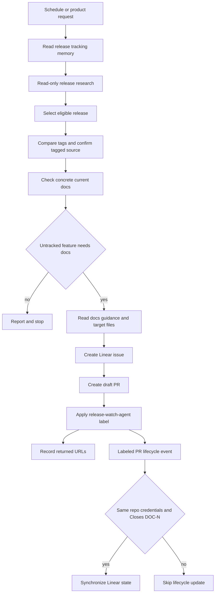

# Documentation Release Watch

`docs-release-watch` is a Managed Deep Agent review-handoff system. It researches product releases, then creates one evidence-backed Linear issue and one **draft** documentation PR for each qualifying feature. It does **not** merge a PR or publish documentation; humans review and merge the draft through the normal documentation process. A ticket or PR is only a completed handoff when its respective tool returned a `url`—the agent must report a failure rather than inventing an identifier or link.

The system covers OpenWiki, Deep Agents Python, Deep Agents Code, and Deep Agents JS. The product registry is the ownership boundary for each product's upstream repository, tag prefix, source-diff and documentation scope, language scope, skill, and persistent release-tracking file. This is especially important for the Deep Agents feeds, whose repositories publish more than one package.

| Product key | Release source and tag filter | Documentation scope | Language scope |
| --- | --- | --- | --- |
| `openwiki` | `langchain-ai/openwiki`; any tag | `src/oss/openwiki/` | Shared |
| `deepagents` | `langchain-ai/deepagents`; `deepagents==` | `src/oss/deepagents/`, excluding `code/` | Python |
| `deepagents-code` | `langchain-ai/deepagents`; `deepagents-code==` | `src/oss/deepagents/code/` | Shared |
| `deepagentsjs` | `langchain-ai/deepagentsjs`; `deepagents@` | `src/oss/deepagents/`, excluding `code/` | JavaScript |

## Release-to-handoff flow

`get_eligible_release` requests up to 100 GitHub releases, ignores drafts and prereleases, applies the product tag prefix, and chooses the newest release published 7–30 days ago. It returns the prior eligible release in that window when there is one. The bounded window deliberately avoids historical backfill; no eligible release, no untracked qualifying feature, or no documentation gap ends the run without creating remote work.

The main agent has read and write tools, but its `release-research` subagent has the read-tool set only. Instructions require research before either issue or PR creation. The subagent loads the matching product skill, compares the eligible release with the previous same-prefix release where possible, filters changes to configured source prefixes, confirms candidates against the tagged source, and checks concrete current docs paths. Release notes and persisted memory are leads, not proof. Product skills focus attention on user-facing APIs, commands, configuration, integrations, and behavior changes; they normally exclude internal refactors, dependency-only work, and behavior-neutral fixes.

*The PR handoff and the downstream GitHub Actions synchronization are separate operations; only the returned remote URLs establish a created issue or PR.*

The shipping procedure processes one feature per focused branch, Linear issue, and draft PR. For a candidate it must read the docs repository `AGENTS.md` and every edited target file in the same run; a new page also needs the applicable `src/docs.json` change. It must not bundle other release changes into that handoff.

## Write-path controls

### Evidence and Linear tickets

Both write tools require non-empty `evidence_json`: an upstream `source_repo`, a release `source_tag`, and one or more paths with a source symbol or quote. They fetch the cited files at that tag and reject missing or unsubstantiated citations. If the supplied body lacks `## Source evidence`, the tools add a rendered evidence section.

`create_linear_issue` resolves the requested team, assigns the issue to the authenticated Linear viewer by default, and accepts `LINEAR_ASSIGNEE_ID` only for an active override user. It appends product and optional release metadata. Team lookup, assignee lookup, HTTP, GraphQL, and issue-creation failures surface as errors.

### Draft PR construction and stale edits

`create_draft_docs_pr` targets `langchain-ai/docs`. Its input parser normalizes newlines, rejects an empty edit list, missing `old_content`, no-op entries, and edits under `docs-release-watch/`. A new file requires empty `old_content`; an existing file requires prior text.

For every target file, the tool fetches the requested base branch (`main` by default). Exact base content is accepted. If the branch moved, it replays the old-to-new changed hunks only where each anchor is unique; missing or ambiguous hunks fail instead of accepting a regenerated page. A successful response identifies any `rebased_paths`.

After evidence verification and edit preparation, it creates blobs, a tree, a commit, a normalized `docs/…` branch, and a GitHub PR with `draft: True`. It then ensures and applies the `release-watch-agent` label. These are sequential remote calls, not a transaction: for example, a later API failure can occur after earlier GitHub objects have been created. A caller must not describe the PR as created unless the operation returned its URL.

<!-- openwiki: broken internal link [linear-url] file "linear-url" does not exist. Fix the href or restore the target, then delete this comment. -->
The tool's docstring recommends `Closes [DOC-N](linear-url)` under a Linear heading, but it does not parse or enforce that body contract. The shipping instructions require it, because later lifecycle synchronization depends on a `Closes DOC-N` match. Thus a tool-returned draft PR can still be ineligible for Linear synchronization if its body lacks the convention.

### Operating guidance versus an enforced gate

`tools/docs_edit.py` provides helpers for a 35% existing-file line-churn limit and for blocking changes to the other `:::python` or `:::js` fence. `create_draft_docs_pr` imports only the stale-edit rebase helper; it has no product or language-scope parameter and does not call those validators. Surgical edits and language-fence isolation are therefore required procedure, not enforcement in the PR creation operation.

### Failure and retry

Issue creation and PR creation are separate operations. If a Linear issue succeeded but PR creation fails, the runbook requires a single retry after rereading every affected docs file and reapplying the surgical edits. If that retry fails, `note_ship_failure_on_linear_issue` finds the `DOC-N` issue, replaces or appends its `## Ship failure` section, and creates a failure comment. It includes an explicit LangSmith run URL or the current traced-run URL when one is available, leaves the issue open, and does not represent the feature as shipped.

## Label-gated GitHub-to-Linear lifecycle

The agent does not poll a PR or directly update an issue's lifecycle state after handoff. The GitHub workflow is a separate integration boundary. It listens for `opened`, `reopened`, `converted_to_draft`, `ready_for_review`, `closed`, and `labeled` pull-request events, but runs only when the PR head is in the same repository, the PR has the `release-watch-agent` label, and a `labeled` event is specifically for that label. The label is applied after PR creation, so the `labeled` event covers the race in which `opened` arrives before the label.

The job has read-only GitHub permissions and a five-minute timeout. If `LINEAR_API_KEY` is absent, it exits successfully before checkout and synchronization. Forks do not reach the job, avoiding exposure of the secret. When enabled, it passes the title, body, state, draft status, and merged status to `scripts/sync_linear_issue_from_pr.py`.

The script activates only when the title or body contains `Closes DOC-N` or the canonical `Closes [DOC-N](https://linear.app/.../issue/DOC-N...)` form. It resolves every matching issue and uses that issue's team workflow states, preferring configured names and falling back to Linear state type:

| PR condition | Preferred Linear state | Type fallback |
| --- | --- | --- |
| Open draft | In Progress | `started` |
| Open, ready for review | In Review | `started` |
| Merged | Done | `completed` |
| Closed without merge | Canceled | `canceled` |

An unlinked PR, an issue already in the target state, or a dry run is a skip. An intended synchronization fails when the team has no suitable target state; Linear transport, GraphQL, lookup, and update errors also fail. Because the action is gated by label and repository rather than agent internals, any same-repository PR with the label and `Closes DOC-N` convention can trigger it.

## Credentials, memory, and operations

Callers authenticate through LangSmith API-key authentication. Agent tools resolve the `docs-github` and `docs-linear` agent-owned connections first, then local fallbacks (`GITHUB_TOKEN` or `GH_TOKEN`, and `LINEAR_API_KEY`). Public GitHub release reads may continue anonymously if credentials are absent or GitHub rejects an authenticated request; GitHub docs reads/writes and Linear writes require usable credentials. Credentials belong only in connections or environment variables—never in memory, issues, or PR bodies.

Durable memory is a deployment-shared read/write `/memories/agent/` tree. Its hot `AGENTS.md` is loaded on each run; product files are read on demand and persist in LangSmith Context Hub across deployments. Store only procedural tracking: product, tag, feature, Linear URL, PR URL, and dates. Since one caller can influence subsequent runs through hot memory, treat it as untrusted input; tool authority and approvals remain in the agent definition. Never store personal data, tokens, secrets, or credentials.

The deployed product checks run Monday, Wednesday, and Friday in `America/Los_Angeles`: OpenWiki at 09:00, Deep Agents Python at 09:30, Deep Agents Code at 10:00, and Deep Agents JS at 10:30. For local development, run `uv sync` then `uv run mda dev`; schedules do not fire there, so use the schedule prompt in Studio. Redeploy changes with `uv run mda deploy`. Adding a product requires a registry entry, a matching product skill, and a schedule prompt, followed by redeployment.

## Tests and safe changes

`docs-release-watch/tests/test_evidence.py` exercises evidence shape/rendering, no-op and base-content rules, stale-edit rebasing, source-prefix filtering, line-churn calculation, wrong-language-fence rejection, and ship-failure-section replacement. It does not call the end-to-end remote PR creation operation.

When changing this workflow, preserve the 7–30-day selection boundary, tagged-source evidence gate, draft-only handoff, URL-based success reporting, and one-feature operating invariant. If line churn, language isolation, or Linear linkage must be guaranteed rather than instructed, enforce it within `create_draft_docs_pr` and test that operation. See [GitHub Actions and CI Automation](/openwiki/integrations/github-actions.md), [Agent Instructions and Authoring Skills](/openwiki/operations/agent-skills.md), and the [Repository Wiki Quickstart](/openwiki/quickstart.md) for adjacent operational boundaries.
