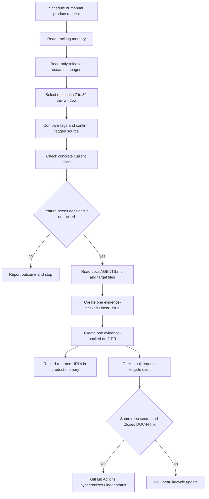

# Documentation Release Watch

`docs-release-watch` is a Managed Deep Agent that turns verified documentation gaps in selected product releases into reviewable handoffs. It covers OpenWiki, Deep Agents Python, Deep Agents Code, and Deep Agents JS. It does not merge or publish documentation: its intended delivery is one Linear issue and one **draft** PR per feature for human review.

The workflow deliberately separates read-only release research from write-capable shipping. Issue creation and PR creation are separate remote operations, however, so they are not transactional: a PR failure can leave a Linear issue without a PR. The prescribed recovery is to retry once from fresh documentation content, then annotate the open issue with the failure and, when available, a LangSmith run URL.

## Coverage and release eligibility

The product registry owns the release-watch boundary: upstream repository, documentation paths and exclusions, release-tag prefix, source-diff prefixes, language scope, product skill, and product-specific tracking memory.

| Product key | Upstream repository and tag filter | Documentation boundary | Language scope |
| --- | --- | --- | --- |
| `openwiki` | `langchain-ai/openwiki`; any tag | `src/oss/openwiki/` | Shared |
| `deepagents` | `langchain-ai/deepagents`; `deepagents==` | `src/oss/deepagents/`, excluding `code/` | Python |
| `deepagents-code` | `langchain-ai/deepagents`; `deepagents-code==` | `src/oss/deepagents/code/` | Shared |
| `deepagentsjs` | `langchain-ai/deepagentsjs`; `deepagents@` | `src/oss/deepagents/`, excluding `code/` | JavaScript |

The tag and source-prefix filters are important because the Deep Agents release feeds serve multiple packages. A run uses the requested product key and matching skill rather than inferring scope from a repository name or release notes. Product skills prioritize user-facing APIs, commands, configuration, integrations, and behavior changes that would make current documentation inaccurate; they normally skip internal refactors, dependency-only changes, and behavior-neutral fixes.

`get_eligible_release` fetches up to 100 releases, discards drafts and prereleases, applies the registered tag prefix, and selects the newest release published **7 to 30 days** before the current UTC time. It also returns the preceding eligible release in that window when available. The bounded window prevents an initial run from backfilling old history; no candidate means no handoff.

## Two-phase research and handoff

`agent.py` gives the main shipping agent both read and write tools, while `release-research` receives only the read-tool set. The main instructions require the subagent before either write tool. Research loads the matching product skill, reads release tracking, compares the eligible tag with the prior same-prefix tag where possible, filters the changed files to product source prefixes, and confirms a candidate in the tagged source. It then checks concrete current documentation paths before marking a feature `needs_docs: true`. Release notes are secondary leads, not proof.

*Research establishes the handoff; GitHub Actions is a separate downstream boundary that can synchronize the linked Linear issue after PR creation.*

If research finds no qualifying feature, the agent reports that outcome briefly and creates neither ticket nor PR. For each feature that does need work, the shipping skill requires the documentation repository `AGENTS.md` and every target file to be read in the same run. A new page also requires the applicable `src/docs.json` navigation change.

## Write-path safeguards

### Evidence and issue creation

Both `create_linear_issue` and `create_draft_docs_pr` require non-empty `evidence_json`: an upstream owner/repository, release tag, and one or more source paths each naming a symbol or quote. Each write path fetches every cited file at the tag and rejects a missing path or a citation not present in that file. It appends a **Source evidence** section when the supplied body lacks one.

A Linear issue is resolved in the requested team and assigned to the authenticated Linear viewer by default. `LINEAR_ASSIGNEE_ID` is usable only when it identifies an active user. The issue body receives product metadata, optional release metadata, and its source attribution. HTTP, GraphQL, team, assignee, and creation failures are surfaced as errors rather than silently creating a partial result.

### Documentation edits and draft PR creation

The PR tool parses all requested edits and normalizes line endings. A new file must have empty `old_content`; an existing file must provide nonempty prior content. It rejects no-op changes and paths under `docs-release-watch/`.

Before committing, the tool re-fetches every target file from the requested base branch, defaulting to `main`. When the supplied prior content equals the live base, it uses the proposed edit directly. If the base moved, it attempts to replay each changed hunk onto the live file only when its anchors are unique; ambiguous or missing hunks fail. This permits unrelated base drift without accepting a whole-page replacement. It returns the paths it rebased in the successful tool response.

Only after source-evidence verification and preparation of every edit does the tool create Git blobs, a tree, a commit, a `docs/…` branch, and a draft pull request against `langchain-ai/docs`. Human review remains required before merge.

### Guidance that is not enforced by the PR tool

`tools/docs_edit.py` contains helpers that reject existing-file edits above 35% line churn and edits to the other language fence for a Python- or JavaScript-scoped change. The focused tests exercise those helpers. The PR creation path imports only `rebase_edit_onto_base`; it neither calls the churn/fence validators nor accepts a product or language-scope argument. Therefore, the skill's surgical-edit and language-fence rules remain operating guidance rather than a hard `create_draft_docs_pr` gate.

<!-- openwiki: broken internal link [linear-url] file "linear-url" does not exist. Fix the href or restore the target, then delete this comment. -->
Likewise, the shipping skill requires one feature, one focused branch, one Linear issue, and one draft PR; a multi-feature release is processed in separate invocations. Neither write tool proves that feature isolation. The PR tool documents the `Closes [DOC-N](linear-url)` body convention but does not parse or require it. A successful draft-PR call can consequently lack the link required for later Linear lifecycle synchronization.

### Failure reporting

When an issue exists but draft-PR creation fails, the operating procedure is to read fresh target files, reapply the same surgical edits, and retry once. If that retry fails, `note_ship_failure_on_linear_issue` looks up the `DOC-N` issue, appends or replaces a `## Ship failure` section in its description, and creates a comment with the reason and an explicit or current LangSmith run URL when available. It leaves the issue open and reports failures rather than claiming that the feature shipped.

## Linear handoff and post-PR lifecycle sync

The handoff is considered successful only after both creation tools return URLs. Product memory then records the product, release tag, feature, Linear URL, PR URL, and dates. The main agent does not poll or update the issue's workflow state after opening the PR.

<!-- openwiki: broken internal link [<issue url>] file "<issue url>" does not exist. Fix the href or restore the target, then delete this comment. -->
A PR body should include `## Linear` with `Closes [DOC-N](<issue url>)`. `.github/workflows/sync-linear-issue-from-pr.yml` is a separate integration that runs on same-repository PR opened, reopened, converted-to-draft, ready-for-review, and closed events. It has read-only GitHub permissions and a five-minute timeout. Fork PRs do not enter the job, and an absent `LINEAR_API_KEY` produces a successful skip before checkout or synchronization.

When enabled, the job supplies the PR title, body, state, draft flag, and merged flag to `scripts/sync_linear_issue_from_pr.py`. The script activates only for a `Closes DOC-N` convention, resolves each linked issue and that issue's team workflow states, and uses preferred state names with a type fallback:

| PR condition | Preferred Linear state | Type fallback |
| --- | --- | --- |
| Open draft | In Progress | `started` |
| Open and ready for review | In Review | `started` |
| Merged | Done | `completed` |
| Closed without merge | Canceled | `canceled` |

The script accepts the canonical linked form and plain `Closes DOC-N`; a bare Linear URL does not activate it. Unlinked PRs, already-correct states, and dry runs are skips. A missing suitable team state causes the intended sync to fail, as do Linear HTTP, GraphQL, lookup, and update failures. This action can synchronize any same-repository PR following the convention, not just release-watch PRs.

## State, credentials, and operations

Durable memory is a deployment-shared, read/write tree at `/memories/agent/`. Its hot `AGENTS.md` is loaded on every run, while product tracking files are read on demand; content persists in LangSmith Context Hub across deployments. Store only procedural tracking: product, tag, feature, Linear URL, PR URL, and dates. Because all callers can influence later runs through this memory, treat it as untrusted input and keep tool authority and approvals outside it. Never store personal data, credentials, tokens, or secrets.

Callers authenticate with a LangSmith API key. GitHub and Linear tools first resolve agent-owned connections (`docs-github` and `docs-linear`) and then local environment fallbacks. Public GitHub release reads can proceed anonymously if a credential is unavailable or rejected; documentation reads and GitHub writes require a GitHub credential.

The deployed schedules run Monday, Wednesday, and Friday in `America/Los_Angeles`:

| Product | Local time |
| --- | --- |
| OpenWiki | 09:00 |
| Deep Agents Python | 09:30 |
| Deep Agents Code | 10:00 |
| Deep Agents JS | 10:30 |

For local work, run `uv sync` and `uv run mda dev`. Schedules do not fire in development, so send the relevant schedule prompt through Studio. Deploy or reconcile schedule changes with `uv run mda deploy`. To add coverage, add a registry entry, matching product skill, and schedule prompt, then redeploy.

## Focused tests and safe changes

`docs-release-watch/tests/test_evidence.py` provides focused tests for evidence shape and rendering, no-op and base-content rules, replaying a surgical stale edit, source-prefix filtering, line-churn calculation, wrong-fence rejection, and ship-failure-section replacement. It does not exercise remote release discovery, GitHub/Linear integration, or end-to-end PR creation.

When changing the workflow, preserve the 7–30-day eligibility window, tagged-source evidence, draft-only delivery, one-feature operating invariant, and downstream `Closes DOC-N` contract. If churn, language scope, or PR-to-issue linkage must become a hard guarantee, wire those checks into `create_draft_docs_pr` and add a test through that operation rather than relying on skills or prompts. For related boundaries, see [Repository Source Map](/openwiki/architecture/source-map.md), [GitHub Actions and CI Automation](/openwiki/integrations/github-actions.md), [agent skills](/openwiki/operations/agent-skills.md), and [test overview](/openwiki/testing/test-overview.md).
