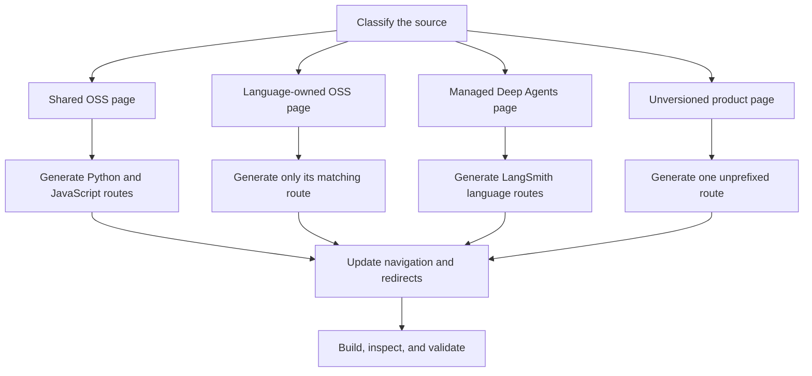

# Changing Versioned Content Safely

A versioned-content change is complete only when four independently maintained contracts agree: source ownership, generated routes, navigation, and redirects. `src/docs.json` does not make the builder emit a page; emitting a page does not put it in a menu; and neither preserves a retired public URL. Author under `src/`; `build/` is regenerated output to inspect, never to edit.



This flow separates the builder's source-to-artifact decisions from the independently configured reader journey and compatibility rules.

## 1. Classify the source before changing it

The builder accepts `python` and `js` as conditional targets. Their URL segments are `python` and `javascript`.

| Content | Author in | Full-build output |
| --- | --- | --- |
| Shared OSS page | Most of `src/oss/` | `/oss/python/...` and `/oss/javascript/...` |
| Language-owned OSS page | `src/oss/python/...` or `src/oss/javascript/...` | Only the matching language route, with the ownership directory removed |
| Deep Agents Code or OpenWiki | `src/oss/deepagents/code/...` or `src/oss/openwiki/...` | One unprefixed product route |
| Managed Deep Agents page | Direct `src/langsmith/managed-deep-agents*.mdx` file | `/langsmith/python/...` and `/langsmith/javascript/...` |
| Other LangSmith page | `src/langsmith/...` | One unprefixed `/langsmith/...` route rendered with the Python target |

Use a shared page when the explanation is common but APIs, packages, filenames, runtime types, or examples differ. `src/oss/python/` and `src/oss/javascript/` express output ownership; they are not a way to choose a sidebar. During a full OSS build, the builder skips the nonmatching ownership tree and removes the matching ownership directory from the public path.

Deep Agents Code and OpenWiki are deliberate single-output products. Their conditionals use the Python target as a deterministic fallback, not because they are Python documentation. Their own product paths stay unprefixed, but a bare link to ordinary OSS content from one of these pages resolves to the Python OSS route.

Managed Deep Agents is the LangSmith exception. The ordinary LangSmith pass excludes these files and a dedicated pass emits both language variants. For a full build, use a direct `.mdx` filename matching `managed-deep-agents*.mdx`; individual-file classification also recognizes `.md`, but the dedicated full-build glob does not discover it. Do not add an unversioned duplicate merely to preserve an old URL.

### Verify ownership routes with a full build

Do not use `build_file()` as the route-shape check for a language-owned OSS source. That entrypoint uses ordinary dual-output OSS handling, retaining the `python/` or `javascript/` source segment in the remainder. Only the full OSS pass filters the other ownership tree and removes that segment. Run a clean full build before accepting the public route.

## 2. Branch only the language-specific unit

Keep shared headings, explanation, and behavior outside adjacent `:::python` and `:::js` blocks. Put each complete differing unit—such as an installation command plus filename, a table, or a component invocation—inside its branch.

````markdown
Shared explanation.

:::python
```python
from langchain.agents import create_agent
```
:::

:::js
```typescript
import { createAgent } from "langchain";
```
:::
````

For the selected target, rendering removes the matching supported-block markers and retains its content, while removing the other supported block. Only `python` and `js` are valid targets; another target raises `ValueError`. Unsupported labels remain intact.

Managed Deep Agents pages use this pattern for Python and JavaScript project filenames, APIs, runtime types, and nullability. For example, the current identity and custom-frontend pages combine shared operational guidance with language-specific `identity.py`/`identity.ts`, agent-definition, and SDK examples. Branching the whole semantic unit prevents an import, type, or filename from one SDK appearing beside an example for the other.

### Conditional syntax is not structural parsing

Conditional rendering is a document-wide regex transform. It is not code-fence-aware and cannot safely represent nested conditionals. To display literal syntax, escape it:

````markdown
\:::python
This is displayed literally.
\:::
````

Do not nest conditionals or expect indentation or a Markdown code fence to protect live conditional syntax. The opening expression can retry with an empty indentation capture, and the first eligible closing marker ends the non-greedy match.

### Scope symbolic references deliberately

Markdown preprocessing resolves `@[Name]`, `@[title][Name]`, and backticked forms before it renders conditionals. Outside ordinary Markdown code fences, an active `:::python` or `:::js` fence selects the autolink map; otherwise the build target is the default scope. An unresolved reference is logged and left unchanged rather than failing the build.

A shared OSS reference outside a branch must resolve in both outputs. Put SDK-specific autolinks in the relevant branch. Escaped autolinks are emitted literally after their escape is removed. Then run:

```bash
make check-cross-refs
```

The checker scans authored `.md` and `.mdx` files below `src/`, derives default scopes from paths, and requires an unfenced shared OSS reference to resolve in every applicable scope. It exits nonzero for unresolved references. This is a source-level check, not a replacement for rendered-link validation.

## 3. Write links and snippets for the generated variant

### OSS and Managed Deep Agents links

For an ordinary OSS destination that should follow the active language, author an absolute, unqualified route:

```mdx
<!-- openwiki: broken internal link [/oss/deepagents/overview] file "/oss/deepagents/overview" does not exist. Fix the href or restore the target, then delete this comment. -->
[Deep Agents overview](/oss/deepagents/overview)
```

A target build inserts `python` or `javascript` after `/oss/`. It preserves an already-qualified route, a path containing `images`, and an OpenWiki or Deep Agents Code root or path. Explicitly qualify a route only when it must remain fixed to one SDK.

Apply the same rule to a Managed Deep Agents destination:

```mdx
<!-- openwiki: broken internal link [/langsmith/managed-deep-agents-deploy] file "/langsmith/managed-deep-agents-deploy" does not exist. Fix the href or restore the target, then delete this comment. -->
[Deploy](/langsmith/managed-deep-agents-deploy)
```

The builder emits `/langsmith/python/...` or `/langsmith/javascript/...`; an already qualified Managed Deep Agents route remains fixed. Current custom-frontend and identity pages rely on this behavior: their source links are unqualified despite being emitted into both Managed Deep Agents variants. Do not change such internal links to Python just because unprefixed public redirects target Python.

### Markdown snippets

Store reusable Markdown or MDX fragments below `src/snippets/` and import an unqualified Markdown fragment from a versioned page:

```mdx
import RequiresLanggraphServer from '/snippets/oss/requires-langgraph-server.mdx';
```

The builder rewrites eligible `.md` and `.mdx` imports to `/snippets/python/` or `/snippets/javascript/`; it leaves existing scoped imports and JSX or TSX component imports alone. Markdown snippets are independently preprocessed into Python and JavaScript copies plus a Python-targeted default copy. Use absolute `/oss/...` links inside a shared fragment so each output works when imported from consumers at arbitrary nesting depths.

## 4. Update navigation and redirects as separate deliverables

Creating a file does not create a sidebar entry. Once generated paths are known, edit `src/docs.json` with extensionless paths relative to `src`.

For a shared OSS source, add a Python entry and a JavaScript entry in the corresponding paired product menus. A language-owned source belongs only in its matching menu; an unversioned product source has one unprefixed entry. This is especially important for recently expanded shared pages: the current menus expose both `async-subagents` in the Deep Agents sections and `event-streaming` in the LangChain core-component sections.

Managed Deep Agents has two parallel tabs, one containing `langsmith/python/managed-deep-agents-*` entries and the other `langsmith/javascript/managed-deep-agents-*` entries. Preserve group parity when adding a page. The current paired tabs place Identity under **Agent capabilities** and Custom frontend under **Build and deploy** in both variants. A route that exists in only one of these tabs is a navigation defect even though its source is shared and both artifacts build.

Redirects are a separate public-URL contract. `docs.json` maps unprefixed and legacy Managed Deep Agents URLs to Python destinations because the builder intentionally emits no unprefixed Managed Deep Agents page. When moving or versioning a public page, decide whether each retired URL needs a redirect to its maintained canonical route; do not create an unversioned duplicate just for compatibility.

For every route change, review:

1. Source owner and every output route that must exist.
2. Sidebar placement for every reader-facing output, including paired menu parity.
3. Existing public URLs and required redirects.
4. Links from shared, language-specific, and unversioned pages.

See [Adding and Maintaining Documentation Pages](/openwiki/operations/adding-pages.md) for the general page-move procedure.

## 5. Build, inspect, and test the generated contract

Run a clean build when changing shared pages, links, snippets, builder rules, navigation, or redirects:

```bash
make build
make check-cross-refs
make broken-links
```

`build_all()` clears the build directory, generates both OSS variants, builds unversioned OSS products and ordinary LangSmith content, emits Managed Deep Agents variants, and copies shared files. `make broken-links` builds first and invokes Mint with redirect checks; use `make broken-links-with-anchors` when anchors changed. The broken-link task filters standalone snippet reports because their absolute language-prefixed OSS routes are valid after inlining, not when Mint checks a fragment alone.

Inspect generated files without modifying them:

1. Required routes exist and prohibited language siblings do not.
2. Each variant retains shared prose and its own branch only, without selected-branch markers.
3. SDK-scoped autolinks resolve in the intended branch.
4. Bare OSS links, bare Managed Deep Agents links, and Markdown imports target the expected variant.
5. Already-qualified links, image paths, and unversioned product paths remain unchanged.
6. `docs.json` exposes each new route in its correct menu and deliberately redirects retired public routes.

When changing build behavior, add a focused regression in `tests/unit_tests/test_builder.py` that asserts content and route presence or absence. Existing tests cover OSS-link exemptions, single-output products, snippet variants, and Managed Deep Agents routes and link rewriting. For a conditional-rendering or autolink change, test both target outputs and the relevant fence edge case.

## Completion checklist

- [ ] Select source ownership before deciding navigation or redirects.
- [ ] Use a full build—not `build_file()`—to validate a language-owned OSS route.
- [ ] Keep common prose outside sequential `:::python` and `:::js` blocks.
- [ ] Do not nest conditionals or rely on indentation or code fences to protect conditional markers.
- [ ] Put language-specific autolinks in their branch and run `make check-cross-refs` after reference changes.
- [ ] Use bare `/oss/...` and Managed Deep Agents links only when they should track the active language.
- [ ] Import shared Markdown snippets without a language prefix and use absolute OSS paths inside them.
- [ ] Update both applicable navigation menus and redirects in `src/docs.json` independently of source placement.
- [ ] Run `make build` and rendered-link validation, then inspect generated routes without editing `build/`.

## See also

- [Source and Generated Content Map](/openwiki/architecture/source-map.md)
- [Versioned Documentation and Routes](/openwiki/concepts/versioning.md)
- [Adding and Maintaining Documentation Pages](/openwiki/operations/adding-pages.md)
- [Cross-References and Links](/openwiki/operations/cross-references.md)
- [Builder Tests](/openwiki/testing/builder-tests.md)
- [Conditional Rendering Tests](/openwiki/testing/conditional-rendering.md)
