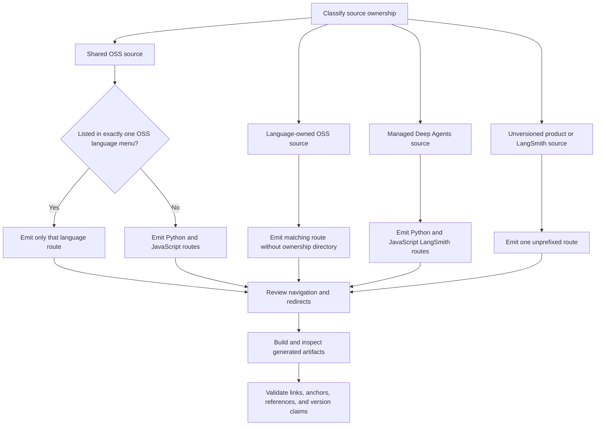

# Versioned Content Change Workflow

A versioned-content change has four contracts: authored source, generated routes, navigation, and redirects. Edit files under `src/`, not `build/`; `src/docs.json` controls reader-facing placement and also affects which language variants the OSS builder emits. Navigation does not create source files, and redirects do not create page artifacts.



*The flowchart separates the `docs.json` decision for shared OSS pages from the later redirect and validation checks.*

## 1. Classify the source and route owner

Start with the source-directory map rather than the menu label. The repository places shared open-source content in `src/oss/`, SDK-owned content in `src/oss/python/` or `src/oss/javascript/`, reusable fragments in `src/snippets/`, and LangSmith content in `src/langsmith/`. Deep Agents Code and OpenWiki are explicit unversioned products. Managed Deep Agents is the LangSmith exception: direct `src/langsmith/managed-deep-agents*.mdx` files have language-prefixed outputs.

| Content | Author in | Full-build output |
| --- | --- | --- |
| Shared OSS page | Most of `src/oss/` | `/oss/python/...` and `/oss/javascript/...`, or only one when navigation selects one language |
| Language-owned OSS page | `src/oss/python/...` or `src/oss/javascript/...` | Its matching language route, with the ownership directory removed |
| Deep Agents Code or OpenWiki | `src/oss/deepagents/code/...` or `src/oss/openwiki/...` | One unprefixed product route |
| Managed Deep Agents page | Direct `src/langsmith/managed-deep-agents*.mdx` file | `/langsmith/python/...` and `/langsmith/javascript/...` |
| Other LangSmith page | `src/langsmith/...` | One unprefixed `/langsmith/...` route |

For a shared Markdown page, the builder recursively reads the `oss/python/...` and `oss/javascript/...` entries in `src/docs.json`. Exactly one language listing emits only that language; listings in both trees, or no listing, emit both. Therefore a navigation move or deletion can change generated output even when the source file is unchanged. A language-owned source is different: the full build skips the other ownership tree and removes the matching ownership directory from the public path. Do not use an ownership directory merely to choose a sidebar.

`build_file()` is useful for individual files but is not a substitute for a clean full build when checking a language-owned route: ordinary single-file handling does not reproduce the full-build filtering and route-shape behavior.

Deep Agents Code and OpenWiki use a Python rendering target as a deterministic fallback while keeping unprefixed routes; this does not mean they are Python-only documentation. Managed Deep Agents is excluded from the ordinary unversioned LangSmith pass and emitted by its dedicated pass. Full-build discovery requires direct `.mdx` filenames, so do not create an unversioned duplicate for an old Managed Deep Agents URL.

## 2. Author language variants as one safe source

Keep shared explanation outside adjacent `:::python` and `:::js` blocks. Put each complete differing unit—such as an install command with its package names, a table, or an invocation—inside its branch:

````markdown
Shared explanation.

:::python
```python
from langchain.agents import create_agent
```
:::

:::js
```typescript
import { createAgent } from "langchain";
```
:::
````

The conditional renderer accepts only the `python` and `js` target keys. It retains the matching supported block without its fences, removes the other supported block, preserves unsupported labels, and raises `ValueError` for an invalid target. Validation rejects nested openers, stray closers, and unclosed blocks with line numbers; escaped fences are ignored and compact closers remain accepted.

This is a document-wide transform, not Markdown code-fence parsing. An unescaped `:::` inside a code block is still interpreted as conditional syntax, so escape literal markers and do not nest conditionals. Managed Deep Agents pages demonstrate the intended pattern for shared prose plus language-specific filenames, SDK APIs, runtime types, and nullability conventions.

Autolinks are resolved before conditional rendering. Outside ordinary code fences, an active conditional block supplies the language scope; otherwise the build target is used. Missing references are logged and left unchanged. A shared OSS reference outside a branch must resolve in every applicable scope, while SDK-specific references belong inside their branch:

```bash
make check-cross-refs
```

The checker scans Markdown and MDX below `src/`, derives path-based scopes, and exits nonzero for unresolved references.

## 3. Write links and snippets for the emitted variant

Use an absolute but unqualified OSS path when a link should follow the active language:

```mdx
<!-- openwiki: broken internal link [/oss/deepagents/overview] file "/oss/deepagents/overview" does not exist. Fix the href or restore the target, then delete this comment. -->
[Deep Agents overview](/oss/deepagents/overview)
```

A target build inserts `python` or `javascript` after `/oss/`. Already-qualified routes, image paths, and OpenWiki and Deep Agents Code roots are preserved. Explicitly qualify a destination only when it must remain pinned to one SDK.

For Managed Deep Agents, the analogous source link is:

```mdx
<!-- openwiki: broken internal link [/langsmith/managed-deep-agents-deploy] file "/langsmith/managed-deep-agents-deploy" does not exist. Fix the href or restore the target, then delete this comment. -->
[Deploy](/langsmith/managed-deep-agents-deploy)
```

The selected variant rewrites it to `/langsmith/python/...` or `/langsmith/javascript/...`; an already-qualified route remains fixed. Do not change the source to Python merely because an unprefixed compatibility redirect chooses Python.

Import shared Markdown snippets without a language prefix:

```mdx
import RequiresLanggraphServer from '/snippets/oss/requires-langgraph-server.mdx';
```

Eligible `.md` and `.mdx` imports on versioned pages are rewritten to `/snippets/python/` or `/snippets/javascript/`; already scoped imports and JSX or TSX component imports are unchanged. Snippets are independently preprocessed into Python and JavaScript copies plus a Python-targeted default copy. Use absolute `/oss/...` links inside a shared snippet so the emitted copies work at arbitrary consumer nesting depths.

## 4. Update navigation and redirects separately

Creating or moving a source page does not add a sidebar entry. Add extensionless paths relative to `src` in `src/docs.json`, in the actual product → menu → tab → group branch. Menu names do not mirror source directories, and lifecycle menus mix `src/oss/` and `src/langsmith/` content.

- A shared source listed in both language menus has two routes; listed in exactly one, it intentionally has one.
- A language-owned source belongs in its matching language menu only.
- An unversioned product source has one unprefixed entry.
- Paired Managed Deep Agents entries must preserve Python/JavaScript placement parity; current navigation places Identity in **Agent capabilities** and Custom frontend in **Build and deploy** in both variants.

Treat redirects as a separate public-URL contract. Add a top-level `redirects` entry for every retired public route, including each applicable language-specific route, and point it to an emitted canonical destination. `docs.json` currently redirects unprefixed and legacy Managed Deep Agents URLs to Python destinations because no unprefixed artifact is emitted. It also redirects former language-prefixed Deep Agents Code routes to the unprefixed Code family. A redirect preserves compatibility; it does not create a page.

The pull-request redirect workflow compares base and head `src/docs.json`, checks that navigation paths resolve to source files, and fails when removed pages lack redirects or navigation points at missing sources:

```bash
python scripts/check_removed_pages_redirects.py --base-ref origin/main src/docs.json
```

Use this as a backstop, then manually inspect the changed menu branch and every redirect destination.

## 5. Regenerate and inspect artifacts

Run a clean build whenever source ownership, navigation, links, snippets, menus, redirects, or builder behavior changes:

```bash
make build
```

The Make target installs JavaScript dependencies and invokes `uv run pipeline build`. `build_all()` clears `build/`, emits Python and JavaScript OSS variants, builds unversioned Deep Agents Code and OpenWiki, builds ordinary LangSmith content, emits Managed Deep Agents variants, and copies shared files and npm snippet components. Generated files are validation output: never patch them by hand.

Inspect `build/` without editing it:

1. Required routes exist, and intentionally absent language siblings are absent.
2. Each variant contains shared prose and only its selected branch, without conditional markers.
3. Scoped autolinks, bare OSS links, bare Managed Deep Agents links, and snippet imports resolve to the intended variant.
4. Qualified links, image paths, and unversioned product paths remain unchanged.
5. `docs.json` exposes every intended route and redirects every retired public route to a generated destination.

When changing generated code samples or snippets, change their source and run the owning generator (`make code-snippets` where applicable) rather than editing derived files. Run focused builder tests for route presence/absence, navigation-selected single-language output, ownership-directory removal, link exemptions, snippet variants, and Managed Deep Agents rewrites. Extend conditional-fence tests for malformed or escaped fences.

## 6. Run focused validation

For links and redirects:

```bash
make broken-links
make broken-links-with-anchors
```

Both targets build first. `make broken-links` asks Mint to check links and redirects; its filter excludes standalone snippets and deployment-generated OpenAPI pages. The anchor-aware target additionally checks fragments. Use the latter after heading or anchor changes.

For source references and MDX:

```bash
make check-cross-refs
make check-mdx
```

`check-mdx` validates built output for unknown components and foreign syntax. The cross-reference check is source-level and complementary to rendered-link checks.

Package-version claims have a separate pull-request check. When changed `src/**/*.mdx` files mention package versions, `.github/workflows/check-version-claims.yml` runs `scripts/check_version_claims.py` for the changed files. It fails when a named version was never published; old floors are reported as notes and do not block. Do not treat a route prefix such as `/oss/python/` as a package-version claim.

## Completion checklist

- [ ] Classify source ownership and list every required public route.
- [ ] For shared OSS content, inspect both language navigation trees and confirm any single-language output is deliberate.
- [ ] Keep language-specific content in complete, balanced, non-nested conditional units.
- [ ] Escape literal conditional markers, including markers inside code examples.
- [ ] Put SDK-specific autolinks in their branch and run `make check-cross-refs`.
- [ ] Use unqualified versioned links only when they should follow the active language.
- [ ] Update `src/docs.json` navigation and redirects independently; verify every redirect destination is emitted.
- [ ] Regenerate snippets or other generated artifacts from their owning sources.
- [ ] Run `make build`, inspect `build/`, and run the relevant link, anchor, MDX, and version-claim checks.

## See also

- [Content Versioning and Navigation Model](/openwiki/concepts/versioning.md)
- [Mintlify integration](/openwiki/integrations/mintlify.md)
- [Adding and Moving Documentation Pages](/openwiki/operations/adding-pages.md)
- [Testing overview](/openwiki/testing/test-overview.md)
