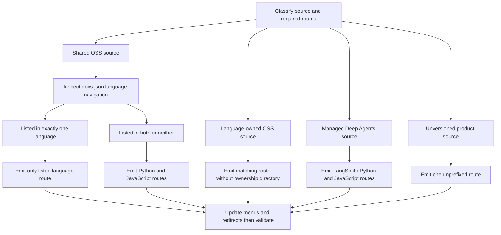

# Versioned Content Change Workflow

A versioned-content change has four contracts: authored source, generated routes, navigation, and redirects. They are related but distinct: `src/docs.json` is both the reader-facing menu configuration and an input to the OSS builder's single-language decision; it does not itself create source files or redirects. Author under `src/`; `build/` is regenerated Mintlify output to inspect, never to edit.



The diagram shows the build-time dependency: for a *shared* OSS Markdown page, presence in exactly one language navigation tree makes the builder emit only that language. Decide and review navigation before accepting the generated route.

## 1. Classify the source and its route owner

The conditional renderer accepts target keys `python` and `js`; URL segments are `python` and `javascript`.

| Content | Author in | Full-build output |
| --- | --- | --- |
| Shared OSS page | Most of `src/oss/` | Usually `/oss/python/...` and `/oss/javascript/...`; only one when listed in exactly one language navigation tree |
| Language-owned OSS page | `src/oss/python/...` or `src/oss/javascript/...` | Only its matching language route, with the ownership directory removed |
| Deep Agents Code or OpenWiki | `src/oss/deepagents/code/...` or `src/oss/openwiki/...` | One unprefixed product route |
| Managed Deep Agents page | Direct `src/langsmith/managed-deep-agents*.mdx` file | `/langsmith/python/...` and `/langsmith/javascript/...` |
| Other LangSmith page | `src/langsmith/...` | One unprefixed `/langsmith/...` route rendered with the Python target |

### Shared OSS pages: navigation can select one output

For a shared `.md` or `.mdx` file, the builder recursively reads `navigation` in `src/docs.json` and collects `oss/python/...` and `oss/javascript/...` routes. A page listed in exactly one tree builds only for that language. A page listed in both trees—or in neither—builds for both. This prevents a Python-only or JavaScript-only shared source from producing an empty or wrong-language sibling merely because its language branch was removed.

Source placement does not choose a sidebar, but `docs.json` has a build-time effect for shared pages. When adding, removing, or moving one, update and review the relevant navigation entries before building. A directory navigation entry can stand for `dir/index` only if a language-owned `src/oss/<language>/dir.mdx` or `.md` does not own that route.

Use `src/oss/python/` and `src/oss/javascript/` when the source itself is owned by one SDK. During a full OSS build, the builder skips the other ownership tree and removes the matching ownership directory from the public path. Do not use a language-owned directory merely to choose a menu.

`build_file()` applies the same navigation-aware selection to ordinary shared pages, but it is not a route-shape substitute for a language-owned source: its ordinary OSS handling treats the ownership directory as route content. Use a clean full build to check a language-owned route.

### Deliberate single-output products and Managed Deep Agents

Deep Agents Code and OpenWiki are single-output products. Their conditionals use the Python target as a deterministic fallback, not as an assertion that the product is Python documentation. Their own paths remain unprefixed; an unqualified ordinary OSS link from such a page is rewritten to the Python OSS route.

Managed Deep Agents is the LangSmith exception. The ordinary LangSmith pass excludes Managed Deep Agents pages, while a dedicated pass emits Python and JavaScript variants. The full-build discovery glob is direct `src/langsmith/managed-deep-agents*.mdx`; although individual-file classification also recognizes `.md`, a direct `.mdx` filename is required for discovery in a full build. Do not create an unversioned duplicate for an old URL.

## 2. Author shared prose and language differences safely

Keep common headings and explanation outside adjacent `:::python` and `:::js` blocks. Put each complete differing unit—an installation command plus filename, a table, or an invocation—inside its branch.

````markdown
Shared explanation.

:::python
```python
from langchain.agents import create_agent
```
:::

:::js
```typescript
import { createAgent } from "langchain";
```
:::
````

For the selected target, rendering removes the matching supported-block markers and retains its content, while removing the other supported block. Unsupported labels remain intact, and an invalid target raises `ValueError`.

Managed Deep Agents sources demonstrate the intended pattern: shared product prose sits around branches for project filenames (`agent.py` and `agent.ts`), SDK APIs, runtime types, and nullability. Keep a semantic unit together so an import, type, or filename from one SDK cannot appear beside the other SDK's example.

### Conditional syntax is not structural parsing

Conditional rendering is a document-wide regex transform, not Markdown parsing. It is not code-fence-aware, cannot safely represent nested conditionals, and indentation is not a reliable guard: the opening expression may retry with empty indentation and the first eligible closing marker completes its non-greedy match. Escape literal conditional syntax:

````markdown
\:::python
This is displayed literally.
\:::
````

Do not nest conditionals or rely on indentation or a Markdown code fence to protect live markers.

### Scope symbolic references deliberately

Markdown preprocessing resolves `@[Name]`, `@[title][Name]`, and backticked forms before conditional rendering. Outside ordinary Markdown code fences, an active `:::python` or `:::js` fence supplies the autolink scope; otherwise the build target is the default. An unresolved reference is logged and left unchanged rather than failing the build.

A shared OSS reference outside a branch must resolve in both outputs. Put SDK-specific autolinks in the relevant branch, and run:

```bash
make check-cross-refs
```

The checker scans authored Markdown and MDX below `src/`, derives scopes from paths, and requires an unfenced shared OSS reference to resolve in every applicable scope. It exits nonzero for unresolved references. This source-level check complements rendered-link validation.

## 3. Write links and snippets for the emitted variant

For an ordinary OSS destination that should follow the active language, author an absolute, unqualified route:

```mdx
<!-- openwiki: broken internal link [/oss/deepagents/overview] file "/oss/deepagents/overview" does not exist. Fix the href or restore the target, then delete this comment. -->
[Deep Agents overview](/oss/deepagents/overview)
```

A target build inserts `python` or `javascript` after `/oss/`. It preserves an already qualified route, image paths, and the OpenWiki and Deep Agents Code roots and paths. Explicitly qualify a destination only when it must remain fixed to one SDK.

Use the analogous unqualified form for a Managed Deep Agents destination:

```mdx
<!-- openwiki: broken internal link [/langsmith/managed-deep-agents-deploy] file "/langsmith/managed-deep-agents-deploy" does not exist. Fix the href or restore the target, then delete this comment. -->
[Deploy](/langsmith/managed-deep-agents-deploy)
```

The Managed Deep Agents variant rewrites it to `/langsmith/python/...` or `/langsmith/javascript/...`; an already qualified route remains fixed. Do not change such source links to Python merely because public unprefixed redirects choose Python.

### Markdown snippets

Store reusable Markdown or MDX fragments below `src/snippets/` and import a shared fragment without a language prefix:

```mdx
import RequiresLanggraphServer from '/snippets/oss/requires-langgraph-server.mdx';
```

Versioned pages rewrite eligible `.md` and `.mdx` imports to `/snippets/python/` or `/snippets/javascript/`; already scoped imports and JSX or TSX component imports are unchanged. Markdown snippets are independently preprocessed into Python and JavaScript copies plus a Python-targeted default copy. Use absolute `/oss/...` links inside a shared fragment so each emitted copy works when imported from pages at arbitrary nesting depths.

## 4. Treat menus and redirects as explicit deliverables

Creating a source page does not add a sidebar entry. Add extensionless paths relative to `src` in `src/docs.json`, and make the menu correspond to actual emitted routes:

- A shared source listed in both language menus has two output routes; listed in exactly one, it intentionally has one output route.
- A language-owned source belongs in only its matching menu.
- An unversioned product source has one unprefixed entry.
- Review a move or deletion as well as an addition: a stale lone menu entry can change a shared page from dual-output to single-output.

Managed Deep Agents has parallel Python and JavaScript navigation entries under `langsmith/python/managed-deep-agents-*` and `langsmith/javascript/managed-deep-agents-*`. Preserve placement parity for shared pages. The current tabs place Identity in **Agent capabilities** and Custom frontend in **Build and deploy** in both variants.

Redirects are a separate public-URL contract. `docs.json` redirects unprefixed and legacy Managed Deep Agents URLs to Python destinations because the builder deliberately emits no unprefixed Managed Deep Agents page. On a route move, decide whether every retired public URL needs a redirect to its maintained canonical route; do not create an orphaned unversioned page for compatibility.

## 5. Build, inspect, and validate

Run a clean build whenever source ownership, shared-page navigation, links, snippets, builder rules, menus, or redirects change:

```bash
make build
make check-cross-refs
make broken-links
```

`build_all()` clears `build/`, builds OSS language routes, then unversioned OSS products and LangSmith content, emits Managed Deep Agents variants, and then copies shared files. `make broken-links` builds first and asks Mint to validate redirects; use `make broken-links-with-anchors` if anchors changed. Its report filter excludes standalone snippets because their absolute language-prefixed OSS paths are valid when inlined, not when Mint evaluates a fragment alone.

Inspect generated files without modifying them:

1. Required routes exist and intentionally absent language siblings are absent.
2. Each variant retains shared prose and only its own branch, without selected-branch markers.
3. Scoped autolinks, bare OSS links, bare Managed Deep Agents links, and Markdown imports resolve to the intended variant.
4. Already-qualified links, image paths, and unversioned product paths remain unchanged.
5. `docs.json` exposes each intended route, selects single-language shared output only deliberately, and redirects retired public routes.

When build behavior changes, add focused regression coverage in `tests/unit_tests/test_builder.py`. The important cases are route presence and absence, navigation-selected one-language shared pages, ownership-directory removal in a full build, link exemptions, snippet variants, and Managed Deep Agents rewrites.

## Completion checklist

- [ ] Classify source ownership and list every required public route.
- [ ] For a shared OSS page, inspect both navigation trees: exactly one entry intentionally produces exactly one language output.
- [ ] Use a full build to validate a language-owned OSS route.
- [ ] Keep common prose outside complete `:::python` and `:::js` semantic units.
- [ ] Do not nest conditionals or rely on code fences or indentation to neutralize conditional markers.
- [ ] Put SDK-specific autolinks in their branch and run `make check-cross-refs`.
- [ ] Use unqualified `/oss/...` and Managed Deep Agents links only when they should track the active language.
- [ ] Import shared Markdown snippets without a language prefix and use absolute OSS paths inside them.
- [ ] Update navigation and redirects in `src/docs.json` independently, then check their emitted-route consequences.
- [ ] Run `make build` and rendered-link validation, then inspect `build/` without editing it.

## See also

- [Source Map](/openwiki/architecture/source-map.md)
- [Documentation Routes and Language Versioning](/openwiki/concepts/versioning.md)
- [Adding and Maintaining Documentation Pages](/openwiki/operations/adding-pages.md)
- [Conditional Rendering Tests](/openwiki/testing/conditional-rendering.md)
- [LangSmith Agent and Observability Documentation Changes](/openwiki/workflows/langsmith-agent-documentation.md)
