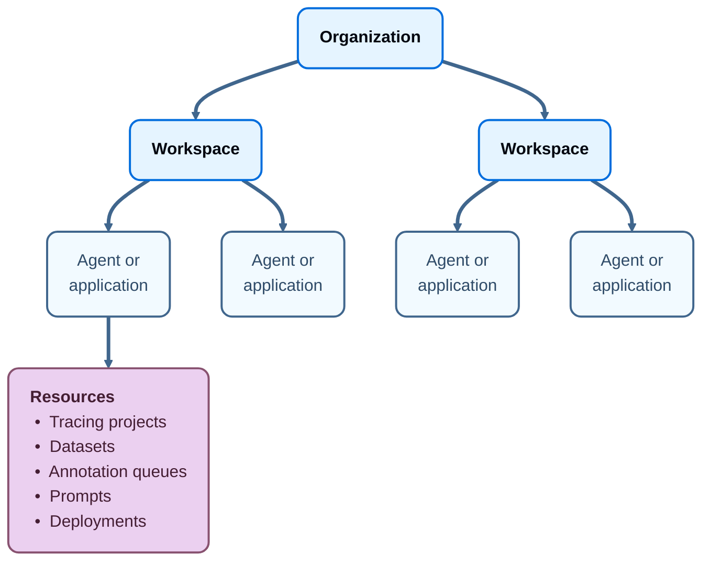

import MaxRunsPerTrace from '/snippets/langsmith/max-runs-per-trace.mdx';
import OrgWorkspaceRole from '/snippets/langsmith/multi-workspace-org-roles.mdx';
import PermissionReference from '/snippets/langsmith/permissions-reference.mdx';
import RetentionDownstreamFeatures from '/snippets/langsmith/retention-downstream-features.mdx';

This overview covers topics related to managing users, organizations, workspaces, agents, and applications within LangSmith.

## Resource hierarchy

LangSmith organizes access and data in four levels. An [organization](#organizations) contains workspaces. Each [workspace](#workspaces) contains agents or applications. [Agents and applications](#agents-and-applications) group the [resources](#resources) you work with, such as tracing projects and datasets.

### Organizations

An organization is a logical grouping of users within LangSmith that defines shared settings applying across all of its workspaces. These settings govern organization-wide concerns rather than individual projects within a workspace. Common organization-level configurations include user management, single sign-on (SSO), OAuth provider configuration, custom role creation, billing, and usage tracking.

Typically, there is one organization per company. An organization can have multiple workspaces. For configuration details, see [Set up an organization](/langsmith/set-up-hierarchy#set-up-an-organization).

When you log in for the first time, a personal organization will be created for you automatically. If you'd like to collaborate with others, you can create a separate organization and invite your team members to join. There are a few important differences between your personal organization and shared organizations:

| Feature             | Personal            | Shared                                                                                       |
| ------------------- | ------------------- | -------------------------------------------------------------------------------------------- |
| Maximum workspaces  | 1                   | Variable, depending on plan (see the [pricing page](https://www.langchain.com/pricing-langsmith)) |
| Collaboration       | Cannot invite users | Can invite users                                                                             |
| Billing: paid plans | Developer plan only | All other plans available                                                                    |

### Workspaces

<Info>
Workspaces were formerly called Tenants. Some code and APIs may still reference the old name for a period of time during the transition.
</Info>

A workspace is a logical grouping of users and [resources](#resources) within an organization. Workspaces are commonly used to isolate business units, providing separation between projects and their associated resources.

A workspace separates trust boundaries for resources and access control. Users are granted permissions at the workspace level, which determine their access to resources in that workspace, including tracing projects, datasets, annotation queues, and prompts. To configure one, see [Set up a workspace](/langsmith/set-up-hierarchy#set-up-a-workspace). For details on permissions, see [Workspace roles](#workspace-roles).

<Tip>
We recommend creating a separate workspace for each team within your organization. To organize resources even further, you can group them within a workspace by [agent or application](#agents-and-applications), depending on which information architecture your workspace uses.

For guidance on different workspace organization models based on your team's isolation requirements, refer to [Workload isolation](/langsmith/workload-isolation).
</Tip>

### Agents and applications

Agents and applications are logical groupings of resources within a workspace, one level below the workspace itself. The grouping keeps the UI organized by surfacing only the resources associated with the agent or application currently in context.

What that grouping is called, and which control selects it, depends on which information architecture your workspace uses. The control at the top left tells you which one you are on:

- **Agent-based workspaces** call it an [agent](/langsmith/agents), and an agent's traces divide further into [environments](/langsmith/agent-environments) drawn from a fixed set of four. Select one from the agent picker in the top bar, or select **All agents** to see every resource in the workspace. For more information, see [Navigate agents](/langsmith/navigate-agents).
- **Project-based workspaces** call it an application, which can group any project within a team rather than an agent alone. Select one from the **Application** dropdown at the top of the sidebar in the [LangSmith UI](https://smith.langchain.com), or select **All applications** to see every resource in the workspace.

Both are built on top of [resource tags](/langsmith/administration-overview#resource-tags) and can be used to control resource access using [ABAC](/langsmith/organization-workspace-operations#access-policies).

Any resource can be created without being tagged to either one. Those resources are visible when all agents or applications are in view.

### Resources

Resources are the concrete entities used to build, run, and observe applications and agents. Examples include [tracing projects](/langsmith/observability-concepts#tracing-projects), [prompts](/langsmith/prompt-context-hub), [datasets](/langsmith/manage-datasets), and [deployments](/langsmith/deployment). Resources are scoped to a specific agent or application.

### Where settings live

The following diagram shows the relationship between organizations, workspaces, agents or applications, and resources:

See the table below for details on which features are available in which scope(s):

| Resource/Setting                                                            | Scope            |
| --------------------------------------------------------------------------- | ---------------- |
| Trace Projects                                                              | Workspace or agent/application  |
| Annotation Queues                                                           | Workspace or agent/application  |
| Deployments                                                                 | Workspace or agent/application  |
| Datasets & Experiments                                                      | Workspace or agent/application  |
| Prompts                                                                     | Workspace or agent/application  |
| [Resource Tags](#resource-tags)                                             | Workspace                       |
| API Keys                                                                    | Workspace                       |
| Settings including Secrets, Feedback config, Models, Rules, and Shared URLs | Workspace                       |
| User management: Invite User to Workspace                                   | Workspace                       |
| RBAC: Assigning Workspace Roles                                             | Workspace                       |
| Data Retention, Usage Limits                                                | Workspace\*                     |
| Plans and Billing, Credits, Invoices                                        | Organization                    |
| User management: Invite User to Organization                                | Organization\*\*                |
| Adding Workspaces                                                           | Organization                    |
| Assigning Organization Roles                                                | Organization                    |
| RBAC: Creating/Editing/Deleting Custom Roles                                | Organization                    |

<Info>
\* Data retention settings and usage limits will be available soon for the organization level as well.

\*\* Self-hosted installations may enable workspace-level invites of users to the organization via a feature flag. For details, refer to the [self-hosted user management docs](/langsmith/self-host-user-management).
</Info>

### Resource tags

Resource tags allow you to further segregate resources within a workspace for use with [ABAC](/langsmith/organization-workspace-operations#access-policies). Each tag is a key-value pair that you can assign to a resource.

LangSmith resource tags are very similar to tags in cloud services like [AWS](https://docs.aws.amazon.com/tag-editor/latest/userguide/tagging.html).

Navigate to **Settings** in the [LangSmith UI](https://smith.langchain.com) to select the **Resource tags** page in the sidebar.

## Users and roles

This section covers who can access LangSmith and what they can do: users, the three types of API keys, and the roles that grant permissions.

### Users

A user is a person who has access to LangSmith. Users can be members of one or more organizations and workspaces within those organizations.

Manage members from the **Settings** page, which has separate sections for the organization and the workspace:

- **Organization** > **Members**: Manage members of the organization.
- **Workspace** > **Members**: Manage members of the current workspace.

### API keys

LangSmith API keys authenticate requests to LangSmith. They are separate from the model provider keys, such as OpenAI or Anthropic keys, that your application uses to call models.

<Warning>
We ended support for legacy API keys prefixed with `ls__` on October 22, 2024 in favor of personal access tokens (PATs) and service keys. We require using PATs and service keys for all new integrations. API keys prefixed with `ls__` will no longer work as of October 22, 2024.
</Warning>

#### Expiration dates

When you create an API key, you have the option to set an expiration date. Adding an expiration date to keys enhances security and minimizes the risk of unauthorized access. For example, you may set expiration dates on keys for temporary tasks that require elevated access.

Once expired, an API key is no longer valid and cannot be reactivated or have its expiration modified.

#### Personal access tokens (PATs)

Personal Access Tokens (PATs) are used to authenticate requests to the LangSmith API. They are created by users and scoped to a user. The PAT will have the same permissions as the user that created it.

PATs are prefixed with `lsv2_pt_`

Members can deactivate, reactivate, or delete their own PATs. [Organization Admins](/langsmith/rbac#organization-admin) and [Organization Operators](/langsmith/rbac#organization-operator) can also list, deactivate, reactivate, and delete any member's PAT.

Deactivating a token stops authentication but keeps its record, owner, and last use visible with a **Deactivated** badge. Deactivation is reversible; deletion permanently removes the record. Reactivation preserves the original expiration date and is unavailable once that date has passed. Because authentication results are cached, these changes take effect within a minute rather than instantly.

For the steps and authentication-cache timing, refer to [Deactivate or delete a personal access token](/langsmith/create-account-api-key#deactivate-or-delete-a-personal-access-token).

<Tip>
Avoid using PATs to authenticate requests from your application. Instead, use them for personal scripts or tools that interact with the LangSmith API. If the user associated with the PAT is removed from the organization, the PAT will no longer work.
</Tip>

#### Service keys

Service keys are similar to PATs, but are used to authenticate requests to the LangSmith API on behalf of a service account. Only admins can create service keys. We recommend using service keys for applications or services that need to interact with the LangSmith API, such as LangGraph agents or other integrations.

Service keys may be scoped to a single workspace, multiple workspaces, or the entire organization. They can be used to authenticate requests to the LangSmith API for whichever workspace(s) it has access to.

Service keys are prefixed with `lsv2_sk_`.

Service keys can only be deleted, not deactivated.

<Warning>
Use the `X-Tenant-Id` header to specify the target workspace.

- **When using PATs**: If this header is omitted, requests will run against the default workspace associated with the key.
- **When using organization-scoped service keys**: You must include the `X-Tenant-Id` header when accessing workspace-scoped resources. Without it, the request will fail with a `403 Forbidden` error.
</Warning>

<Note>
To create any type of API key, see [Create an account and API key](/langsmith/create-account-api-key).
</Note>

#### Tracing keys

Tracing keys are organization-owned credentials with fixed permissions to submit traces and create projects in selected workspaces. They do not grant access to stored traces, experiments, saved views, or administration.

Tracing keys use the `lsv2_tr_` prefix. Their scope is fixed at creation, and they remain valid when the creator leaves the organization. They follow service-key expiry limits. For creation permissions, scope limits, and deletion rules, refer to [Tracing keys](/langsmith/create-account-api-key#tracing-keys).

### Roles

Each user has one organization role, which applies across the organization. On Enterprise plans, each user also has one workspace role in every workspace they belong to. Manage both in **Settings** > **Roles**. For more information, see [Role-based access control](/langsmith/rbac).

#### Organization roles

Your organization role determines your [organization-level permissions](/langsmith/organization-workspace-operations) and your workspace membership. Organization roles are distinct from [workspace roles](#workspace-roles) (an Enterprise feature), and apply across all workspaces in the organization.

Each organization role affects workspace membership as follows:

- The role of [Organization Admin](/langsmith/rbac#organization-admin) grants a user full access to manage all organization configuration, users, billing, and workspaces.
    - An Organization Admin has `Admin` access to all workspaces in an organization.
- The role of [Organization Operator](/langsmith/rbac#organization-operator) grants a user management access to workspaces and non-admin users for day-to-day operations, without admin-level privileges such as managing Organization Admins.
    - An Organization Operator is added only to the workspaces they create or are invited to.
- The role of [Organization User](/langsmith/rbac#organization-user) grants a user permission to read organization information. However, they cannot execute any write actions at the organization level. An Organization User may create [Personal Access Tokens](#personal-access-tokens-pats).
    - An Organization User can be added to a subset of workspaces and assigned workspace roles as usual (if RBAC is enabled), which specify permissions at the workspace level.
- The role of [Organization Viewer](/langsmith/rbac#organization-viewer) is equivalent to Organization User, but a user with this role **cannot** create Personal Access Tokens. Self-hosted installations require Helm chart version 0.11.25 or later for this role.
- The role of [Organization Restricted](/langsmith/rbac#organization-restricted) grants a user access to their assigned workspaces without organization-wide read access, so the user cannot list organization members. Workspace-scoped service keys can also hold this role.

<Info>
<OrgWorkspaceRole/>

See [Security settings](/langsmith/manage-organization-by-api#security-settings) for instructions on how to disable PAT creation for the entire organization.
</Info>

For more information on setting up organizations and workspaces, refer to the [organization setup guide](/langsmith/set-up-hierarchy#organization-roles).

Organization-level permissions by role:

|                                             | Organization Restricted | Organization Viewer | Organization User | Organization Operator | Organization Admin |
| ------------------------------------------- | ----------------------- | ------------------- | ----------------- | --------------------- | ------------------ |
| View organization configuration             | ✅                       | ✅                   | ✅                 | ✅                     | ✅                  |
| View organization roles                     | ✅                       | ✅                   | ✅                 | ✅                     | ✅                  |
| View organization members                   | ❌                       | ✅                   | ✅                 | ✅                     | ✅                  |
| View data retention settings                | ❌                       | ✅                   | ✅                 | ✅                     | ✅                  |
| View usage limits                           | ❌                       | ✅                   | ✅                 | ✅                     | ✅                  |
| Create personal access tokens (PATs)        | ❌                       | ❌                   | ✅                 | ✅                     | ✅                  |
| View, deactivate, reactivate, and delete any member's PATs | ❌        | ❌                   | ❌                 | ✅                     | ✅                  |
| Admin access to all workspaces              | ❌                       | ❌                   | ❌                 | ❌                     | ✅                  |
| Manage billing settings                     | ❌                       | ❌                   | ❌                 | ✅                     | ✅                  |
| Create workspaces                           | ❌                       | ❌                   | ❌                 | ✅                     | ✅                  |
| Create, edit, and delete organization roles | ❌                       | ❌                   | ❌                 | ✅                     | ✅                  |
| Invite new users to organization            | ❌                       | ❌                   | ❌                 | ✅\*                   | ✅                  |
| Delete user invites                         | ❌                       | ❌                   | ❌                 | ✅\*                   | ✅                  |
| Remove users from an organization           | ❌                       | ❌                   | ❌                 | ✅\*                   | ✅                  |
| Update data retention settings              | ❌                       | ❌                   | ❌                 | ✅                     | ✅                  |
| Update usage limits                         | ❌                       | ❌                   | ❌                 | ✅                     | ✅                  |

\* Organization Operators cannot invite, remove, or delete invites for Organization Admins.

<PermissionReference/>

#### Workspace roles

<Note>
RBAC (Role-Based Access Control) is only available to Enterprise customers. If you are interested in this feature, [contact our sales team](https://www.langchain.com/contact-sales). Other plans default to using the Admin role for all users.
</Note>

On Enterprise plans, workspace roles define the permissions a user has within a workspace. There are three built-in workspace roles that cannot be edited:

- [Workspace Admin](/langsmith/rbac#workspace-admin) has full access to all resources within the workspace.
- [Workspace Editor](/langsmith/rbac#workspace-editor) can create, edit, and delete most resources, but cannot delete runs, change workspace settings, or manage workspace members.
- [Workspace Viewer](/langsmith/rbac#workspace-viewer) has read-only access to all resources within the workspace.

[Organization Admins](/langsmith/rbac#organization-admin) can also create and edit custom roles with specific permissions for different resources.

<Tip>
To give a group of users a role in several workspaces at once, use [teams](/langsmith/teams).
</Tip>

## Separate environments

An environment is a stage in your release process, such as development, staging, or production. How to separate environments depends on which information architecture your workspace uses:

- **Agent-based workspaces** have environments built in, drawn from a fixed set of four. An [agent](/langsmith/agents) divides its traces across them, and every trace lands in one environment of one agent, so no tagging convention is required. For more information, see [Agent environments](/langsmith/agent-environments).
- **Project-based workspaces** use [resource tags](#resource-tags) to organize resources by environment, with the default tag key `Environment` and a different value per environment (for example, `dev`, `staging`, `prod`).

In either case, avoid using separate workspaces for environment separation, because resources cannot be shared across workspaces, which prevents you from promoting resources such as prompts between environments.

<Note>
**Resource tags vs. commit tags for prompt management**

While both types of tags can use environment terminology like `dev`, `staging`, and `prod`, they serve different purposes:

- **Resource tags** (`Environment: prod`): Use these to *organize and filter* resources across your workspace. Apply resource tags to tracing projects, datasets, and other resources (including prompts) to group them by environment, which enables filtering in the UI.
- [Commit tags](/langsmith/manage-prompts#commit-tags) (`prod` tag): Use these to manage which [prompt version](/langsmith/prompt-context-hub#prompts) your code references. Commit tags are labels that point to specific commits in a prompt's history. When your code pulls a prompt by tag name (e.g., `client.pull_prompt("prompt-name:prod")`), it retrieves whichever commit that tag currently points to. To promote a prompt from `staging` to `prod`, move the commit tag to point to the desired version.

Resource tags organize **which resources** belong to an environment. Commit tags let you control **which version** of a prompt your code references without changing the code itself.
</Note>

## Usage and billing

### Data retention

This section covers how data retention works and how it's priced in LangSmith.

#### Why retention matters

* **Privacy**: Many data privacy regulations, such as GDPR in Europe or CCPA in California, require organizations to delete personal data once it's no longer necessary for the purposes for which it was collected. Setting retention periods aids in compliance with such regulations.
* **Cost**: LangSmith charges less for traces that have low data retention. For more information, learn how to [enforce spend limits](/langsmith/billing#enforce-spend-limits).

<Tip>
Plan your retention tiers before you start sending traces. Changes apply to new traces only—existing traces keep their original tier. See [Change project-level default retention](/langsmith/billing#change-project-level-default-retention).
</Tip>

#### How it works

LangSmith has two tiers of traces based on Data Retention with the following characteristics:

|                      | Base             | Extended       |
| -------------------- | ---------------- | -------------- |
| **Price**            | [See pricing page](https://www.langchain.com/pricing-langsmith) | [See pricing page](https://www.langchain.com/pricing-langsmith) |
| **Retention Period** | 14 days          | 180 days       |

<Warning>
Starting September 14, 2026, the maximum long-lived trace retention period for SaaS customers is changing to 180 days. Enterprise customers can still customize the extended retention period per workspace up to this new maximum. Changes apply to new traces only—existing traces are unaffected. See [Customize extended retention policy](/langsmith/data-purging-compliance#customize-extended-retention-policy).
</Warning>

**Data deletion after retention ends**

After the specified retention period, traces are no longer accessible in the tracing project UI or via the API. All user data associated with the trace (e.g. inputs and outputs) is deleted from our internal systems within a day thereafter. Some metadata associated with each trace may be retained indefinitely for analytics and billing purposes.

#### Data retention auto-upgrades

<Warning>
Auto upgrades can have an impact on your bill. Please read this section carefully to fully understand your estimated LangSmith tracing costs.
</Warning>

Most traces use base retention. Some actions, such as online evaluators and automation rules, can extend a trace to a longer retention period at a higher cost. You control which actions extend retention.

When you use certain features with `base` tier traces, their data retention may be automatically upgraded to `extended` tier. This increases both the retention period and the cost of the trace.

Retention behavior by action:

* **Feedback via API or SDK**: Feedback is added to any run on the trace (or any trace in the thread) through an API or SDK call that explicitly passes `extend_trace_retention=true` (`extendTraceRetention: true` in TypeScript). For more information, see [Attach user feedback](/langsmith/attach-user-feedback). The LangSmith UI sends feedback and notes without extending retention.
* **Online evaluators**: An online evaluator scores the trace and its retention setting is enabled. Both trace-level and thread-level evaluators can opt out of this upgrade.
* **Automation rules**: An [automation rule](/langsmith/rules#create-a-rule) with retention extension enabled matches any run within a trace. Matching a single run upgrades the entire trace, not just that run. A rule whose [item type](/langsmith/rules#set-the-item-type-to-runs-or-threads) is **Threads** upgrades every trace in the matched thread, not only the most recent one.
* **Manual annotation queue adds** (no upgrade): Manually adding runs or threads to an [annotation queue](/langsmith/annotation-queues#assign-runs-and-threads-to-a-single-run-queue) does not upgrade retention by default.

This change applies to new actions only. Traces that were already upgraded by a previous action keep their extended retention.

<Note>
When you create or edit an online evaluator on a tracing project, you can opt out of upgrading the traces that evaluator scores, keeping them at base retention. This option is available only when the project's default retention is the base tier. For step-by-step instructions, see [Manage evaluator trace retention](/langsmith/evaluators#manage-evaluator-trace-retention).
</Note>

<Note>
Retention extension is enabled by default for new online evaluators and automation rules. You can opt out when configuring each evaluator or rule.
</Note>

**Why auto-upgrade traces?**

We have two reasons behind the auto-upgrade model for tracing:

1. We think that traces that match any of these conditions are fundamentally more interesting than other traces, and therefore it is good for users to be able to keep them around longer.
2. We philosophically want to charge customers an order of magnitude lower for traces that may not be interacted with meaningfully. We think auto-upgrades align our pricing model with the value that LangSmith brings, where only traces with meaningful interaction are charged at a higher rate.

If you have questions or concerns about our pricing model, please feel free to contact support via [support.langchain.com](https://support.langchain.com) and let us know your thoughts!

**How does data retention affect downstream features?**

<RetentionDownstreamFeatures />

#### Billing model

**Billable metrics**

On your LangSmith invoice, you will see two metrics that we charge for:

* LangSmith Traces (Base Charge)
* LangSmith Traces (Extended Data Retention Upgrades).

The first metric includes all traces, regardless of tier. The second metric just counts the number of extended retention traces.

**Why measure all traces + upgrades instead of base and extended traces?**

A natural question to ask when considering our pricing is why not just show the number of `base` tier and `extended` tier traces directly on the invoice?

While we understand this would be more straightforward, it doesn't fit trace upgrades properly. Consider a `base` tier trace that was recorded on June 30, and upgraded to `extended` tier on July 3. The `base` tier trace occurred in the June billing period, but the upgrade occurred in the July billing period. Therefore, we need to be able to measure these two events independently to properly bill our customers.

If your trace was recorded as an extended retention trace, then the `base` and `extended` metrics will both be recorded with the same timestamp.

### Rate limits

LangSmith has rate limits which are designed to ensure the stability of the service for all users.

To ensure access and stability, LangSmith will respond with HTTP Status Code 429 indicating that rate or usage limits have been exceeded under the following circumstances:

#### Temporary throughput limit over a 1 minute period at our application load balancer

This 429 is the result of exceeding a fixed number of API calls over a 1 minute window on a per service key or PAT basis. The start of the window will vary slightly—it is not guaranteed to start at the start of a clock minute—and may change depending on application deployment events.

After the max events are received we will respond with a 429 until 60 seconds from the start of the evaluation window has been reached and then the process repeats.

This 429 is thrown by our application load balancer and is a mechanism in place for all LangSmith users independent of plan tier to ensure continuity of service for all users.

| Method            | Endpoints     | Limit | Window   |
| ----------------- | ------------- | ----- | -------- |
| `DELETE`          | `/sessions*`  | 30    | 1 minute |
| `POST` OR `PATCH` | `/runs*`      | 5000  | 1 minute |
| `GET`             | `/runs/:id`   | 30    | 1 minute |
| `POST`            | `/feedbacks*` | 5000  | 1 minute |
| `*`               | `*`           | 2000  | 1 minute |

<Note>
The LangSmith SDK takes steps to minimize the likelihood of reaching these limits on run-related endpoints by batching up to 100 runs from a single session ID into a single API call.
</Note>

#### Plan-level hourly trace event limit

This 429 is the result of reaching your maximum hourly events ingested and is evaluated in a fixed window starting at the beginning of each clock hour in UTC and resets at the top of each new hour.

An event in this context is the creation or update of a run. If a run is created and then subsequently updated in the same hourly window, that counts as 2 events against this limit.

This is thrown by our application and varies by plan tier, with organizations on our Startup/Plus and Enterprise plan tiers having higher hourly limits than our Free and Developer Plan Tiers which are designed for personal use.

| Plan                             | Limit          | Window |
| -------------------------------- | -------------- | ------ |
| Developer (no payment on file)   | 50,000 events  | 1 hour |
| Developer (with payment on file) | 250,000 events | 1 hour |
| Startup/Plus                     | 500,000 events | 1 hour |
| Enterprise                       | Custom         | Custom |

#### Plan-level hourly trace data ingest limit

This 429 is the result of reaching the maximum amount of data ingested across your trace inputs, outputs, and metadata and is evaluated in a fixed window starting at the beginning of each clock hour in UTC and resets at the top of each new hour.

Typically, inputs, outputs, and metadata are sent on both run creation and update events. If a run is created at 2.0MB and updated to 3.0MB in the same hourly window, that counts as 5.0MB of storage against this limit.

This is thrown by our application and varies by plan tier, with organizations on our Startup/Plus and Enterprise plan tiers having higher hourly limits than our Free and Developer Plan Tiers which are designed for personal use.

| Plan                             | Limit  | Window |
| -------------------------------- | ------ | ------ |
| Developer (no payment on file)   | 500MB  | 1 hour |
| Developer (with payment on file) | 2.5GB  | 1 hour |
| Startup/Plus                     | 5.0GB  | 1 hour |
| Enterprise                       | Custom | Custom |

#### Plan-level monthly unique traces limit

This 429 is the result of reaching your maximum monthly traces ingested and is evaluated in a fixed window starting at the beginning of each calendar month in UTC and resets at the beginning of each new month.

This is thrown by our application and applies only to the Developer Plan Tier when there is no payment method on file.

| Plan                           | Limit        | Window  |
| ------------------------------ | ------------ | ------- |
| Developer (no payment on file) | 5,000 traces | 1 month |

#### Self-configured monthly usage limits

This 429 is the result of reaching your usage limit as configured by your organization admin and is evaluated in a fixed window starting at the beginning of each calendar month in UTC and resets at the beginning of each new month.

This is thrown by our application and varies by organization based on their configured settings.

#### Maximum runs per trace

<MaxRunsPerTrace />

#### Run query endpoint

The [`POST /runs/query`](/langsmith/smith-api/run/query-runs) endpoint has additional per-tenant rate limits based on query parameters. See [Query traces using the SDK](/langsmith/export-traces#rate-limits) for details.

#### Handling 429s responses in your application

Since some 429 responses are temporary and may succeed on a successive call, if you are directly calling the LangSmith API in your application we recommend implementing retry logic with exponential backoff and jitter.

For convenience, LangChain applications built with the LangSmith SDK has this capability built-in.

<Note>
It is important to note that if you are saturating the endpoints for extended periods of time, retries may not be effective as your application will eventually run large enough backlogs to exhaust all retries.

If that is the case, we would like to discuss your needs more specifically. Please contact support via [LangSmith Support](https://support.langchain.com) with details about your applications throughput needs and sample code and we can work with you to better understand whether the best approach is fixing a bug, changes to your application code, or a different LangSmith plan.
</Note>

### Usage limits

LangSmith lets you configure usage limits on tracing. Note that these are *usage* limits, not *spend* limits, which mean they let you limit the quantity of occurrences of some event rather than the total amount you will spend.

LangSmith lets you set two different monthly limits, mirroring our Billable Metrics discussed in the aforementioned data retention guide:

* All traces limit
* Extended data retention traces limit

These let you limit the number of total traces, and extended data retention traces respectively.

<Note>For *spend* limits on evaluator runs specifically, refer to [Track and limit evaluator spend](/langsmith/evaluator-spend).</Note>

#### Properties of usage limiting

Usage limiting is approximate, meaning that we do not guarantee the exactness of the limit. In rare cases, there may be a small period of time where additional traces are processed above the limit threshold before usage limiting begins to apply.

#### Side effects of extended data retention traces limit

The extended data retention traces limit has side effects. If the limit is already reached, any feature that could cause an auto-upgrade of tracing tiers becomes inaccessible. This is because an auto-upgrade of a trace would cause another extended retention trace to be created, which in turn should not be allowed by the limit. Therefore, you can no longer:

1. match run rules
2. add feedback to traces
3. add runs to annotation queues

Each of these features may cause an auto upgrade, so we shut them off when the limit is reached.

#### Updating usage limits

Usage limits can be updated from the `Settings` page under `Usage and Billing`. Limit values are cached, so it may take a minute or two before the new limits apply.

#### Per-project and per-user trace limits

In addition to the [workspace-wide limits](#usage-limits), you can cap monthly traces for a single tracing project or an individual workspace member. This prevents one project or user from consuming a disproportionate share of a workspace's tracing budget.

To configure these limits, open **Settings**, go to **Usage configuration**, and select the **Project & user limits** tab. Choose **Add limit**, then set:

* **Scope**: **Project** to cap a single tracing project, or **User** to cap a single workspace member.
* **Workspace**: the workspace that contains the project or member.
* **Project** or **User**: the target to cap.
* **Monthly trace limit**: the maximum number of traces allowed per calendar month.

In an [agent-based workspace](/langsmith/agents), a project-scoped limit caps one [environment](/langsmith/agent-environments) of one agent rather than the agent as a whole. There is no agent scope, so capping an agent's total traces means adding one limit per environment.

Updating these limits requires the same permission as workspace usage limits (`Update usage limits`).

Like workspace limits, per-project and per-user limits are evaluated per calendar month in UTC and reset at the start of each new month. Once a project or user reaches its limit, its new traces are dropped and are not ingested again until the limit resets. Enforcement is approximate, so a small number of traces may be processed above the threshold before the limit takes effect. These limits apply to both [Cloud](/langsmith/cloud) and [Self-hosted](/langsmith/self-hosted).

<Note>
Per-project and per-user limits are **additional** to your workspace-wide and plan limits. A trace must be within every applicable limit to be ingested.

Per-user limits count only traces attributed to a specific workspace member. Traces sent with an API key or service key that isn't tied to a member are not counted toward a per-user limit.

Limit values are cached, so it may take a minute or two before a new or changed limit applies.
</Note>

## Additional resources

* **[Release policy](/langsmith/release-versions)**: Learn about the self-hosted release channels, cadence, and version numbering.
