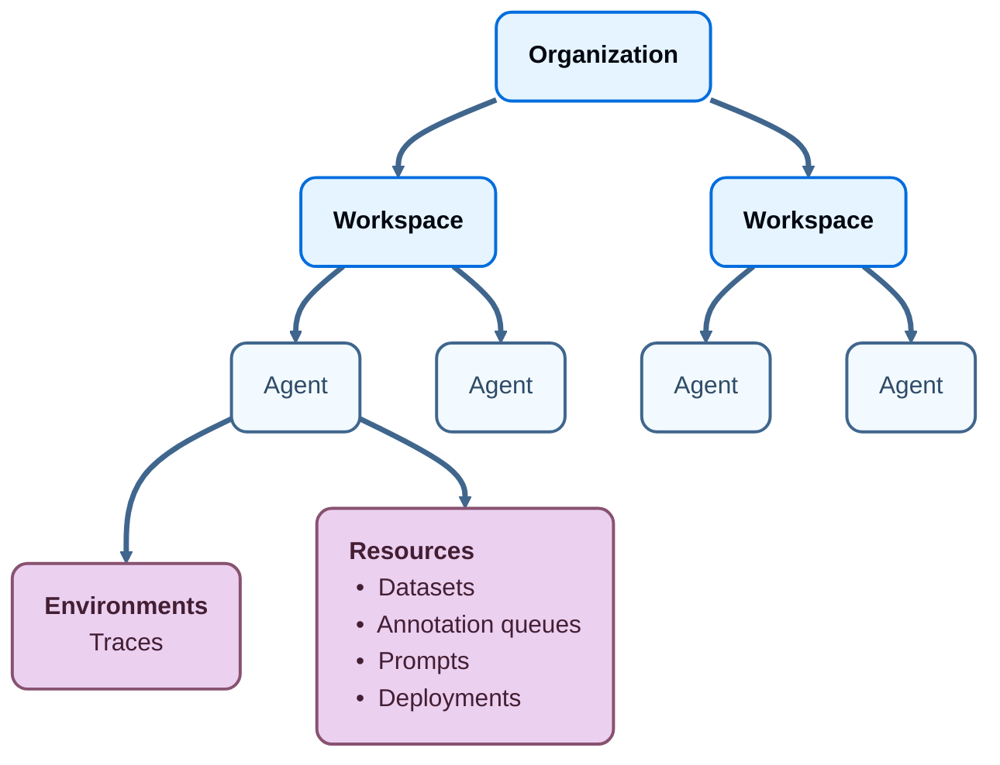

import OrgWorkspaceRole from '/snippets/langsmith/multi-workspace-org-roles.mdx';
import PermissionReference from '/snippets/langsmith/permissions-reference.mdx';

This overview covers topics related to managing users, organizations, workspaces, and agents within LangSmith.

## Resource hierarchy

LangSmith organizes access and data in four levels. An [organization](#organizations) contains workspaces. Each [workspace](#workspaces) contains agents. [Agents](#agents) organize your traces by environment and group the [resources](#resources) you work with, such as datasets and prompts.

Self-hosted LangSmith groups resources by application instead of agent. For details, see [Self-hosted workspaces](#self-hosted-workspaces).

The following diagram shows the relationship between organizations, workspaces, agents, environments, and resources:

### Organizations

An organization is a logical grouping of users within LangSmith that defines shared settings applying across all of its workspaces. These settings govern organization-wide concerns rather than the agents and resources within a workspace. Common organization-level configurations include user management, single sign-on (SSO), OAuth provider configuration, custom role creation, billing, and usage tracking.

Typically, there is one organization per company. An organization can have multiple workspaces. For configuration details, see [Set up an organization](/langsmith/set-up-hierarchy#set-up-an-organization).

When you log in for the first time, a personal organization will be created for you automatically. If you'd like to collaborate with others, you can create a separate organization and invite your team members to join. There are a few important differences between your personal organization and shared organizations:

| Feature             | Personal            | Shared                                                                                       |
| ------------------- | ------------------- | -------------------------------------------------------------------------------------------- |
| Maximum workspaces  | 1                   | Variable, depending on plan (see the [pricing page](https://www.langchain.com/pricing)) |
| Collaboration       | Cannot invite users | Can invite users                                                                             |
| Billing: paid plans | Developer plan only | All other plans available                                                                    |

### Workspaces

<Info>
Workspaces were formerly called Tenants. Some code and APIs may still reference the old name for a period of time during the transition.
</Info>

A workspace is a logical grouping of users, agents, and [resources](#resources) within an organization. Workspaces are commonly used to isolate business units, so each unit's agents and resources stay separate from other units'.

A workspace separates trust boundaries for resources and access control. Users are granted permissions at the workspace level, which determine their access to resources in that workspace, including datasets, annotation queues, and prompts. To configure one, see [Set up a workspace](/langsmith/set-up-hierarchy#set-up-a-workspace). For details on permissions, see [Workspace roles](#workspace-roles).

<Tip>
Create a separate workspace for each team within your organization. To organize resources even further, you can group them within a workspace by [agent](#agents).

For guidance on different workspace organization models based on your team's isolation requirements, refer to [Workload isolation](/langsmith/workload-isolation).
</Tip>

### Agents

An [agent](/langsmith/agent-registry#agent) is a logical grouping of resources within a workspace, one level below the workspace itself. The grouping keeps the UI organized by surfacing only the resources associated with the agent currently in context. An agent's traces divide further into [environments](/langsmith/agent-environments) drawn from a fixed set of four.

Select an agent from the agent switcher in the top bar, or select **All agents**. For more information, see [Navigate agents](/langsmith/navigate-agents).

LangSmith links traces to an agent through the agent's environments, and links datasets, prompts, annotation queues, and deployments to an agent with the reserved `Agent` [resource tag](#resource-tags) key.

Tracing pages require you to select an agent. Datasets, prompts, annotation queues, and deployments can exist without an agent. Selecting **All agents** shows these unlinked resources along with every agent's resources. Selecting a specific agent shows only that agent's resources.

### Resources

Resources are the concrete entities used to build, run, and observe agents. Examples include [prompts](/langsmith/prompt-context-hub), [datasets](/langsmith/manage-datasets), [annotation queues](/langsmith/annotation-queues), and [deployments](/langsmith/deployment). Resources can be scoped to a specific agent.

### Where settings live

See the table below for details on which features are available in which scope(s):

| Resource/Setting                                                            | Scope            |
| --------------------------------------------------------------------------- | ---------------- |
| Trace Projects                                                              | Workspace or agent              |
| Annotation Queues                                                           | Workspace or agent              |
| Deployments                                                                 | Workspace or agent              |
| Datasets & Experiments                                                      | Workspace or agent              |
| Prompts                                                                     | Workspace or agent              |
| [Resource Tags](#resource-tags)                                             | Workspace                       |
| API Keys                                                                    | Workspace                       |
| Settings including Secrets, Feedback config, Models, Rules, and Shared URLs | Workspace                       |
| User management: Invite User to Workspace                                   | Workspace                       |
| RBAC: Assigning Workspace Roles                                             | Workspace                       |
| Data Retention, Usage Limits                                                | Workspace\*                     |
| Plans and Billing, Credits, Invoices                                        | Organization                    |
| User management: Invite User to Organization                                | Organization\*\*                |
| Adding Workspaces                                                           | Organization                    |
| Assigning Organization Roles                                                | Organization                    |
| RBAC: Creating/Editing/Deleting Custom Roles                                | Organization                    |

<Info>
\* Data retention settings and usage limits will be available soon for the organization level as well.

\*\* Self-hosted installations may enable workspace-level invites of users to the organization via a feature flag. For details, refer to the [self-hosted user management docs](/langsmith/self-host-user-management).
</Info>

### Resource tags

Resource tags allow you to further segregate resources within a workspace for use with [ABAC](/langsmith/organization-workspace-operations#access-policies). Each tag is a key-value pair that you can assign to a resource.

LangSmith resource tags are very similar to tags in cloud services like [AWS](https://docs.aws.amazon.com/tag-editor/latest/userguide/tagging.html).

Navigate to **Settings** in the [LangSmith UI](https://smith.langchain.com) to select the **Resource tags** page in the sidebar.

### Separate environments

An environment is a stage in your release process, such as development, staging, or production. Agents have environments built in, drawn from a fixed set of four. An [agent](/langsmith/agent-registry#agent) divides its traces across them, so no tagging convention is required. For more information, see [Agent environments](/langsmith/agent-environments).

Self-hosted LangSmith separates environments with resource tags instead. For details, see [Self-hosted workspaces](#self-hosted-workspaces).

In either case, avoid using separate workspaces for environment separation, because resources cannot be shared across workspaces, which prevents you from promoting resources such as prompts between environments.

<Note>
**Resource tags vs. commit tags for prompt management**

While both types of tags can use environment terminology like `dev`, `staging`, and `prod`, they serve different purposes:

- **Resource tags** (`Environment: prod`): Use these to *organize* resources across your workspace. Apply resource tags to tracing projects, datasets, and other resources (including prompts) to group them by environment.
- [Commit tags](/langsmith/manage-prompts#commit-tags) (`prod` tag): Use these to manage which [prompt version](/langsmith/prompt-context-hub#prompts) your code references. Commit tags are labels that point to specific commits in a prompt's history. When your code pulls a prompt by tag name (e.g., `client.pull_prompt("prompt-name:prod")`), it retrieves whichever commit that tag currently points to. To promote a prompt from `staging` to `prod`, move the commit tag to point to the desired version.

Resource tags organize **which resources** belong to an environment. Commit tags let you control **which version** of a prompt your code references without changing the code itself.
</Note>

### Self-hosted workspaces

Self-hosted LangSmith uses project-based workspaces, which group resources by application rather than agent. An application can group any project within a team. Select one from the **Application** dropdown at the top of the sidebar, or select **All applications** to see every resource in the workspace.

Project-based workspaces separate environments with [resource tags](#resource-tags): the default tag key `Environment`, with a different value per environment (for example, `dev`, `staging`, `prod`).

To check which type of workspace you have, see [How agent-based workspaces differ](/langsmith/migrate-to-agent-based-workspaces#check-which-one-you-have).

## Users and roles

This section covers who can access LangSmith and what they can do: users, the three types of API keys, and the roles that grant permissions.

### Users

A user is a person who has access to LangSmith. Users can be members of one or more organizations and workspaces within those organizations.

Manage members from the **Settings** page, which has separate sections for the organization and the workspace:

- **Organization** > **Members**: Manage members of the organization.
- **Workspace** > **Members**: Manage members of the current workspace.

### API keys

LangSmith API keys authenticate requests to LangSmith. They are separate from the model provider keys, such as OpenAI or Anthropic keys, that your application uses to call models.

<Warning>
We ended support for legacy API keys prefixed with `ls__` on October 22, 2024 in favor of personal access tokens (PATs) and service keys. We require using PATs and service keys for all new integrations. API keys prefixed with `ls__` will no longer work as of October 22, 2024.
</Warning>

#### Expiration dates

When you create an API key, you have the option to set an expiration date. Adding an expiration date to keys enhances security and minimizes the risk of unauthorized access. For example, you may set expiration dates on keys for temporary tasks that require elevated access.

Once expired, an API key is no longer valid and cannot be reactivated or have its expiration modified.

#### Personal access tokens (PATs)

Personal Access Tokens (PATs) are used to authenticate requests to the LangSmith API. They are created by users and scoped to a user. The PAT will have the same permissions as the user that created it.

PATs are prefixed with `lsv2_pt_`

Members can deactivate, reactivate, or delete their own PATs. [Organization Admins](/langsmith/rbac#organization-admin) and [Organization Operators](/langsmith/rbac#organization-operator) can also list, deactivate, reactivate, and delete any member's PAT.

Deactivating a token stops authentication but keeps its record, owner, and last use visible with a **Deactivated** badge. Deactivation is reversible; deletion permanently removes the record. Reactivation preserves the original expiration date and is unavailable once that date has passed. Because authentication results are cached, these changes take effect within a minute rather than instantly.

For the steps and authentication-cache timing, refer to [Deactivate or delete a personal access token](/langsmith/create-account-api-key#deactivate-or-delete-a-personal-access-token).

<Tip>
Avoid using PATs to authenticate requests from your application. Instead, use them for personal scripts or tools that interact with the LangSmith API. If the user associated with the PAT is removed from the organization, the PAT will no longer work.
</Tip>

#### Service keys

Service keys are similar to PATs, but are used to authenticate requests to the LangSmith API on behalf of a service account. Organization Admins can create any service key. Organization Operators and Organization Users can create workspace-scoped service keys in workspaces where their role grants `workspaces:manage-keys`, such as Workspace Admin. For the full breakdown, see [API keys operations](/langsmith/organization-workspace-operations#api-keys). We recommend using service keys for applications or services that need to interact with the LangSmith API, such as LangGraph agents or other integrations.

Service keys may be scoped to a single workspace, multiple workspaces, or the entire organization. They can be used to authenticate requests to the LangSmith API for whichever workspace(s) it has access to.

Service keys are prefixed with `lsv2_sk_`.

Service keys can only be deleted, not deactivated.

<Warning>
Use the `X-Tenant-Id` header to specify the target workspace.

- **When using PATs**: If this header is omitted, requests will run against the default workspace associated with the key.
- **When using organization-scoped service keys**: You must include the `X-Tenant-Id` header when accessing workspace-scoped resources. Without it, the request will fail with a `403 Forbidden` error.
</Warning>

<Note>
To create any type of API key, see [Create an account and API key](/langsmith/create-account-api-key).
</Note>

#### Tracing keys

Tracing keys are organization-owned credentials with fixed permissions to submit traces and create projects in selected workspaces. They do not grant access to stored traces, experiments, saved views, or administration.

Tracing keys use the `lsv2_tr_` prefix. Their scope is fixed at creation, and they remain valid when the creator leaves the organization. They follow service-key expiry limits. For creation permissions, scope limits, and deletion rules, refer to [Tracing keys](/langsmith/create-account-api-key#tracing-keys).

### Roles

Each user has one organization role, which applies across the organization. On Enterprise plans, each user also has one workspace role in every workspace they belong to. Manage both in **Settings** > **Roles**. For more information, see [Role-based access control](/langsmith/rbac).

#### Organization roles

Your organization role determines your [organization-level permissions](/langsmith/organization-workspace-operations) and your workspace membership. Organization roles are distinct from [workspace roles](#workspace-roles) (an Enterprise feature), and apply across all workspaces in the organization.

Each organization role affects workspace membership as follows:

- The role of [Organization Admin](/langsmith/rbac#organization-admin) grants a user full access to manage all organization configuration, users, billing, and workspaces.
    - An Organization Admin has `Admin` access to all workspaces in an organization.
- The role of [Organization Operator](/langsmith/rbac#organization-operator) grants a user management access to workspaces and non-admin users for day-to-day operations, without admin-level privileges such as managing Organization Admins.
    - An Organization Operator is added only to the workspaces they create or are invited to.
- The role of [Organization User](/langsmith/rbac#organization-user) grants a user permission to read organization information. However, they cannot execute any write actions at the organization level. An Organization User may create [Personal Access Tokens](#personal-access-tokens-pats).
    - An Organization User can be added to a subset of workspaces and assigned workspace roles as usual (if RBAC is enabled), which specify permissions at the workspace level.
- The role of [Organization Viewer](/langsmith/rbac#organization-viewer) is equivalent to Organization User, but a user with this role **cannot** create Personal Access Tokens. Self-hosted installations require Helm chart version 0.11.25 or later for this role.
- The role of [Organization Restricted](/langsmith/rbac#organization-restricted) grants a user access to their assigned workspaces without organization-wide read access, so the user cannot list organization members. Workspace-scoped service keys can also hold this role.

<Info>
<OrgWorkspaceRole/>

See [Security settings](/langsmith/manage-organization-by-api#security-settings) for instructions on how to disable PAT creation for the entire organization.
</Info>

For more information on setting up organizations and workspaces, refer to the [organization setup guide](/langsmith/set-up-hierarchy#organization-roles).

Organization-level permissions by role:

|                                             | Organization Restricted | Organization Viewer | Organization User | Organization Operator | Organization Admin |
| ------------------------------------------- | ----------------------- | ------------------- | ----------------- | --------------------- | ------------------ |
| View organization configuration             | ✅                       | ✅                   | ✅                 | ✅                     | ✅                  |
| View organization roles                     | ✅                       | ✅                   | ✅                 | ✅                     | ✅                  |
| View organization members                   | ❌                       | ✅                   | ✅                 | ✅                     | ✅                  |
| View data retention settings                | ❌                       | ✅                   | ✅                 | ✅                     | ✅                  |
| View usage limits                           | ❌                       | ✅                   | ✅                 | ✅                     | ✅                  |
| Create personal access tokens (PATs)        | ❌                       | ❌                   | ✅                 | ✅                     | ✅                  |
| View, deactivate, reactivate, and delete any member's PATs | ❌        | ❌                   | ❌                 | ✅                     | ✅                  |
| Admin access to all workspaces              | ❌                       | ❌                   | ❌                 | ❌                     | ✅                  |
| Manage billing settings                     | ❌                       | ❌                   | ❌                 | ✅                     | ✅                  |
| Create workspaces                           | ❌                       | ❌                   | ❌                 | ✅                     | ✅                  |
| Create, edit, and delete organization roles | ❌                       | ❌                   | ❌                 | ✅                     | ✅                  |
| Invite new users to organization            | ❌                       | ❌                   | ❌                 | ✅\*                   | ✅                  |
| Delete user invites                         | ❌                       | ❌                   | ❌                 | ✅\*                   | ✅                  |
| Remove users from an organization           | ❌                       | ❌                   | ❌                 | ✅\*                   | ✅                  |
| Update data retention settings              | ❌                       | ❌                   | ❌                 | ✅                     | ✅                  |
| Update usage limits                         | ❌                       | ❌                   | ❌                 | ✅                     | ✅                  |

\* Organization Operators cannot invite, remove, or delete invites for Organization Admins.

<PermissionReference/>

#### Workspace roles

<Note>
RBAC (Role-Based Access Control) is only available to Enterprise customers. If you are interested in this feature, [contact our sales team](https://www.langchain.com/contact-sales). Other plans default to using the Admin role for all users.
</Note>

On Enterprise plans, workspace roles define the permissions a user has within a workspace. There are three built-in workspace roles that cannot be edited:

- [Workspace Admin](/langsmith/rbac#workspace-admin) has full access to all resources within the workspace.
- [Workspace Editor](/langsmith/rbac#workspace-editor) can create, edit, and delete most resources, but cannot delete runs, change workspace settings, or manage workspace members.
- [Workspace Viewer](/langsmith/rbac#workspace-viewer) has read-only access to all resources within the workspace.

[Organization Admins](/langsmith/rbac#organization-admin) can also create and edit custom roles with specific permissions for different resources.

<Tip>
To give a group of users a role in several workspaces at once, use [teams](/langsmith/teams).
</Tip>

## Usage and billing

For trace retention periods, rate limits, and usage limits, see [Usage and billing](/langsmith/usage-and-billing). To manage invoices and spend, see [Manage billing](/langsmith/billing).

## See also

* **[Release policy](/langsmith/release-versions)**: Learn about the self-hosted release channels, cadence, and version numbering.
