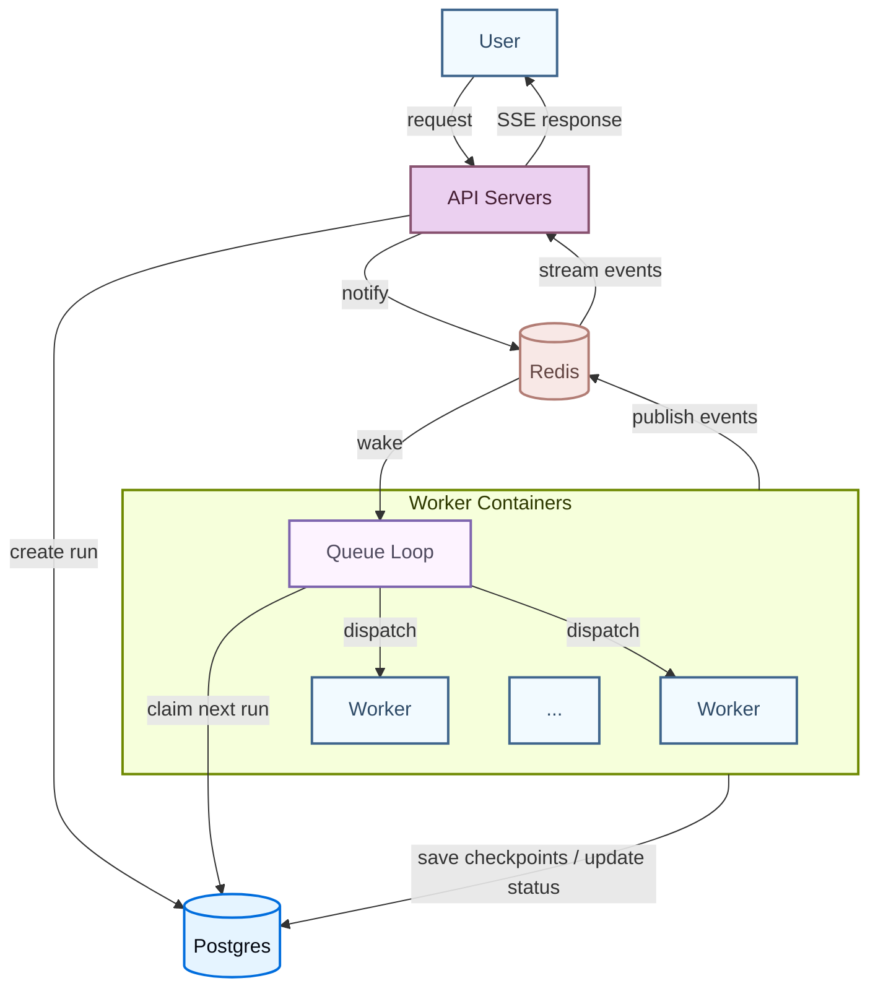

import AgentServerRenameNote from '/snippets/langsmith/agent-server-rename-note.mdx';

**LangSmith Agent Server** is a workflow orchestration runtime for agent workloads. It offers an API for creating and managing agent-based applications. It is built on the concept of [assistants](/langsmith/assistants), which are agents configured for specific tasks, and includes built-in [persistence](/oss/langgraph/persistence#memory-store) and a [task queue](#task-queue). This versatile API supports a wide range of agentic application use cases, from background processing to real-time interactions.

<AgentServerRenameNote />

<Tip>
To choose where Agent Server runs, such as LangSmith Cloud, Hybrid, or your own infrastructure, see [Deploy agents](/langsmith/deploy-overview).
</Tip>

Use Agent Server to create and manage:

<CardGroup cols={4}>
  <Card title="Assistants" icon="robot" href="/langsmith/assistants" />
  <Card title="Threads" icon="messages" href="/langsmith/use-threads" />
  <Card title="Runs" icon="player-play" href="/langsmith/runs" />
  <Card title="Cron jobs" icon="clock" href="/langsmith/cron-jobs" />
</CardGroup>

Agent Server also [streams](/langsmith/streaming) output to clients, pauses runs for [human review](/langsmith/add-human-in-the-loop), handles [concurrent input on a thread](/langsmith/double-texting), calls [webhooks](/langsmith/use-webhooks) when runs finish, and exposes agents over [MCP](/langsmith/server-mcp) and [A2A](/langsmith/server-a2a).

<Tip>
**API reference**  
For the endpoints and data models for assistants, threads, runs, crons, store, A2A, MCP, and system operations, refer to the [Agent Server API reference](/langsmith/server-api-ref).
</Tip>

## Application structure

To deploy an Agent Server application, you need to specify the graph(s) you want to deploy, as well as any relevant configuration settings, such as dependencies and environment variables.

Read the [application structure](/langsmith/application-structure) guide to learn how to structure your LangGraph application for deployment. To declare dependencies, use [`requirements.txt`](/langsmith/setup-app-requirements-txt), [`pyproject.toml`](/langsmith/setup-pyproject), or [`package.json`](/langsmith/setup-javascript). For more complex builds, [customize the Dockerfile](/langsmith/custom-docker) or [deploy from a monorepo](/langsmith/monorepo-support).

## What you deploy

When you deploy Agent Server, you are deploying one or more [graphs](#graphs), a database for [persistence](/oss/langgraph/persistence), and a [task queue](#task-queue).

### Graphs

When you deploy a graph with Agent Server, you are deploying a "blueprint" for an [Assistant](/langsmith/assistants).

A graph most commonly implements an [agent](/oss/langgraph/workflows-agents), but it does not have to. For example, a graph could implement a simple chatbot that only supports back-and-forth conversation, without the ability to influence any application control flow. In reality, as applications get more complex, a graph will often implement a more complex flow that may use [multiple agents](/oss/langchain/multi-agent) working in tandem.

Graphs do not have to be written with LangGraph. To deploy an agent built with another framework, wrap it with the LangGraph Functional API or the `deployments-wrap-sdk` package. For examples, see [Deploy Google ADK agents](/langsmith/deploy-google-adk) and [Deploy other frameworks](/langsmith/deploy-other-frameworks), which covers Strands, Claude Agent SDK, CrewAI, and AutoGen.

#### Graph loading and compilation

How and when your graph is compiled depends on how you register it in your [application structure](/langsmith/application-structure):

1. **Compiled graph** (recommended): Export an already-compiled `CompiledGraph` instance. The server loads it once at container startup and reuses it for every run—no compilation overhead per request.
2. **Factory function**: Export an agent factory function that the server invokes each time it needs the graph. Use this only when you need per-run graph customization (for example, choosing different models or tools based on the assistant config). Keep factory functions lightweight, since they run on every invocation.

<Tip>
Use a compiled graph unless you specifically need per-run customization. Factory functions add overhead on every invocation; compiled graphs do not.
</Tip>

In both cases, the server automatically injects the checkpointer and memory store configured for that deployment at runtime. **Do not configure these in your graph code** because the server needs to manage them for other operations.

### Persistence

Agent Server persists three types of data, all backed by [PostgreSQL](https://www.postgresql.org/) by default:

- **Core resource data**: assistants, threads, runs, and cron jobs. Always stored in PostgreSQL.
- **Checkpoints (short-term memory)**: snapshots of graph execution state written at each step. They make runs durable: if a worker is interrupted, the run can resume from the last checkpoint rather than from the beginning. Durability mode controls checkpoint frequency—`async` (default) writes after each step; `exit` stores only the final state. LangSmith stores this in PostgreSQL by default; but you can switch to [MongoDB](https://www.mongodb.com/) or a custom implementation. For details, refer to [Configure checkpointer backend](/langsmith/configure-checkpointer).
- **Store (long-term memory)**: memory that persists across threads, enabling agents to retain information between separate conversations. Stored in PostgreSQL by default but can be replaced with a custom implementation. For details, refer to [Add custom store](/langsmith/custom-store).

On [LangSmith Cloud](/langsmith/cloud-platform-features#database-provisioning) and with a [self-hosted control plane](/langsmith/deploy-with-control-plane), the control plane creates the PostgreSQL database for each Agent Server. Self-hosted setups can [use their own PostgreSQL instance](/langsmith/self-hosted-platform-features#custom-postgresql) instead. A [standalone Agent Server](/langsmith/deploy-standalone-server) has no control plane, so you provide the database and pass its connection string in `DATABASE_URI`.

To expire old threads, checkpoints, and store items, [add TTLs](/langsmith/configure-ttl). To search the store by meaning rather than exact key, [add semantic search](/langsmith/semantic-search).

### Task queue

When a client creates a run, the API server enqueues it and a queue worker picks it up for execution. Workers can also be signaled to cancel a run in progress, and publish output events that open `/stream` connections forward to the client in real time.

[Redis](https://redis.io/) handles the signaling, cancellation, and streaming pub/sub between API servers and queue workers. It stores only ephemeral data—no user or run data persists in Redis. Run data itself is always read from and written to PostgreSQL.

The control plane creates the Redis instance alongside the database, and self-hosted setups can [use their own Redis instance](/langsmith/self-hosted-platform-features#custom-redis) instead. With a standalone Agent Server, you provide Redis and pass its connection string in `REDIS_URI`. For more on how Agent Server uses PostgreSQL and Redis, see [Data plane](/langsmith/data-plane).

## Runtime architecture

Agent Server runs as API servers and queue workers that share PostgreSQL and Redis. The deployment mode decides how those processes are split across hosts. This section covers the deployment modes, the containers they run, and how a run moves through them.

### Deployment modes

Agent Server supports three runtime configurations:

- **Single host**: The API server manages the task queue directly with no separate queue workers. This is the default for self-hosted deployments and is suitable for development and low-traffic use cases.
- **Split API and queue**: Dedicated queue workers handle run execution on separate hosts from the API server. For self-hosted deployments, enable this by setting `queue.enabled: true` in your configuration. Each tier scales independently—API servers scale on request volume, queue workers scale on pending run count.
- **Distributed runtime**: The API and queue processes are again run separately, but instead of a single queue process handling both the orchestration and execution of your graph, the distributed runtime uses one process for orchestration and one process for execution. Use this for large-scale deployments with high concurrency requirements.

The container architecture and run lifecycle described below apply to single host and split API and queue configurations.

### Container architecture

A typical deployment consists of two kinds of long-running containers, both built from the same Docker image (a base image with your project code installed on top):

- **API servers** handle client requests (creating runs, reading thread state, streaming results) but do not execute agent code themselves.
- **Queue workers** are the execution engine. They listen to the durable task queue, execute your graph code, and write checkpoints.

Containers are **stateless** but persistent. At least 1 queue worker must listen to the task queue at any time to ensure no runs are orphaned. The containers can serve many runs over their lifetime.

API servers and queue workers are separate container pools and [scale independently](/langsmith/data-plane#autoscaling).

### Run execution lifecycle

When you invoke a run, the request flows through several components:

1. A client sends a request to an API server, which creates a pending run in the durable task queue.
2. A queue worker picks up the run, acquires a lease on it, loads the appropriate graph, and begins execution. The queue enforces that at most 1 run can be executed for a given thread at one time.
3. As the graph executes, the worker writes checkpoints to the persistence layer (the frequency depends on the [durability mode](/oss/langgraph/persistence#durability-modes)) and broadcasts streaming events over the configured pubsub provider.
4. If the client opened a `/stream` connection, the API server subscribes to the pubsub channel and forwards events to the client via server-sent events in real time.
5. When execution completes, the worker updates the run status and releases its slot for the next run.

Each worker executes up to [`N_JOBS_PER_WORKER`](/langsmith/env-var-self-hosted) runs concurrently (default: 10), so a single worker container serves many runs in parallel. This bounds concurrent run execution, not the number of API requests the deployment can serve. API servers handle requests independently and scale separately, so request-serving capacity is not capped by `N_JOBS_PER_WORKER`. See [Configure Agent Server for scale](/langsmith/agent-server-scale) for tuning guidance.

## Secure and customize the server

<CardGroup cols={2}>

<Card
  title="Auth & access control"
  cta="Secure your server"
  href="/langsmith/auth"
  icon="lock"
>
Authenticate users, enforce resource-level access, and connect external OAuth2 identity providers.
</Card>

<Card
  title="Server customization"
  cta="Customize your server"
  href="/langsmith/caching"
  icon="settings"
>
Add caching, custom stores and checkpointers, lifespan hooks, middleware, custom routes, encryption, and configurable headers and logs.
</Card>

</CardGroup>

## Tutorials

- [Collect user feedback for Agent Server runs](/langsmith/agent-server-feedback): Attach end-user feedback to runs and traces.
- [Implement generative user interfaces](/langsmith/generative-ui-react): Stream UI elements to a React client.
- [Implement a CI/CD pipeline](/langsmith/cicd-pipeline-example): Automate tests, evaluations, and deployments with GitHub Actions.
