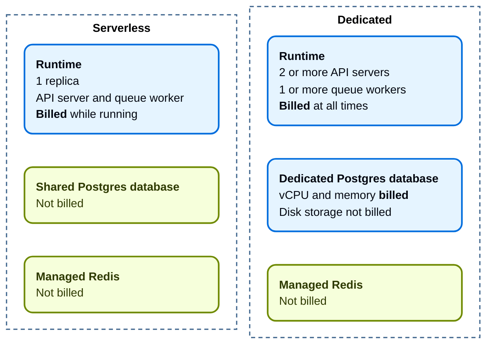
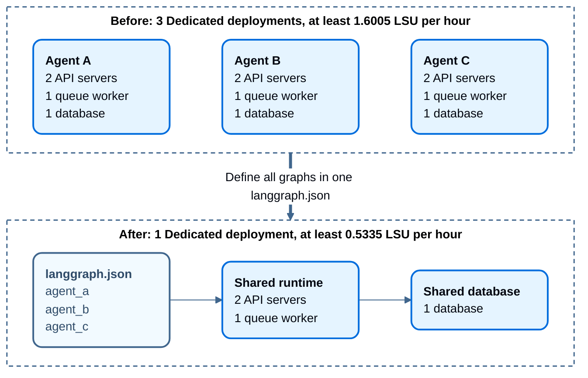

This page describes how to manage billing for your LangSmith organization:

- [Set up billing for your account](#set-up-billing-for-your-account): Complete the billing setup process for Developer and Plus plans, including special instructions for legacy accounts.
- [Track contract usage (Enterprise)](#track-contract-usage-enterprise): View prepaid contract consumption.
- [Update your information](#update-your-information-paid-plans-only): Modify invoice email addresses, business information, and tax IDs for your organization.
- [Enforce spend limits](#enforce-spend-limits): Learn how to manage your spend through usage limits and data retention.
- [LangSmith Deployment billing](#langsmith-deployment-billing): Understand deployment charges, compare sizes and hourly costs, and reduce deployment costs.

## Set up billing for your account

<Note>
Before using this guide, note the following:

- If you are interested in the [Enterprise](https://www.langchain.com/pricing) plan, [contact our sales team](https://www.langchain.com/contact-sales). This guide is only for our self-serve billing plans.
</Note>

To set up billing for your LangSmith organization, navigate to the [Billing and Usage](https://smith.langchain.com/settings/payments) page under **Settings**. Depending on your organization's settings, there are different setup guides:

- [Developer plan](#developer-plan%3A-set-up-billing-on-your-personal-organization)
- [Plus plan](#plus-plan%3A-set-up-billing-on-a-shared-organization)

### Developer plan: set up billing on your personal organization

Personal organizations are limited to 5,000 traces per month until a credit card is added. To add a card:

1. Click **Add card to remove trace limit**.
1. Add your credit card information.
1. Once complete, you will no longer be rate limited to 5,000 traces, and you will be charged for any excess traces at rates specified on the [pricing](https://www.langchain.com/pricing-langsmith) page.

### Plus plan: set up billing on a shared organization
Team organizations are given an initial 10,000 traces per month. Any excess traces will be charged at rates specified on the [pricing](https://www.langchain.com/pricing-langsmith) page.

<Note>
New organizations that you manually create are required to be on the Plus Plan. If you see a message about needing to upgrade to Plus to use this organization, follow these steps.
</Note>

1. Click **Upgrade to Plus**.
1. Invite members to your organization, as desired.
1. Enter your credit card information. Then, enter business information, invoice email, and tax ID. If this organization belongs to a business, check the **This is a business** checkbox and enter the information accordingly. For more information, refer to the [Update your information section](#update-your-information-paid-plans-only).

## Track contract usage (Enterprise)

Contract usage tracking is available for [**Enterprise plan**](/langsmith/pricing-plans) customers with prepaid commitments. You must have the [`organization:manage` permission](/langsmith/organization-workspace-operations) to access this feature.

For details on viewing your prepaid contract consumption, refer to [Contract usage](/langsmith/view-usage#contract-usage).

<Note>
For more details on the Enterprise plan, [contact our sales team](https://www.langchain.com/contact-sales).
</Note>

## Update your information (Paid plans only)

To update business information for your LangSmith organization, head to the [Billing and Usage](https://smith.langchain.com/settings/payments) page under **Settings**.

### Invoice email

To update the email address for invoices, follow these steps:

1. Navigate to the **Plans and Billing** tab.
2. Locate the section beneath the payment method, where the current invoice email is displayed.
3. Enter the new email address for invoices in the provided field.
4. The new email address will be automatically saved.

You will receive all future invoices to the updated email address.

### Business information and tax ID

<Note>
In certain jurisdictions, LangSmith is required to collect sales tax. If you are a business, providing your tax ID may qualify you for a sales tax exemption.
</Note>

To update your organization's business information, follow these steps:

1. Navigate to the **Plans and Billing** tab.
2. Below the invoice email section, you will find a checkbox labeled **Business**.
3. Check the **Business** checkbox if your organization belongs to a business.
4. A business information section will appear, allowing you to enter or update the following details:
   - Business Name
   - Address
   - Tax ID for applicable jurisdictions
5. A Tax ID field will appear for applicable jurisdictions after you select a country.
6. After entering the necessary information, click the **Save** button to save your changes.

This ensures that your business information is up-to-date and accurate for billing and tax purposes.

## Enforce spend limits

<Check>
You may find it helpful to read the following pages, before continuing with this section on optimizing your tracing spend:

- [Data Retention Conceptual Docs](/langsmith/usage-and-billing#data-retention)
- [Usage Limiting Conceptual Docs](/langsmith/usage-and-billing#usage-limits)
</Check>

<Note>
Some of the features mentioned in this guide are not currently available on Enterprise plan due to its custom nature of billing. If you are on the Enterprise plan and have questions about cost optimization, contact your sales rep or support via [support.langchain.com](https://support.langchain.com).
</Note>

### Understand your current usage

The first step of any optimization process is to understand current usage. For details on the usage graph, granular usage, invoices, and contract usage, refer to [View usage](/langsmith/view-usage).

LangSmith measures usage per workspace, because workspaces often represent development environments or teams within an organization.

### Set limits on usage

#### Set spend limit for workspace

1. To set limits, navigate to **Settings** -> **Billing and Usage** -> **Usage limits**.
1. Input a spend limit for your selected workspace. LangSmith will determine an appropriate number of base and extended trace limits to match that spend. The trace limits include the free trace allocation that comes with your plan \(see details on [pricing page](https://smith.langchain.com/settings/payments)\).

<Note>
For organizations with **multiple workspaces only**: For simplicity, LangSmith incorporates the free traces into the cost calculation of the **first workspace only**. In actuality, the free traces can be "consumed" by any workspace. Therefore, although workspace-level spend limits are approximate for multi-workspace organizations, the organization-level spend limit is absolute.
</Note>

#### Configure trace tier distribution

LangSmith has two trace tiers: base traces and extended traces. Base traces have the base retention and are short-lived (14 days), while extended traces have extended retention and are long-lived (180 days by default, [customizable for Enterprise customers](/langsmith/data-purging-compliance#customize-extended-retention-policy)). For more information, refer to the [data retention conceptual docs](/langsmith/usage-and-billing#data-retention).

<Warning>
Starting September 14, 2026, the maximum long-lived trace retention period for SaaS customers is changing to 180 days. Enterprise customers can still customize the extended retention period per workspace up to this new maximum. Changes apply to new traces only—existing traces are unaffected.
</Warning>

Set the desired default trace tier by selecting an option below the **Default data retention** label. All traces will have this tier by default when they are registered. Note that because extended traces cost more than base traces, selecting **Extended** as your default data retention option will result in less overall traces allowed in the billing period. By default, updating this setting will only apply to future incoming traces. To apply to all existing traces in the workspace, select the checkbox.

If the default data retention is set to **Base** you can optionally use the slider to distribute trace limits across base and extended tracess. LangSmith automatically provides a suggestion for this distribution but you can tailor this to your needs. For example, if you are running lots of automations or other features that may upgrade a trace to extended, you may want to increase your extended trace limits. To see the complete list of features that may upgrade a trace, [see here](https://docs.langchain.com/langsmith/usage-and-billing#how-it-works:~:text=Data%20retention%20auto%2Dupgrades).

<Note>
The extended data retention limit can cause features other than tracing to stop working once reached. If you plan to use this feature, read more about its [functionality and side effects](/langsmith/usage-and-billing#side-effects-of-extended-data-retention-traces-limit).
</Note>

### Other methods of managing traces

#### Customize extended retention period ([Enterprise](/langsmith/pricing-plans) only)

[Enterprise](/langsmith/pricing-plans) customers can customize the extended data retention period at the workspace level to meet compliance requirements. The default is 180 days (as of September 14, 2026), but this can be adjusted based on your organization's needs. For more information, refer to [Customize extended retention policy](/langsmith/data-purging-compliance#customize-extended-retention-policy).

#### Change project-level default retention

Data retention settings are adjustable per tracing project. At the project level, you choose between two tiers: base (14 days) or extended (180 days). To customize the extended duration up to 180 days, use [workspace-level configuration](/langsmith/data-purging-compliance#customize-extended-retention-policy) (Enterprise only).

In an [agent-based workspace](/langsmith/agents), each of an agent's [environments](/langsmith/agent-environments) is its own tracing project, so retention is set per environment rather than per agent, and you reach the setting through the agent rather than a **Projects** list.

Navigate to **Projects** > ***Your project name*** > Select **Retention** and select the desired default retention. This will only affect retention (and pricing) for **traces going forward**.

#### Apply extended data retention to a percentage of traces

You may not want all traces to expire after 14 days. You can automatically extend the retention of traces that match some criteria by creating an [automation rule](/langsmith/rules). You might want to apply extended data retention to specific types of traces, such as:

* 10% of all traces: For general analysis or analyzing trends long term.
* Errored traces: To investigate and debug issues thoroughly.
* Traces with specific metadata: For long-term examination of particular features or user flows.

To configure this:

1. Navigate to **Projects** > ***Your project name*** > Select **+ New** > Select **New Automation**. In an agent-based workspace, start from the agent's environment.
2. Name your rule and optionally apply filters or a sample rate. For more information on configuring filters, refer to [filtering techniques](/langsmith/filter-traces-in-application#filter-operators).

<Note>
When an automation rule matches any [run](/langsmith/observability-concepts#runs) within a [trace](/langsmith/observability-concepts#traces), then all runs within the trace are upgraded to extended data retention (180 days by default, [customizable for Enterprise customers](/langsmith/data-purging-compliance#customize-extended-retention-policy)).
</Note>

For example, this is the expected configuration to keep 10% of all traces for extended data retention:

If you want to keep a subset of traces for **longer than 180 days** for data collection purposes, you can create another run rule that sends some runs to a dataset of your choosing. A dataset allows you to store the trace inputs and outputs (e.g., as a key-value dataset), and will persist indefinitely, even after the trace gets deleted.

### Summary

If you have questions about further managing your spend, please contact support via [support.langchain.com](https://support.langchain.com).

## LangSmith Deployment billing

In addition to traces, LangSmith charges for deployed agents through LangSmith Deployment. Deployments are billed on the resources they consume:

- **Compute**: Requested vCPU and memory per running replica, measured in LangChain Standard Units (LSU). [Autoscaling](/langsmith/cloud-platform-features#scaling) adds billable replicas. [Serverless](/langsmith/cloud-platform-features#serverless) compute charges stop at scale-down, not when traffic stops. [Dedicated](/langsmith/cloud-platform-features#dedicated) runs continuously.
- **Database**: Dedicated database charges are based on configured vCPU and memory, including while idle. Runtime autoscaling does not change the database charge. Database disk storage and the shared Serverless database are not billed.

Managed Redis is not billed on any deployment type or size.

The following diagram shows which parts of each deployment type are billed. Blue parts are billed. Green parts are not billed:

Usage is converted to LSU at the following rates. One LSU costs $1.00:

| Resource | Rate |
|---|---|
| Runtime vCPU | 0.0675 LSU per vCPU-hour |
| Runtime memory | 0.009 LSU per GiB-hour |
| Database vCPU | 0.177 LSU per vCPU-hour |
| Database memory | 0.025 LSU per GiB-hour |

Usage is sampled every 5 minutes and totaled hourly. Each running billable container is charged for that interval based on requested resources, not actual utilization.

### Compare sizes and hourly costs

The following tables show the hourly cost of each [size](/langsmith/cloud-platform-features#sizes) on LangSmith Cloud in GCP. All costs are in LSU per hour.

A Serverless deployment is charged only while it runs. A scaled-down Serverless deployment costs 0 LSU. Serverless deployments do not scale out, and their shared database is not billed:

| Serverless size | Billable runtime | Cost while running |
|---|---|---|
| Small | 0.8 vCPU / 2 GiB | 0.072 |
| Medium | 4 vCPU / 4 GiB | 0.306 |
| Large | 8 vCPU / 8 GiB | 0.612 |

A Dedicated deployment is charged for its minimum runtime and its database at all times. This table assumes the database size matches the compute size:

| Dedicated size | Runtime + database | Minimum total |
|---|---|---|
| Small | 0.2565 + 0.277 | 0.5335 |
| Medium | 0.513 + 0.554 | 1.067 |
| Large | 1.026 + 1.108 | 2.134 |

<Note>
The Dedicated minimum runtime is 2 API server replicas and 1 queue worker. [Autoscaling](/langsmith/cloud-platform-features#scaling) adds API server or queue worker replicas. Each added replica costs the added replica rate for its size.
</Note>

The following table shows the minimum runtime and the added replica rate for each Dedicated size:

| Dedicated size | Minimum runtime | Each added replica |
|---|---|---|
| Small | 3 vCPU / 6 GiB | +0.0855 |
| Medium | 6 vCPU / 12 GiB | +0.171 |
| Large | 12 vCPU / 24 GiB | +0.342 |

Dedicated database capacity on LangSmith Cloud in GCP is:

| Database size | Capacity | Database cost per hour |
|---|---|---|
| Small | 1 vCPU / 4 GiB | 0.277 LSU |
| Medium | 2 vCPU / 8 GiB | 0.554 LSU |
| Large | 4 vCPU / 16 GiB | 1.108 LSU |

Database capacity differs by cloud provider. Compute and database sizes can be [set independently](/langsmith/cloud-platform-features#sizes).

Tracing and other product usage are separate charges.

[Free Serverless deployments](https://www.langchain.com/pricing) are available only in the Small size. A free deployment is not billed for any container, at any **Scale down after** setting. Dedicated deployments are never free.

To estimate the cost of a deployment, you can also use the deployment cost calculator on the [pricing page](https://www.langchain.com/pricing).

<Note>
Usage-based pricing replaced per-run and uptime pricing on October 1, 2026. Scale to zero requires the new pricing. For transition questions, contact [support](https://support.langchain.com).
</Note>

For high-volume deployment usage, [contact our sales team](https://www.langchain.com/contact-sales) to discuss custom pricing options.

### Reduce deployment costs

Deployment charges are based on the compute and database resources that each deployment requests. To lower your deployment bill, run fewer deployments, use smaller sizes, and let idle deployments scale down:

- **Use Serverless with a short scale-down time**: A Serverless deployment stops compute charges when it scales down. Set **Scale down after** to `1 hour` instead of the default `1 week`. With the default, a deployment that receives a request at least once a week never scales down. Serverless deployments have cold starts and run one replica. Serverless is not yet available for deployments on AWS or Azure, or for self-hosted and hybrid deployments.
- **Run multiple agents on one deployment**: Charges apply to each deployment, not to each agent. [Define multiple graphs](/langsmith/application-structure#define-multiple-graphs-in-one-deployment) in one `langgraph.json` so that your agents share one set of replicas and one database. This saves the most on Dedicated, where each deployment has at least 2 API server replicas, 1 queue worker, and its own database.
- **Use the smallest size that works**: Each runtime replica and each database is charged by its size. On a Dedicated deployment, you can set the compute size and the database size separately. See [Sizes](/langsmith/cloud-platform-features#sizes).
- **Delete unused deployments**: An idle Dedicated deployment is charged for its minimum replicas and its database. An idle Serverless deployment is charged until it scales down.
- **Limit preview deployments**: Each [preview deployment](/langsmith/preview-builds) is a separate deployment and is charged like one. Lower **Idle TTL** and **Max concurrent previews** to limit how many preview deployments run, and for how long.
- **Remove unneeded wake-ups**: A request to a scaled-down Serverless deployment starts it again, including automated health checks. Enabled [cron jobs](/langsmith/cron-jobs) and scheduled runs start the deployment up to 10 minutes before they are due. Remove cron jobs and health checks that you do not need.

The following diagram compares three Dedicated deployments with one Dedicated deployment that runs three graphs:

The following table shows the effect of two changes. Monthly costs use 720 hours:

- **Shorter scale-down time**: A Serverless Small deployment receives requests for 2 hours each weekday, 22 days each month.
- **Multiple graphs**: Three agents run on Dedicated Small deployments on GCP.

| Change | Before | After |
|---|---|---|
| Shorter scale-down time | `1 week` (default): 720 hours, about 51.84 LSU | `1 hour`: about 66 hours, about 4.75 LSU. Saves about 47.09 LSU. |
| Multiple graphs | 3 deployments: about 1,152 LSU | 1 deployment with 3 graphs: about 384 LSU. Saves about 768 LSU. |

Autoscaling adds runtime cost to both Dedicated setups.

LangSmith does not support changing the type of a deployment after creation. To move to Serverless, create a new Serverless deployment and copy data from the previous deployment with the [Agent Server API](/langsmith/server-api-ref). You can also contact [support](https://support.langchain.com) for help with the migration.
