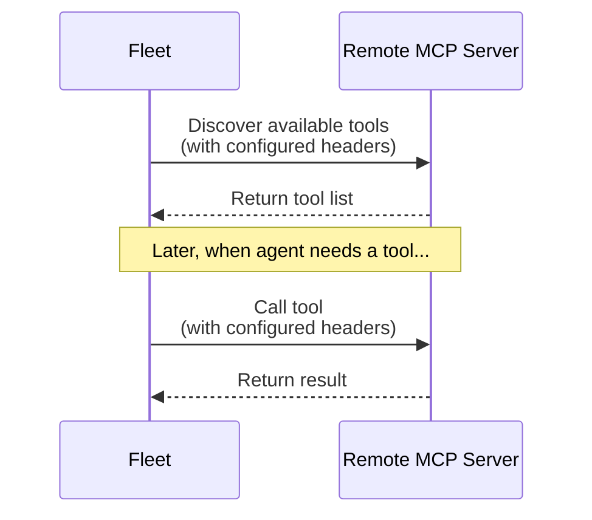

You can connect LangSmith Fleet to remote MCP servers to extend your agents with additional tools and integrations. This page covers how to add custom MCP servers and provides configuration details for popular remote servers.

An [MCP (Model Context Protocol) server](https://modelcontextprotocol.io/docs/getting-started/intro) exposes tools that an agent can call at runtime.

A remote MCP server:

- Runs outside of LangSmith (usually over HTTPS).
- Owns its own authentication and authorization.
- Acts as a bridge between your agent and an external system.

LangSmith Fleet doesn't execute these tools itself, it forwards requests to the MCP server and returns the results to the agent.

### How it works

- Fleet discovers tools from remote MCP servers via the standard MCP protocol.
- Headers configured in your workspace are automatically attached when fetching tools or calling them. Headers are key-value pairs sent with every HTTP request to your MCP server. They're commonly used for authentication (like API keys or bearer tokens), but can also provide configuration information, content types, or custom metadata.
- Tools from remote servers are available alongside built-in tools in Fleet.

**Runtime**: Fleet automatically connects to your MCP server and uses its tools.



## Add a remote MCP server

You can add MCP servers directly from your agent or from workspace settings.

<Note>
Adding MCP servers requires the **MCP Server Create** permission. Workspace admins can grant this permission to users from workspace settings.
</Note>

### Add to a specific agent

To add a remote MCP server to a specific agent:

<Steps>
  <Step title="Open the Connections drawer">
    Open your agent, then in the sidebar expand the **Connections** drawer.
  </Step>
  <Step title="Add the MCP server">
    1. Click **Add connection**, then click **+ Add custom MCP**.
    1. Enter the server name and URL, then configure authentication (see [authentication types](#authentication-types)).
  </Step>
  <Step title="Discover tools">
    Fleet discovers available tools from your MCP server and makes them available in this agent.
  </Step>
</Steps>

### Add to all agents in the workspace

To add a remote MCP server to all agents in the workspace:

<Tabs>
  <Tab title="From Fleet > Integrations">

    <Steps>
      <Step title="Navigate to Fleet > Integrations">
        In the LangSmith UI, navigate to the [**Fleet** > **Integrations**](https://smith.langchain.com/agents/tools) tab.
      </Step>

      <Step title="Add the server">
        1. Click **+ Custom MCP** at the bottom of the left sidebar.
        1. Add a **Name** for the MCP server.
        1. Add the MCP **URL** (e.g., `https://api.example.com/mcp`)
        1. Select the **Authentication** type. See [Authentication types](#authentication-types) for more details.
      </Step>

      <Step title="Save the server">
        Click **Save server**. Fleet will automatically discover available tools from your MCP server and make them available in your agents. The configured headers are applied to both tool discovery requests and tool execution requests.
      </Step>
    </Steps>
  </Tab>
  <Tab title="From workspace settings">
    <Steps>
      <Step title="Navigate to MCP server settings">
        In the LangSmith UI, navigate to the [Settings > MCP servers](https://smith.langchain.com/settings/workspaces/mcp-servers) tab.
      </Step>
      <Step title="Add the server">
        Click **Add server** and enter the server name and URL, then configure authentication (see [authentication types](#authentication-types)).
      </Step>
      <Step title="Save the server">
        Click **Save server**. Fleet will automatically discover available tools from your MCP server and make them available in your agents. The configured headers are applied to both tool discovery requests and tool execution requests.
      </Step>
    </Steps>
  </Tab>
</Tabs>

### Authentication types

Select an authentication type based on the server's requirements:

- **Static Headers**: Add key-value pairs sent with every request. The most common pattern is using an Authorization bearer token:
    - **Key**: `Authorization`
    - **Value**: `Bearer API_KEY`

    <Info>
    You can add multiple headers if your MCP server requires additional authentication or configuration parameters. Each header key-value pair is sent with every request to the server.
    </Info>

- **OAuth 2.1 (Auto)**: Select this for servers that support OAuth via dynamic client registration (DCR). Fleet registers a client for you and prompts you to log in with your account for that service. No setup is required, so prefer this option when the server supports it.
- **OAuth 2.1 (Manual)**: Select this for servers that support OAuth but not dynamic client registration. Select an OAuth provider that you [registered](#register-an-oauth-provider) in advance with your client ID and secret. The provider uses one of two grant types:
    - **Authorization Code**: Each user logs in with their own account for that service. The provider must have **PKCE** enabled.
    - **Client Credentials**: The agent authenticates machine-to-machine as your app, so no user logs in. Fleet requests a new access token from the provider's token URL when it calls the server.

### Register an OAuth provider

An OAuth provider stores your OAuth application's client ID, secret, and endpoints at the organization level. Register a provider once, then select it whenever you add an MCP server with **OAuth 2.1 (Manual)**.

<Note>
Managing OAuth providers requires the `workspaces:manage` permission, included in the [Workspace Admin](/langsmith/rbac#workspace-admin) role.
</Note>

<Note>
On self-hosted LangSmith v0.17, the Client Credentials grant requires v0.17.32 or later (Helm chart 0.17.5 or later). Also set `FF_FLEET_OAUTH_CLIENT_CREDENTIALS_ENABLED=true` on both `hostBackend` and `platformBackend`, for example through `hostBackend.deployment.extraEnv` and `platformBackend.deployment.extraEnv`.
</Note>

To register an OAuth provider:

<Steps>
  <Step title="Create the OAuth application with your identity provider">
    In your identity provider (for example, GitHub or Google), create an OAuth application. Note its client ID and client secret.

    For the Authorization Code grant, set the application's redirect (callback) URL to:

    ```txt
    https://<your-langsmith-host>/host-oauth-callback/<provider-id>
    ```

    Replace `<provider-id>` with the Provider ID you choose in the next step. The Client Credentials grant does not use a redirect URL.
  </Step>
  <Step title="Register the provider in LangSmith">
    Go to **Settings** > **OAuth providers** and click **OAuth Provider**. Fill in the fields for every provider:

    - **Provider ID**: A short identifier using letters, numbers, hyphens, and underscores (for example, `github`). This value appears in the redirect URL.
    - **Display Name**: A human-readable name (for example, `GitHub OAuth`).
    - **Client ID** and **Client Secret**: From the OAuth application you created.
    - **Grant Type**: **Authorization Code** or **Client Credentials**.
    - **Token URL**: The provider's token endpoint (for example, `https://example.com/oauth/token`).

    For **Authorization Code**, also set:

    - **Authorization URL**: The provider's authorization endpoint (for example, `https://example.com/oauth/authorize`).
    - **Enable PKCE**: Turn this on. Only providers with PKCE enabled appear when you add a manual-OAuth MCP server.
    - **Scope** (under **Advanced**): Optional. Overrides the `scope` parameter sent to the authorization URL.

    For **Client Credentials**, also set:

    - **Token Authentication**: How Fleet sends the client ID and secret to the token URL, either **HTTP Basic** (the default) or **Request body**.
    - **Scope** (under **Advanced**): Optional. Space-separated scopes sent with the token request.
    - **Audience** (under **Advanced**): Optional. Some providers, such as Auth0, require it.
  </Step>
  <Step title="Select the provider when adding the server">
    When you [add the MCP server](#add-a-remote-mcp-server), choose **OAuth 2.1 (Manual)** and select the provider you registered. For an Authorization Code provider, each user connects their account. For a Client Credentials provider, Fleet authorizes as the agent, so no user is prompted to connect.
  </Step>
</Steps>

## Update your MCP server URL

<Warning>
Changing the URL of a custom MCP server will break any agents that use tools from that server.
</Warning>

Fleet stores tool references by MCP server URL. If you update the URL of a custom MCP server, existing agents will fail when attempting to call those tools because the stored URL no longer matches.

To update an MCP server URL:

1. Update your MCP server URL in the workspace settings.
2. For each agent using tools from that server:
   - Remove the affected tools from the agent configuration.
   - Re-add the tools (they will now reference the new URL).
3. Test the agent to confirm tools work correctly.

## Supported servers

To view all available MCP servers and configuration details, navigate to the [Fleet > Integrations tab](https://smith.langchain.com/agents/tools).
