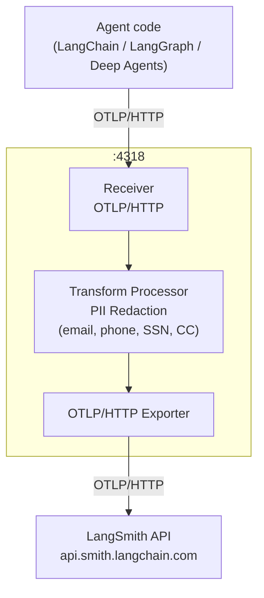

import AgentTracingPrerequisite from '/snippets/langsmith/agent-tracing-prerequisite.mdx';

Agents built with [LangChain](/langsmith/trace-with-langchain), [LangGraph](/langsmith/trace-with-langgraph), or [Deep Agents](/langsmith/trace-deep-agents) support [OpenTelemetry-based tracing](/langsmith/trace-with-opentelemetry). Instead of sending traces directly to LangSmith, you can route them through an OpenTelemetry collector you control, apply redaction rules to strip sensitive fields, and forward the sanitized traces to LangSmith.

Traces flow from your agent to the collector over OTLP/HTTP. The collector runs a transform processor that redacts sensitive span attributes, such as prompt inputs and model completions, before forwarding the sanitized spans to the LangSmith API.

You can send traces to the collector in two ways: [through the LangChain, LangGraph, or Deep Agents integration](#trace-with-langchain-langgraph-or-deep-agents), or by [configuring the OpenTelemetry SDK directly](#trace-with-the-opentelemetry-sdk-directly).



<AgentTracingPrerequisite />

## Prerequisites

Both approaches require the following environment variables. Set `OTEL_EXPORTER_OTLP_ENDPOINT` to the address of your collector:

```bash
LANGSMITH_OTEL_ENABLED="true"
LANGSMITH_TRACING="true"
LANGSMITH_OTEL_ONLY="true"
LANGSMITH_AGENT_ID="<your-agent-id>"
LANGSMITH_AGENT_ENVIRONMENT="production"
OTEL_EXPORTER_OTLP_ENDPOINT="http://<my-otel-collector-endpoint>:4318"
```

`LANGSMITH_AGENT_ID` and `LANGSMITH_AGENT_ENVIRONMENT` name the agent and environment the traces belong to. For more information, see [Log traces to an agent](/langsmith/log-traces-to-agent).

## Configure the collector

Both approaches also require an OpenTelemetry collector running as an intermediary between your agent and LangSmith. The following configuration sets up an OTLP receiver on port `4318`, a transform processor that redacts the `gen_ai.prompt` and `gen_ai.completion` span attributes, and an exporter that forwards the sanitized traces to the LangSmith API:

```yaml
receivers:
  otlp:
    protocols:
      http:
        endpoint: 0.0.0.0:4318


processors:
  transform/redact:
    error_mode: ignore
    trace_statements:
      - context: span
        statements:
          - replace_pattern(attributes["gen_ai.completion"], "[\\s\\S]*", "[REDACTED]")
          - replace_pattern(attributes["gen_ai.prompt"], "[\\s\\S]*", "[REDACTED]")

exporters:
  otlphttp/langsmith:
    traces_endpoint: "https://api.smith.langchain.com/otel/v1/traces"
    headers:
      x-api-key: "${env:LANGSMITH_API_KEY}"
      Langsmith-Agent-Id: "${env:LANGSMITH_AGENT_ID}"
      Langsmith-Agent-Environment: "${env:LANGSMITH_AGENT_ENVIRONMENT}"
      x-Tenant-Id: "${env:LANGSMITH_TENANT_ID}" # Required if API key is not scoped to a specific workspace


service:
  pipelines:
    traces:
      receivers: [otlp]
      processors: [transform/redact]
      exporters: [otlphttp/langsmith]
```

The collector reads `LANGSMITH_API_KEY`, `LANGSMITH_AGENT_ID`, and `LANGSMITH_AGENT_ENVIRONMENT` from its own environment, not from your application's. Set them where the collector runs, along with `LANGSMITH_TENANT_ID` if your API key is not scoped to a specific workspace.

### Send traces to an agent

The collector, not your application, decides which agent and environment receive the traces. The collector sends its own headers to LangSmith and does not forward the headers your application sends by default. The `otlphttp/langsmith` exporter in the preceding configuration sets both agent headers:

- **`Langsmith-Agent-Id`**: The identifier of the agent. It must be 1 to 63 lowercase letters, digits, or hyphens, start with a letter, and end with a letter or digit.
- **`Langsmith-Agent-Environment`**: The environment the traces belong to. One of `local`, `development`, `staging`, or `production`.

Send both agent headers or neither. LangSmith rejects a request that sets one without the other, or that sets either alongside `Langsmith-Project`, with a `400` error.

The headers apply to every span the exporter sends. To send traces to more than one agent or environment, define one exporter for each, and route each agent's spans to its exporter. Span attributes, including `gen_ai.agent.name`, do not send traces to an agent. To learn more about sending traces to an agent, see [Log traces to an agent](/langsmith/log-traces-to-agent).

## Trace with LangChain, LangGraph, or Deep Agents

Use this approach if your agent already uses [LangChain](/langsmith/trace-with-langchain), [LangGraph](/langsmith/trace-with-langgraph), or [Deep Agents](/langsmith/trace-deep-agents). The tracing integration handles span creation automatically based on your environment variables, so no additional instrumentation code is required:

```python
from langchain.agents import create_agent
from langchain.tools import tool
from langchain_openai import ChatOpenAI


@tool
def tell_joke(topic: str) -> str:
   llm = ChatOpenAI()
   response = llm.invoke(f"Tell me a short, funny joke about {topic}.")
   return response.content


agent = create_agent(
   model=ChatOpenAI(),
   tools=[tell_joke],
   system_prompt="When the user asks for jokes, use the tell_joke tool for each topic.",
)


topics = ["programming", "python", "kubernetes", "machine learning"]


result = agent.invoke(
   {"messages": [{"role": "user", "content": f"Tell me jokes about these topics: {', '.join(topics)}"}]}
)


print(result["messages"][-1].content)
```

## Trace with the OpenTelemetry SDK directly

Use this approach if you need programmatic control over the tracer provider and exporter, such as which span processors run or where the exporter sends spans. You configure the provider explicitly in code rather than relying on environment variables alone. The collector's exporter, not your code, decides which agent receives the traces:

```python
import os

from langchain_core.prompts import ChatPromptTemplate
from langchain_openai import ChatOpenAI
from opentelemetry import trace
from opentelemetry.exporter.otlp.proto.http.trace_exporter import OTLPSpanExporter
from opentelemetry.sdk.trace import TracerProvider
from opentelemetry.sdk.trace.export import BatchSpanProcessor


otlp_endpoint = os.environ["OTEL_EXPORTER_OTLP_ENDPOINT"]


provider = TracerProvider()
provider.add_span_processor(
   BatchSpanProcessor(
       OTLPSpanExporter(
           endpoint=otlp_endpoint+"/v1/traces",
       )
   )
)
trace.set_tracer_provider(provider)


chain = ChatPromptTemplate.from_template("Tell me a joke about {topic}") | ChatOpenAI()


for topic in ["programming", "python", "databases", "kubernetes", "machine learning"]:
   print(f"Asking about {topic}...")
   result = chain.invoke({"topic": topic})
   print(f"  {result.content[:100]}\n")


provider.force_flush()
provider.shutdown()
```

<Note>
If you prefer to redact sensitive data without routing through a collector, see [Prevent logging of sensitive data in traces](/langsmith/mask-inputs-outputs).
</Note>
