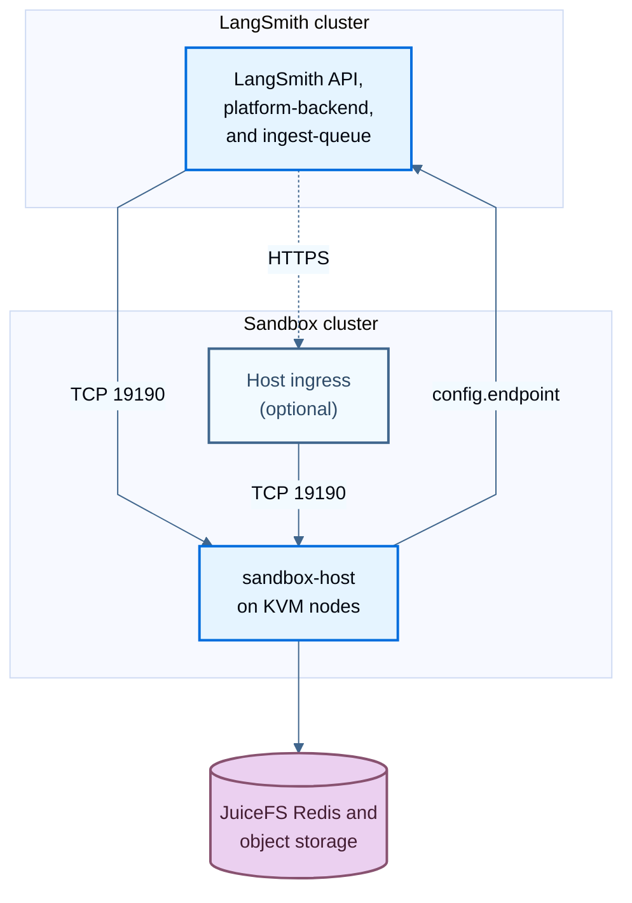

import SandboxCallbackSigningJwk from '/snippets/langsmith/sandbox-callback-signing-jwk.mdx';
import { SandboxDiagram } from '/snippets/sandbox-diagram.jsx';

By default, the `langsmith` Helm release runs the [Sandbox](/langsmith/sandboxes) runtime in the same Kubernetes cluster as LangSmith. With `sandboxes.external.enabled: true`, the runtime is external: a second chart, `langsmith-sandbox`, installs it, here in a dedicated cluster. This guide covers the requirements, network rules, secrets, and Helm steps for that topology.

For the default topology and the settings both topologies share, see [Enable Sandboxes](/langsmith/enable-self-hosted-sandboxes). For upgrades, see [Upgrade separate sandbox clusters](/langsmith/self-host-upgrades#upgrade-separate-sandbox-clusters).

<Note>
Separate sandbox clusters require LangSmith Helm chart version 0.18.0-rc.51 or later, from the v0.18 preview, and a `langsmith-sandbox` chart whose appVersion matches your `langsmith` chart. Earlier charts ignore `sandboxes.external.enabled` and deploy the embedded runtime. To list the runtime chart versions and their appVersions, run `helm search repo langchain/langsmith-sandbox --versions --devel`.
</Note>

## Decide when to use a separate cluster

Use a separate cluster when:

- **Your LangSmith cluster cannot host sandbox nodes**: The sandbox runtime needs KVM-capable nodes and privileged pods. For example, GKE Autopilot clusters cannot run the runtime, so a LangSmith installation on Autopilot needs a separate GKE Standard cluster for Sandboxes.
- **You want to isolate sandbox workloads**: Sandboxes run user code on privileged hosts. A separate cluster keeps those nodes away from the cluster that runs LangSmith and holds its application secrets. The runtime receives only the two secret values it needs.

Otherwise, keep the default embedded runtime. One Helm release then installs and upgrades the control plane and the runtime together, with no network path between clusters to maintain.

## Understand the topology

The LangSmith cluster keeps the Sandbox API and the control plane: authentication, placement, sandbox records in PostgreSQL, and the proxy for exec, file, and [service URL](/langsmith/sandbox-service-urls) traffic. The sandbox cluster runs the hosts and their microVMs.

<Frame caption="The LangSmith cluster keeps the API, placement, and sandbox records. The sandbox cluster runs the hosts, holds copies of two secrets, and reaches sandbox storage.">
  <SandboxDiagram name="separate-cluster" />
</Frame>

Compare it with the [default architecture](/langsmith/self-host-sandbox-architecture#understand-the-deployment-model), where `sandbox-host` runs in the LangSmith cluster.

| | LangSmith cluster | Sandbox cluster |
| --- | --- | --- |
| Helm release | `langsmith`, with `sandboxes.external.enabled: true` | `langsmith-sandbox`, with `sandboxHost.enabled: true` |
| Runs | `platform-backend`, `ingest-queue`, and the rest of LangSmith | `sandbox-host` on KVM-capable nodes, the JuiceFS formatter Job, and an optional host ingress |
| Holds | Sandbox records, the callback signing JWK, and the sandbox service-auth secret | A minimal Secret with copies of those two values, and the egress proxy CA |

With an external runtime, the `langsmith` release does not render `sandbox-host`, the JuiceFS formatter, the JuiceFS configuration Secret, or the proxy CA. The sandbox cluster reaches the JuiceFS Redis metadata store and the object storage; the LangSmith cluster does not need them.

The runtime chart uses the same settings as the embedded runtime, without the `sandboxes.` prefix:

| `langsmith` chart, embedded runtime | `langsmith-sandbox` chart |
| --- | --- |
| `sandboxes.sandboxHost.*` | `sandboxHost.*` |
| `sandboxes.juicefs.*` | `juicefs.*` |
| `sandboxes.juicefsFormatJob.*` | `juicefsFormatJob.*` |
| `sandboxes.proxyCa.*` | `proxyCa.*` |
| `sandboxes.authProxy.httpProxy.noProxy` | `authProxy.httpProxy.noProxy` |
| `sandboxes.authProxy.httpProxy.url` | Key `sandbox_egress_proxy_url` in the runtime Secret |
| `images.sandboxHostImage.*` | `images.sandboxHostImage.*` |
| `config.customCa` | `config.customCa` |
| Workload identity annotations on `sandboxes.sandboxHost.serviceAccount.annotations` | `workloadIdentity` |

The [scaling](/langsmith/self-host-sandbox-scaling) and [operations](/langsmith/self-host-sandbox-operations) guides use the embedded runtime's names. Apply the same settings in the runtime chart.

## Check the requirements

### Every cloud

- **Nodes**: KVM-capable `linux/amd64` nodes, tainted `sandbox.langsmith.com/host=true:NoSchedule` and labeled to match `sandboxHost.deployment.nodeSelector`. The node selector has no default, and the chart fails to render without it. The default toleration matches the taint above; for other taints, override `sandboxHost.deployment.tolerations`. For node-level requirements, see the [Enable Sandboxes prerequisites](/langsmith/enable-self-hosted-sandboxes#prerequisites) and [Node requirements for bare-metal and on-premises clusters](/langsmith/enable-self-hosted-sandboxes#node-requirements-for-bare-metal-and-on-premises-clusters).
- **JuiceFS metadata Redis**: Use `maxmemory-policy noeviction`. Require AUTH, TLS, or IAM authentication whenever another cluster can reach it. The storage backends and bucket formats in the Enable Sandboxes prerequisites apply to `juicefs.storage` and `juicefs.bucket`.
- **LangSmith hostname**: Set `config.hostname` in the `langsmith` release to an address the sandbox cluster can reach. With an external runtime, the chart fails to render without it, or with a loopback or in-cluster Service address.
- **`config.endpoint`**: Set the runtime chart's `config.endpoint` to `https://<LangSmith hostname>[/<base path>]/api`, the externally reachable LangSmith API including the `/api` prefix.
- **Private CA**: If a private CA signs the LangSmith API certificate, the host ingress certificate, or an HTTPS egress proxy certificate, add that CA to the runtime chart's `config.customCa`.
- **Network**: Open the paths in [Configure the network](#configure-the-network).
- **Secrets**: Create the Secret in [Create the runtime Secret](#create-the-runtime-secret).

If the sandbox cluster cannot pull from public registries, mirror the `sandbox-host` image as described in [Additional images for Sandboxes](/langsmith/self-host-mirroring-images#additional-images-for-sandboxes), and set `images.sandboxHostImage.repository` in the runtime chart to the mirrored repository. Keep the image's release tag in the mirror and leave `images.sandboxHostImage.tag` empty, so the image follows the chart's appVersion. A pinned tag does not change when you upgrade the chart.

### Amazon EKS

- **Identity**: An IAM OIDC provider for the sandbox cluster, and an IAM role that trusts `system:serviceaccount:<namespace>:<service-account-name>`. Set `sandboxHost.serviceAccount.name` so the subject stays stable. Set `workloadIdentity.provider: aws` and `workloadIdentity.aws.roleArn`.
- **Storage grants**: `s3:GetObject`, `s3:PutObject`, `s3:DeleteObject`, and `s3:AbortMultipartUpload` on `arn:aws:s3:::<bucket>/<juicefs.name>/*`, and `s3:ListBucket` on `arn:aws:s3:::<bucket>` with the condition `s3:prefix` like `<juicefs.name>/*`. A bucket that only JuiceFS uses needs no condition.
- **Nodes**: Instance types that expose KVM, such as bare-metal instances.

### Google Kubernetes Engine

- **Cluster**: A Standard cluster, not Autopilot, with a node pool on `UBUNTU_CONTAINERD` and nested virtualization (N2, N1, C3, or C4). Set the node pool's OAuth scope to `cloud-platform`, so IAM grants decide access.
- **Identity**: Set `workloadIdentity.provider: gcp`. `sandbox-host` uses the host network, and the chart runs the JuiceFS formatter there too, so both authenticate as the node pool's service account and need no Workload Identity binding. Leave `juicefsFormatJob.nodeSelector` empty, so the formatter runs on the sandbox node pool.
- **Storage grants**: Use a bucket that only JuiceFS uses, with uniform bucket-level access, and grant the node pool's service account `roles/storage.objectAdmin` on it. If JuiceFS must share a bucket, turn on uniform bucket-level access and use the condition `resource.name.startsWith("projects/_/buckets/<bucket>/objects/<juicefs.name>/") || resource.type == "storage.googleapis.com/Bucket"`. A prefix-only condition blocks the list calls JuiceFS makes. The second clause lets sandbox nodes list the name and metadata of every object in the bucket.
- **Redis**: With `juicefs.redis.iamAuthProvider: gcp`, use Memorystore for Redis Cluster and grant the node pool's service account `roles/redis.dbConnectionUser`.
- **Cache**: Point `juicefs.hostMount.cacheDirs` at node-local SSD.
- **Namespace**: If the sandbox cluster shares a Google Cloud project with the LangSmith cluster and has Workload Identity enabled, install the runtime in a namespace other than the LangSmith one. Workload Identity trusts a namespace and ServiceAccount name across every cluster in a project.

### Azure Kubernetes Service

- **Nodes**: A VM size that supports nested virtualization.
- **Identity**: OIDC issuer and Workload Identity enabled, and a federated credential with the subject `system:serviceaccount:<namespace>:<service-account-name>`. Set `sandboxHost.serviceAccount.name` so the subject stays stable. Set `workloadIdentity.provider: azure` and `workloadIdentity.azure.clientId`, plus `tenantId` if it differs from the cluster's tenant. The chart adds the `azure.workload.identity/use` label to `sandbox-host` and the formatter.
- **Storage grants**: `Storage Blob Data Contributor` on the container. Set `juicefs.storage: wasb` and `juicefs.storageAccountName`.
- **Redis**: Azure Managed Redis on database 0 over `rediss://`, with the `NoEviction` eviction policy set on the database. JuiceFS cannot change it.
- **Cache**: Point `juicefs.hostMount.cacheDirs` at the temporary disk under `/mnt`.

## Configure the network

By default, the LangSmith control plane connects directly to the node IPs that `sandbox-host` advertises, on TCP port `19190`. Allow these paths:

| Source | Destination | Port | Purpose |
| --- | --- | --- | --- |
| LangSmith `platform-backend` and `ingest-queue` pods | Sandbox nodes | TCP `19190` | Sandbox placement, lifecycle calls, exec, files, and other sandbox traffic |
| Other sandbox nodes | Sandbox nodes | TCP `19190` | Forwarded ingress requests, sandbox links, and live-migration streams |
| Host ingress controller or load balancer, when enabled | Sandbox nodes | TCP `19190` | Requests that arrive through the [host ingress](#use-the-host-ingress) |
| Sandbox nodes | `config.endpoint` | The endpoint's port, usually `443` | Host reports, lifecycle callbacks, and calls to the LangSmith API from inside Sandboxes |
| Sandbox nodes | JuiceFS Redis and object storage | The stores' ports | Sandbox storage |

For the first row, allow the address that LangSmith pods appear from on your network: the node security group, the pod CIDR, or a SNAT address, depending on the CNI.



<Warning>
Traffic on port `19190` is plain HTTP and carries sandbox commands, files, and credentials. Keep it on a private network you trust. If the clusters have no routed private network, or the traffic would leave one you trust, use the [host ingress](#use-the-host-ingress) with TLS.
</Warning>

The path from the sandbox nodes to `config.endpoint` is new in this topology. With the embedded runtime, `sandbox-host` reaches LangSmith through in-cluster Service DNS. With an external runtime, it calls `config.endpoint` over the network, so the call must pass every control in front of that address:

- **Load balancer allowlists**: If the LangSmith load balancer restricts source addresses, allow the address sandbox node traffic arrives from. For an internal load balancer, that is usually the sandbox nodes' private addresses. For an internet-facing one, it is usually the public address of the NAT gateway that the sandbox nodes use.
- **Egress filtering**: If a firewall filters egress from the sandbox cluster, allow the LangSmith hostname.
- **DNS**: The sandbox nodes must resolve the LangSmith hostname. An address that resolves only in the LangSmith cluster's private DNS does not work. For an internal load balancer, add the record to a private DNS zone the sandbox network uses, before you install the runtime: a lookup that fails at startup can stay cached for several minutes.

### Use the host ingress

The runtime chart can create an Ingress in front of `sandbox-host`. Use it when the LangSmith cluster cannot reach the sandbox node IPs, or when that plain-HTTP traffic would leave a private network you trust.

To route control-plane traffic through the host ingress:

1. In the runtime values, enable `sandboxHost.ingress` with a hostname and TLS:

   ```yaml
   sandboxHost:
     ingress:
       enabled: true
       ingressClassName: "<ingress-class>"
       hostname: "sandbox-hosts.example.com"
       tls:
         - secretName: "sandbox-hosts-tls"
           hosts:
             - "sandbox-hosts.example.com"
   ```

2. In the `langsmith` values, set the ingress origin, with no path or trailing slash:

   ```yaml
   sandboxes:
     external:
       hostIngressEndpoint: "https://sandbox-hosts.example.com"
   ```

TLS ends at the ingress. Inside the sandbox cluster, traffic from the ingress to the hosts and between hosts stays plain HTTP on port `19190`, so keep that network private.

The Ingress routes only `/internal/SandboxHost/` (host calls) and `/guest-operation/` (exec, files, tunnels, sandbox links, and browser and service URLs). It does not route `/metrics` or `/readyz`; scrape and probe those on each `sandbox-host` pod at port `19190`. Before you rely on the ingress, check:

- **Clients**: The LangSmith `platform-backend` and `ingest-queue` pods connect to the ingress, and so do the sandbox hosts, which dial it for sandbox links. If the ingress restricts source addresses, allow both. The sandbox hosts must also resolve the ingress hostname and trust its certificate. If a private CA signs it, add the CA to the runtime chart's `customCa` and to the `langsmith` chart's `config.customCa`.
- **Health checks**: Load balancers check the `sandbox-host` pods directly, and many check `/` or the Ingress path by default, which returns `404`. Set the health check path to `/readyz`. With the AWS Load Balancer Controller, add `alb.ingress.kubernetes.io/healthcheck-path: /readyz` and `alb.ingress.kubernetes.io/target-type: ip` to `sandboxHost.ingress.annotations`, because the Service is `ClusterIP`. On GKE, leave `ingressClassName` empty, set the `kubernetes.io/ingress.class: gce` annotation, and attach a `BackendConfig` with `healthCheck.requestPath: /readyz` and `healthCheck.port: 19190` through `sandboxHost.ingress.service.annotations` (`cloud.google.com/backend-config`).
- **Timeouts**: LangSmith waits up to 310 seconds for an exec request. Exec streams, tunnels, sandbox links, and browser sessions are long-lived WebSocket or server-sent event connections. Set the controller's read, idle, and backend timeouts above 310 seconds, and higher if long sessions must stay open. Defaults of 30 to 60 seconds cut them off. On GKE, set `timeoutSec` in the same `BackendConfig`.
- **Request size**: File uploads go through the ingress. Raise the controller's body size limit to at least your largest upload. On ingress-nginx, set `nginx.ingress.kubernetes.io/proxy-body-size`, which defaults to `1m`.
- **WebSockets**: The controller must allow WebSocket upgrades on Ingress routes. Azure Application Gateway for Containers supports WebSockets only through the Gateway API, so it cannot serve this Ingress. Use another controller, or leave `sandboxHost.ingress` disabled and route the two paths to port `19190` of the `sandbox-host` pods with your own Service and Gateway API `HTTPRoute`.

## Create the runtime Secret

The runtime reads its credentials from a Secret that you create in the sandbox namespace. Set its name in `config.existingSecretName`. The Secret holds two values, copied from the LangSmith side:

- **Sandbox service-auth secret**: Signs calls between the control plane and the sandbox hosts. Store it under `sandbox_service_auth_secret`, or the key that `serviceAuth.secretKey` names.
- **Callback signing JWK**: The Ed25519 private JWK that signs sandbox callbacks. Store it under `sandbox_callback_signing_jwk`, or the key that `config.callbackSigningJwkSecretKey` names.

Both values must equal the control plane's. Find them in the LangSmith app Secret:

| Value | With the chart-managed Secret | With `config.existingSecretName` |
| --- | --- | --- |
| Service-auth secret | Key `sandbox_service_auth_secret`, set from `sandboxes.serviceAuth.secret` | The key that `sandboxes.serviceAuth.secretKey` names |
| Callback signing JWK | Key `sandbox_callback_signing_jwk`, set from `sandboxes.callbackSigningJwk` | Key `sandbox_callback_signing_jwk` |

With an external runtime, the Helm install notes of the `langsmith` release print the key names for your configuration.

```yaml
apiVersion: v1
kind: Secret
metadata:
  name: langsmith-sandbox-runtime
  namespace: langsmith-sandbox
type: Opaque
stringData:
  sandbox_service_auth_secret: '<same-value-as-the-control-plane>'
  sandbox_callback_signing_jwk: '<same-ed25519-private-jwk-as-the-control-plane>'
```

Avoid committing this file to version control. If an external secret manager supplies your Secrets, sync the same two values into this one.

<Warning>
Copy only these two values. Never copy the whole LangSmith app Secret into the sandbox cluster.
</Warning>

The service-auth secret must be its own random value. Do not reuse `api_key_salt`: that value also salts LangSmith API keys and signs other LangSmith service calls, so it must not leave the LangSmith cluster. With an external runtime, the `langsmith` chart refuses to render without a dedicated value. Generate one, for example with `openssl rand -hex 32`, and set it on the control plane:

- **Chart-managed Secret**: Set `sandboxes.serviceAuth.secret`. It must differ from `config.apiKeySalt`.
- **`config.existingSecretName`**: Add a key with the new value to your Secret, and name it in `sandboxes.serviceAuth.secretKey`.

Do not change the value of `api_key_salt` itself: that invalidates every existing API key. To change the service-auth value of a running installation, follow [Rotate the service-auth secret](#rotate-the-service-auth-secret).

### Generate a callback signing JWK

If the `langsmith` release has no callback signing JWK yet, generate one. Set it on the control plane as `sandboxes.callbackSigningJwk`, or as the `sandbox_callback_signing_jwk` key in `config.existingSecretName`, and copy the same value into the runtime Secret.

<SandboxCallbackSigningJwk />

## Install with Helm

Install the `langsmith` release first, then the `langsmith-sandbox` release. The examples use the namespace `langsmith-sandbox` and the release name `langsmith-sandbox`.

<Steps>
  <Step title="Configure the LangSmith release">
    In the LangSmith cluster, add the sandbox settings to `langsmith_config.yaml`, along with the callback signing JWK described in [Create the runtime Secret](#create-the-runtime-secret):

    ```yaml
    config:
      hostname: "langsmith.example.com"

    sandboxes:
      enabled: true
      external:
        enabled: true
        # Only when you use the host ingress:
        # hostIngressEndpoint: "https://sandbox-hosts.example.com"
      # Required: a dedicated service-auth value, never api_key_salt. With
      # config.existingSecretName, set serviceAuth.secretKey to its key instead.
      serviceAuth:
        secret: "<random-secret>"
    ```

    With an external runtime, the chart ignores `sandboxes.juicefs`, `sandboxes.sandboxHost`, and `sandboxes.proxyCa`. It fails to render when `sandboxes.authProxy.httpProxy` or `sandboxes.juicefs.redis.iamAuthProvider` is set; configure those in the runtime chart.

    Apply the chart:

    ```bash
    helm upgrade -i langsmith langchain/langsmith \
      --kube-context <langsmith-context> \
      --namespace <langsmith-namespace> \
      --version <langsmith-chart-version> \
      --values langsmith_config.yaml \
      --wait
    ```
  </Step>

  <Step title="Prepare the sandbox cluster">
    Label and taint the sandbox nodes, open the [network paths](#configure-the-network), and create the namespace and the [runtime Secret](#create-the-runtime-secret):

    ```bash
    kubectl --context <sandbox-context> create namespace langsmith-sandbox
    kubectl --context <sandbox-context> apply -f langsmith-sandbox-runtime-secret.yaml
    ```

    To keep the JuiceFS Redis URL and its password out of your values file, also create a JuiceFS configuration Secret with the keys `name`, `metaurl`, `storage`, and `bucket`, and set `juicefs.existingSecretName` instead of the inline `juicefs` values. On Azure, `access-key` holds the storage account name.
  </Step>

  <Step title="Write the runtime values">
    Create `langsmith_sandbox_config.yaml`. Replace the placeholders with your values.

    <Tabs>
      <Tab title="EKS">

```yaml
config:
  endpoint: "https://langsmith.example.com/api"
  existingSecretName: "langsmith-sandbox-runtime"

workloadIdentity:
  provider: aws
  aws:
    roleArn: "<role_arn>"

juicefs:
  name: "sandbox-juicefs"
  storage: "s3"
  bucket: "https://bucket-name.s3.us-west-2.amazonaws.com"
  redis:
    metaURL: "rediss://<redis-host>:6379/0"

sandboxHost:
  enabled: true
  serviceAccount:
    name: "langsmith-sandbox-host"
  deployment:
    nodeSelector:
      kubernetes.io/arch: "amd64"
      sandbox.langsmith.com/host: "true"
```

      </Tab>
      <Tab title="GKE">

```yaml
config:
  endpoint: "https://langsmith.example.com/api"
  existingSecretName: "langsmith-sandbox-runtime"

workloadIdentity:
  provider: gcp

juicefs:
  name: "sandbox-juicefs"
  storage: "gs"
  bucket: "gs://bucket-name"
  redis:
    # Memorystore with AUTH. With in-transit encryption, use rediss:// on port 6378.
    metaURL: "redis://:<auth-string>@<redis-host>:6379/0"
  # Without local SSD on the node pool, omit hostMount to keep the cache on the
  # boot disk (/var/cache/juicefs).
  hostMount:
    cacheDirs:
      - "<node-local-ssd-path>/juicefs"

sandboxHost:
  enabled: true
  deployment:
    nodeSelector:
      kubernetes.io/arch: "amd64"
      sandbox.langsmith.com/host: "true"
```

      </Tab>
      <Tab title="AKS">

```yaml
config:
  endpoint: "https://langsmith.example.com/api"
  existingSecretName: "langsmith-sandbox-runtime"

workloadIdentity:
  provider: azure
  azure:
    clientId: "<client_id>"

juicefs:
  name: "sandbox-juicefs"
  storage: "wasb"
  bucket: "https://<container>.blob.core.windows.net"
  storageAccountName: "<storage-account-name>"
  redis:
    # Azure Managed Redis with an access key. With Microsoft Entra authentication,
    # drop the key and set iamAuthProvider: azure.
    metaURL: "rediss://:<url-encoded-access-key>@<redis-host>:10000/0"
  hostMount:
    cacheDirs:
      - "/mnt/juicefs-cache"

sandboxHost:
  enabled: true
  serviceAccount:
    # Must match the subject of the managed identity's federated credential.
    name: "langsmith-sandbox-host"
  deployment:
    nodeSelector:
      kubernetes.io/arch: "amd64"
      sandbox.langsmith.com/host: "true"
```

      </Tab>
    </Tabs>

    Leave `images.sandboxHostImage.tag` empty. The chart then runs the `sandbox-host` image for its appVersion, the LangSmith release it pairs with.
  </Step>

  <Step title="Install the runtime chart">
    Find the newest `langsmith-sandbox` chart whose appVersion equals the appVersion of the `langsmith` chart you installed:

    ```bash
    helm repo update
    helm search repo langchain/langsmith-sandbox --versions --devel
    ```

    Install that exact version:

    ```bash
    helm upgrade -i langsmith-sandbox langchain/langsmith-sandbox \
      --kube-context <sandbox-context> \
      --namespace langsmith-sandbox \
      --version <matching-sandbox-chart-version> \
      --values langsmith_sandbox_config.yaml \
      --wait
    ```
  </Step>
</Steps>

### Install with Argo CD or Flux

Manage the two releases as two applications, one for each cluster:

- **Order**: Deploy the `langsmith` release first. Add the runtime after the `langsmith` application has synced and is Healthy (Flux: the HelmRelease is `Ready`).
- **Versions**: Pin `langsmith-sandbox` to the exact chart version whose appVersion matches. Never use a range, `*`, or `*-0`, and never omit `version` in a Flux HelmRelease.
- **Proxy CA with Argo CD**: Set `proxyCa.mode: existingSecret` and point `proxyCa.existingSecretName` at a TLS Secret you create in the runtime namespace, with keys `tls.crt` and `tls.key`, for example `kubectl create secret tls <name> --cert=ca.crt --key=ca.key` with a CA certificate you generate. The default `generatedSecret` mode reuses its CA through Helm `lookup`, which Argo CD and other tools that render without cluster access cannot run, so each render produces a new CA. Flux runs Helm in the cluster, so the default mode works there.
- **Install notes**: Argo CD and Flux do not show Helm install notes. The rules that the notes print are on this page.
- **Back to the Helm CLI**: To stop managing the runtime with Flux, set `spec.suspend: true` on its HelmRelease before you delete it; deleting an active HelmRelease uninstalls the release. Helm 4 applies changes server-side, so the first `helm upgrade` afterwards fails with conflicts on fields that Flux's `helm-controller` owns. Run that one upgrade with `--force-conflicts`.

## Verify the installation

Check that both releases run the same LangSmith release. The `APP VERSION` columns must match:

```bash
helm list --kube-context <langsmith-context> -n <langsmith-namespace> --filter '^langsmith$'
helm list --kube-context <sandbox-context> -n langsmith-sandbox --filter '^langsmith-sandbox$'
```

Argo CD renders the charts without creating Helm releases, so `helm list` shows nothing for an Argo CD install, or a stale record for a release that Helm installed before Argo CD took it over. Compare the image tags instead. Both must end in the same release:

```bash
kubectl --context <langsmith-context> -n <langsmith-namespace> get deployment langsmith-platform-backend \
  -o jsonpath='{.spec.template.spec.containers[?(@.name=="platform-backend")].image}{"\n"}'
kubectl --context <sandbox-context> -n langsmith-sandbox get deployment langsmith-sandbox-sandbox-host \
  -o jsonpath='{.spec.template.spec.containers[?(@.name=="sandbox-host")].image}{"\n"}'
```

Check that the hosts are ready:

```bash
kubectl --context <sandbox-context> -n langsmith-sandbox rollout status deployment/langsmith-sandbox-sandbox-host
kubectl --context <sandbox-context> -n langsmith-sandbox get pods
```

Then run the sandbox smoke test in [Verify the installation](/langsmith/enable-self-hosted-sandboxes#verify-the-installation). If creating a sandbox fails with `NoSandboxHostsAvailable`, the control plane has no ready hosts. Check that the sandbox nodes reach `config.endpoint`, which the hosts use to register, and the other paths in [Configure the network](#configure-the-network).

The same error appears when the two releases hold different service-auth secrets: LangSmith and the sandbox hosts then reject each other's calls. Compare the two values by checksum, without printing them:

```bash
kubectl --context <langsmith-context> -n <langsmith-namespace> get secret <langsmith-app-secret> \
  -o jsonpath='{.data.<service-auth-key>}' | base64 -d | openssl dgst -sha256
kubectl --context <sandbox-context> -n langsmith-sandbox get secret langsmith-sandbox-runtime \
  -o jsonpath='{.data.sandbox_service_auth_secret}' | base64 -d | openssl dgst -sha256
```

`<langsmith-app-secret>` is the chart-managed Secret (`langsmith-secrets` for a release named `langsmith`) or your `config.existingSecretName`, and `<service-auth-key>` is `sandbox_service_auth_secret` or the key that `sandboxes.serviceAuth.secretKey` names. The two checksums must match. After you correct a value, restart the Deployments that read it on that side, listed in [Rotate the service-auth secret](#rotate-the-service-auth-secret), because Kubernetes does not restart pods when Secret data changes. The previous-secret settings only cover a planned [rotation](#rotate-the-service-auth-secret), not values that drift apart.

## Run one runtime per installation

Run exactly one `langsmith-sandbox` release for each LangSmith installation, and only while the `langsmith` release sets `sandboxes.external.enabled: true`. Running Sandboxes in more than one cluster for the same installation is not supported.

LangSmith accepts host reports from one sandbox runtime at a time, counting the `langsmith` release's embedded runtime as one. While one runtime reports, LangSmith refuses any other: the refused runtime's hosts never join the host pool, and the accepted runtime's Sandboxes keep running. A refused runtime shows up in three places:

- Its elected `sandbox-host` pod stays not ready, so `helm install --wait` and `kubectl rollout status` do not finish.
- Its `sandbox-host` logs repeat `the platform refused this sandbox runtime because another runtime already reports to the same LangSmith install`, with the error code `sandbox_runtime_conflict`, every 15 seconds.
- LangSmith logs `refused host report from a second sandbox runtime`, with the instance IDs of the accepted and the refused runtime.

Remove the extra runtime. LangSmith accepts a different runtime once the accepted one has sent no reports for 6 minutes, so after a reinstall or a move to another cluster, the new runtime can wait up to 6 minutes before its hosts join. It continues on its own.

Set `sandboxes.clusterName` only when you first install Sandboxes. Renaming it later hides existing Sandboxes, snapshots, and hosts.

## Watch for a release mismatch

LangSmith compares its own release with the releases that its sandbox hosts report. When they drift apart, it warns [Organization Admins](/langsmith/rbac#organization-admin) and [Organization Operators](/langsmith/rbac#organization-operator) under **Notifications** in the sidebar of the LangSmith UI:

| Warning | When it appears |
| --- | --- |
| Sandbox runtime is behind LangSmith | The hosts still run an older release 72 hours after LangSmith first ran a newer one. It appears as an error at once when the hosts are two or more minor versions behind. Hosts that do not report a release count as behind. |
| Sandbox runtime is newer than LangSmith | Hosts have run a newer release than LangSmith for more than 30 minutes. It appears as an error when that release is a newer minor version. |
| Sandbox host rollout is incomplete | Some hosts run LangSmith's release, but others still run an older one 72 hours after LangSmith first ran a newer one, or at once when they are two or more minor versions behind. If the rollout is not progressing, see [Diagnose a stalled rollout](/langsmith/self-host-sandbox-operations#diagnose-a-stalled-rollout). |
| Sandbox hosts stopped reporting | Hosts reported before, but none reports now. |

No warning appears in the first 15 minutes after LangSmith moves to a new release, while its own rollout finishes. Each warning names the release to install. To act on it, [upgrade](/langsmith/self-host-upgrades#upgrade-separate-sandbox-clusters) the `langsmith-sandbox` release to the chart that pairs with your `langsmith` release, or the `langsmith` release when the hosts are newer. Dismissing a warning hides it for 24 hours, or until the releases change.

## Move an existing installation to a separate cluster

To move an installation from the embedded runtime to a separate cluster, switch the `langsmith` release first, then install the runtime against the same JuiceFS metadata store and bucket. In the reverse order, LangSmith [refuses the new runtime](#run-one-runtime-per-installation) while the embedded one still reports. Sandboxes are unavailable between the two steps. Afterwards, existing Sandboxes and snapshots keep working.

<Steps>
  <Step title="Prepare the sandbox cluster">
    Meet the [requirements](#check-the-requirements) and open the [network paths](#configure-the-network). The sandbox cluster must reach the existing JuiceFS Redis and bucket, and have the storage grants for them. Create the [runtime Secret](#create-the-runtime-secret) with a dedicated service-auth secret and the callback signing JWK the control plane uses today. If the control plane still uses `api_key_salt` as its service-auth secret, generate a new value. If it already uses a dedicated value, keep that one.
  </Step>
  <Step title="Copy the proxy CA">
    Sandboxes that resume from saved memory keep trusting the egress proxy CA they started with. To keep auth proxy credential injection working for them, run the new runtime with the same CA. Copy the proxy CA Secret (`smithbox-proxy-ca` by default, with keys `tls.crt` and `tls.key`) into the sandbox namespace, and set `proxyCa.mode: existingSecret` and `proxyCa.existingSecretName` in the runtime values. Copy it before the next step, which deletes a CA Secret that the `langsmith` chart generated.
  </Step>
  <Step title="Switch the LangSmith release">
    Set `sandboxes.external.enabled: true`, set the same dedicated service-auth secret as in the runtime Secret (`sandboxes.serviceAuth.secret`, or a key named in `sandboxes.serviceAuth.secretKey`), and upgrade the `langsmith` release. Keep `sandboxes.clusterName` unchanged. The release removes the embedded `sandbox-host` Deployment, and each host suspends its Sandboxes as it shuts down. Wait until the old host pods are gone:

    ```bash
    kubectl --context <langsmith-context> -n <langsmith-namespace> wait --for=delete pod \
      -l app.kubernetes.io/component=langsmith-sandbox-host --timeout=15m
    ```

    The label assumes the release name `langsmith`. Use a timeout longer than the hosts' `terminationGracePeriodSeconds`.
  </Step>
  <Step title="Install the runtime">
    Install `langsmith-sandbox` as in [Install with Helm](#install-with-helm), with `juicefs` settings that point at the same metadata Redis URL, bucket, and `juicefs.name` as before. LangSmith accepts the new runtime once the embedded hosts have been gone for 6 minutes, so one new host can stay not ready until then. Then [verify the installation](#verify-the-installation). Stopped Sandboxes start again on the new hosts when a user or API action starts or wakes them.
  </Step>
</Steps>

## Rotate the service-auth secret

Rotate the sandbox service-auth secret in three steps. After each step, apply both releases and wait for both to finish rolling out before you start the next one:

1. On both sides, add the new value as the previous secret. In the `langsmith` chart, set `sandboxes.serviceAuth.previousSecret`, or with `config.existingSecretName`, add a key and name it in `sandboxes.serviceAuth.previousSecretKey`. In the runtime chart, add a key to the runtime Secret and name it in `serviceAuth.previousSecretKey`.
2. On both sides, make the new value current and the old value the previous secret. If you edit an existing Secret in place, this step changes no chart values, so restart the Deployments that read the Secret instead of applying the releases.
3. On both sides, remove the previous secret. With an existing Secret, first unset the previous-secret key setting and apply the release, then delete the key from the Secret: pods that reference a deleted key cannot start.

With the embedded runtime, apply each step to the `langsmith` release only.

Kubernetes does not restart pods when the data in an existing Secret changes. After you edit a Secret in place, restart the Deployments that read it, for example with `kubectl rollout restart`. In the LangSmith cluster, `<release>-backend`, `<release>-platform-backend`, `<release>-queue`, and `<release>-ingest-queue` read the service-auth secret; in the sandbox cluster, `<runtime release>-sandbox-host` does. Restarting `sandbox-host` suspends its Sandboxes, as in a rolling upgrade. Creating a Sandbox can fail with `No sandbox hosts are available. Retry shortly.` for a few seconds after the rollout finishes, until the new hosts report to LangSmith.

The callback signing JWK has no previous-key setting. Keep it stable: changing it on a running installation makes callbacks fail until both sides use the new value.

## Route egress through a forward proxy

To send sandbox egress through a corporate forward proxy, configure the runtime chart instead of the `langsmith` chart:

- **Proxy URL**: Add the URL to the runtime Secret under the key `sandbox_egress_proxy_url`, or the key that `authProxy.httpProxy.urlSecretKey` names. The URL can carry credentials, so the chart reads it only from the Secret. Without the key, Sandboxes reach destinations directly.
- **Bypass list**: Set `authProxy.httpProxy.noProxy`.
- **Private CA**: For an HTTPS proxy with a private CA, add the CA to `config.customCa`.

For proxy requirements and behavior, see [Route Sandbox egress through a forward proxy](/langsmith/self-host-sandbox-egress-proxy).

## Uninstall

Uninstall the runtime release first, then uninstall or reconfigure the `langsmith` release. The hosts report to the control plane while they shut down, so remove them while the control plane still runs:

```bash
helm uninstall langsmith-sandbox --kube-context <sandbox-context> -n langsmith-sandbox --wait
```

Neither chart deletes the JuiceFS Redis or the bucket. They hold the Sandboxes' persistent data; delete them separately if you no longer need it.

## See also

- [Deploy LangSmith with Terraform](/langsmith/self-host-terraform): the AWS, GCP, and Azure modules can build this topology with `sandbox_runtime_source = "external"`. They are one way to meet the requirements on this page.
- [Enable Sandboxes](/langsmith/enable-self-hosted-sandboxes)
- [Sandbox architecture and lifecycle](/langsmith/self-host-sandbox-architecture)
- [Operate self-hosted Sandboxes](/langsmith/self-host-sandbox-operations)
- [Upgrade an installation](/langsmith/self-host-upgrades#upgrade-separate-sandbox-clusters)
- [Release policy](/langsmith/release-versions#pair-the-sandbox-runtime-chart)
