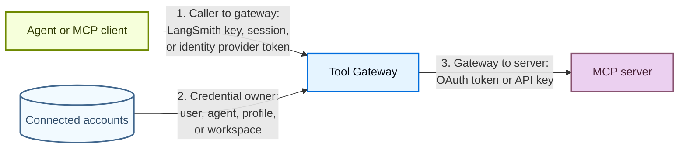

import ToolGatewayBetaNote from '/snippets/langsmith/tool-gateway-beta-note.mdx';

<ToolGatewayBetaNote />

This page explains the model behind [Tool Gateway](/langsmith/tool-gateway). It covers how each call authenticates, which stored credential it uses, what tool kits and policies control, and the limits that apply. Read it before you plan a setup for more than one user or agent. Each section links to the page with the procedure.

## Three layers of authentication

A tool call through Tool Gateway involves three separate authentication steps. The caller authenticates only to LangSmith. Tool Gateway then picks a stored credential and uses it to authenticate to the MCP server. Therefore, the caller never holds the server's token or API key.

- **Caller to gateway**: The caller proves its identity to LangSmith. It can use a personal access token, a service key, a LangSmith session in the UI, or a token from your identity provider. The caller can also say whose credentials to use. See [Act as users and agents](/langsmith/tool-gateway-identity).
- **Credential owner**: Tool Gateway resolves which stored credential the call uses, based on who the caller is acting as. See [Credential owners](#credential-owners) and [Connect accounts](/langsmith/tool-gateway-connect-accounts).
- **Gateway to server**: The MCP server receives what it expects: an OAuth token, an API key in a named header, or nothing for a public server. You declare this when you add the server. See [Add MCP servers](/langsmith/tool-gateway-servers).

Adding a server and connecting an account are separate jobs. An admin adds a workspace server once and declares the kind of credential it needs, but no credential exists yet. Each user, agent, or profile then connects its own credential to that server.

## Credential owners

Each stored credential belongs to one owner. The owner decides whose account a tool call runs as on the upstream service.

| Owner | Who connects it | When a call uses it |
|-------|-----------------|---------------------|
| User | Each user, for their own account | The call acts as that user |
| Agent | An admin, for the agent's own identity through [agent auth](/langsmith/agent-auth) | The call acts as that agent |
| Profile | An admin, once, as a set of shared credentials | The call names the profile, for agents that run with no one signed in |
| Workspace | A workspace admin, as one API key for a workspace server | Every call to that server, whoever the caller is |

In practice, a call acts in one of two ways. It acts as a user, with that user's own access, or as an agent, with the agent's credentials or a profile. A call uses one identity. It cannot act as a user and a profile at the same time.

A workspace credential overrides the others. Setting it on a server removes every other owner's credential for that server, and no other owner can connect one while it is stored. For the procedure, see [Connect accounts](/langsmith/tool-gateway-connect-accounts).

### When a credential is missing

What happens when the owner has not connected depends on whether a person is present to sign in:

- **A user**: The call returns a sign-in link. A client that supports MCP URL elicitation shows the link to the user. Otherwise, the call returns `428` with the link. After the user connects, later calls use the stored credential.
- **An agent or a profile**: The call returns `409`, because no one is present to sign in. An admin must connect the credential before the agent can call the tool.

For the responses and how to handle them, see [Call tools](/langsmith/tool-gateway-call-tools).

## Servers, tool kits, and scope

Servers and tool kits each have a scope:

- **Workspace**: Everyone in the workspace can use it. Each person still connects their own account, unless the server has a workspace credential.
- **Personal**: Only the person who created it can use it. A workspace kit cannot include a personal server.

Tool Gateway serves tools at three kinds of MCP endpoint, all under `/v1/managed-tools/`:

| Endpoint | Serves |
|----------|--------|
| `kits/<kit-id>/mcp` | The tools in one tool kit |
| `kits/me/mcp` | Every tool the caller can use, built on each request |
| `servers/<server-id>/mcp` | The tools on one server |

Agents usually connect to a kit. For how to create one, see [Create tool kits](/langsmith/tool-gateway-tool-kits).

## Tool kits curate, policies enforce

Tool kits and policies answer different questions:

- **A tool kit** decides which tools an agent sees. Giving each agent a small kit keeps its tool list relevant and its tool choices accurate. A kit is not an access control: the same caller can use `kits/me/mcp`, which serves every tool the caller can use.
- **A policy** decides what a caller may invoke. Tool Gateway evaluates policies on every call, whichever endpoint the call uses. A policy either denies the call or requires approval before it runs.

Tools are allowed by default. When more than one policy matches a call, a deny policy takes priority. An approval policy asks the person using the MCP client to confirm the call. Approval by a separate reviewer is not available. To restrict what a caller can do, use policies, not kits. See [Set policies](/langsmith/tool-gateway-policies).

## Traces

Tool Gateway can record a trace for each tool call. A trace records metadata about the call, such as the tool, the server, and the identity it ran as. It does not record the data sent to or returned by the tool. See [Traces and audit log](/langsmith/tool-gateway-traces).

## Limits

These limits apply to every tool call:

- **Request size**: 1 MB.
- **Response size**: 8 MB.
- **Upstream timeout**: 60 seconds for the MCP server to start responding.
- **Tools per kit**: 10,000.
- **Rate limit**: 100 requests per second, with bursts up to 1,000.

## Known limitations

In beta, Tool Gateway has these limitations:

- **Remote servers over HTTPS only**: Tool Gateway connects to MCP servers that use Streamable HTTP over HTTPS. To reach a server inside your own network, use a [tunnel](/langsmith/tunnels).
- **Tool output is untrusted**: Tool Gateway passes each server's response to the caller unchanged. Treat tool output as untrusted input to your agent.
- **One identity per call**: A call acts as one user, agent, or profile.
- **Identity provider tokens reach the whole workspace**: A caller authenticated only by an identity provider token can reach any server or kit in the workspace. Use policies to restrict what those callers can invoke.
- **No usage dashboards**: To review tool usage, use [traces and the audit log](/langsmith/tool-gateway-traces).

## See also

- [Tool Gateway quickstart](/langsmith/tool-gateway-quickstart)
- [Act as users and agents](/langsmith/tool-gateway-identity)
- [Connect accounts](/langsmith/tool-gateway-connect-accounts)
- [Set policies](/langsmith/tool-gateway-policies)
