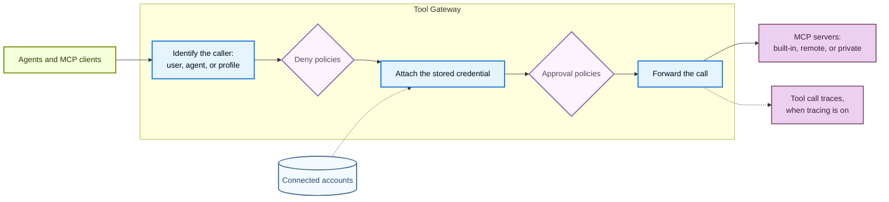

import ToolGatewayBetaNote from '/snippets/langsmith/tool-gateway-beta-note.mdx';

<ToolGatewayBetaNote />

Tool Gateway is a managed layer in LangSmith that sits between your agents and the MCP servers they call. It handles access, identity, and policies for the tool calls agents make, as [LLM Gateway](/langsmith/llm-gateway) does for their model calls.

Without a gateway, each team builds tool authentication into each agent. Tokens end up hardcoded in agent code. Each agent can reach every tool on a server. No record shows which tool ran on whose behalf. Tool Gateway replaces that per-agent work with one shared setup:

- **Access**: Register each MCP server once, and connect each user's or agent's account once. Each agent calls a chosen set of tools through one MCP URL.
- **Control**: Set policies that block tool calls or require approval before they run.
- **Visibility**: Record a trace for each tool call, showing which tool ran and as whom.

<Info>
Tool Gateway is available on LangSmith [Plus and Enterprise plans](https://www.langchain.com/pricing).

It runs on:

- **[Cloud](/langsmith/cloud)**: The GCP US, GCP EU, GCP APAC, and AWS US regions. It is not available in the Azure US region.
- **[BYOC](/langsmith/byoc)**: Data planes that run LangSmith v0.18 or later, on AWS, GCP, and Azure.
- **[Self-hosted](/langsmith/self-hosted)**: LangSmith v0.18 or later. See [Enable the Tool Gateway](/langsmith/tool-gateway-self-hosted).
</Info>

## How a tool call flows

On each tool call, Tool Gateway:

1. Identifies the caller: a user, an agent, or a profile.
1. Blocks the call if a deny policy matches.
1. Attaches the caller's stored credential for the server, or asks the caller to connect.
1. Asks the caller to approve the call if an approval policy matches.
1. Forwards the call to the MCP server and, when [tracing](/langsmith/tool-gateway-traces) is on, records a trace.

Four concepts shape every setup:

- **MCP server**: A remote MCP server that an admin or user registers once, along with the kind of credential it needs. LangSmith also provides built-in servers for common services. To reach a server inside your own network, use a [tunnel](/langsmith/tunnels).
- **Connected account**: The credential Tool Gateway uses when it calls a server. A credential can belong to you, to an agent, to a profile, or to the whole workspace. A profile holds shared credentials for agents that run with no one signed in.
- **Tool kit**: A curated set of tools from any number of servers, served at one MCP URL. A kit decides which tools an agent sees. To control which tools a caller may invoke, use permissions and policies.
- **Policy**: A rule that blocks matching tool calls or requires approval before they run.

For how these pieces fit together, see [How Tool Gateway works](/langsmith/tool-gateway-how-it-works).

## Choose your setup

Tool Gateway supports a few common setups. Start from the one closest to yours:

- **Agents that act for each of your users**: Each end user connects their own accounts, and the agent calls tools as that user. See [Act as users and agents](/langsmith/tool-gateway-identity).
- **Agents that run with no one signed in**: An admin connects shared credentials once, through a profile or an agent's own credentials, and the agent calls tools with them. See [Connect accounts](/langsmith/tool-gateway-connect-accounts).
- **Central tool governance for a platform or security team**: Register servers for the whole workspace, give each agent a tool kit, and set [policies](/langsmith/tool-gateway-policies) and [traces](/langsmith/tool-gateway-traces) for every tool call.
- **Tools for your own coding agent**: Add a tool kit to Claude Code, Cursor, or another MCP client with one URL. See [Connect an MCP client](/langsmith/tool-gateway-clients).

## Next steps

<CardGroup cols={2}>
  <Card
    title="Run the quickstart"
    icon="rocket"
    href="/langsmith/tool-gateway-quickstart"
    arrow="true"
  >
    Add two MCP servers, connect your accounts, create a tool kit, and call its tools from an MCP client.
  </Card>

  <Card
    title="Learn how it works"
    icon="sitemap"
    href="/langsmith/tool-gateway-how-it-works"
    arrow="true"
  >
    See how Tool Gateway authenticates callers, chooses credentials, and applies policies, and the limits that apply.
  </Card>
</CardGroup>
