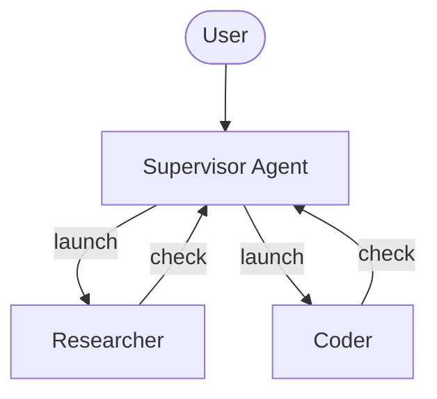
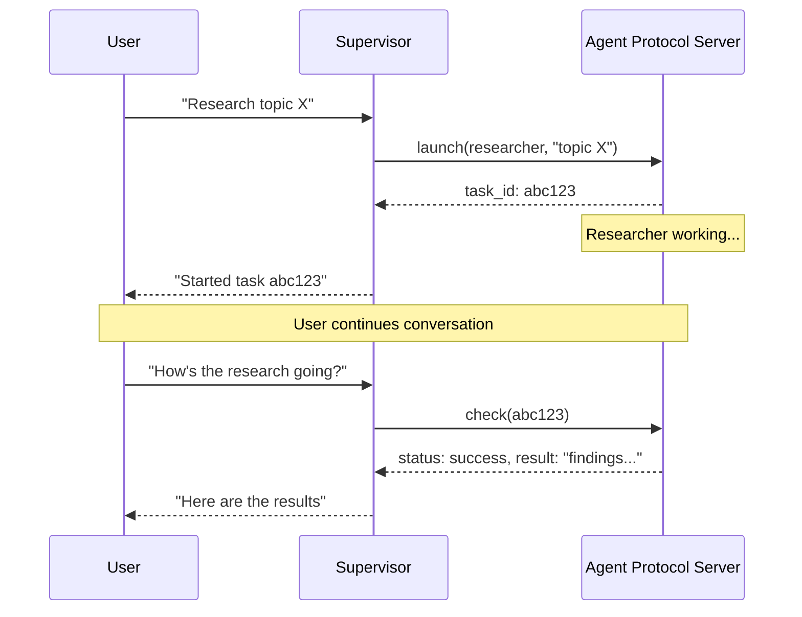

import AsyncSubagentsConfigurePy from '/snippets/code-samples/async-subagents-configure-py.mdx';
import AsyncSubagentsConfigureJs from '/snippets/code-samples/async-subagents-configure-js.mdx';
import AsyncSubagentsHttpTransportPy from '/snippets/code-samples/async-subagents-http-transport-py.mdx';
import AsyncSubagentsHybridPy from '/snippets/code-samples/async-subagents-hybrid-py.mdx';
import AsyncSubagentsHybridJs from '/snippets/code-samples/async-subagents-hybrid-js.mdx';
import AsyncSubagentsDescriptionsGoodPy from '/snippets/code-samples/async-subagents-descriptions-good-py.mdx';
import AsyncSubagentsDescriptionsBadPy from '/snippets/code-samples/async-subagents-descriptions-bad-py.mdx';
import AsyncSubagentsDescriptionsJs from '/snippets/code-samples/async-subagents-descriptions-js.mdx';
import AsyncSubagentsTroubleshootingPollingPy from '/snippets/code-samples/async-subagents-troubleshooting-polling-py.mdx';
import AsyncSubagentsTroubleshootingPollingJs from '/snippets/code-samples/async-subagents-troubleshooting-polling-js.mdx';
import AsyncSubagentsNotificationsPy from '/snippets/code-samples/async-subagents-notifications-py.mdx';
import AsyncSubagentsAnswerWaitingPy from '/snippets/code-samples/async-subagents-answer-waiting-py.mdx';
import AsyncSubagentsParentThreadPy from '/snippets/code-samples/async-subagents-parent-thread-py.mdx';

Async subagents let a supervisor agent launch background tasks that return immediately, so the supervisor can continue interacting with the user while subagents work concurrently. The supervisor can check progress, send follow-up instructions, or cancel tasks at any point.

This builds on [subagents](/oss/deepagents/subagents), which run synchronously and block the supervisor until completion. Use async subagents when tasks are long-running, parallelizable, or need mid-flight steering.

:::python
On an Agent Server, the supervisor also learns when a task finishes, fails, or needs input, so it does not have to check. See [Get notified when tasks finish](#get-notified-when-tasks-finish).
:::



<Note>
Async subagents communicate with any server that implements the [Agent Protocol](https://github.com/langchain-ai/agent-protocol). You can use [LangSmith Deployments](/langsmith/deployment), or self-host any Agent Protocol-compatible server. Each subagent runs independently of the supervisor, which controls them through the SDK to launch, check, update, and cancel.
</Note>

## When to use async subagents

| Dimension            | Sync subagents                                                  | Async subagents                                                   |
|----------------------|-----------------------------------------------------------------|-------------------------------------------------------------------|
| **Execution model**  | Supervisor blocks until subagent completes                      | Returns job ID immediately; supervisor continues                  |
| **Concurrency**      | Parallel but blocking                                           | Parallel and non-blocking                                         |
| **Mid-task updates** | Not possible                                                    | Send follow-up instructions via `update_async_task`           |
| **Cancellation**     | Not possible                                                    | Cancel running tasks via `cancel_async_task`                  |
| **Statefulness**     | Stateless -- no persistent state between invocations            | Stateful -- maintains state on its own thread across interactions |
| **Best for**         | Tasks where the agent should wait for results before continuing | Long-running, complex tasks managed interactively in a chat       |

## Configure async subagents

Define async subagents as a list of @[`AsyncSubAgent`] specs, each pointing to an Agent Protocol server:

:::python
<AsyncSubagentsConfigurePy />

| Field | Type | Description |
|-------|------|-------------|
| `name` | `str` | Required. Unique identifier. The supervisor uses this when launching tasks. |
| `description` | `str` | Required. What this subagent does. The supervisor uses this to decide which agent to delegate to. |
| `graph_id` | `str` | Required. The graph ID (or assistant ID) on the Agent Protocol server. For LangGraph-based deployments, this must match a graph registered in `langgraph.json`. |
| `url` | `str` | Optional. When omitted, uses ASGI transport (in-process). When set, uses HTTP transport to a remote Agent Protocol server. |
| `headers` | `dict[str, str]` | Optional. Additional headers for requests to the remote server. Use for custom authentication with self-hosted Agent Protocol servers. |
| `mode` | `"isolated" \| "fork"` | Optional. Controls what conversation context the subagent receives at launch. Defaults to `"isolated"`. See [Choose a launch mode](#choose-a-launch-mode). |
:::

:::js
<AsyncSubagentsConfigureJs />

| Field | Type | Description |
|-------|------|-------------|
| `name` | `string` | Required. Unique identifier. The supervisor uses this when launching tasks. |
| `description` | `string` | Required. What this subagent does. The supervisor uses this to decide which agent to delegate to. |
| `graphId` | `string` | Required. The graph ID (or assistant ID) on the Agent Protocol server. For LangGraph-based deployments, this must match a graph registered in `langgraph.json`. |
| `url` | `string` | Optional. When omitted, uses ASGI transport (in-process). When set, uses HTTP transport to a remote Agent Protocol server. |
| `headers` | `Record<string, string>` | Optional. Additional headers for requests to the remote server. Use for custom authentication with self-hosted Agent Protocol servers. |
:::

For LangGraph-based deployments, register all graphs in the same `langgraph.json` for co-deployed setups:

```json
{
  "graphs": {
    "supervisor": "./src/supervisor.py:graph",
    "researcher": "./src/researcher.py:graph",
    "coder": "./src/coder.py:graph"
  }
}
```

## Use the async subagent tools

The @[`AsyncSubAgentMiddleware`] which is included in the [Deep Agents stack](/oss/deepagents/customization#deep-agents-stack) when async subagents are configured, gives the supervisor five tools:

| Tool | Purpose | Returns |
|------|---------|---------|
| `start_async_task` | Start a new background task | Task ID (immediately) |
| `check_async_task` | Get current status and result of a task | Status + result (if complete) |
| `update_async_task` | Send new instructions to a running task | Confirmation + updated status |
| `cancel_async_task` | Stop a running task | Confirmation |
| `list_async_tasks` | List all tracked tasks with live statuses | Summary of all tasks |

The supervisor's LLM calls these tools like any other tool. The middleware handles thread creation, run management, and state persistence automatically.

### Understand the lifecycle

A typical interaction follows this sequence:



- **Launch** creates a new thread on the server, starts a run with the task description as input, and returns the thread ID as the task ID. The supervisor reports this ID to the user and does not poll for completion.
- **Check** fetches the current run status. If the run succeeded, it retrieves the thread state to extract the subagent's final output. If still running, it reports that to the user.
- **Update** creates a new run on the same thread with an interrupt multitask strategy. The previous run is interrupted, and the subagent restarts with the full conversation history plus the new instructions. The task ID stays the same.
- **Cancel** calls `runs.cancel()` on the server and marks the task as `"cancelled"`.
- **List** iterates over all tracked tasks. For non-terminal tasks, it fetches live status from the server in parallel. Terminal statuses (`success`, `error`, `cancelled`) are returned from cache.

:::python
If a subagent paused for input or approval, **check** and **list** report it as `waiting`. Updating a `waiting` task drops its pending request, and cancelling one only marks it as `"cancelled"`, since it has no active run. See [Handle subagents waiting for input](#handle-subagents-waiting-for-input).
:::

:::python

When running on an [Agent Protocol](https://github.com/langchain-ai/agent-protocol) server, subagents automatically update the supervisor as they complete. If using a [single deployment](#single-deployment) for the supervisor and subagents, subagents will wake the supervisor if it is idle; otherwise it receives the update at the start of its next run.

<Note>
    Task notifications require `deepagents>=0.7.26`. They are in [**beta**](/oss/versioning); APIs and behavior may change between releases.
</Note>

Notifications are returned to the supervisor as a `HumanMessage`. They can include images and other multimodal media. The message carries a @[`TaskEvent`] (`task_id`, `agent_name`, `status`, `run_id`) in `additional_kwargs["deepagents_notification"]`, so your app can show notifications differently from user messages:

<AsyncSubagentsNotificationsPy />

## Handle subagents waiting for input

<Note>
    The `waiting` status requires `deepagents>=0.7.26`. It is in [**beta**](/oss/versioning); APIs and behavior may change between releases.
</Note>

When a subagent pauses for input or approval with `interrupt()` or [human-in-the-loop](/oss/deepagents/human-in-the-loop), the **check** and **list** tools report it as `waiting` with its pending interrupts. The supervisor cannot answer or approve on the user's behalf. The request is for the user.

Your app answers it on the subagent's own thread. The task ID is the subagent's thread ID:

<AsyncSubagentsAnswerWaitingPy />

When the subagent finishes after the answer, the supervisor receives a notification as usual. If a subagent needs information from the supervisor rather than the user, have it ask in its result. The supervisor replies with `update_async_task`.
:::

## Understand state management

:::python
Task metadata is stored in a dedicated state channel (`async_tasks`) on the supervisor's graph, separate from the message history. This is critical because deep agents [compact their message history](/oss/deepagents/context-engineering#summarization) when the context window fills up. If task IDs were only in tool messages, they would be lost during compaction. The dedicated channel ensures the supervisor can always recall its tasks through `list_async_tasks`, even after multiple rounds of summarization.

Each tracked task records the task ID, agent name, thread ID, run ID, status, and timestamps (`created_at`, `last_checked_at`, `last_updated_at`).

### Find a supervisor's subagent threads

<Note>
    Thread tagging requires `deepagents>=0.7.26`. It is in [**beta**](/oss/versioning); APIs and behavior may change between releases.
</Note>

`start_async_task` creates each subagent thread with `metadata={"parent_thread_id": ...}`, the supervisor's thread ID. Use it to find a supervisor's subagent threads, or to read the supervisor's thread in a subagent's graph factory:

<AsyncSubagentsParentThreadPy />

For example, a subagent can reuse the supervisor's [thread-scoped sandbox](/oss/deepagents/sandboxes#thread-scoped-default) by looking it up with `parent_thread_id`. Check that the caller may access that thread first, since anyone with access to the thread can edit its metadata.
:::

:::js
Task metadata is stored in a dedicated state channel (`asyncTasks`) on the supervisor's graph, separate from the message history. This is critical because deep agents [compact their message history](/oss/deepagents/context-engineering#summarization) when the context window fills up/ If task IDs were only in tool messages, they would be lost during compaction. The dedicated channel ensures the supervisor can always recall its tasks through `list_async_tasks`, even after multiple rounds of summarization.

Each tracked task records the task ID, agent name, thread ID, run ID, status, and timestamps (`createdAt`, `checkedAt`, `updatedAt`).
:::

## Choose a transport

### ASGI transport (co-deployed)

When a subagent spec omits the `url` field, the LangGraph SDK uses ASGI transport -- SDK calls are routed through in-process function calls rather than HTTP. For LangGraph-based deployments, this requires both graphs to be registered in the same `langgraph.json`.

ASGI transport eliminates network latency and requires no additional auth configuration. The subagent still runs as a separate thread with its own state. This is the recommended default.

### HTTP transport (remote)

Add a `url` field to switch to HTTP transport, where SDK calls go over the network to a remote Agent Protocol server:

:::python
<AsyncSubagentsHttpTransportPy />
:::

:::js
```typescript
{
  name: "researcher",
  description: "Research agent",
  graphId: "researcher",
  url: "https://my-research-deployment.langsmith.dev",
}
```
:::

For LangGraph deployments, authentication is handled by the LangGraph SDK using `LANGSMITH_API_KEY` (or `LANGGRAPH_API_KEY`) from environment variables. Self-hosted Agent Protocol servers may use a different authentication mechanism.

Use HTTP transport when subagents need independent scaling, different resource profiles, or are maintained by a different team.

## Choose a launch mode

The `mode` field on each @[`AsyncSubAgent`] spec controls what conversation context the subagent receives when a task starts.

| Mode | Behavior |
|------|----------|
| `"isolated"` (default) | Sends only the delegated task description. The subagent starts fresh with no knowledge of the parent's conversation history. |
| `"fork"` | Sends a snapshot of the parent's conversation at launch, followed by the task description. The subagent can use that context while working in the background. |

`"isolated"` is the right choice for most tasks. Use `"fork"` when the subagent needs established context — for example, a background drafting agent that should write in the style and voice already set up in the conversation.

### Fork mode

<Warning>

`mode="fork"` is available in Python only. It is experimental and may change in a future release.

</Warning>

:::python

Set `mode="fork"` on any `AsyncSubAgent` spec:

```python
async_subagents=[
    {
        "name": "drafter",
        "description": "Drafts documents based on the conversation context",
        "graph_id": "drafter",
        "mode": "fork",
    }
]
```

:::

At launch, `start_async_task` sends the parent's full conversation history — replayed up to that point — followed by the task description. Later messages from the parent are not forwarded to the child.

**Prompt-cache reuse.** To get cache hits on the forked conversation prefix, configure the remote agent with the same model, system prompt, tools, and prompt-processing middleware as the parent. Fork mode copies conversation history; it does not synchronize those settings. Matching configuration is necessary but not sufficient: the rendered prefix must match, and cache hits depend on the provider.

## Choose a deployment topology

### Single deployment

A single deployment means all agents are co-deployed on the same server using ASGI transport. For LangGraph-based deployments, register all graphs in one `langgraph.json`. This is the recommended starting point -- one server to manage, zero network latency between agents.

### Split deployment

Supervisor on one server, subagents on another via HTTP transport. Use when subagents need different compute profiles or independent scaling.

### Hybrid

In a hybrid deployment, some subagents are co-deployed via ASGI, others remote via HTTP:

:::python
<AsyncSubagentsHybridPy />
:::

:::js
<AsyncSubagentsHybridJs />
:::

## Best practices

### Size the worker pool for local development

When running locally with `langgraph dev`, increase the worker pool to accommodate concurrent subagent runs. Each active run occupies a worker slot. A supervisor with 3 concurrent subagent tasks requires 4 slots (1 supervisor + 3 subagents). Under-provisioning causes launches to queue.

```bash
langgraph dev --n-jobs-per-worker 10
```

### Write clear subagent descriptions

The supervisor uses descriptions to decide which subagent to launch. Be specific and action-oriented:

:::python
<CodeGroup>
    <AsyncSubagentsDescriptionsGoodPy />
    <AsyncSubagentsDescriptionsBadPy />
</CodeGroup>
:::

:::js
<AsyncSubagentsDescriptionsJs />
:::

### Trace with thread IDs

When using LangGraph-based deployments, every async subagent run is a standard LangGraph run, fully visible in LangSmith. The supervisor's trace shows tool calls for `launch`, `check`, `update`, `cancel`, and `list`. Each subagent run appears as a separate trace, linked by thread ID. Use the thread ID (task ID) to correlate supervisor orchestration traces with subagent execution traces.

## Troubleshooting

### Supervisor polls immediately after launch

**Problem**: The supervisor calls `check` in a loop right after launching, turning async execution into blocking.

**Solution**: The middleware injects system prompt rules to prevent this. If polling persists, reinforce the behavior in your supervisor's system prompt:

:::python
<AsyncSubagentsTroubleshootingPollingPy />
:::

:::js
<AsyncSubagentsTroubleshootingPollingJs />
:::

### Supervisor reports stale status

**Problem**: The supervisor references a task status from earlier in conversation history instead of making a fresh `check` call.

**Solution**: The middleware prompt instructs the model that "task statuses in conversation history are always stale." If this still occurs, add explicit instructions to always call `check` or `list` before reporting status.

### Task ID lookup failures

**Problem**: The supervisor truncates or reformats the task ID, causing `check` or `cancel` to fail.

**Solution**: The middleware prompt instructs the model to always use the full task ID. If truncation persists, this is typically a model-specific issue -- try a different model or add "always show the full task_id, never truncate or abbreviate it" to your system prompt.

### Subagent launches queue instead of running

**Problem**: Launching a subagent hangs or takes a long time to start.

**Solution**: The worker pool is likely exhausted. Increase the pool size with `--n-jobs-per-worker`. See [Size the worker pool](#size-the-worker-pool-for-local-development).

## Reference implementation

The [async-deep-agents](https://github.com/langchain-ai/async-deep-agents) repository contains working examples in both Python and TypeScript that deploy to LangSmith Deployments. It demonstrates a supervisor with researcher and coder subagents running as background tasks.
