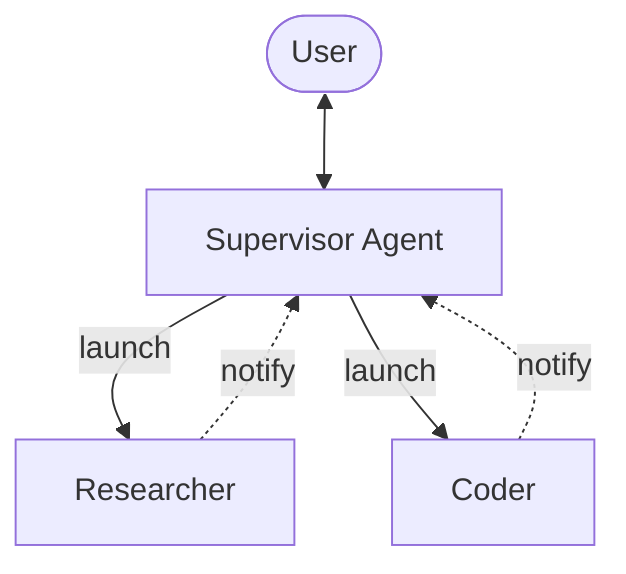
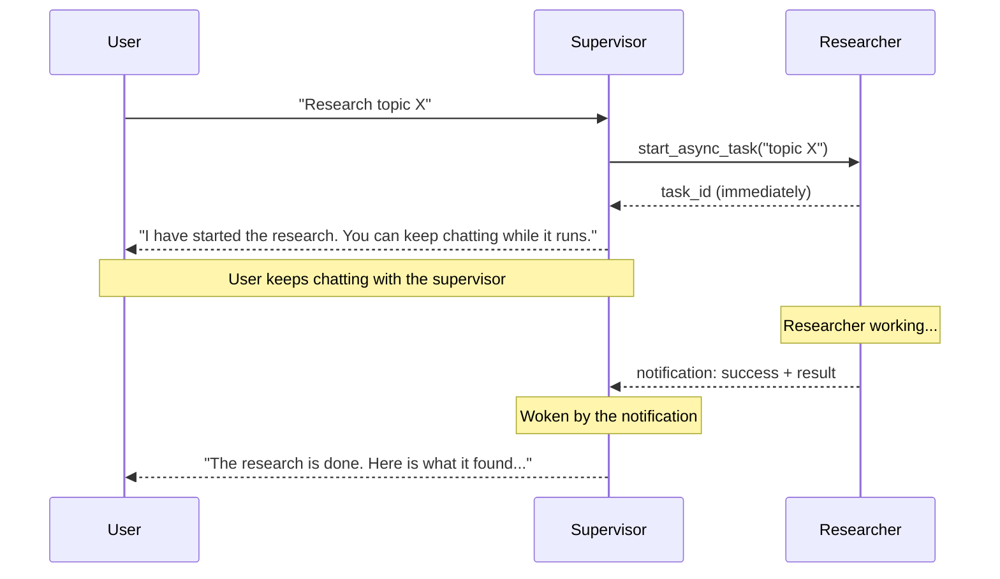

import AsyncSubagentsConfigurePy from '/snippets/code-samples/async-subagents-configure-py.mdx';
import AsyncSubagentsConfigureJs from '/snippets/code-samples/async-subagents-configure-js.mdx';
import AsyncSubagentsHttpTransportPy from '/snippets/code-samples/async-subagents-http-transport-py.mdx';
import AsyncSubagentsHybridPy from '/snippets/code-samples/async-subagents-hybrid-py.mdx';
import AsyncSubagentsHybridJs from '/snippets/code-samples/async-subagents-hybrid-js.mdx';
import AsyncSubagentsDescriptionsGoodPy from '/snippets/code-samples/async-subagents-descriptions-good-py.mdx';
import AsyncSubagentsDescriptionsBadPy from '/snippets/code-samples/async-subagents-descriptions-bad-py.mdx';
import AsyncSubagentsDescriptionsJs from '/snippets/code-samples/async-subagents-descriptions-js.mdx';
import AsyncSubagentsTroubleshootingPollingPy from '/snippets/code-samples/async-subagents-troubleshooting-polling-py.mdx';
import AsyncSubagentsTroubleshootingPollingJs from '/snippets/code-samples/async-subagents-troubleshooting-polling-js.mdx';
import AsyncSubagentsNotificationsPy from '/snippets/code-samples/async-subagents-notifications-py.mdx';
import AsyncSubagentsAnswerWaitingPy from '/snippets/code-samples/async-subagents-answer-waiting-py.mdx';
import AsyncSubagentsParentThreadPy from '/snippets/code-samples/async-subagents-parent-thread-py.mdx';
import AsyncSubagentsNotificationsJs from '/snippets/code-samples/async-subagents-notifications-js.mdx';
import AsyncSubagentsAnswerWaitingJs from '/snippets/code-samples/async-subagents-answer-waiting-js.mdx';
import AsyncSubagentsParentThreadJs from '/snippets/code-samples/async-subagents-parent-thread-js.mdx';
import AsyncSubagentsDeliverResultsPy from '/snippets/code-samples/async-subagents-deliver-results-py.mdx';
import AsyncSubagentsDeliverResultsJs from '/snippets/code-samples/async-subagents-deliver-results-js.mdx';

Async subagents let a supervisor agent launch background tasks that return immediately. The supervisor can continue interacting with the user while subagents work concurrently. The supervisor can check a task's status, send follow-up instructions, or cancel it at any point. On Agent Server, subagents also report back when they finish, fail, or need input. The supervisor does not have to check.

This builds on [subagents](/oss/deepagents/subagents), which run synchronously and block the supervisor until completion. Use async subagents when tasks are long-running, parallelizable, or need mid-flight steering.

To run async subagents in a managed agent, enable them with `async: true`. See [Async subagents in Managed Deep Agents](/langsmith/managed-deep-agents-subagents#async-subagents).



<Note>
Async subagents run on any server that implements the [Agent Protocol](https://github.com/langchain-ai/agent-protocol), such as [LangSmith Deployments](/langsmith/deployment) or a self-hosted Agent Protocol server. Each subagent runs independently of the supervisor. The supervisor starts, checks, updates, and cancels it through the SDK. Notifications and webhooks require [Agent Server](/langsmith/agent-server).
</Note>

## Compare sync and async subagents

| Dimension            | Sync subagents                                                  | Async subagents                                                                       |
|----------------------|-----------------------------------------------------------------|---------------------------------------------------------------------------------------|
| **Execution model**  | Supervisor blocks until subagent completes                      | Returns a task ID immediately; supervisor continues                                   |
| **Where it runs**    | Inside the supervisor's run                                     | On its own thread on a server (Agent Server or another Agent Protocol server)         |
| **Concurrency**      | Parallel but blocking                                           | Parallel and non-blocking                                                             |
| **Results**          | Returned as the tool result                                     | On Agent Server, the subagent notifies the supervisor; otherwise the supervisor calls `check_async_task` |
| **Mid-task updates** | Not possible                                                    | Send follow-up instructions via `update_async_task`                                   |
| **Cancellation**     | Not possible without stopping the supervisor                    | Cancel a task via `cancel_async_task`                                                 |
| **Statefulness**     | Stateless -- no persistent state between invocations            | Stateful -- maintains state on its own thread across interactions                     |
| **Best for**         | Tasks where the agent should wait for results before continuing | Long-running, complex tasks managed interactively in a chat                           |

## Configure async subagents

Define async subagents as a list of @[`AsyncSubAgent`] specs, each pointing to an Agent Protocol server:

:::python
<AsyncSubagentsConfigurePy />

| Field | Type | Description |
|-------|------|-------------|
| `name` | `str` | Required. Unique identifier. The supervisor uses this when launching tasks. |
| `description` | `str` | Required. What this subagent does. The supervisor uses this to decide which agent to delegate to. |
| `graph_id` | `str` | Required. The graph ID (or assistant ID) on the Agent Protocol server. For LangGraph-based deployments, this must match a graph registered in `langgraph.json`. |
| `url` | `str` | Optional. When omitted, uses ASGI transport (in-process). When set, uses HTTP transport to a remote Agent Protocol server. |
| `headers` | `dict[str, str]` | Optional. Additional headers for requests to the remote server. Use for custom authentication with self-hosted Agent Protocol servers. |
| `mode` | `"isolated" \| "fork"` | Optional. Controls what conversation context the subagent receives at launch. Defaults to `"isolated"`. See [Choose a launch mode](#choose-a-launch-mode). |
| `update_strategy` | `"interrupt" \| "enqueue"` | Optional. How `update_async_task` sends a follow-up while a run is active. Defaults to `"interrupt"`. See [Understand the lifecycle](#understand-the-lifecycle). |
| `webhook` | `str` | Optional. URL the Agent Server calls whenever a run of this subagent finishes. See [Deliver results through your app](#deliver-results-through-your-app). |
| `notify_parent` | `bool` | Optional. Whether the subagent may wake the supervisor when it finishes or fails while the supervisor is idle. Defaults to `True`. |
:::

:::js
<AsyncSubagentsConfigureJs />

| Field | Type | Description |
|-------|------|-------------|
| `name` | `string` | Required. Unique identifier. The supervisor uses this when launching tasks. |
| `description` | `string` | Required. What this subagent does. The supervisor uses this to decide which agent to delegate to. |
| `graphId` | `string` | Required. The graph ID (or assistant ID) on the Agent Protocol server. For LangGraph-based deployments, this must match a graph registered in `langgraph.json`. |
| `url` | `string` | Optional. When omitted, talks to the same Agent Server deployment (the address the server gives the running graph). Set `url` for a remote server, or when your Agent Server does not yet provide that address. See [Choose a transport](#choose-a-transport). |
| `headers` | `Record<string, string>` | Optional. Additional headers for requests to the remote server. Use for custom authentication with self-hosted Agent Protocol servers. |
| `mode` | `"isolated" \| "fork"` | Optional. Controls what conversation context the subagent receives at launch. Defaults to `"isolated"`. See [Choose a launch mode](#choose-a-launch-mode). |
| `updateStrategy` | `"interrupt" \| "enqueue"` | Optional. How `update_async_task` sends a follow-up while a run is active. Defaults to `"interrupt"`. See [Understand the lifecycle](#understand-the-lifecycle). |
| `webhook` | `string` | Optional. URL the Agent Server calls whenever a run of this subagent finishes. See [Deliver results through your app](#deliver-results-through-your-app). |
| `notifyParent` | `boolean` | Optional. Whether the subagent may wake the supervisor when it finishes or fails while the supervisor is idle. Defaults to `true`. |
:::

For LangGraph-based deployments, register all graphs in the same `langgraph.json` for co-deployed setups:

```json
{
  "graphs": {
    "supervisor": "./src/supervisor.py:graph",
    "researcher": "./src/researcher.py:graph",
    "coder": "./src/coder.py:graph"
  }
}
```

## Use the async subagent tools

The @[`AsyncSubAgentMiddleware`] which is included in the [Deep Agents stack](/oss/deepagents/customization#deep-agents-stack) when async subagents are configured, gives the supervisor five tools:

| Tool | Purpose | Returns |
|------|---------|---------|
| `start_async_task` | Start a new background task | Task ID (immediately) |
| `check_async_task` | Get the current status of a task, with its result, error, or what it is asking the user | Status, plus the result, the error, or the pending request |
| `update_async_task` | Send new instructions to a task | Confirmation that the follow-up started or was queued |
| `cancel_async_task` | Stop a task | Confirmation |
| `list_async_tasks` | List tracked tasks with their live statuses, optionally filtered by status | Status of each task (no results) |

The supervisor's LLM calls these tools like any other tool. The middleware handles thread creation, run management, and state persistence automatically.

### Understand the lifecycle

A typical interaction follows this sequence. On Agent Server, the supervisor does not need to check on the task: when the subagent finishes, the task notifies the supervisor.



- **Launch** creates a new thread on the server and starts a run with input determined by the [launch mode](#choose-a-launch-mode). Isolated mode sends only the task description; fork mode also sends the parent's effective conversation history. `start_async_task` returns the thread ID as the task ID.
- **Check** fetches the task's current status, plus its result, error, or what it is asking the user.
- **Update** creates a new run on the same thread. By default it interrupts the previous run, and the subagent restarts with the full conversation history plus the new instructions. The task ID stays the same.
- **Cancel** calls `runs.cancel()` on the server and marks the task as `"cancelled"`.
- **List** iterates over all tracked tasks. For non-terminal tasks, it fetches live status from the server in parallel. For terminal statuses (`success`, `error`, `timeout`, `cancelled`, `interrupted`), it uses the cached status.

:::python
To let follow-ups wait, set `update_strategy="enqueue"`. **Update** then queues the new run behind the current one, and the task is `pending` until it starts. Cancelling the task also cancels earlier runs that are still active.
If the current run pauses for input or approval before the follow-up starts, the follow-up still starts and that request is dropped.

<Note>
`update_strategy` requires `deepagents>=0.7.30`. It is in [**beta**](/oss/versioning); APIs and behavior may change between releases.
</Note>
:::

:::js
To let follow-ups wait, set `updateStrategy: "enqueue"`. **Update** then queues the new run behind the current one, and the task is `pending` until it starts. Cancelling the task also cancels earlier runs that are still active.
If the current run pauses for input or approval before the follow-up starts, the follow-up still starts and that request is dropped.

<Note>
`updateStrategy` requires `deepagents>=1.16.0`. It is in [**beta**](/oss/versioning); APIs and behavior may change between releases.
</Note>
:::

If a subagent paused for input or approval, **check** and **list** report it as `waiting`. Updating a `waiting` task drops its pending request, and cancelling one only marks it as `"cancelled"`, since it has no active run. See [Handle subagents waiting for input](#handle-subagents-waiting-for-input).

On [Agent Server](/langsmith/agent-server), subagents notify the supervisor when they finish, fail, or need input. While the supervisor is busy, it receives those notification before its next model call. A subagent that finishes or fails wakes an idle supervisor with a new run, if both are on the [same deployment](#single-deployment). Only subagents that are deep agents wake an idle supervisor. A subagent waiting for input does not wake the supervisor. The supervisor receives that notification on its next run.


<Note>
:::python
Task notifications require `deepagents>=0.7.26`, and notification metadata requires `deepagents>=0.7.33`. They are in [**beta**](/oss/versioning); APIs and behavior may change between releases.
:::
:::js
Task notifications require `deepagents>=1.16.0`, and notification metadata requires `deepagents>=1.16.2`. They are in [**beta**](/oss/versioning); APIs and behavior may change between releases.
:::
</Note>

:::python
The supervisor receives each notification as a `HumanMessage`. Notifications can include images and other multimodal media. Each notification carries metadata: its `source` is `"async_subagent"`, and its `data` is a @[`TaskEvent`] (`task_id`, `agent_name`, `status`, `run_id`). Read it with `get_notification_metadata` to show notifications differently from user messages:

<AsyncSubagentsNotificationsPy />
:::

:::js
The supervisor receives each notification as a `HumanMessage`. Notifications can include images and other multimodal media. Each notification carries metadata: its `source` is `"async_subagent"`, and its `data` is a `TaskEvent` (`task_id`, `agent_name`, `status`, `run_id`). Read it with `getNotificationMetadata` to show notifications differently from user messages:

<AsyncSubagentsNotificationsJs />
:::

:::python
<Note>
Refusal results from async subagents require `deepagents>=0.7.33`.
</Note>

If a subagent's run ends with a model refusal, the supervisor receives a short result that says so, instead of the refusal itself. See [Model refusals](/oss/deepagents/subagents#model-refusals).
:::

### Deliver results through your app

<Note>
:::python
`webhook` and `notify_parent` require `deepagents>=0.7.30`. `notify_parent` is in [**beta**](/oss/versioning); APIs and behavior may change between releases.
:::
:::js
`webhook` and `notifyParent` require `deepagents>=1.16.0`. `notifyParent` is in [**beta**](/oss/versioning); APIs and behavior may change between releases.
:::
</Note>

Set `webhook` to have the Agent Server call your app whenever a run of the subagent finishes. The call includes the run's thread ID, run ID, status, and metadata, including `parent_thread_id` and `subagent_name`. To deliver results through your app instead of waking the supervisor, also turn off parent notifications. The supervisor still receives notifications while it is running.

:::python
<AsyncSubagentsDeliverResultsPy />
:::

:::js
<AsyncSubagentsDeliverResultsJs />
:::

## Handle subagents waiting for input

<Note>
:::python
The `waiting` status requires `deepagents>=0.7.26`. It is in [**beta**](/oss/versioning); APIs and behavior may change between releases.
:::
:::js
The `waiting` status requires `deepagents>=1.16.0`. It is in [**beta**](/oss/versioning); APIs and behavior may change between releases.
:::
</Note>

When a subagent pauses for input or approval with `interrupt()` or [human-in-the-loop](/oss/deepagents/human-in-the-loop), `check_async_task` and `list_async_tasks` report it as `waiting`. Only `check_async_task` also returns its pending interrupts. The supervisor cannot answer or approve on the user's behalf. The request is for the user.

Your app answers it on the subagent's own thread. The task ID is the subagent's thread ID:

:::python
<AsyncSubagentsAnswerWaitingPy />
:::

:::js
<AsyncSubagentsAnswerWaitingJs />
:::

When the subagent finishes after the answer, the supervisor receives a notification as usual. If a subagent needs information from the supervisor rather than the user, have it ask in its result. The supervisor replies with `update_async_task`.

## Understand state management

:::python
Task metadata is stored in a dedicated state channel (`async_tasks`) on the supervisor's graph, separate from the message history. This is critical because deep agents [compact their message history](/oss/deepagents/context-engineering#summarization) when the context window fills up. If task IDs were only in tool messages, they would be lost during compaction. The dedicated channel ensures the supervisor can always recall its tasks through `list_async_tasks`, even after multiple rounds of summarization.

Each tracked task records the task ID, agent name, thread ID, run ID, status, and timestamps (`created_at`, `last_checked_at`, `last_updated_at`).

### Find a supervisor's subagent threads

<Note>
    Thread tagging requires `deepagents>=0.7.26`. It is in [**beta**](/oss/versioning); APIs and behavior may change between releases.
</Note>

`start_async_task` creates each subagent thread with `metadata={"parent_thread_id": ...}`, the supervisor's thread ID. Use it to find a supervisor's subagent threads, or to read the supervisor's thread in a subagent's graph factory:

<AsyncSubagentsParentThreadPy />

For example, a subagent can reuse the supervisor's [thread-scoped sandbox](/oss/deepagents/sandboxes#thread-scoped-default) by looking it up with `parent_thread_id`. Check that the caller may access that thread first, since anyone with access to the thread can edit its metadata.
:::

:::js
Task metadata is stored in a dedicated state channel (`asyncTasks`) on the supervisor's graph, separate from the message history. This is critical because deep agents [compact their message history](/oss/deepagents/context-engineering#summarization) when the context window fills up. If task IDs were only in tool messages, they would be lost during compaction. The dedicated channel ensures the supervisor can always recall its tasks through `list_async_tasks`, even after multiple rounds of summarization.

Each tracked task records the task ID, agent name, thread ID, run ID, status, and timestamps (`createdAt`, `checkedAt`, `updatedAt`).

### Find a supervisor's subagent threads

<Note>
    Thread tagging requires `deepagents>=1.16.0`.
</Note>

`start_async_task` creates each subagent thread with `metadata: { parent_thread_id }`, the supervisor's thread ID. Use it to find a supervisor's subagent threads, or to read the supervisor's thread in a subagent's graph factory:

<AsyncSubagentsParentThreadJs />
:::

## Choose a transport

:::python
### ASGI transport (co-deployed)

When a subagent spec omits the `url` field, the LangGraph SDK uses ASGI transport -- SDK calls are routed through in-process function calls rather than HTTP. For LangGraph-based deployments, this requires both graphs to be registered in the same `langgraph.json`.

ASGI transport eliminates network latency and requires no additional auth configuration. The subagent still runs as a separate thread with its own state. This is the recommended default.
:::

:::js
### Same-deployment (omit `url`)

When a subagent spec omits the `url` field, the LangGraph SDK talks to the Agent Server that is running this graph, using the address that server provides. Elsewhere, the SDK defaults to `http://localhost:8123`. For LangGraph-based deployments, register both graphs in the same `langgraph.json`.

Deployed Agent Servers provide this address from version 0.18.0 (`langgraph dev` already does). On earlier versions, set `url` to the deployment URL.
:::

### HTTP transport (remote)

Add a `url` field to switch to HTTP transport, where SDK calls go over the network to a remote Agent Protocol server:

:::python
<AsyncSubagentsHttpTransportPy />
:::

:::js
```typescript
{
  name: "researcher",
  description: "Research agent",
  graphId: "researcher",
  url: "https://my-research-deployment.langsmith.dev",
}
```
:::

For LangGraph deployments, authentication is handled by the LangGraph SDK using `LANGSMITH_API_KEY` (or `LANGGRAPH_API_KEY`) from environment variables. Self-hosted Agent Protocol servers may use a different authentication mechanism.

Use HTTP transport when subagents need independent scaling, different resource profiles, or are maintained by a different team.

## Choose a launch mode

The `mode` field on each @[`AsyncSubAgent`] spec controls what conversation context the subagent receives when a task starts.

| Mode | Behavior |
|------|----------|
| `"isolated"` (default) | Sends only the delegated task description. The subagent starts fresh with no knowledge of the parent's conversation history. |
| `"fork"` | Sends a snapshot of the parent's conversation at launch, followed by the task description. The subagent can use that context while working in the background. |

`"isolated"` is the right choice for most tasks. Use `"fork"` when the subagent needs established context. For example, use `"fork"` for a background drafting agent that should write in the style and voice already set up in the conversation.

### Fork mode

<Warning>
:::python
Fork mode is experimental and may change in a future release.
:::
:::js
Fork mode requires `deepagents>=1.16.0`. It is experimental and may change in a future release.
:::
</Warning>

:::python

Set `mode="fork"` on any `AsyncSubAgent` spec:

```python
async_subagents=[
    {
        "name": "drafter",
        "description": "Drafts documents based on the conversation context",
        "graph_id": "drafter",
        "mode": "fork",
    }
]
```

:::

:::js

Set `mode: "fork"` on any `AsyncSubAgent` spec:

```typescript
const asyncSubagents: AsyncSubAgent[] = [
  {
    name: "drafter",
    description: "Drafts documents based on the conversation context",
    graphId: "drafter",
    mode: "fork",
  },
];
```

:::

At launch, `start_async_task` sends a snapshot of the parent's effective conversation history, followed by the task description. If the parent has compacted its history, the snapshot includes that compacted context, not every original message. Later messages from the parent are not forwarded to the child.

The subagent starts on a new server thread. Fork mode sends conversation messages as run input; it does not copy the parent's checkpoint history or all parent state. Metadata can associate the new thread with its supervisor, but that association does not itself transfer conversation context.

**Prompt-cache reuse.** To get cache hits on the forked conversation prefix, configure the remote agent with the same model, system prompt, tools, and prompt-processing middleware as the parent. Fork mode copies conversation history; it does not synchronize those settings. Matching configuration is necessary but not sufficient: the rendered prefix must match, and cache hits depend on the provider.

:::js
**Offloaded media.** If the parent offloads media with `offloadBinaryContent`, fork mode sends references to it rather than the media itself. The subagent must be a deep agent that shares the parent's backend to see the media; other deep agents get a note that it's unavailable, and other graphs can't use these messages.
:::

## Choose a deployment topology

### Single deployment

:::python
A single deployment means all agents are co-deployed on the same server using ASGI transport. For LangGraph-based deployments, register all graphs in one `langgraph.json`. This is the recommended starting point -- one server to manage, zero network latency between agents.
:::

:::js
A single deployment means all agents are co-deployed on the same Agent Server. Omit `url` so each graph reaches the others through that server. For LangGraph-based deployments, register all graphs in one `langgraph.json`. This is the recommended starting point -- one server to manage.
:::

### Split deployment

Supervisor on one server, subagents on another via HTTP transport. Use when subagents need different compute profiles or independent scaling.

### Hybrid

:::python
In a hybrid deployment, some subagents are co-deployed via ASGI, others remote via HTTP:

<AsyncSubagentsHybridPy />
:::

:::js
In a hybrid deployment, some subagents omit `url` (same Agent Server), others set `url` for a remote server:

<AsyncSubagentsHybridJs />
:::

## Best practices

### Size the worker pool for local development

When running locally with `langgraph dev`, increase the worker pool to accommodate concurrent subagent runs. Each active run occupies a worker slot. A supervisor with 3 concurrent subagent tasks requires 4 slots (1 supervisor + 3 subagents). Under-provisioning causes launches to queue.

```bash
langgraph dev --n-jobs-per-worker 10
```

### Write clear subagent descriptions

The supervisor uses descriptions to decide which subagent to launch. Be specific and action-oriented:

:::python
<CodeGroup>
    <AsyncSubagentsDescriptionsGoodPy />
    <AsyncSubagentsDescriptionsBadPy />
</CodeGroup>
:::

:::js
<AsyncSubagentsDescriptionsJs />
:::

### Trace subagent runs

When using LangGraph-based deployments, every async subagent run is a standard LangGraph run, fully visible in LangSmith. The supervisor's trace shows its `start_async_task`, `check_async_task`, `update_async_task`, `cancel_async_task`, and `list_async_tasks` calls. By default, each subagent run appears as a separate trace. Use the thread ID (task ID) to match a subagent's traces to the supervisor's.

Subagents on the same deployment also receive the supervisor's trace headers. To show a subagent's runs nested under the supervisor's trace, have the subagent's graph adopt those trace headers. See [distributed tracing on Agent Server](/langsmith/agent-server-distributed-tracing).

## Troubleshooting

### Supervisor polls immediately after launch

**Problem**: The supervisor calls `check_async_task` in a loop right after launching, turning async execution into blocking.

**Solution**: The supervisor does not need to check. On Agent Server, the subagent notifies the supervisor when the task finishes, fails, or needs input. The `start_async_task` tool description already tells the model not to check status right after launching. If polling persists, reinforce this in your supervisor's system prompt:

:::python
<AsyncSubagentsTroubleshootingPollingPy />
:::

:::js
<AsyncSubagentsTroubleshootingPollingJs />
:::

### Supervisor reports stale status

**Problem**: The supervisor reports a task status from earlier in the conversation instead of checking the task again.

**Solution**: The `check_async_task` and `list_async_tasks` tool descriptions tell the model that statuses in conversation history are stale. If this still occurs, add instructions to call `check_async_task` or `list_async_tasks` before reporting a task's status. With notifications on, the supervisor learns about each status change without checking.

### Task ID lookup failures

**Problem**: The supervisor truncates or reformats the task ID, causing `check_async_task` or `cancel_async_task` to fail.

**Solution**: The task ID argument of each tool tells the model to pass the full task ID. If truncation persists, the cause is typically model-specific. Try a different model, or add "always show the full task_id, never truncate or abbreviate it" to your system prompt.

### Subagent launches queue instead of running

**Problem**: Launching a subagent hangs or takes a long time to start.

**Solution**: The worker pool is likely exhausted. Increase the pool size with `--n-jobs-per-worker`. See [Size the worker pool](#size-the-worker-pool-for-local-development).

## Reference implementation

The [async-deep-agents](https://github.com/langchain-ai/async-deep-agents) repository contains working examples in both Python and TypeScript that deploy to LangSmith Deployments. It demonstrates a supervisor with researcher and coder subagents running as background tasks.
