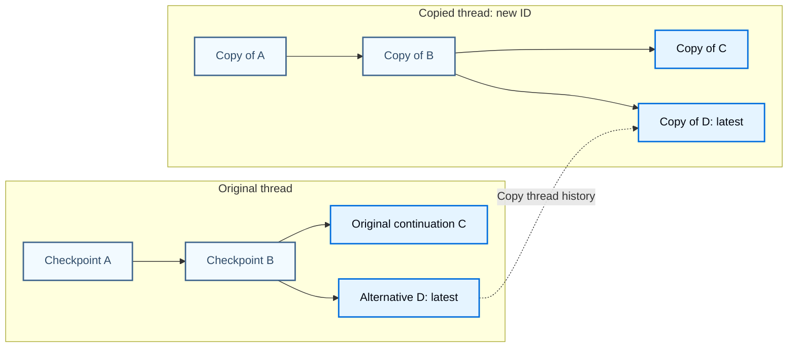

A branch is an alternative continuation of a [thread's checkpoint history](/oss/langgraph/checkpointers#threads). You can try another response without creating a new thread, or copy a thread to continue separately.

## Choose an operation

| Goal | Operation | Thread identity |
| --- | --- | --- |
| Retry execution after a saved checkpoint | [Replay](/oss/langgraph/use-time-travel#replay) that checkpoint. | Same `thread_id`. |
| Change saved state and explore another outcome | [Fork](/oss/langgraph/use-time-travel#fork) with a state update, then resume. | Same `thread_id`. |
| Preserve history in a separate conversation | [Copy an Agent Server thread](/langsmith/use-threads#copy-thread). | New `thread_id`. |
| Start with selected values, without copying history | Initialize a new thread with those values. | New `thread_id`. |
| Delegate work with inherited context | Use a [forked subagent](/oss/deepagents/subagents#forked-subagents). | Delegation, not a copy of checkpoint history. |

Branching and copying require saved checkpoints. Retention and pruning determine which checkpoints remain available.

## Keep branches in one thread

A thread can contain multiple continuations of the same checkpoint. Creating one does not overwrite the other checkpoints:

A through D belong to one `thread_id`; the copied history belongs to another. Within each thread, parent links record the branching history. LangGraph does not create named branch pointers.

When you omit `checkpoint_id`, the checkpointer selects the latest checkpoint for the requested thread and `checkpoint_ns`. The root graph uses the empty namespace, `""`. With the bundled savers, latest means the greatest checkpoint ID, not a preferred branch. If D is newer than C, a thread-only call continues from D.

To keep using a particular continuation, save its checkpoint config. It identifies the thread, namespace, and checkpoint. Use [state history](/oss/langgraph/checkpointers#get-state-history) to find an earlier continuation again.

:::python
Pass `snapshot.config` to `graph.invoke(None, snapshot.config)` to resume its pending nodes. Pass new input instead of `None` to start another turn from that checkpoint. `graph.update_state(snapshot.config, values)` creates a checkpoint and returns its config; use that returned config to resume the fork.
:::

:::js
Pass `snapshot.config` to `graph.invoke(null, snapshot.config)` to resume its pending nodes. Pass new input instead of `null` to start another turn from that checkpoint. `graph.updateState(snapshot.config, values)` creates a checkpoint and returns its config; await it and use that returned config to resume the fork.
:::

A saved config stays pinned to its checkpoint. After advancing a branch, save the new continuation's config if you want to return to that point. Resuming an older config creates another continuation; it does not move a named branch forward.

Replay can repeat model calls, tool calls, and other side effects. Resuming a final checkpoint without new input does not generate another response. See [Time travel](/oss/langgraph/use-time-travel) for execution behavior, reducers, interrupts, and subgraphs.

## Continue in a separate thread

A copied thread has its own ID and independently selected latest checkpoint. Subsequent execution on either thread does not append checkpoints to the other.

Use the Agent Server copy operation for a separate conversation with the source's checkpoint history. It copies the thread at the time of the operation, not only a selected branch. The SDK copy method does not accept a checkpoint cutoff. For the recipe, see [Copy thread](/langsmith/use-threads#copy-thread).

To branch from an older checkpoint after copying, select it from the copied thread's history. Resume or update using that checkpoint's config, not the original thread's config.

Outside Agent Server, copying depends on your checkpointer. Python's base `copy_thread` and `acopy_thread` methods raise `NotImplementedError`; their presence does not guarantee implementation support. Agent Server supplies its own copy handling, including a fallback for custom checkpointers.

Reading state and writing its values under a new `thread_id` only seeds a new history. It does not copy checkpoint ancestry, pending writes, subgraph namespaces, or delta reconstruction history. A full copy must preserve the ancestor checkpoints and writes required to reconstruct state.

:::python
For implementation requirements, see [Copy thread with delta channels](/oss/langgraph/checkpointers#copy-thread-with-delta-channels).
:::

## Understand isolation boundaries

A new thread ID separates checkpoint histories, not every resource an agent uses:

- **Long-term memory**: Threads can share the same [Store namespaces](/oss/langgraph/stores).
- **Files**: Files in checkpointed state follow that state. External filesystem paths and sandbox contents do not become independent because you copy or branch a thread.
- **External services**: Tool calls can still affect the same databases, APIs, and other resources.

A forked subagent inherits context for a delegated task, not the parent's historical checkpoint lineage. It is not a substitute for copying a user conversation. For inheritance and backend boundaries, see [Forked subagents](/oss/deepagents/subagents#forked-subagents).

:::python
[Async subagents](/oss/deepagents/async-subagents) also delegate work rather than copy historical checkpoint lineage. See that guide for background execution and context inheritance.
:::

## See also

- [Checkpointers](/oss/langgraph/checkpointers) for persistence foundations.
- [Time travel in Agent Server](/langsmith/human-in-the-loop-time-travel) for server-side replay and state updates.
- [Studio](/langsmith/studio) for inspecting and resuming saved execution.
- [Frontend time travel](/oss/langchain/frontend/time-travel) for user-facing edit and retry controls.
